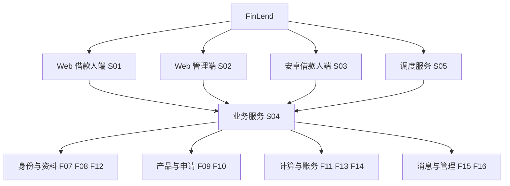
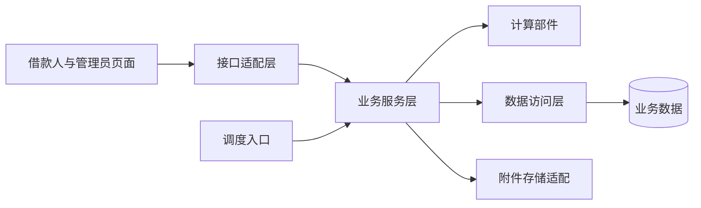
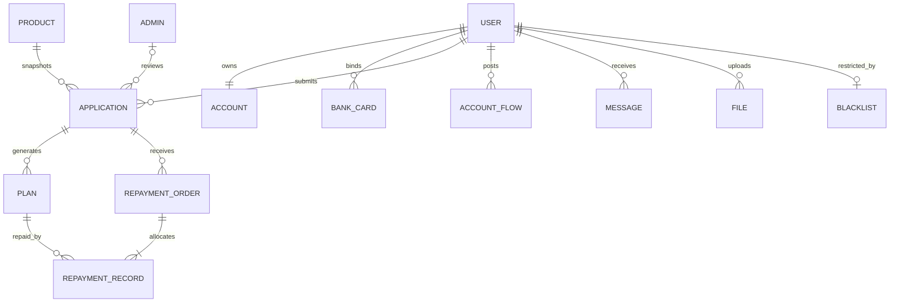

# 借贷软件平台 FinLend 概要设计报告

| 项目 | 内容 |
| --- | --- |
| 文档编号 | FL-HLD-001 |
| 版本 | v1.0 |
| 编制日期 | 2026年11月1日 |
| 适用产品 | FinLend v1.0 课程演示系统 |
| 需求依据 | 《借贷软件平台需求分析报告》v1.2及《02 功能需求分析》v1.1 |
| 状态 | 设计稿，待团队评审与实现验证 |

本报告确定 FinLend 的系统组成、模块职责、接口边界、完整性约束和数据库总体方案，作为详细设计和分工开发的依据。本学期交付 Web 借款人端、Web 管理端和安卓借款人 App，以模拟身份、模拟资金完成借还闭环。接口字段、程序流程和数据库物理约束由《详细设计报告》规定；本报告中的设计均不表示已有可运行实现。

# 1. 引言

## 1.1 编写目的

将需求报告中“系统应提供什么服务”转化为“由哪些模块协作提供服务”。设计覆盖认证、产品、申请审批、签约放款、账户还款、逾期处理、附件和消息，以及 Web 和安卓客户端。将金额计算与状态流转集中到共用后端，使三个客户端使用一致的业务口径。

信用评分、自动风控决策在本期仅提供明确标注的模拟结果；动态授信、多源数据融合、真实身份核验及真实资金通道不属于本期实现范围。统计图表、导出、催收备注和模拟充值页面为 P1，不能挤占 P0 的交付时间。

## 1.2 项目风险

| 风险承担者 | 设计阶段风险 | 应对设计与验证入口 |
| --- | --- | --- |
| 课程组与指导教师 | 文档有架构但无法追溯到需求，三端交付范围理解不一致 | 模块表关联 FR 需求组；M4 同时验收 Web 与 APK |
| 开发团队 | 金额舍入错误、重复记账、超额放款 | 统一计算部件、单库事务、持久化幂等和用户维度串行化；详细设计规定流程 |
| 开发团队 | 安卓打包与安全存储验证过晚 | M1 先做最小真机包；安全存储、局域网访问与续期同步验证 |
| 模拟借款人与管理员 | 状态不清、重复提交后结果未知、误认为真实金融服务 | 显示模拟标识、业务编号、明确状态和结果查询入口 |
| 部署维护人员 | 数据库迁移不完整、备份恢复后账务不一致 | 全量迁移与有来源的演示资金；空库重建和恢复后对账 |

## 1.3 预期读者和阅读建议

需求评审者阅读第2、3章，确认系统边界和职责分配；后端开发者重点阅读第3、4、6章；Web 与安卓开发者重点阅读第3章的交互关系和第5章技术约束；测试人员依据第3.4节完整性约束和第4章错误处理制定验证场景；集成负责人按第8章检查交付证据。进度与成员角色来自现有分工文档，实际人员对应关系由团队确认。

## 1.4 参考资料

| 编号 | 资料 | 版本与来源 | 用途 |
| --- | --- | --- | --- |
| R1 | 借贷软件平台需求分析报告 | v1.2，本仓库需求分析报告目录 | 功能、业务规则、非功能要求和验收依据 |
| R2 | 02 功能需求分析 | v1.1，docs/02 | 业务口径基线；冲突先按此核对 |
| R3 | 01 技术栈分析与选型 | v1.1，docs/01 | 已有技术方案 |
| R4 | 03 数据库设计 | v1.1，docs/03 | 核心实体、字段和一致性设计 |
| R5 | 04 团队分工与开发规范 | v1.1，docs/04 | 分工与里程碑 |
| R6 | 06 扩展与演进规划、07 审阅记录与待验证事项 | docs/06、docs/07 | 安卓交付与后续扩展边界 |
| R7 | 软件概要设计报告文档模板 | 用户提供的概要设计模板.docx | 本报告的章节与表项结构 |
| R8 | 借贷软件平台详细设计报告 | v1.0，本仓库详细设计报告目录 | 部件、接口和存储实现设计 |

# 2. 设计概述

## 2.1 限制和约束

系统采用前后端分离、单体后端和单业务数据库，不引入微服务、消息队列及分布式事务。后端按现有方案使用 Python/FastAPI；Web 使用 Vue 3；安卓使用 uni-app Vue 3 并交付签名 APK；数据库为 MySQL，Redis 承担临时状态和限流。具体依赖版本组合在 M1 实测并锁定，不将最低版本声明视为兼容性结果。

团队为4人，基线排期12周，每周每人6至8小时属于待核对的投入假设。复用现有 PC、安卓设备和局域网；新增采购预算按现有方案取零，构建服务和辅助开发工具是否发生费用按实际记录。第12周保留给缺陷修复、安装复验和演示，不安排新功能。

所有身份、手机号、卡号和图片为虚构测试资料。账户只记录模拟现金，授信额度独立管理。银行卡仅作为模拟资料，不作为扣款或放款通道。业务日统一为北京时间，不随客户端所在时区改变。

## 2.2 设计原则和设计要求

**职责独立。** 路由接收输入、调用服务并形成响应；业务服务负责规则与事务边界；数据访问层负责持久化；金额计算部件只接收业务值，不依赖 HTTP、数据库连接或客户端。

**统一业务口径。** 利息、罚息、额度和结清报价由后端确定，Web 与安卓展示后端结果。产品规则在提交申请时形成快照，后续产品修改不得改写已有借款规则。

**资金一致。** 余额、流水、计划、还款订单和分摊共同构成账务事实。成功交易和其幂等结果一起持久化；失败交易不得留下部分扣款。授信判断与资金变更在同一用户的统一并发控制范围内完成。

**权限与隐私。** 身份从服务端认证结果取得，资源归属逐次检查。管理员和借款人主体分离，附件通过鉴权接口读取，日志脱敏。退出和冻结在服务端立即生效。

**命名与演进。** 子系统使用 S 编号、系统特性使用 F 编号、部件使用 C 编号，英文名称在两份设计报告中一致。表名使用 t_ 前缀，程序标识采用有业务意义的英文名称。扩展风控通过独立服务边界接入，本期默认实现不读取预留但未建的表。

# 3. 系统逻辑设计

## 3.1 系统组织设计

| 子系统编号 | 英文名称 | 中文名称 | 业务职能 | 安装地点 | 备注 |
| --- | --- | --- | --- | --- | --- |
| S01 | BorrowerWeb | Web 借款人端 | 认证、产品、申请、还款与消息 | 浏览器；静态资源部署于演示主机 | 只调用借款人授权接口 |
| S02 | AdminWeb | Web 管理端 | 用户、产品、审批放款及逾期管理 | 浏览器；可与 S01 共用 Web 工程 | 独立管理路由和身份入口 |
| S03 | BorrowerAndroid | 安卓借款人端 | 借款人必需业务、弱网恢复 | 安卓真机，签名 APK | 无管理操作 |
| S04 | FinLendApi | 业务服务 | 共用规则、权限、账务、存储访问 | 演示服务端 | 单体应用，内部按模块划分 |
| S05 | FinLendJobs | 调度服务 | 签约失效、罚息补算、提醒 | 演示服务端独立单实例进程 | 复用 S04 的服务与数据访问代码 |

MySQL、Redis 和私有文件目录为支撑设施，不视为独立业务子系统。S04 与 S05 共用 MySQL 业务事实；Redis 缓存不得成为余额或成功交易的唯一依据。

## 3.2 系统结构设计

客户端与后端通过统一接口交换业务数据。后端内部按“接口适配—业务服务—数据访问”组织，计算、鉴权、幂等和异常处理是共用能力。调度进程直接调用业务服务，不通过模拟管理员登录绕行客户端操作。

### 3.2.1 系统特性表

S01 BorrowerWeb Web 借款人端。

| 特性编号 | 英文名称 | 中文名称与操作功能 | 调用对象 | 被调用对象 | 需求来源 |
| --- | --- | --- | --- | --- | --- |
| F01 | borrower_identity | 注册、登录、资料、模拟实名与卡管理 | 借款人页面 | F07、F08、F12 | FR-AUTH、FR-FILE |
| F02 | borrower_loan | 浏览、试算、申请、撤销与签约 | 借款人页面 | F09、F10、F11 | FR-PROD、FR-LOAN |
| F03 | borrower_repayment | 账户、还款、结清与消息 | 借款人页面 | F13、F14、F15 | FR-LEND、FR-REPAY、FR-MSG |

S02 AdminWeb Web 管理端。

| 特性编号 | 英文名称 | 中文名称与操作功能 | 调用对象 | 被调用对象 | 需求来源 |
| --- | --- | --- | --- | --- | --- |
| F04 | admin_operations | 登录、用户、产品、名单与逾期管理 | 管理页面 | F07、F09、F16 | FR-ADMIN、FR-PROD、FR-RISK-05 |
| F05 | admin_lending | 审批与模拟放款 | 管理页面 | F10、F13 | FR-LOAN-04、FR-LEND-01 |

S03 BorrowerAndroid 安卓借款人端。

| 特性编号 | 英文名称 | 中文名称与操作功能 | 调用对象 | 被调用对象 | 需求来源 |
| --- | --- | --- | --- | --- | --- |
| F06 | android_borrowing | 借款人全流程、前后台生命周期与安全存储 | App 页面与生命周期 | F07至F15中借款人能力 | FR-APP-01及借款人需求 |

S04 FinLendApi 业务服务。

| 特性编号 | 英文名称 | 中文名称与操作功能 | 调用对象 | 被调用对象 | 需求来源 |
| --- | --- | --- | --- | --- | --- |
| F07 | session_auth | 登录、续期、退出与授权 | F01、F04、F06及全部受保护接口 | 会话与主体存储 | FR-AUTH-02/03/07 |
| F08 | user_profile | 资料、实名与模拟银行卡 | F01、F06 | F12、用户与卡存储 | FR-AUTH-01/04/05 |
| F09 | product_catalog | 产品浏览、管理与规则校验 | F02、F04、F06 | 产品存储 | FR-PROD-01/02/03 |
| F10 | application_workflow | 申请、撤销、审批、签约与失效 | F02、F05、F06、F17 | F11、F16、F15、申请存储 | FR-LOAN-02/03/04/05 |
| F11 | repayment_calculation | 试算、计划及结清金额计算 | F02、F10、F13、F14 | 纯计算与日期函数 | FR-LOAN-01、FR-REPAY-01/03 |
| F12 | private_attachment | 测试图片上传与授权读取 | F01、F06、F08 | 附件存储与私有目录 | FR-FILE-01 |
| F13 | account_lending | 授信余额查询、模拟放款与流水 | F03、F05、F06 | F11、F15、F16及账务存储 | FR-AUTH-06、FR-LEND |
| F14 | repayment_settlement | 普通还款、提前结清与记录查询 | F03、F06 | F11、罚息补算、账务存储 | FR-REPAY |
| F15 | site_message | 业务消息、列表、未读数和已读 | F03、F06、F10、F13、F17 | 消息存储 | FR-MSG |
| F16 | admin_risk | 冻结调额、黑名单、模拟风控及可选统计 | F04、F10、F13 | 用户、名单、会话与聚合查询 | FR-ADMIN、FR-RISK |

S05 FinLendJobs 调度服务。

| 特性编号 | 英文名称 | 中文名称与操作功能 | 调用对象 | 被调用对象 | 需求来源 |
| --- | --- | --- | --- | --- | --- |
| F17 | scheduled_business | 扫描签约失效、逾期计费与还款提醒 | 单实例调度器 | F10、罚息补算、F15 | FR-LOAN-05、FR-REPAY-04、FR-MSG |

F11 中的金额函数不调用应用服务；罚息补算是可复用的账务部件，由 F14 与 F17 调用，不反向调用还款入口。这样避免循环调用，也避免普通还款与任务采用不同计费规则。

### 3.2.2 系统特性结构图

S01 中身份页面调用 F07/F08/F12，产品申请页面调用 F09/F10/F11，账户还款消息页面调用 F13/F14/F15；S02 中用户产品页面调用 F07/F09/F16，审批放款页面调用 F10/F13；S03 保持同样的借款人调用关系；S05 的三项任务分别调用签约失效、罚息补算与消息生成部件。详细设计的 C01至C20给出对应程序部件。

## 3.3 系统接口设计

### 3.3.1 系统接口表

接口速率随演示局域网和设备变化，不虚构固定带宽。速率列以需求的响应目标或调度周期表示约束，最终吞吐由实测确认。

| 子系统 | 接口编号与名称 | 类型 | 性质 | 速率或时效 | 协议 | 相关对象与备注 |
| --- | --- | --- | --- | --- | --- | --- |
| S01 | I01 借款人 Web API | 网络 | 双向 | 常规查询 P95≤500ms目标 | HTTPS/JSON | F01至F03；令牌鉴权 |
| S02 | I02 管理 API | 网络 | 双向 | 常规查询同 I01，报表≤2s目标 | HTTPS/JSON | F04/F05；管理员鉴权 |
| S03 | I03 安卓 API | 网络 | 双向 | 同 I01；前台消息30秒查询 | HTTPS/JSON | F06；与 Web 共用业务契约 |
| S04 | I04 业务数据库 | 数据库 | 双向 | 事务时限按实测配置 | MySQL 协议 | 数据访问层；仅服务端可达 |
| S04 | I05 临时状态 | 缓存 | 双向 | 验证码5分钟有效 | Redis 协议 | 认证与限流，不存唯一账务事实 |
| S04 | I06 私有附件 | 文件 | 双向 | 单文件≤5MiB | 服务端文件访问 | F12；外部经 I01/I03读取 |
| S05 | I07 调度调用 | 进程内服务接口 | 双向 | 扫描每分钟、计费每日、提醒每日 | Python 函数调用 | 独立进程复用服务代码；非公网接口 |

### 3.3.2 系统接口传输协议说明

I01至I03使用 HTTP 请求响应模式，正式部署经 HTTPS 传输；仅隔离局域网演示配置允许明文。业务数据为 UTF-8 JSON，图片上传为 multipart，读取成功返回图片字节。身份令牌放在 Authorization 请求头，不放入 URL；管理端仍须服务端逐次鉴权。

金额和利率使用十进制字符串，大整数标识使用字符串；日期为 YYYY-MM-DD，时刻为带 +08:00 的 ISO 8601。分页要求稳定排序。关键写操作携带 Idempotency-Key，同主体同操作同键同内容返回原结果，同键异内容返回冲突。HTTP状态与业务错误分工、具体路径和字段由详细设计第5章规定。

I04通过同步数据库驱动和 ORM 访问，每请求使用独立会话。服务层决定事务提交，不允许客户端直接连接数据库。I05只供服务端访问，鉴权或交易依赖的安全检查不可用时拒绝继续处理。I06不公开目录路径；磁盘写入与数据库提交分别处理，通过临时文件及失败清理维持可恢复性。

I07按任务入口调用服务方法；任务扫描只负责定位候选对象，金额和状态变更仍由业务服务在并发控制内决定。客户端消息采用主动查询，不要求后台厂商推送或 WebSocket。

## 3.4 系统完整性设计

下表按 S04 的业务对象定义完整性条件；S01、S02、S03必须呈现这些条件，不能仅靠前端禁用按钮维护完整性；S05复用同一条件执行任务。∀表示对任一对象成立，Σ表示相关对象合计。

| 约束编号 | 完整性名称 | 相对对象名 | 约束表达式 | 设计措施 |
| --- | --- | --- | --- | --- |
| K01 | 用户账户唯一 | User、Account | ∀u，count(Account.user=u)=1 | 注册共同提交，账户归属唯一 |
| K02 | 默认卡唯一 | User、BankCard | ∀u，count(默认卡)≤1 | 同用户卡操作串行处理 |
| K03 | 单笔待审核 | User、Application | ∀u，count(待审核申请)≤1 | 用户维度并发控制与唯一约束辅助 |
| K04 | 合法状态转换 | Application | next(status)∈需求§9.2的允许边 | 状态校验与条件更新 |
| K05 | 本金守恒 | Application、Plan | Σ计划本金=借款金额 | 末期平账，放款前校验 |
| K06 | 余额可对账 | Account、Flow | balance≥0 且 balance=Σ现金流水 | 放款入账、还款出账与流水共同提交 |
| K07 | 还款分摊守恒 | Order、Record | 订单金额=Σ分摊现金+结清费 | 分项校验后统一扣款 |
| K08 | 已付不超应付 | Plan | 0≤已付本金≤本金；0≤已付利息+减免≤利息；0≤已付罚息≤罚息 | 数据库检查与服务校验 |
| K09 | 授信不超用 | User、Plan | 放款后占用本金≤授信 | 放款时重算；调额不得低于占用 |
| K10 | 重复请求等价 | BusinessRequest | 相同主体操作键内容 ⇒ 相同业务结果 | 成功结果与业务事务共同持久化 |
| K11 | 罚息不重计 | Plan、计费日期 | 每个逾期业务日最多计费一次 | 记录处理进度，重跑增量为零 |
| K12 | 结清债务为零 | Application、Plan | status=已结清 ⇒ Σ未还本金利息罚息=0 | 结清时检查所有计划 |
| K13 | 资源归属一致 | User、File、Message、Loan | 非管理员读取 ⇒ owner=当前用户 | 服务端查询与访问校验 |
| K14 | 消息事件唯一 | User、Message | 同用户同事件最多一条消息 | 持久化事件键去重 |

对于 S05，K15为“任务重复执行不改变已成功处理区间的结果”；对于三个客户端，K16为“展示金额等于服务端返回金额，未知结果不得展示为成功或自动创建新扣款”。这些约束共同覆盖任务重启与弱网情形。

# 4. 系统出错处理设计

## 4.1 系统出错处理表

表中错误编号为本报告设计编号，具体 HTTP 与业务 code 映射见详细设计第5章。客户端均按同一分类处理；不能将数据库错误或堆栈直接显示给用户。

| 子系统 | 错误编号与名称 | 错误原因 | 错误信息 | 处理方式 | 备注 |
| --- | --- | --- | --- | --- | --- |
| S04 | E01 输入不合法 | 类型、区间或必填项错误 | 输入内容不符合要求，请检查标记项 | 拒绝保存，返回字段位置 | 对应客户端定位字段 |
| S04 | E02 身份失效 | 访问凭证过期、会话吊销 | 登录已失效，请重新登录 | 可续期时续期一次，否则重新登录 | S01/S02/S03共用 |
| S04 | E03 权限不足 | 主体或资源归属不匹配 | 无权执行此操作 | 拒绝且不暴露他人信息 | 管理角色逐次检查 |
| S04 | E04 状态冲突 | 重复审批、超时签约、非法放款 | 状态已变化，请刷新后重试 | 保持原业务结果 | 返回当前可见状态 |
| S04 | E05 金额冲突 | 报价变化、余额或额度不足 | 金额已变化或不足，请刷新金额 | 无扣款、无部分记账 | 保留查询入口 |
| S04 | E06 幂等冲突 | 同键提交不同内容 | 请求内容已变化，请重新确认 | 拒绝覆盖原结果 | 不替换成功记录 |
| S04 | E07 上传失败 | 超限、格式不符、写盘失败 | 图片上传失败，请按格式重新选择 | 清理无效临时文件 | 大小和格式分别提示 |
| S04 | E08 服务暂不可用 | 数据库、Redis或磁盘异常 | 服务暂不可用，请稍后查询结果 | 回滚、记录请求编号 | 不降级放行 |
| S01/S02/S03 | E09 结果未知 | 超时、断网、响应丢失 | 结果待确认，请查询处理结果 | 用原键查询或重试 | 不自动换键扣款 |
| S05 | E10 任务中断 | 服务重启或执行异常 | 运维记录任务失败与处理位置 | 下次扫描补算 | 已提交借款不回滚重计 |

## 4.2 维护处理过程表

| 子系统 | 错误编号 | 过程英文名称 | 过程中文名称 | 处理功能 | 入口参数 | 出口参数 |
| --- | --- | --- | --- | --- | --- | --- |
| S04 | E01/E03/E04 | reject_request | 拒绝不合法请求 | 终止写操作并统一返回 | 错误分类、请求编号 | 状态、提示、原业务状态 |
| S01/S02/S03 | E02 | refresh_or_login | 续期或重新登录 | 合并并发续期；失败清理凭证 | 当前会话、待发请求 | 新会话或登录提示 |
| S04 | E05/E06 | rollback_and_requote | 回滚并刷新报价 | 保留原成功结果，返回冲突原因 | 确认金额、业务键 | 新报价或原结果 |
| S04 | E07 | cleanup_upload | 清理失败上传 | 删除无效临时文件，不发布附件 | 临时路径、元数据结果 | 清理状态与错误编号 |
| S04 | E08 | record_failure | 记录服务异常 | 回滚、记录脱敏日志供定位 | 请求编号、异常分类 | 503或500响应 |
| S01/S02/S03 | E09 | reconcile_result | 查询未知结果 | 按业务编号或原键核对 | 操作、原键、业务标识 | 成功、失败或仍待确认 |
| S05 | E10 | resume_jobs | 恢复任务 | 重扫未处理业务日期和候选项 | 业务日期、任务标识 | 成功数、失败项及耗时 |

维护人员通过请求编号和业务编号定位异常；恢复数据库前先停止写入和调度，再在独立库验证恢复结果，核对余额、订单、分摊与计划后切换。不得直接手工修改余额解决差异，修正必须保留账务依据。

# 5. 技术设计

## 5.1 系统开发技术说明表

技术编号用于追踪关键设计应用，不替代依赖锁文件。

| 子系统 | 技术编号 | 英文名称 | 中文名称 | 处理功能 | 系统特性编号 | 备注 |
| --- | --- | --- | --- | --- | --- | --- |
| S04 | T01 | Decimal | 十进制金额计算 | 逐期舍入、末期平账、日息计算 | F11、F13、F14 | 不使用二进制浮点计算金额 |
| S04 | T02 | Database Transaction | 数据库事务 | 原子记账与并发控制 | F08、F10、F13、F14、F16 | 锁序在详细设计规定 |
| S04 | T03 | Persistent Idempotency | 持久化幂等 | 请求重试返回原成功结果 | F10、F13、F14、F16 | 不依赖短时缓存保证 |
| S04 | T04 | JWT and Refresh Session | 令牌与服务端会话 | 访问鉴权、轮换和立即吊销 | F07 | 会话持久化 |
| S05 | T05 | APScheduler | 单实例任务调度 | 失效、补算和提醒 | F17 | 不嵌入每个 Web worker |
| S01/S02 | T06 | Vue and Pinia | Web 组件与状态管理 | 页面、路由权限和请求状态 | F01至F05 | Element Plus 为 Web 组件库 |
| S03 | T07 | uni-app | 安卓跨端开发 | 安卓页面、设备生命周期与打包 | F06 | uni-ui，不直接复用 Element Plus |
| S04 | T08 | Alembic | 数据库版本迁移 | 空库初始化与可重复升级 | F07至F16 | 迁移与演示数据分离 |

## 5.2 开发技术应用说明

后端采用 FastAPI、SQLAlchemy 2.x、Pydantic v2 和同步 MySQL 驱动。同步数据库调用放在同步路由或显式线程池内，每请求独立 Session；不能在异步事件循环直接执行阻塞调用。业务服务统一管理提交与回滚，路由和数据访问方法不分散提交。

Web 请求模块统一设置认证、超时、续期和错误提示。路由守卫用于交互引导，服务端权限检查仍是最终判断。安卓通过 uni.request 实现同一业务契约，使用 uni-app 生命周期控制消息轮询；刷新凭证的安全存储须经过真机验证，普通本地存储不得直接宣称已加密。

数据库事务使用 READ COMMITTED，并按统一用户锁约定维护额度与资金。调度任务在独立单实例进程运行，漏跑从数据库计费进度补算。文件不通过公开静态目录发布，附件适配层屏蔽物理路径。

接口契约在 M1 固定基础字段和错误格式，后续业务接口随模块补充。密钥、环境配置和签名文件不入库；依赖版本、演示环境、构建记录和迁移结果作为交付证据保存。这里规定工程结构与技术使用方式，不宣称依赖兼容性、性能和许可证已完成核验。

# 6. 数据库设计

数据库以用户、借款申请和账务事实为中心。用户与账户一对一；产品是申请规则快照的来源；申请与计划一对多；一次还款由订单表示，订单通过分摊记录关联一个或多个计划。流水记录现金变化，罚息计提只增加应收，实际还款时才统一形成现金出账。

| 数据域 | 物理表 | 核心职责与约束 |
| --- | --- | --- |
| 身份资料 | t_user、t_admin、t_bank_card | 主体隔离、账号唯一、用户至多一张默认卡 |
| 产品申请 | t_loan_product、t_loan_application | 快照保留、单次审批、合法状态转换 |
| 还款 | t_repayment_plan、t_repayment_order、t_repayment_record | 本金守恒、还款分摊、减免独立记录 |
| 现金账务 | t_account、t_account_flow | 唯一账户、非负余额、业务流水唯一 |
| 消息名单 | t_message、t_blacklist | 事件去重、名单用户唯一 |
| 安全支撑 | t_refresh_token、t_file、t_business_request | 会话吊销、附件归属、幂等结果持久化 |

本期共15张业务及支撑表。用户、管理员、产品先建，再建账户、附件、申请、计划、订单、分摊等依赖表；用户对证件附件的可空外键最后补充，处理循环引用。风控预留表本期不建，催收备注表仅在 P1 确认后设计。

金额保存到分，费率按百分数保留四位；日期区分业务日和精确时刻。历史账务不得级联删除。字段类型、非空、外键、索引和检查约束统一列入详细设计第3.19节，原 docs/03 作为配套依据。数据库迁移必须覆盖完整表结构，现有文档中的账户 DDL 片段不能当成可运行全量初始化脚本。

备份恢复验证包括演示初始资金，不能只检查放款后的流水；验收须同时满足余额对账、计划与分摊对账、订单现金守恒、放款唯一和结清债务为零。测试数据和生产式配置分开，任何演示数据均使用虚构资料。

# 7. 词汇表

| 术语 | 英文 | 本报告含义 |
| --- | --- | --- |
| 授信额度 | Credit Line | 可占用借款本金的总上限，不是现金 |
| 可用额度 | Available Credit | 授信减已放款未还本金后的非负值 |
| 规则快照 | Rule Snapshot | 提交申请时固定的费率和还款方式 |
| 还款计划 | Repayment Plan | 每期到期日、本金、利息与已付情况 |
| 分摊 | Allocation | 一次还款分别清偿各期本金、利息和罚息的记录 |
| 幂等 | Idempotency | 同一业务请求重试不重复产生业务效果 |
| 原子性 | Atomicity | 一组账务变化全部成功或全部不生效 |
| 会话 | Session | 一次设备登录到失效期间的服务端身份记录 |
| 单体后端 | Monolithic Backend | 一个应用内按模块分层实现业务 |
| 任务补算 | Catch-up Processing | 恢复未处理业务日期而不重复已处理部分 |

# 8. 进度计划

采用相对周次，实际开课日期和成员工时由 M1 确认，不以报告日期倒推项目已完成进度。

| 里程碑 | 周次 | 子系统与模块产出 | 人员配备 | 退出条件 |
| --- | --- | --- | --- | --- |
| M1 | 第1至2周 | S04认证和基础存储；S01/S02骨架；S03最小包；S05入口方案 | 后端A认证；B模型计算；前端Web；全栈安卓及集成 | 空库迁移与初始化、注册登录、双端访问、首个真机 APK；依赖和设备记录 |
| M2 | 第3至5周 | 产品、实名附件、申请审批、撤销签约；双端相应页面 | A产品资料；B申请幂等；前端Web；全栈安卓 | Web与安卓提交申请，管理员审批，签约与超时互斥；权限和幂等证据 |
| M3 | 第6至9周 | S04放款账务、普通还款、提前结清；S05计费提醒；双端账户消息 | B账务；A消息及复核；前端Web；全栈安卓联调 | 三种计算方式及零利率、并发放还款、补算重跑与账务对账通过 |
| M4 | 第10至12周 | 签名 APK、部署恢复、测试与演示；有余量再做 P1 | 全员；全栈统筹集成，A/B交叉复核 | 两种借款人终端完整流程，管理端配合；实际性能和恢复证据齐全 |

每个交付项指定主责与复核人；涉及金额和权限的变更由另一名后端复核。需求变化先更新业务基线，再同步需求报告、两份设计、数据设计和接口契约。原子需求 FR 与 TC 编号保持稳定，设计部件的追踪关系见详细设计第3章。
