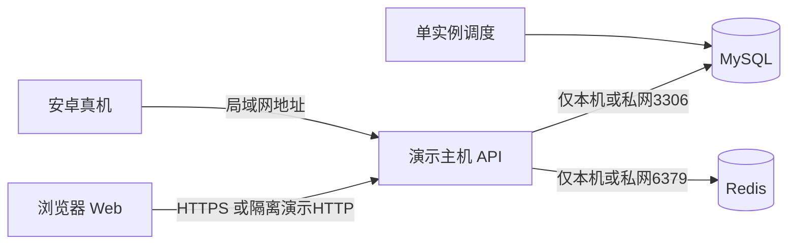

# 借贷软件平台 FinLend 详细设计报告

| 项目 | 内容 |
| --- | --- |
| 文档编号 | FL-LLD-001 |
| 版本 | v1.0 |
| 编制日期 | 2026年11月1日 |
| 适用产品 | FinLend v1.0 课程演示系统 |
| 依据 | 需求分析报告v1.2、概要设计报告v1.0、docs/02与docs/03 v1.1 |
| 状态 | 设计稿，待团队评审与实现验证 |

本报告将概要设计中的系统特性细化为可编码的部件、接口、数据结构和异常流程。开发者应据此实现统一的金额算法、状态机与账务事务，测试者可按稳定的 FR/TC 编号核对结果。文中程序名称、API 路径与配置是本次采用的设计方案，实际依赖补丁版本、设备和压测结果须由实现阶段记录。

# 1. 引言

## 1.1 编写目的

依据需求报告确定的业务范围与概要设计确定的模块分工，描述 FinLend 的程序组成、入口出口、处理步骤、并发控制、物理数据约束及页面交互。覆盖 Web 用户端、Web 管理端、安卓借款人 App、共用 API 与独立调度进程。使用虚构测试身份与模拟账户，不接入真实身份认证、资金清算和征信。

需求报告规定应实现的行为，本报告规定本次选择的实现方法。业务冲突按 docs/02 核对；实现方法变更不应直接改变业务结果。性能数值均为目标，不能作为已通过测试的结论。

## 1.2 项目风险

| 承担者 | 详细设计风险 | 控制方式 |
| --- | --- | --- |
| 任务提出者 | 设计范围扩张导致核心流程无法交付 | P0、P1与后续预留分开；不实施预留风控表 |
| 开发人员 | 月供尾差、百分数单位或日息天数理解不一致 | C03集中计算，给定输入与预期输出；日期以业务时区处理 |
| 开发人员 | 放款和还款并发造成额度、余额不一致 | C02幂等；C07/C08/C10共用锁序与事务边界 |
| 模拟用户 | 断网重试重复扣款、报价过时仍扣款 | 先查询结果，重试沿用原键；确认时锁定重算金额 |
| 集成维护人员 | 依赖不兼容、APK安全存储或打包不可用 | M1记录实测版本、首次真机包和安全存储结果 |

## 1.3 文档约定

子系统 S01至S05和特性 F01至F17沿用概要设计。部件统一编号 C01至C20，界面编号 U01至U12，协议编号 A01至A10。FR、UC、TC编号沿用需求报告，不因章节迁移重编。名称采用英文业务名，Python模块和函数使用 snake_case，Vue组件使用 PascalCase，数据库表和字段使用小写下划线。

本报告的“调用者”指发起调用的部件或界面，“被调用者”指本部件依赖的部件。流程以有序步骤或伪代码表示；伪代码用来明确设计，并非已运行程序。金额字段命名可沿用现有数据字典，但客户端必须使用服务端计算结果。

模板第5章“部件表格式”和第6章“界面表格式”均保留。第3章每个部件使用第5章定义的表项；第5章同时集中列出共用API契约，第6章填写实际界面记录。模板中的重复“入口参数”按语义区分为入口参数、出口参数，避免遗漏返回值。

## 1.4 预期读者和阅读建议

后端开发者阅读第2章、C01至C15、C19/C20及第5章；Web开发者阅读C16和第5、6章；安卓开发者阅读C17及环境ENV03；测试人员按各部件关联FR、异常流程和账务不变量组织验证；集成负责人核对C18/C19、设备配置记录与部署恢复。第4章解释算法和接口中的关键术语。

## 1.5 参考资料

| 编号 | 文件 | 版本或来源 | 作用 |
| --- | --- | --- | --- |
| R1 | 借贷软件平台需求分析报告 | v1.2，需求分析报告目录 | 业务与验收规格 |
| R2 | 借贷软件平台概要设计报告 | v1.0，概要设计报告目录 | 子系统、特性、完整性约束 |
| R3 | 02 功能需求分析 | v1.1，docs/02 | 业务规则基线 |
| R4 | 03 数据库设计 | v1.1，docs/03 | 表字段、事务与索引方案 |
| R5 | 01、04、06、07配套文档 | docs目录 | 技术、团队、安卓与待验证事项 |
| R6 | 软件详细设计报告文档模板 | 用户提供的详细设计模板.docx | 章节、部件表与界面表 |

# 2. 支撑环境

## 2.1 数据库管理系统

| 配置项 | 设计配置或记录要求 |
| --- | --- |
| 产品与发行方 | MySQL Community Server，Oracle；单实例关系型数据库 |
| 版本和补丁 | 主版本基线8.0；具体补丁号尚未冻结，M1记录实际安装结果 |
| 存储与编码 | InnoDB；utf8mb4；utf8mb4_general_ci |
| 实例和库名 | 演示服务端单实例；设计库名loan_platform，测试独立库 |
| 安装位置 | 数据库主机名、程序安装目录、数据卷目录由部署环境清单填写，当前无已安装路径可报告 |
| 连接设置 | TCP默认3306，仅服务端可达；连接信息由环境配置注入，不写入客户端 |
| 事务 | 业务写事务READ COMMITTED；每请求一个Session；服务层统一提交 |
| 时区 | 连接与应用统一Asia/Shanghai或等价+08:00；DATETIME按此约定写入 |
| 数据类型 | 金额DECIMAL(18,2)，费率DECIMAL(8,4)，标识BIGINT，日期DATE，时刻DATETIME |
| 验证 | M1验证CHECK实际执行、外键、唯一键、迁移；M3以实际MySQL执行并发测试 |

Redis用于演示验证码、限流和必要的吊销辅助缓存，版本及发行方式M1记录；默认连接端口6379，禁止客户端直连。数据库是会话状态与账务事实的最终依据。缓存失效不应丢失成功交易。

模板示例提及的其他行业数据库建设规范不是本项目已采用标准；本项目以课程要求、现有业务基线及本报告的数据约束为依据。

## 2.2 开发工具、中间件以及数据库接口

| 产品或组件 | 版本基线 | 适用范围及接口方式 | 必须记录的验证项 |
| --- | --- | --- | --- |
| Python及FastAPI | Python3.11+；FastAPI实测锁定 | API进程；HTTP服务 | 解释器、框架及补丁版本 |
| SQLAlchemy、PyMySQL | SQLAlchemy2.x；驱动实测锁定 | 同步ORM，经MySQL TCP连接 | Session生命周期、隔离级别与连接超时 |
| Pydantic | v2 | 请求响应模型及字段校验 | Decimal字符串、枚举与未知字段处理 |
| PyJWT、passlib与bcrypt | 实测兼容组合 | 签名校验与密码哈希 | 注册、登录、中文密码和72字节边界 |
| redis客户端 | 实测锁定 | Redis协议 | 限流与验证码原子操作 |
| APScheduler | 实测锁定 | 独立调度进程 | 重启补算和重复执行 |
| Alembic、pytest | 实测锁定 | 迁移、计算与MySQL集成验证 | 空库升级、全部约束及异常回滚 |
| Vue、Vite、Element Plus | Vue3，其余实测锁定 | Web组件、构建与表单 | 浏览器、构建和依赖锁文件 |
| Pinia、Vue Router、Axios | 实测锁定 | Web状态、路由、HTTP | 合并续期、未知结果提示 |
| uni-app、uni-ui、HBuilderX | Vue3模板，具体版本M1冻结 | 安卓页面、uni.request与签名打包 | 真机安装、网络及安全存储 |

Python依赖使用锁定清单；Web与mobile工程分别提交各自唯一一种包管理器的锁文件。Node22 LTS只是现有选型候选，应按Vite和uni-app模板共同兼容范围验证，不预先断言任意新版本可用。使用开源组件的名称不代表已核验某一具体版本许可证或工具计费条件，实际采用版本需在M1登记。

## 2.3 硬件环境

| 环境编号 | 机型与系统 | CPU与容量 | 用途和位置 | 验收记录 |
| --- | --- | --- | --- | --- |
| ENV01 | 团队PC，Windows11含WSL2或Linux | 具体CPU型号主频待登记；建议可用内存≥4GB、可用磁盘≥10GB | 后端、数据库、Redis及调度，演示局域网 | 实际配置、端口、磁盘与软件版本 |
| ENV02 | 团队开发PC，Chrome/Edge | CPU、内存、磁盘按实机登记，无专用硬件 | Web开发与验收 | OS与浏览器最低支持版本 |
| ENV03 | 安卓真机 | 型号、CPU、内存、剩余存储与Android最低版本M1确认 | 安装和运行借款人APK | 机型、系统、签名方式、构建日期和流程结果 |

以上建议容量是待确认的验收条件，不是已验证的最低硬件要求。安卓功能必须真机验证，H5预览不能替代APK安装证据。

## 2.4 网络环境



网络采用现有有线或无线局域网，具体带宽、路由器、主机IP和端口登记后验收，不声称固定吞吐。手机的API地址必须指向服务端IP或域名，不能填手机自身localhost。服务端端口由配置管理，开发期可使用8000，正式入口统一由部署配置确定。无VPN与专线依赖。

正式部署使用HTTPS；局域网明文例外仅在隔离演示配置启用。CORS只开放已配置Web源，安卓可达API不等于具备访问权限。数据库、Redis和附件目录不对借款人终端直接开放。

## 2.5 多种支撑环境开发要点

ENV01负责权威计算与事务；ENV02使用Axios和Vue Router；ENV03使用uni.request与pages.json，不能直接复制Element Plus、浏览器路由或Web存储实现。三个客户端只共享枚举、接口数据语义和格式校验约定，不分别实现账务公式。

Windows的Redis使用已验证的WSL2或容器方案，Linux记录服务管理方式。路径通过配置或Path处理，不在业务代码中硬编码盘符。全部部署环境统一时区，测试可注入业务时钟。APK配置区分开发与演示API地址，签名密钥不入库；HBuilderX构建所需账号、网络及额度条件M1核对。

每个环境清单登记OS、CPU、内存、磁盘、Python/Node、数据库/Redis、HBuilderX、Android、构建日期和锁文件版本。第二台设备复现与备份恢复属于交付验证，不以“本机可运行”代替兼容性结论。

# 3. 部件详细设计

## 3.1 部件总览及调用约定

| 编号 | 名称 | 子系统 | 特性 | 关联需求组 |
| --- | --- | --- | --- | --- |
| C01 | AuthService | S04 | F07 | FR-AUTH-02/03/07 |
| C02 | IdempotencyService | S04 | 跨特性 | 各关键写操作、BR-16 |
| C03 | RepaymentCalculator | S04 | F11 | FR-LOAN-01、FR-REPAY-01/03 |
| C04 | UserService | S04 | F08 | FR-AUTH-01/04/05 |
| C05 | ProductService | S04 | F09 | FR-PROD-01/02/03 |
| C06 | ApplicationService | S04 | F10 | FR-LOAN-02/03/04/05 |
| C07 | LendingService | S04 | F13 | FR-LEND-01 |
| C08 | RepaymentService | S04 | F14 | FR-REPAY-02/05/06 |
| C09 | SettlementService | S04 | F11/F14 | FR-REPAY-03 |
| C10 | PenaltyService | S04 | F14/F17 | FR-REPAY-04 |
| C11 | MessageService | S04 | F15 | FR-MSG-01/02 |
| C12 | FileService | S04 | F12 | FR-FILE-01 |
| C13 | AdminService | S04 | F16 | FR-ADMIN-01/02/03、FR-RISK-05 |
| C14 | DefaultRiskEngine | S04 | F16 | FR-RISK-01/02/03/04 |
| C15 | AccountQueryService | S04 | F13 | FR-AUTH-06、FR-LEND-02 |
| C16 | WebRequestClient | S01/S02 | F01至F05 | Web交互、鉴权及未知结果 |
| C17 | AndroidRequestClient | S03 | F06 | FR-APP-01 |
| C18 | BusinessScheduler | S05 | F17 | 签约超时、罚息与提醒 |
| C19 | PersistenceAndSeed | S04/S05 | 数据支撑 | FR-LEND-03、恢复与对账 |
| C20 | ApiRouter | S04 | 接口支撑 | 全部客户端业务接口 |

目录设计为backend/app/{api,core,schemas,services,crud,models,db,utils}，backend/jobs为调度入口，backend/alembic为迁移，frontend为Web工程，mobile为uni-app工程。C01至C15位于服务与工具层；C19负责持久化适配；C20不实现业务公式。

所有同用户资金、额度、冻结、黑名单、申请创建与签约操作先锁用户行，再按需锁申请、账户和计划；多申请或多计划按ID升序锁定。会话变更在所属主体之后锁会话。管理员鉴权在入口完成，身份记录不在取得借款人锁后反向加锁。锁等待超时或死锁最多额外重试2次，每次回滚并使用新Session与同一幂等键，仍失败返回503，不留下部分业务记录。

## 3.2 C01 AuthService

| 部件表项 | 设计内容 |
| --- | --- |
| 部件编号与名称 | C01 AuthService |
| 所属子系统 | S04 FinLendApi |
| 部件调用者 | C20、C04注册校验流程、C13冻结操作 |
| 部件被调用者 | C19；Redis验证码和限流适配 |
| 入口参数 | 登录主体类型、账号、密码、client_type、device_id；续期令牌；退出sid |
| 出口参数 | access_token、refresh_token、expires_in=7200、会话到期时刻，或统一错误 |
| 算法 | 密码BCrypt校验；JWT固定签名算法；刷新原文为高熵随机串，数据库存SHA-256摘要 |
| 流程描述 | 登录校验账号状态和密码后建立固定7天会话；访问JWT含主体类型、sid和到期时刻，实际到期不得超过会话到期。每次鉴权检查主体与会话。刷新按主体→会话加锁，比对当前摘要和有效期后原子替换；旧令牌立即失效且固定截止不延长。退出吊销当前会话；冻结吊销该用户全部会话 |
| 部件表示形式 | Python服务类及鉴权依赖 |
| 运行环境 | ENV01 API进程 |
| 性能要求 | 立即执行吊销；并发轮换最多一次成功；敏感凭据不进入日志 |

JWT sub使用user:ID或admin:ID，不能仅凭相同数字ID混淆主体；不接受请求体传入角色。过期访问令牌返回401；冻结登录返回403。密码超过UTF-8的72字节须显式拒绝，不能截断。验证码5分钟过期且单次使用；原报告暂定的6位与60秒冷却仍待M1确认，登录限流阈值在部署配置中冻结。

## 3.3 C02 IdempotencyService

| 部件表项 | 设计内容 |
| --- | --- |
| 部件编号与名称 | C02 IdempotencyService |
| 所属子系统 | S04 FinLendApi |
| 部件调用者 | C04/C05/C06/C07/C08/C09/C11/C13关键写操作，经C20适配 |
| 部件被调用者 | C19 |
| 入口参数 | 服务端主体、operation、Idempotency-Key、规范化业务请求 |
| 出口参数 | 原结果，或允许继续执行业务的事务内上下文；同键异内容返回409 |
| 算法 | 请求哈希包含路由资源ID、业务字段和动作；字段排序、默认值及金额表达规范化；不含访问令牌、刷新令牌或易变请求编号 |
| 流程描述 | 先完成身份与资源权限校验；事务内查同主体同操作同键。存在则比对哈希并返回原响应；不存在则占位、执行变更、写入资源ID和响应并一起提交。唯一键竞争失败须回滚后新事务重读，不能继续执行扣款。失败整体回滚，允许原键重试 |
| 部件表示形式 | 服务层事务辅助方法 |
| 运行环境 | ENV01 API进程，MySQL |
| 性能要求 | 不重复记账；结果持久保留；鉴权不可因返回缓存结果而跳过 |

Idempotency-Key长度1至64个可见ASCII字符，operation为固定动作名，如application.submit、loan.lend、repayment.pay。数据库唯一范围为(actor_type,actor_id,operation,idempotency_key)。成功写入前的resource_id和响应字段由事务内暂存对象补齐，不能因NOT NULL限制提交半成品：实现时应先完成业务并插入最终记录，或为同事务占位设计合法临时值；并发最终唯一键冲突会回滚全部业务后返回已提交结果。

写结果查询优先用业务详情或按operation与原键读取本人成功幂等记录。查询不到表示“尚无已提交成功结果”，不能据此断言原网络请求必定失败；客户端可继续查询或用原键重试。结果查询路径见A10。

## 3.4 C03 RepaymentCalculator

| 部件表项 | 设计内容 |
| --- | --- |
| 部件编号与名称 | C03 RepaymentCalculator |
| 所属子系统 | S04，共用于S05 |
| 部件调用者 | C06试算、C07生成计划、C09结清计算 |
| 部件被调用者 | 十进制金额与自然月日期工具，不访问数据库 |
| 入口参数 | 本金P、年利率annual_rate、期数n、repay_type、可选放款日；结清时传入规则与计划值 |
| 出口参数 | 逐期本金利息、总利息、总还款额、可选到期日，或非法参数错误 |
| 算法 | Decimal字符串构造，工作精度至少40位，金额统一quantize到0.01、ROUND_HALF_UP；月利率=annual_rate/100/12 |
| 流程描述 | 校验本金正、期数正整数、利率非负；按还款方式计算；每期舍入，末期本金按总额减前期本金平账；校验本金合计及非负性；依据原放款日加k个自然月计算日期 |
| 部件表示形式 | 纯函数及不可变结果对象 |
| 运行环境 | ENV01，可脱离Web框架运行 |
| 性能要求 | 精确到分；所有调用共用公式；相同输入结果一致 |

Q(x)表示按四舍五入保留两位。等额本息月供A=Q(P×r×(1+r)^n/((1+r)^n−1))，r=0时A=Q(P/n)；每期利息Q(期初本金×r)，前n−1期本金A−利息，末期本金P−前期本金合计。等额本金前n−1期本金Q(P/n)，末期平账；每期利息Q(期初本金×r)。先息后本各期利息Q(P×r)，末期归还全部本金。

```text
schedule(P, annual_rate, n, type, lend_date):
  将金额/费率字符串转换为Decimal；校验区间和小数位
  r = annual_rate / 100 / 12; remaining = P
  对 k = 1..n：
    依还款方式计算本期本金principal及利息interest
    若 k == n：principal = remaining
    若principal < 0或principal > remaining：拒绝
    remaining = remaining - principal
    若k < n且remaining <= 0：拒绝参数组合
    due_date = add_months_from_original(lend_date,k)
    零金额期标记已还；其余标记未还
  断言remaining==0且sum(principal)==P
  返回计划与总额，不进行持久化
```

当本金极小、期数过长造成提前分完本金或负本金，试算和申请均拒绝。零利率先息后本的零金额期直接已还，不创建零扣款。试算无实际放款日时只返回相对期次与估计计划，实际到期日以放款后计划为准，不能把试算日当作已放款日。

| 固定输入 | 验证结果 |
| --- | --- |
| P=12000.00、年利率12.0000、12期等额本息 | 前11期1066.19，末期1066.14，总利息794.23 |
| 同输入等额本金 | 每期本金1000.00，总利息780.00 |
| 同输入先息后本 | 每期利息120.00，末期另还本金，总利息1440.00 |
| 2026-01-31放款 | 第1期2026-02-28，第2期2026-03-31 |

## 3.5 C04 UserService

| 部件表项 | 设计内容 |
| --- | --- |
| 部件编号与名称 | C04 UserService |
| 所属子系统 | S04 |
| 部件调用者 | C20，U01/U02 |
| 部件被调用者 | C01验证码适配、C12附件归属检查、C19、C02 |
| 入口参数 | 注册资料与验证码；个人可编辑字段；姓名、虚构证件号、file_id；模拟卡资料 |
| 出口参数 | 用户资料、模拟认证状态、卡列表或统一错误，不返回密码哈希 |
| 算法 | 唯一性、格式与归属校验；默认卡按用户串行设置 |
| 流程描述 | 注册先验证一次性验证码和密码范围，再创建用户及唯一零余额账户并共同提交。实名验证本人附件与格式后保存。资料只更新白名单字段。设默认卡时先锁用户、清除其原默认再设新默认；删除默认卡不自动指定替代卡 |
| 部件表示形式 | Python服务类 |
| 运行环境 | ENV01 |
| 性能要求 | 用户账户一致；默认卡至多一张；任何更新只作用于本人 |

月收入业务范围0至9999999999.99元，数据库DECIMAL(12,2)；其他金额字段按各自精度校验。用户名、手机号唯一冲突由数据库兜底并转换为可理解错误。注册消费验证码后数据库失败可以要求重新获取验证码，不承诺跨Redis与MySQL的联合回滚。证件号只采用现有暂定字符集与18位长度，是否校验校验位仍待需求Q-19确认。

## 3.6 C05 ProductService

| 部件表项 | 设计内容 |
| --- | --- |
| 部件编号与名称 | C05 ProductService |
| 所属子系统 | S04 |
| 部件调用者 | C20、C06 |
| 部件被调用者 | C19、C02管理写入 |
| 入口参数 | 产品名、金额期限区间、固定年利率、还款方式、罚息日利率、结清费率、上下架动作 |
| 出口参数 | 产品列表、详情或管理结果 |
| 算法 | 0<min_amount≤max_amount；1≤min_term≤max_term；年利率上下限相等；费率非负 |
| 流程描述 | 借款人只读上架产品；管理员创建默认下架产品，校验后保存；修改和上下架只改变产品，不回写申请快照。申请读取产品时与产品变更协调行锁，保证取得一次完整版本 |
| 部件表示形式 | Python服务类 |
| 运行环境 | ENV01 |
| 性能要求 | 产品规则一致；无客户端成交利率覆盖；常规查询达到需求目标 |

产品锁在用户之后、申请创建之前取得，产品管理只锁产品而不反向锁用户，避免循环持锁。提交时若下架已提交则拒绝；若申请已先取得有效规则并完成提交，其快照继续有效，不因随后下架撤销已有申请。

## 3.7 C06 ApplicationService

| 部件表项 | 设计内容 |
| --- | --- |
| 部件编号与名称 | C06 ApplicationService |
| 所属子系统 | S04 |
| 部件调用者 | C20、C18签约失效任务 |
| 部件被调用者 | C02、C03、C11、C13名单只读检查、C19 |
| 入口参数 | 当前用户、product_id、amount、term、purpose；application_id、审批结论/原因或签约确认 |
| 出口参数 | 申请编号、状态、规则快照、签约截止与处理结果 |
| 算法 | 只允许需求状态机的边；通过时截止=审批时刻+72小时；签约要求now<截止 |
| 流程描述 | 提交先锁用户，检查实名、冻结、黑名单、额度及待审核唯一，读取上架产品并校验C03参数组合，保存快照与待审核申请。撤销只允许本人待审核。审批只处理待审核，拒绝原因必填，通过写截止和待签约。签约核对本人和快照；到截止仍未签约则失效，否则转待放款 |
| 部件表示形式 | Python服务类与状态转换方法 |
| 运行环境 | ENV01 |
| 性能要求 | 并发最多一次合法转换；快照不漂移；成功后消息可见 |

状态值0待审核、1待签约、2待放款、3已放款、4已结清、5已拒绝、6已撤销、7已失效。逾期只属于计划状态。签约与失效任务均在取得锁后读取同一时钟与sign_deadline；拒绝签约的超时分支若更新失效，须明确提交失效状态而不被通用异常回滚，或由任务随后完成失效；外部结果始终是截止后签约被拒绝。产品下架不改变既有快照。

## 3.8 C07 LendingService

| 部件表项 | 设计内容 |
| --- | --- |
| 部件编号与名称 | C07 LendingService |
| 所属子系统 | S04 |
| 部件调用者 | C20管理放款入口 |
| 部件被调用者 | C02、C03、C11、C13名单检查、C19 |
| 入口参数 | 已认证管理员、application_id、幂等键 |
| 出口参数 | 已放款状态、lend_time、余额与计划标识 |
| 算法 | available=max(0,credit_line−已放款未还本金)；balance_after=balance+amount |
| 流程描述 | 依次锁用户、申请、账户；检查用户正常、非黑名单、申请待放款；在用户锁取得后查询最新已提交本金占用。额度足够时按快照和实际放款日生成完整计划，增加余额，写唯一LEND流水，更新申请、写消息及幂等成功结果并一起提交 |
| 部件表示形式 | Python事务服务 |
| 运行环境 | ENV01，MySQL |
| 性能要求 | 不超授信；仅一次入账；全部账务原子提交 |

```text
BEGIN READ COMMITTED
  按用户→申请→账户锁定并验证管理员可操作状态
  检查冻结、黑名单与最新未还本金占用
  若amount>available：回滚并返回额度不足
  plans = C03.schedule(申请快照, 放款业务日)
  余额 += amount；写正数流水，business_no=LEND:apply_no
  插入全部计划；申请置已放款并写lend_time
  插入放款消息与最终幂等结果
COMMIT
```

同一用户两笔待放款申请可以并存，第一笔成功后第二笔须重新判断额度。余额是现金而非授信，放款方向必须为加。状态、唯一流水和幂等记录共同防止不同键重复放款。

## 3.9 C08 RepaymentService

| 部件表项 | 设计内容 |
| --- | --- |
| 部件编号与名称 | C08 RepaymentService |
| 所属子系统 | S04 |
| 部件调用者 | C20普通还款、C09结清提交 |
| 部件被调用者 | C02、C10、C19；结清金额由C09提供，不反向调用C09 |
| 入口参数 | 用户、application_id、期次或还款模式、确认金额、幂等键 |
| 出口参数 | repay_no、扣款金额、分项、计划状态与余额 |
| 算法 | 普通应还=未付本金+未付未减免利息+未付罚息；一次恰好结清最早到期未还整期 |
| 流程描述 | 按用户→申请→账户→计划ID升序加锁；先C10补算至当日，选择该借款最早未还计划。未到期拒绝并引导整笔结清；金额不等或余额不足不扣款。创建一个成功订单与相应分摊，扣余额并写负数流水，更新已付与结清状态、幂等结果后一起提交 |
| 部件表示形式 | Python事务服务及post_payment内部方法 |
| 运行环境 | ENV01，MySQL |
| 性能要求 | 不部分扣款；不超余额；订单、计划、流水一致 |

一次普通还款只对应一笔借款中的最早到期未还期，不跨不同借款自动分配。提前结清由C09先取得同一锁范围并计算分摊，再调用C08.post_payment在已有事务和锁下记账，不另开嵌套事务。订单只保存成功交易；失败需整体回滚。原始计划本金利息不可被改写，只累加已付与减免。

```text
assert 余额 >= 确认金额 == 锁定后的应还金额
order.amount = sum(现金本金+现金利息+现金罚息) + prepay_fee
对每个分摊：更新paid_principal、paid_interest、paid_penalty与waived_interest
扣减余额；插入REPAY:repay_no负数流水；保存订单及分摊
若所有期剩余债务==0：申请置已结清并写finish_time
写幂等最终结果；一次提交
```

## 3.10 C09 SettlementService

| 部件表项 | 设计内容 |
| --- | --- |
| 部件编号与名称 | C09 SettlementService |
| 所属子系统 | S04 |
| 部件调用者 | C20提前结清报价及确认 |
| 部件被调用者 | C03、C10、C08.post_payment、C02、C19 |
| 入口参数 | 用户、application_id；确认时含confirm_amount与幂等键 |
| 出口参数 | 业务日、未还本金、到期利息、罚息、当期日息、结清费、总额、减免 |
| 算法 | 全未还本金+到期未付利息罚息+下一未到期期当期日息+结清费；日息封顶该期未付计划利息 |
| 流程描述 | 报价读取一致计划快照，在内存计算截至当日罚息，不修改已付或扣款。确认按统一顺序锁定，补算并重算；与确认总额不等返回409。等额时构造所有未还期分摊，记当期实际利息、减免未来及当期未计收利息，调用C08统一记账 |
| 部件表示形式 | Python报价及事务服务 |
| 运行环境 | ENV01 |
| 性能要求 | 报价不扣款；旧价不扣款；减免与现金分项可对账 |

设D为结清日，下一未到期期起息日为上期到期日或首期放款日，R为该期起息日的合同剩余本金；days=max(0,D−起息日)。当期日息=min(该期未付计划利息,Q(R×annual_rate/100/365×days))。R按原合同计划重建期初本金，不因更早期欠款把到期利息再次计入当期日息。到期含当日的计划按完整未付利息计收；未来期除下一期外利息全部减免。

结清费=Q(全部未还本金×prepay_fee_rate/100)，默认0；若D已达到最后到期日，改按全部到期债务结清且不收结清费。减免不进入现金订单金额。已还计划保持不变，零金额已还计划不再分摊。固定示例：12000.00元、12%年利率、2026-01-01放款、01-11结清且费率0，日息39.45，总额12039.45；等额本息计划减免利息754.78。

## 3.11 C10 PenaltyService

| 部件表项 | 设计内容 |
| --- | --- |
| 部件编号与名称 | C10 PenaltyService |
| 所属子系统 | S04，供S05复用 |
| 部件调用者 | C08、C09、C18 |
| 部件被调用者 | C19；金额舍入工具 |
| 入口参数 | 已锁定借款与计划、业务日D；报价可使用只读计算模式 |
| 出口参数 | 各期罚息增量、处理截止日和逾期状态 |
| 算法 | daily=Q((principal−paid_principal)×penalty_daily_rate/100)；days=max(0,D−last_penalty_date) |
| 流程描述 | 仅处理due_date<D且未结清计划；累加daily×days，更新last_penalty_date至D并置逾期。到期当天、未来期和已还期不更新。调用者持有事务与锁，C10不独立提交 |
| 部件表示形式 | 可复用纯增量函数与计划更新服务 |
| 运行环境 | ENV01 API或调度进程 |
| 性能要求 | 每业务日最多计一次；漏跑可补；不对利息罚息复利 |

last_penalty_date初始等于due_date。普通还款前补到当天，逾期还款当天按本课程规则也计一天。因本期不允许部分还款，单期未结清期间计费本金固定，因此逐日舍入后的日罚息乘未处理天数等价于逐日累加；未来加入部分还款时必须改为按本金变化分段，不能沿用此简化。

1000.00元未还本金、日利率0.0500%时每日0.50，漏跑3天补1.50；同日重跑增量为0。先息后本纯利息期虽逾期但本金0、罚息0。任务更新与用户还款共用用户锁，不能在还款后继续给已还期计费。

## 3.12 C11 MessageService

| 部件表项 | 设计内容 |
| --- | --- |
| 部件编号与名称 | C11 MessageService |
| 所属子系统 | S04 |
| 部件调用者 | C06、C07、C18、C20消息查询与已读 |
| 部件被调用者 | C19、C02已读写入 |
| 入口参数 | user_id、事件类型、业务编号、业务日期；本人查询分页与消息ID |
| 出口参数 | 消息列表、未读数与已读结果 |
| 算法 | UNIQUE(user_id,event_key)；审批/放款按业务编号，提醒按期次和日期生成事件键 |
| 流程描述 | 审批和放款消息随业务事务写入。提醒按到期前3天和逾期日生成；重跑同事件不新增。本人列表按create_time与id倒序；已读重复提交保持已读，不改变他人消息 |
| 部件表示形式 | Python消息服务 |
| 运行环境 | ENV01 |
| 性能要求 | 同事件唯一；只读本人；前台轮询不产生写副作用 |

事件示例：AUDIT:apply_no、LEND:apply_no、REMIND:plan_id:due_date、OVERDUE:plan_id:业务日。逾期提醒可每日一条，以事件键去重；漏跑历史消息不必补发每一天，恢复时生成当日仍适用的提醒，罚息日期则必须完整补算。

## 3.13 C12 FileService

| 部件表项 | 设计内容 |
| --- | --- |
| 部件编号与名称 | C12 FileService |
| 所属子系统 | S04 |
| 部件调用者 | C20、C04 |
| 部件被调用者 | C19、服务端私有文件适配 |
| 入口参数 | 当前用户、上传流、用途IDENTITY_TEST；读取file_id |
| 出口参数 | file_id、类型、字节数；授权读取图片字节 |
| 算法 | 限制≤5242880字节，实际解码验证JPEG/PNG；随机storage_key，不信任原始文件名 |
| 流程描述 | 受限流式写临时文件，校验尺寸与格式，移动至私有目录并保存元数据；失败清理新增文件。读取先校验本人或管理员，内部解析路径，不返回磁盘路径。认证只接受本人附件 |
| 部件表示形式 | Python上传与读取服务 |
| 运行环境 | ENV01，私有可写目录 |
| 性能要求 | 不公开资料；失败无可用残留引用；拒绝超限流 |

文件系统与数据库不能一起原子提交，因此先写临时文件，数据库失败时清理；崩溃遗留由清理任务识别。未引用文件保留期和清理周期由M1配置冻结，删除前必须再次检查无实名引用。不得将storage_key映射成无需鉴权的公开URL。

## 3.14 C13 AdminService

| 部件表项 | 设计内容 |
| --- | --- |
| 部件编号与名称 | C13 AdminService |
| 所属子系统 | S04 |
| 部件调用者 | C20；C06/C07只读名单检查 |
| 部件被调用者 | C01会话吊销、C02、C19 |
| 入口参数 | 管理员、目标用户、冻结/解冻/调额/名单动作与原因；逾期及可选统计过滤条件 |
| 出口参数 | 管理结果、逾期列表、模拟风控所需名单命中；可选统计值 |
| 算法 | 新授信≥当前已放款未还本金；逾期率按借款数而非计划数统计 |
| 流程描述 | 管理入口逐次校验ADMIN；锁用户后冻结并吊销全部会话，或重算占用后调额。黑名单加入原因必填，移出改active；只读检查不得修改名单。逾期列表聚合计划，不额外增加申请状态 |
| 部件表示形式 | Python管理服务与聚合查询 |
| 运行环境 | ENV01 |
| 性能要求 | 冻结立即生效；调额不低于占用；统计口径可复核 |

黑名单允许既有还款，冻结期间用户不能登录还款，但债务与罚息继续，需解冻后偿还。统计P1：放款总额含已放款与已结清；待还为计划未付本金、未付未减免利息与罚息，不含尚未触发结清费；逾期率分母为当前未结清已放款借款数，分子为其中有逾期计划的借款数，分母0显示0%；用户数不含管理员。催收备注需先补存储设计再实施。

## 3.15 C14 DefaultRiskEngine

| 部件表项 | 设计内容 |
| --- | --- |
| 部件编号与名称 | C14 DefaultRiskEngine |
| 所属子系统 | S04 |
| 部件调用者 | C20；C06可在申请流程内部调用 |
| 部件被调用者 | C19读取用户当前授信及申请归属 |
| 入口参数 | 用户标识或申请标识；调用者身份 |
| 出口参数 | decision=PASS、score=60、level=C、credit_line、is_mock=true、engine_version=mock-v1 |
| 算法 | 固定模拟值，不进行真实信用计算 |
| 流程描述 | 权限与存在性校验后返回默认结果；数据源接口仅返回internal元信息；不保存伪造历史评分，不查询预留风控表，不改变申请状态 |
| 部件表示形式 | 风控服务接口的默认实现 |
| 运行环境 | ENV01 |
| 性能要求 | 显式模拟；不绕过实际业务校验；不引入额外数据源依赖 |

授信查询返回用户实际配置的额度，默认50000.00不等于每次固定返回50000.00。模拟PASS不等于人工审批通过，也不能覆盖实名、冻结、黑名单与额度判断。未来替换风险实现需先变更需求和数据依据。

## 3.16 C15 AccountQueryService

| 部件表项 | 设计内容 |
| --- | --- |
| 部件编号与名称 | C15 AccountQueryService |
| 所属子系统 | S04 |
| 部件调用者 | C20，U06 |
| 部件被调用者 | C19 |
| 入口参数 | 当前用户；流水分页与时间范围 |
| 出口参数 | balance、credit_line、occupied_credit、available_credit及流水 |
| 算法 | 占用=Σ已放款未结清计划的未还本金；available=max(0,credit_line−占用) |
| 流程描述 | 在同一一致读取范围取得用户额度、账户与未还本金，不将多次独立读出的不同时间结果拼接；流水按create_time,id倒序稳定分页，金额输出字符串 |
| 部件表示形式 | Python只读查询服务 |
| 运行环境 | ENV01 |
| 性能要求 | 不混淆余额与授信；只读本人；满足查询响应目标 |

可使用单条聚合查询或只读一致快照形成账户概览。该读结果只用于展示；放款必须在取得用户锁之后重新读取最新已提交占用，不能复用页面查询或旧快照。

## 3.17 C16 WebRequestClient

| 部件表项 | 设计内容 |
| --- | --- |
| 部件编号与名称 | C16 WebRequestClient |
| 所属子系统 | S01/S02 |
| 部件调用者 | U01至U12中的Web页面 |
| 部件被调用者 | C20；Pinia会话状态与浏览器路由 |
| 入口参数 | 路径、动作、业务字段、既有幂等键 |
| 出口参数 | 类型化结果或统一交互错误 |
| 算法 | 401时共享一次刷新Promise；成功重放原请求时仍使用原幂等键 |
| 流程描述 | 附加访问凭证，写操作禁用按钮。首次401只尝试一次续期；失败清凭据并进入登录。网络超时保留原键与非敏感表单，显示结果待确认，先查结果或由用户沿用原键重试。金额显示后端值 |
| 部件表示形式 | Axios封装、Pinia与页面组合逻辑 |
| 运行环境 | ENV02，Chrome/Edge |
| 性能要求 | 不并发消费刷新令牌；不自动新建扣款；不存明文密码 |

Web访问令牌保持在内存，刷新凭证持久化适配在M1结合站点安全方案评审；最小课程实现可使用按标签页隔离的sessionStorage，须承认其可被同源脚本读取，不能称其已加密或可防XSS。若改用HttpOnly Cookie，必须同步设计CSRF、SameSite和跨源凭证契约，不得只改客户端。退出即清本机凭证并调用服务端吊销。

## 3.18 C17 AndroidRequestClient

| 部件表项 | 设计内容 |
| --- | --- |
| 部件编号与名称 | C17 AndroidRequestClient |
| 所属子系统 | S03 |
| 部件调用者 | 安卓U01至U08及App前后台生命周期 |
| 部件被调用者 | C20、uni.request、安全存储适配与Pinia |
| 入口参数 | 接口参数、网络状态、前后台事件、既有幂等键 |
| 出口参数 | 页面数据、会话恢复或结果待确认状态 |
| 算法 | 同C16合并续期；前台30秒查询未读数，后台停止，恢复前台立即刷新 |
| 流程描述 | 登录后访问凭证驻内存，刷新凭证进入经验证安全存储；重启通过刷新恢复会话。上传调用适配接口，非敏感表单可恢复；超时先查询或沿用原键。退出清本机凭证及轮询并吊销当前会话 |
| 部件表示形式 | uni-app请求模块、状态模块和生命周期钩子 |
| 运行环境 | ENV03；HBuilderX签名APK |
| 性能要求 | 安全存储真机验证；弱网不重复交易；后台无轮询 |

安全存储适配的原生模块、接口与可用版本在M1通过安装包验证后冻结；普通uni storage不等于加密存储，不能把未验证的插件名称写成已完成方案。APK至少验收安装、登录恢复、认证上传、申请撤销/签约、还款结清、消息及退出，管理操作由Web配合。

## 3.19 C19 PersistenceAndSeed

| 部件表项 | 设计内容 |
| --- | --- |
| 部件编号与名称 | C19 PersistenceAndSeed |
| 所属子系统 | S04/S05 |
| 部件调用者 | C01至C15、C18、部署与初始化入口 |
| 部件被调用者 | SQLAlchemy、PyMySQL、MySQL与配置适配 |
| 入口参数 | 独立Session、业务值、查询条件；迁移版本和演示数据标识 |
| 出口参数 | 持久化对象、聚合值、迁移与对账结果 |
| 算法 | 数据库唯一/检查/外键约束；有来源的初始化流水；seed按固定演示业务标识去重 |
| 流程描述 | 每请求创建独立Session，数据访问方法不自行提交。部署执行全部Alembic迁移后初始化管理员和虚构数据；初始非零余额与INIT流水共同写入，重复执行不重复加钱。恢复至独立库并核对全部账务等式 |
| 部件表示形式 | ORM模型、仓储方法、版本迁移和seed脚本 |
| 运行环境 | ENV01，MySQL8.0 |
| 性能要求 | 全量可迁移；查询稳定分页；恢复后账务一致 |

以下为编码时应落实的物理结构。本节从docs/03统一整理，公共字段适用于全部15张表；不把字段清单冒充已经执行的迁移脚本。

### 3.19.1 公共列及标量规则

每表id为BIGINT自增主键，create_time与update_time为DATETIME非空；更新由ORM或数据库统一写时间。外键默认RESTRICT，禁止级联删除账务。金额DECIMAL(18,2)，范围0至9999999999999999.99；费率DECIMAL(8,4)，范围0至9999.9999，表示百分数，业务产品可配置更窄范围。SQL一律绑定参数。

| 表 | 必需字段及约束 |
| --- | --- |
| t_user | username VARCHAR(50)与phone VARCHAR(20)各自非空唯一；password VARCHAR(255)非空；real_name VARCHAR(50)、id_card VARCHAR(18)、cert_file_id BIGINT可空；nickname50、email100、occupation50、address200可空；monthly_income DECIMAL(12,2)默认0且非负；credit_score INT默认60、credit_level CHAR(1)默认C；credit_line金额默认50000.00非负；is_real_name与status为0/1；last_login_time可空 |
| t_admin | username VARCHAR(50)非空唯一；password VARCHAR(255)；role VARCHAR(20)默认ADMIN；status为0启用或1禁用；不公开注册 |
| t_bank_card | user_id外键；bank_name与holder_name VARCHAR(50)非空；card_no VARCHAR(30)非空；is_default为0/1默认0；UNIQUE(user_id,card_no)；默认唯一由用户锁维护 |
| t_loan_product | name VARCHAR(100)非空；min_amount/max_amount为正金额且min≤max；annual_rate_min/max费率非负且相等；min_term/max_term正整数且min≤max；repay_type在1/2/3内；penalty_daily_rate/prepay_fee_rate费率默认0；status为0下架或1上架；description TEXT可空 |
| t_loan_application | apply_no VARCHAR(32)非空唯一；user_id/product_id外键；amount正金额、term正整数；annual_rate/penalty_daily_rate/prepay_fee_rate和repay_type为快照；purpose VARCHAR(200)可空；status在0至7；auditor_id可空外键；audit_opinion VARCHAR(200)、audit_time、sign_deadline、signed_at、lend_time、finish_time可空；version INT默认0 |
| t_repayment_plan | application_id与user_id外键；period_no正整数、due_date DATE非空；principal/interest非负金额；paid_principal/paid_interest/paid_penalty、penalty、waived_interest默认0；last_penalty_date DATE非空；status在0/1/2/3内，其中1保留但本期不产生；UNIQUE(application_id,period_no) |
| t_repayment_order | repay_no VARCHAR(32)非空唯一；application_id/user_id外键；amount正金额；prepay_fee非负金额默认0；repay_type为1普通、2提前结清、3逾期补缴；repay_time DATETIME非空；只保存成功交易 |
| t_repayment_record | order_id/plan_id/user_id外键；principal/interest/penalty/waived_interest非负金额默认0；UNIQUE(order_id,plan_id) |
| t_account | user_id非空唯一外键；balance非负金额默认0；version INT默认0；不设含义不清的frozen_amount |
| t_account_flow | user_id外键；amount有符号金额且非零；balance_after非负金额；type为1初始化/演示充值、2放款、3还款；business_no VARCHAR(64)非空唯一；remark VARCHAR(200)可空 |
| t_message | user_id外键；title VARCHAR(200)、content TEXT非空；type为1结果、2到期提醒、3逾期提醒；is_read为0/1默认0；event_key VARCHAR(100)非空；UNIQUE(user_id,event_key) |
| t_blacklist | user_id非空唯一外键；reason VARCHAR(200)非空；operator_id为管理员外键；active为0/1默认1，移出保留行 |
| t_refresh_token | user_id/admin_id分别可空外键且恰一非空；client_type VARCHAR(10)取WEB/ANDROID；device_id VARCHAR(64)非空；token_hash CHAR(64)非空唯一；expires_at DATETIME非空；revoked_at可空；id作为sid |
| t_file | user_id外键；storage_key VARCHAR(255)非空唯一；mime_type VARCHAR(50)限image/jpeg或image/png；size_bytes BIGINT在1至5242880；purpose VARCHAR(30)为IDENTITY_TEST |
| t_business_request | actor_type VARCHAR(10)为USER/ADMIN；actor_id BIGINT；operation VARCHAR(40)；idempotency_key VARCHAR(64)；request_hash CHAR(64)；resource_id BIGINT；response_json JSON；http_status INT，最终记录均非空；主体按actor_type校验 |

### 3.19.2 外键与检查约束

user.cert_file_id指向t_file.id，服务层再检查附件归属。申请指向用户、产品和可空审批管理员；计划指向申请和用户；订单指向申请和用户；分摊指向订单、计划和用户。分摊的订单与计划必须同属该申请及用户，跨行关系由服务层校验，必要时用复合约束增强。

计划检查0≤paid_principal≤principal，0≤paid_interest+waived_interest≤interest，0≤paid_penalty≤penalty。已还状态要求剩余债务为0；其他字段枚举、金额非负、产品上下界均写入检查约束。当前未还本金汇总、订单分摊合计和默认卡至多一张属于跨行条件，不能仅靠单列CHECK声称保证。

待审核唯一可用生成列pending_user_id=CASE WHEN status=0 THEN user_id ELSE NULL END，添加UNIQUE(pending_user_id)，并保留创建时用户锁校验；确切DDL以所选MySQL补丁版本验证后纳入迁移。

### 3.19.3 索引与查询

| 表 | 额外唯一键与查询索引 |
| --- | --- |
| t_loan_application | UNIQUE(apply_no)、UNIQUE(pending_user_id)；(user_id,status,id)、(status,sign_deadline,id) |
| t_repayment_plan | UNIQUE(application_id,period_no)；(user_id,status,id)、(status,due_date,id) |
| t_repayment_order | UNIQUE(repay_no)；(application_id,repay_time,id) |
| t_repayment_record | UNIQUE(order_id,plan_id)；(plan_id) |
| t_account_flow | UNIQUE(business_no)；(user_id,create_time,id) |
| t_message | UNIQUE(user_id,event_key)；(user_id,is_read,create_time,id) |
| t_refresh_token | UNIQUE(token_hash)；(user_id,revoked_at)、(admin_id,revoked_at) |
| t_file | UNIQUE(storage_key)；(user_id,purpose) |
| t_business_request | UNIQUE(actor_type,actor_id,operation,idempotency_key) |

索引按实际查询计划核对，不无依据增加所有列组合。借款人列表必须带user_id过滤，管理列表检查角色后才使用跨用户查询。额度查询只统计已放款未结清借款计划的principal−paid_principal；剩余应还包括未付本金、未付且未减免利息与未付罚息。

### 3.19.4 迁移与对账

先建用户、管理员、产品，再建账户、附件、申请、计划、订单、分摊、流水、消息、名单、会话和幂等表；最后补用户对附件的可空外键。风控预留表本期不建。seed使用固定演示业务编号INIT:场景:用户标识创建初始化流水，余额与流水同事务，重复运行只核对不追加。

对账要求：账户余额=全部现金流水合计；计划各类已付和减免=分摊记录同类合计；订单金额=分摊本金利息罚息+订单结清费；每笔放款只有一条LEND流水；已结清申请的全部剩余债务为0。计划本金合计等于放款本金。初始资金、提前结清减免与费用均须纳入。

## 3.20 C18 BusinessScheduler

| 部件表项 | 设计内容 |
| --- | --- |
| 部件编号与名称 | C18 BusinessScheduler |
| 所属子系统 | S05 |
| 部件调用者 | 独立APScheduler进程及受控运维重跑入口 |
| 部件被调用者 | C06签约失效、C10罚息、C11提醒、C19 |
| 入口参数 | 业务时钟、任务类型、扫描游标与批大小 |
| 出口参数 | 扫描数、成功数、失败业务编号和耗时 |
| 算法 | 按稳定ID分批扫描候选；单借款独立事务；按数据库进度和事件键保证可重跑 |
| 流程描述 | 每分钟扫描待签约截止项；每日零点后补计逾期并生成提醒。启动恢复时执行一次应补算扫描，不依赖进程内上次运行时刻。候选定位不持长事务，逐借款按统一锁序重查后处理；一笔失败记录并继续其他借款 |
| 部件表示形式 | 独立Python进程与任务函数 |
| 运行环境 | ENV01，单实例 |
| 性能要求 | 重跑不重计；漏跑可恢复；不长期持有跨用户锁 |

批大小设计默认100，可配置并在M3按实际样本验证；每天任务完成时段与耗时目标沿用需求待确认项。即使误启动重复任务，计费日期与唯一事件键仍须兜底；单实例部署不能代替数据库正确性。冻结用户的既有计划仍补算，黑名单不影响既有债务计费。

## 3.21 C20 ApiRouter

| 部件表项 | 设计内容 |
| --- | --- |
| 部件编号与名称 | C20 ApiRouter |
| 所属子系统 | S04 |
| 部件调用者 | C16、C17与授权接口调试工具 |
| 部件被调用者 | C01至C15及Session依赖 |
| 入口参数 | HTTP路径、头、请求模型与当前身份 |
| 出口参数 | 统一JSON、图片字节或错误响应 |
| 算法 | Pydantic结构校验；将主体与请求交给服务；统一异常映射 |
| 流程描述 | 分配X-Request-ID，检查身份、角色和幂等键必需性，创建独立Session，调用一个业务入口；提交责任在服务层。响应金额/费率/标识序列化为字符串，清除敏感字段；异常日志带请求编号并脱敏 |
| 部件表示形式 | FastAPI路由与依赖 |
| 运行环境 | ENV01 API进程 |
| 性能要求 | 不阻塞事件循环；不泄露内部错误；协议一致 |

同步数据库路由使用def，或显式把整个阻塞工作单元放入受控线程池；不跨线程共享Session。C20不逐行更新账务、不自行拼接业务SQL，也不调用调度进程完成在线扣款。

# 4. 词汇表

| 术语 | 英文 | 定义 |
| --- | --- | --- |
| 授信占用 | Occupied Credit | 已放款尚未偿还的本金，不含利息和罚息 |
| 末期平账 | Final Adjustment | 最后一期按原本金减前期本金合计确定本金 |
| 计费进度 | Penalty Progress | 某计划已计罚息到哪个业务日 |
| 减免利息 | Waived Interest | 提前结清时不再收取的原计划利息，不计作现金 |
| 还款订单 | Repayment Order | 一次成功现金扣款与其独立费用 |
| 分摊记录 | Allocation Record | 订单分别偿还各期分项的记录 |
| 锁序 | Lock Order | 多对象加锁时所有写入口遵守的共同顺序 |
| 读已提交 | Read Committed | 查询不读取未提交变更的事务隔离级别 |
| 幂等键 | Idempotency Key | 标识同一次逻辑写请求的客户端生成值 |
| 会话轮换 | Refresh Rotation | 续期签发新刷新凭证并使旧值失效 |
| 安全存储 | Secure Storage | 通过真机验证的受保护凭证存储机制 |
| 迁移 | Migration | 可版本化执行的数据库结构升级 |

# 5. 部件表格式

## 5.1 统一部件记录格式

| 表项 | 填写规则 |
| --- | --- |
| 部件编号 | C编号，项目内唯一并保持稳定 |
| 部件名称 | 实际采用的英文类、模块或函数名称 |
| 所属子系统 | 概要设计的S编号 |
| 部件调用者 | 调用本部件的部件或界面编号及名称 |
| 部件被调用者 | 本部件依赖的部件、数据库或运行时能力 |
| 部件入口参数 | 名称、语义、类型、约束与可选性 |
| 部件出口参数 | 结果类型、关键字段和错误出口 |
| 算法 | 算式、判断依据、精度与边界条件 |
| 流程描述 | 校验、加锁、计算、持久化、提交及失败处理顺序 |
| 部件表示形式 | 服务类、函数、页面组件、任务或脚本 |
| 运行环境 | ENV编号及依赖 |
| 性能要求 | 按重要性排列，原则上不超过3项 |

第3章已按此填写全部20个部件。以下协议字段是共用入口出口约定，作为部件表的补充，避免每个部件重复列举HTTP格式。

## 5.2 共用请求响应协议

前缀/api/v1。请求和JSON响应采用UTF-8，成功为{code:0,message:"成功",data:...}；错误code为下表业务标识字符串，data可包含字段错误或可见当前状态。响应头携带X-Request-ID；客户端日志可记录该编号但不记录敏感参数。

| HTTP状态 | 业务code | 使用情形 |
| --- | --- | --- |
| 200或201 | 0 | 查询或写成功；具体创建接口201，其余200 |
| 401 | AUTH_REQUIRED | 未登录、访问过期或会话吊销 |
| 403 | FORBIDDEN | 角色不足、冻结账号或明示拒绝访问 |
| 404 | NOT_FOUND | 资源不存在；对他人资源可统一隐藏存在性 |
| 409 | STATE_CONFLICT | 当前状态不允许、重复账号/手机号/模拟卡等业务唯一冲突 |
| 409 | AMOUNT_CHANGED | 确认金额与当前报价不一致 |
| 409 | INSUFFICIENT_BALANCE / CREDIT | 余额不足或授信不足 |
| 409 | IDEMPOTENCY_CONFLICT | 同键异内容 |
| 413/415 | FILE_TOO_LARGE / FILE_TYPE_INVALID | 图片超限或实际格式不符 |
| 422 | VALIDATION_ERROR | 必填、类型、长度、区间或参数组合不合法 |
| 429 | TOO_MANY_REQUESTS | 登录、验证码或上传等频率超限 |
| 503 | SERVICE_UNAVAILABLE | 安全检查或交易依赖不可用，或并发重试耗尽 |
| 500 | INTERNAL_ERROR | 未预期错误，向用户只返回请求编号与通用提示 |

重复注册现有报告曾出现422与409两种描述，本设计统一为409；需求验收以拒绝重复且不新增账户为准。公开错误不暴露SQL、文件路径、哈希或堆栈。金额和利率仅接受十进制普通字符串，拒绝NaN、Infinity及超精度值；ID是正整数字符串，期数为整数。分页offset≥0，limit默认20最大100，排序含唯一id作为次关键字。15秒客户端超时为原报告待确认配置，不是服务端失败判据。

## 5.3 接口清单

以下为设计期统一命名；实现后导出的OpenAPI必须与表一致，改名同步两个客户端。W表示需要Idempotency-Key；登录、刷新、退出有各自会话语义，上传通过独立附件引用处理。

| 协议编号 | 方法与路径 | 身份 | 输入及输出要点 |
| --- | --- | --- | --- |
| A01 | POST /auth/code；POST /auth/register | 访客 | phone及演示验证码；注册username、phone、password、code，返回user_id；register为W |
| A01 | POST /auth/login；POST /admin/auth/login | 对应主体 | username、password、client_type、device_id；返回两种令牌与到期信息 |
| A01 | POST /auth/refresh；POST /auth/logout | 刷新凭证或当前会话 | refresh_token换新值；退出吊销当前sid |
| A02 | GET /users/me；PATCH /users/me | 借款人 | 脱敏资料；修改允许字段，PATCH为W |
| A02 | POST /users/me/identity | 借款人W | real_name、id_card、file_id，返回模拟认证状态 |
| A02 | GET/POST /users/me/bank-cards；DELETE /users/me/bank-cards/{id}；PUT /users/me/bank-cards/{id}/default | 借款人，写为W | 模拟卡信息、列表与默认结果 |
| A03 | GET /products；GET /products/{id}；POST /loans/quote | 借款人 | 产品；试算product_id、amount、term，返回逐期金额与总额 |
| A03 | GET/POST /admin/products；PATCH /admin/products/{id}；PUT /admin/products/{id}/status | 管理员，写为W | 管理列表、产品区间与费率、上架状态 |
| A04 | GET/POST /applications；GET /applications/{id} | 借款人，POST为W | 提交product_id、amount、term、purpose；返回本人申请与快照 |
| A04 | POST /applications/{id}/cancel；POST /applications/{id}/sign | 本人W | 撤销；签约确认快照字段confirmed=true |
| A04 | GET /admin/applications；GET /admin/applications/{id}；POST /admin/applications/{id}/audit | 管理员，审批为W | 筛选与详情；decision=APPROVE/REJECT、opinion |
| A05 | POST /admin/applications/{id}/lend | 管理员W | 仅路径ID，金额从申请快照读取；返回放款结果 |
| A05 | GET /accounts/me；GET /accounts/me/flows | 借款人 | 余额、额度、占用与分页流水 |
| A06 | GET /applications/{id}/plans；GET /applications/{id}/repayments | 本人 | 逐期债务；订单及分摊明细 |
| A06 | POST /applications/{id}/repay | 本人W | plan_id、confirm_amount；服务端重选最早到期期并比对 |
| A06 | GET /applications/{id}/settlement-quote；POST /applications/{id}/settle | 本人，POST为W | 报价；confirm_amount确认整笔结清 |
| A07 | POST /files；GET /files/{id} | 本人上传，读取本人或管理员 | multipart单一JPEG/PNG；元数据或图片字节 |
| A08 | GET /messages；GET /messages/unread-count；PUT /messages/{id}/read | 本人，PUT为W | 分页列表、未读数、已读 |
| A09 | GET /admin/users；PUT /admin/users/{id}/status；PUT /admin/users/{id}/credit-line | 管理员，写为W | 脱敏列表、冻结/解冻、新授信 |
| A09 | GET /admin/blacklist；PUT /admin/blacklist/{userId}；DELETE /admin/blacklist/{userId} | 管理员，写为W | 列表、必填reason、移出结果 |
| A09 | GET /admin/overdue；GET /admin/statistics | 管理员 | 逾期列表P0；统计P1 |
| A09 | POST /risk/evaluate；GET /risk/datasources | 管理员 | 用户标识；明确模拟评估及internal数据源 |
| A09 | GET /risk/decision/{applicationId}；GET /credit/score；GET /credit/line | 决策本人或管理员；额度与分数本人 | 模拟决策、60/C或实际配置额度 |
| A10 | GET /business-requests/result?operation=...&key=... | 当前主体 | 仅本人成功幂等结果；未查到返回found=false，含义是尚无成功记录 |

## 5.4 关键输入输出数据类

| 数据类 | 字段与约束 | 结果或错误 |
| --- | --- | --- |
| ApplicationCreate | product_id正ID；amount正金额字符串且在产品区间；term正整数且在区间；purpose可空≤200字符 | application_id、apply_no、status、rule_snapshot |
| ProductWrite | name非空≤100；金额上下界、期限上下界、固定年利率、repay_type1/2/3、两项非负费率 | 完整产品或422 |
| AuditRequest | decision为APPROVE/REJECT；opinion≤200，拒绝必填 | 审批结果、sign_deadline或409 |
| RepaymentConfirm | plan_id、confirm_amount，原键放请求头 | repay_no、amount、principal、interest、penalty、balance_after |
| SettlementQuote | 由申请ID和当前身份生成，无客户端费率 | business_date、principal、due_interest、penalty、current_interest、prepay_fee、total_amount、waived_interest |
| SettlementConfirm | confirm_amount与原键，资源路径固定申请 | 结清订单与分摊；旧价409不扣款 |
| AccountOverview | 无用户ID输入，主体取会话 | balance、credit_line、occupied_credit、available_credit字符串 |
| PageResult | items列表、total非负整数、offset、limit | 稳定顺序结果，不越过权限过滤 |
| RiskResult | 当前用户或经授权申请 | decision、score、level、credit_line、is_mock、engine_version |

非法额外角色、余额、授信、已付金额、审批人等不可写字段由后端拒绝或忽略规则在Schema中显式固定；关键写模型采用拒绝未知字段，不能静默接受客户端控制账务字段。服务器生成申请、放款、还款编号，不接受客户端伪造成功状态。

# 6. 界面表格式

## 6.1 界面记录约定

每个界面记录包含界面编号、部件名称、界面性质、界面介质、表示形式和界面参数。下表为总索引，后续记录逐项给出输入、输出与交互。Web页面为Vue组件，安卓页面为uni-app组件；对应页面分别维护UI，业务状态与API保持一致。

| 界面编号 | 部件名称 | 界面性质 | 界面介质 | 表示形式 |
| --- | --- | --- | --- | --- |
| U01 | IdentityEntry | 认证入口 | Web与安卓 | 注册、登录、退出及会话提示 |
| U02 | ProfileIdentity | 资料认证 | Web与安卓 | 资料、虚构证件图、模拟卡表单 |
| U03 | ProductQuote | 产品试算 | Web与安卓 | 产品列表、详情、试算结果 |
| U04 | ApplicationEntry | 申请操作 | Web与安卓 | 申请确认、列表、详情、撤销与签约 |
| U05 | RepaymentEntry | 还款结清 | Web与安卓 | 计划、普通还款确认、整笔结清报价 |
| U06 | AccountOverview | 账户查询 | Web与安卓 | 余额、授信、可用额度与流水 |
| U07 | MessageCenter | 消息交互 | Web与安卓 | 列表、未读数与已读 |
| U08 | AndroidLifecycle | 终端状态交互 | 安卓 | 启动恢复、断网与前后台提示 |
| U09 | AdminUserRisk | 管理操作 | 仅Web | 用户冻结调额、黑名单 |
| U10 | AdminProduct | 产品管理 | 仅Web | 产品表单与上下架 |
| U11 | AdminAuditLend | 审批放款 | 仅Web | 申请详情、审批与放款确认 |
| U12 | AdminOverdueReport | 逾期与统计 | 仅Web | 逾期列表；可选报表图表 |

## 6.2 U01至U04 身份与申请界面

| 界面编号与参数名 | 内容说明 |
| --- | --- |
| U01 输入 | 注册账号、模拟手机号、密码及验证码；登录账号密码。管理入口独立选择，不让用户填写ADMIN角色 |
| U01 输出与交互 | 显示注册或登录结果；字段错误定位；退出后清本机凭证。登录失败不回显密码。Enter提交当前合法表单，Esc关闭非必需弹窗 |
| U02 输入 | 可编辑资料、姓名、18位虚构号码、测试图片、模拟卡资料 |
| U02 输出与交互 | 认证页明显标识模拟；先上传得到file_id再提交；图片格式与大小在前端先提示，服务端最终校验；默认卡只有一个标识 |
| U03 输入 | 产品、金额、期数 |
| U03 输出与交互 | 展示年利率、还款方式、罚息和结清费用；试算逐期金额使用后端结果；说明实际到期日以放款计划为准 |
| U04 输入 | 金额期数用途；撤销和签约确认 |
| U04 输出与交互 | 显示申请编号、中文状态与规则快照；仅待审核显示撤销，仅待签约且未超时可签；截止时刻按北京时间展示，客户端倒计时不能代替服务端判断 |

## 6.3 U05至U08 还款与终端状态界面

| 界面编号与参数名 | 内容说明 |
| --- | --- |
| U05 普通还款 | 显示最早到期期本金、利息、罚息与合计；点击后确认金额并使用一个幂等键。未到期引导整笔结清，不提供任意部分金额输入 |
| U05 提前结清 | 先获取报价，分列本金、到期利息罚息、当期日息、结清费与减免；确认仍传总额。409展示新报价并要求重新确认；任何结果未知先查询 |
| U06 参数与输出 | 查询当前主体账户；余额、授信、占用和可用额度分开展示；流水有方向、金额、记账后余额、业务编号与时间 |
| U07 参数与输出 | 消息分页与消息ID；前台未读数更新，进入消息页刷新列表；已读提交不会修改其他用户消息 |
| U08 生命周期 | 重启验证安全存储刷新令牌恢复；进入后台停轮询，回前台立即刷新；断网保留非敏感表单与原幂等键，提示结果待确认 |

## 6.4 U09至U12 管理界面

| 界面编号与参数名 | 内容说明 |
| --- | --- |
| U09 用户操作 | 查询用户并脱敏展示；冻结、调额、拉黑前二次确认对象与金额；授信低于占用拒绝；黑名单原因必填。提示冻结后既有债务继续 |
| U10 产品操作 | 展示区间、固定费率、还款方式及上下架；每产品仅一种方式，年利率上下限一致；提示产品变更不影响已有申请快照 |
| U11 审批放款 | 审批显示申请快照和申请人信息，拒绝要求原因；放款显示金额和申请编号二次确认。状态冲突后刷新详情，不在客户端强制标记成功 |
| U12 逾期列表 | 借款人、申请编号、期次、到期日、逾期天数、未还分项；逾期是计划标签，申请仍为已放款 |
| U12 可选统计 | 放款总额、待还总额、逾期率计数分母、用户数与统计时刻；图表、导出与催收备注仅P1确认后实现 |

## 6.5 共用表现与异常状态

全部页面使用简体中文，金额格式如¥12,000.00，费率如12.00%，时刻按北京时间YYYY-MM-DD HH:mm，日期为YYYY-MM-DD。证件号前3后4、手机如138****8888、卡号仅后4。表单有可读标签，状态同时使用文字与颜色。

请求进行中禁用当前写按钮；发生还款、结清、放款、拒绝、冻结、拉黑前二次确认。错误提示说明原因与下一步，不展示代码堆栈。空列表、加载、无权限、断网、会话失效和结果未知分别显示明确状态。刷新页面或重启终端不得把未知交易自动当作成功，也不得自动生成新键再次扣款。
