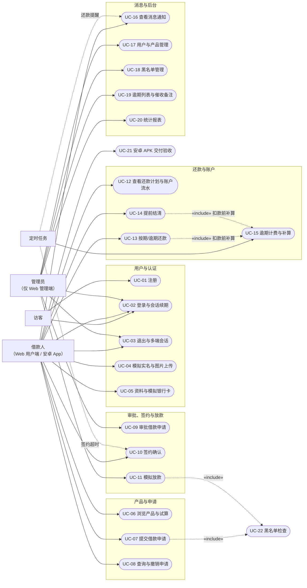
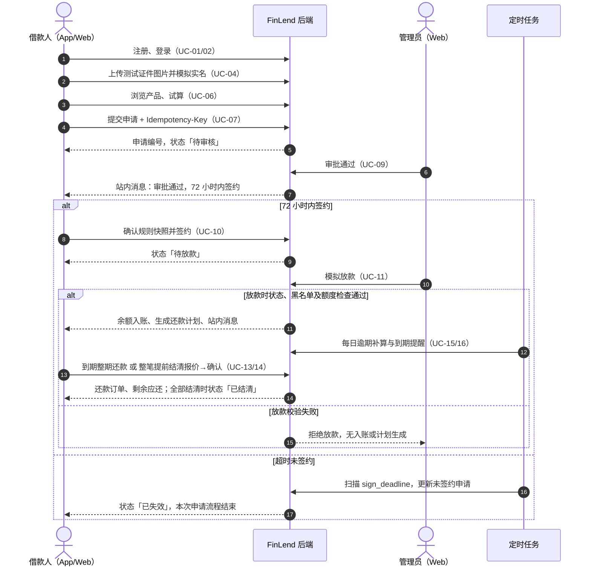
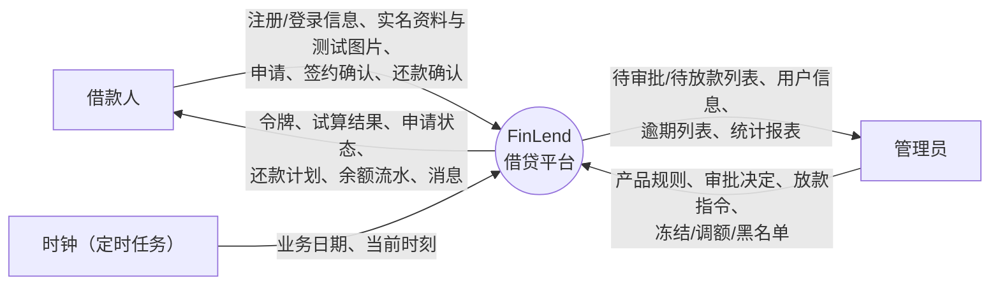
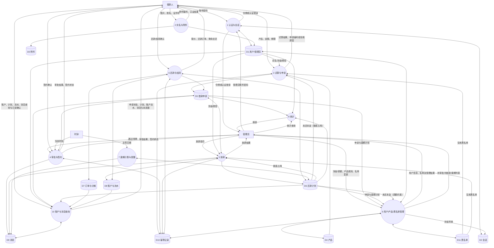
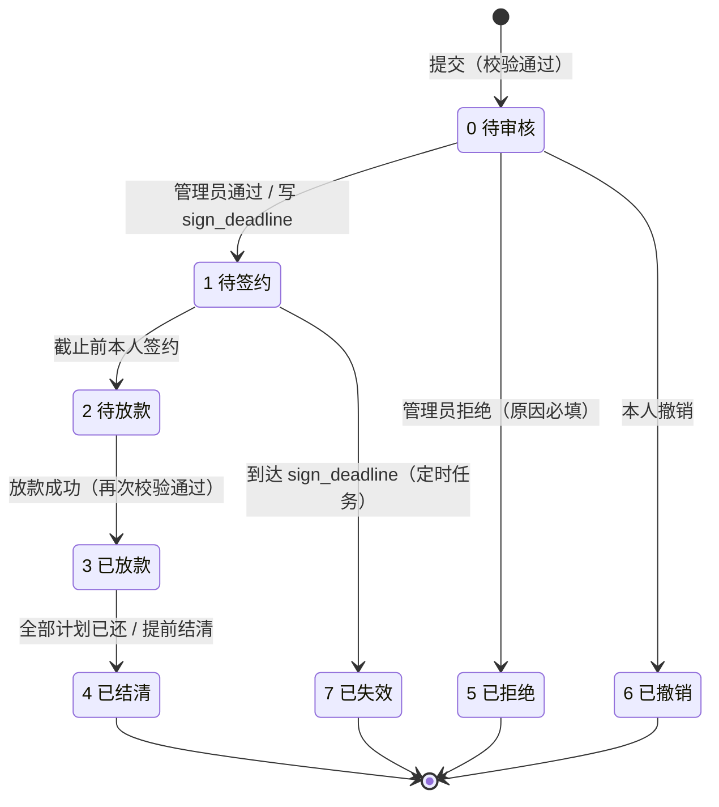
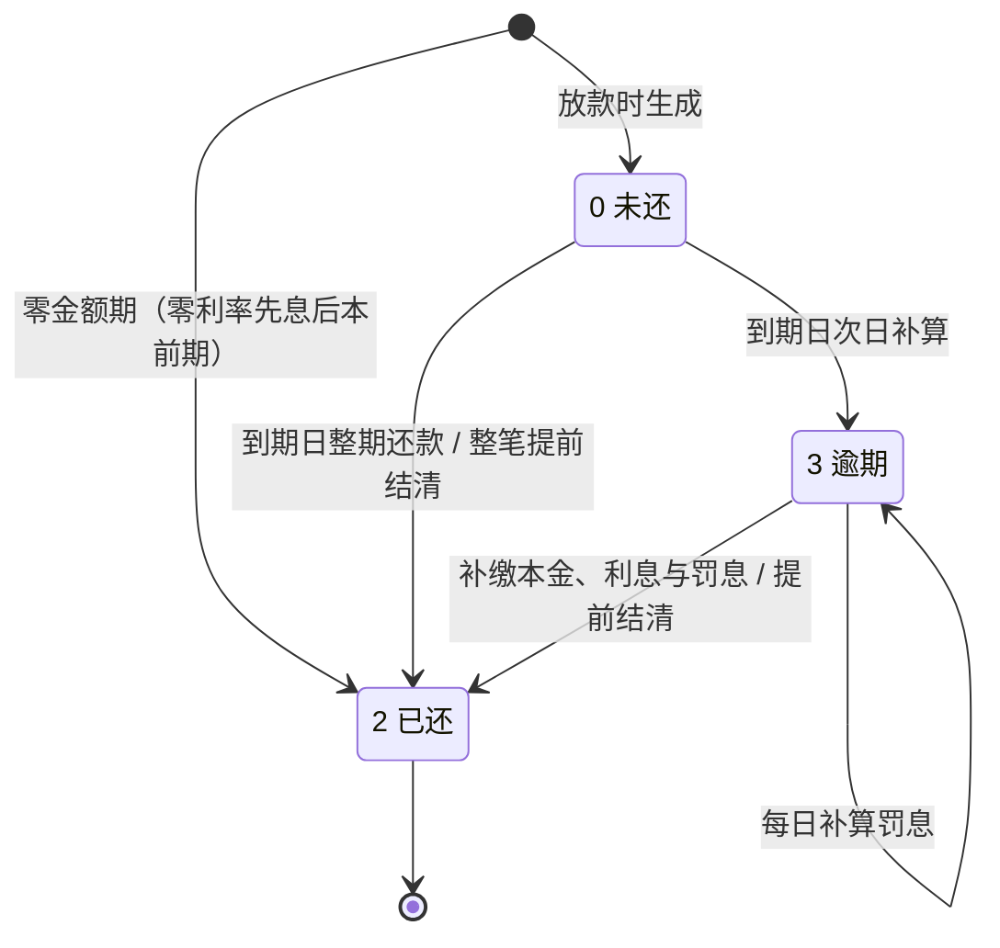
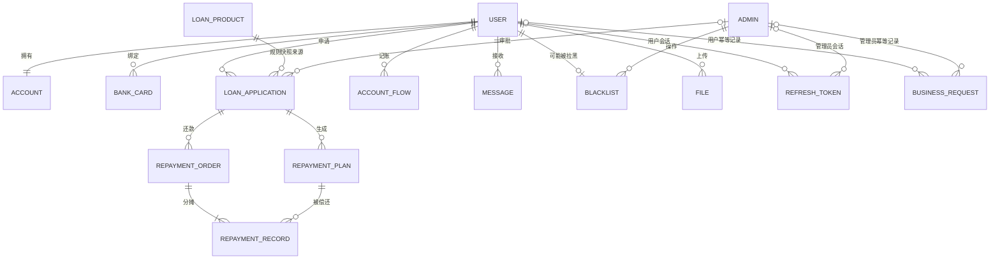
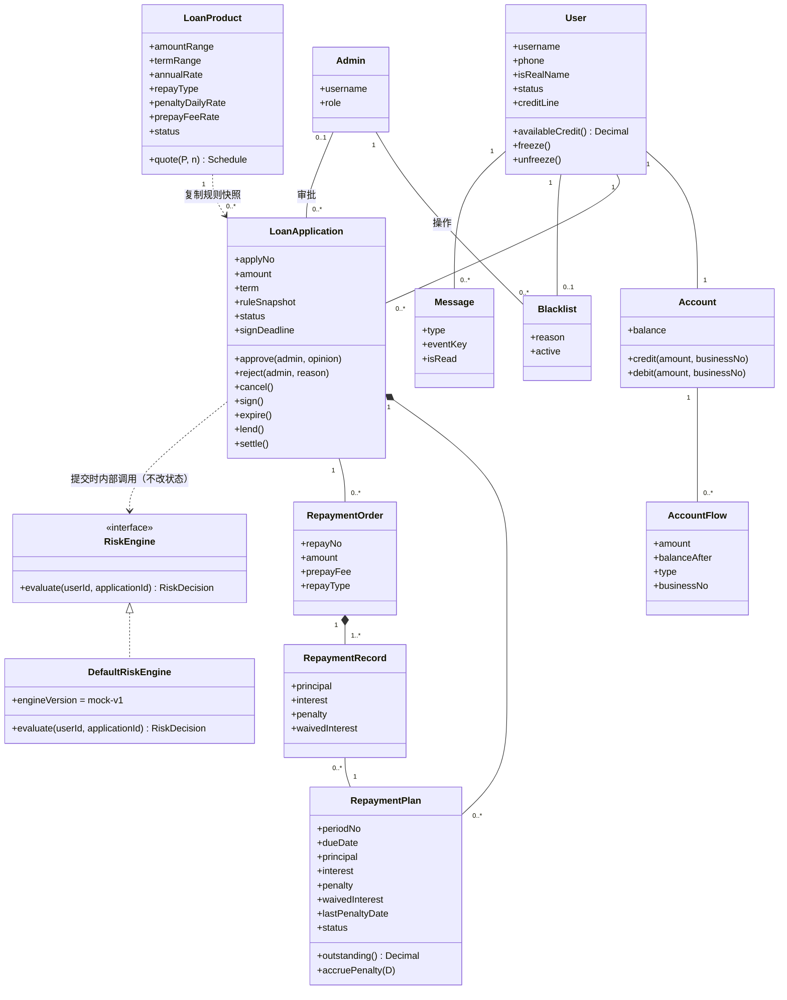

# 借贷软件平台（FinLend）需求分析报告

| 项目       | 内容                                                              |
| ---------- | ----------------------------------------------------------------- |
| 产品名称   | 借贷软件平台（FinLend）                                           |
| 项目类型   | 高校「综合设计 1」课程设计项目                                    |
| 报告版本   | v1.1（内容审阅修订稿）                                                  |
| 依据版本   | [docs/02-功能需求分析](../docs/02-功能需求分析.md) v1.1 业务基线  |
| 初次编制日期 | 2026年10月12日 |
| 本次修订日期 | 2026年10月13日 |
| 编制者     | 王晨宇、宋沛铮（4 人开发团队）                                    |
| 适用阶段   | 本学期（综设 1）：Web 用户端 + Web 管理端 + uni-app 安卓借款人端  |
| 文档状态   | **完整需求草案，待团队评审；仓库当前只有文档，尚无应用代码、迁移或 APK**  |

> **阅读前须知（本报告的证据边界）**
>
> 1. 本报告描述的是**计划交付的需求规格**。文中出现的性能数值、并发数、行数上限、工期与工时，均为**计划验收指标或排期假设**，**不是已测量的结果**；实现后须以实测证据回填。
> 2. 业务口径**唯一基线**是 [docs/02-功能需求分析](../docs/02-功能需求分析.md) v1.1。若本报告与其不一致，以《02》为准，并在 §10 记录待定问题。
> 3. 全部价格、许可证、框架版本可用性均未做在线核查；实现前须在 M1 冻结实测版本。
> 4. 报告正文第 4 章（系统用例设计）为**独立成章**：模板目录未列该章、正文却有完整写作要求，本报告按正文要求独立成章并顺延编号，理由见 §10 Q-01。

---

# 1. 引言

## 1.1 编写目的

本报告为**借贷软件平台（FinLend）**编写。该产品面向高校「综合设计 1」课程设计项目，交付版本号为 **v1.0**（本学期综设 1 范围）。

开发本产品的意义在于：以一个**完整的借贷业务闭环**——注册认证 → 借款申请 → 审批签约 → 放款 → 按期还款 → 结清——为载体，训练团队在需求分析、系统设计、工程协作与软件验证四个方面的能力；同时让团队成员在真实约束（多端交付、金额一致性、并发与幂等）下实践前后端分离、分层架构、RESTful 设计、数据校验与鉴权等知识点。

产品的核心目标是「**业务流程跑通 + 关键业务规则正确**」。其中**利息计算、审批流转、还款与逾期处理**三类规则是必须正确的高风险业务逻辑，也是本报告 §5 与 §6.5 的重点。

**本报告的作用**：详尽说明该软件产品的需求规格，作为后续**概要设计、详细设计、编码、测试与验收**的依据；同时作为需求变更的受控基线——任何需求调整须先修改本报告与被引用的《02》，再同步数据设计与接口契约。

**覆盖范围**：本学期交付 Web 用户端、Web 管理端与 uni-app 安卓借款人端，三端共用后端与业务数据库。信用评分、动态授信额度与多数据融合风控属**后续扩展阶段**内容，本期仅**预留接口与数据结构设计**，不承诺实现，详见 [docs/06-扩展与演进规划](../docs/06-扩展与演进规划.md)。

**与商业产品的区别**：本产品使用虚构身份与模拟资金，不接入真实资金通道、真实征信与真实身份核验，不采集真实个人敏感资料。因此本报告不对真实放贷业务、合规经营或风险效果作任何主张。

## 1.2 项目风险

本阶段涉及三类风险承担者。下表说明各自在本阶段承担的主要风险，以及本报告如何降低其风险。

| 风险承担者 | 本项目对应方        | 本阶段主要风险                                                                                                                       | 本报告的应对                                                                             |
| ---------- | ------------------- | ------------------------------------------------------------------------------------------------------------------------------------ | ---------------------------------------------------------------------------------------- |
| 任务提出者 | 课程组 / 指导教师   | 需求理解偏差导致交付物与课程要求不符；验收标准不够明确，事后追加要求                                                                   | §5.1 每条需求给出**可验证结果**；§6.1 给出计划验收指标与验证方式；§10 记录待定问题与责任人 |
| 软件开发者 | 4 人开发团队        | 需求不充分导致返工；利息/审批/逾期规则理解错误；进度延误；技能不足；**本学期新增安卓端交付**，APK 打包签名与 uni-app 平台差异存在受阻风险 | §5.4 用例描述逐一覆盖异常路径；§6.5 业务规则固化默认值；§2.5 明确技术限制；§2.6 列出假设与验证时间 |
| 产品使用者 | 模拟借款人 / 管理员 | 功能与真实借贷习惯不符；关键操作路径不顺畅；错误提示不清晰；对「模拟」性质产生误解                                                     | §3.1 规定提示与错误信息标准；§6.4 规定易用性优于易学性；全文与界面均标注「模拟」口径       |

**风险等级与应对**（与 [docs/00-可行性分析报告](../docs/00-可行性分析报告.md) §2.2 一致）：

| 风险                   | 影响                       | 等级 | 负责人    | 应对与验收证据                                       |
| ---------------------- | -------------------------- | ---- | --------- | ---------------------------------------------------- |
| 月供舍入、费率单位混淆 | 错误应还金额               | 高   | B，A 复核 | 固定 Decimal 规则；三种方式/零利率/最后一期基准用例  |
| 余额与授信混用         | 放款方向错误、超额授信     | 高   | B         | 模拟放款增加现金；授信由未还本金计算；事务与对账验证 |
| 重复请求/罚息任务重跑  | 重复扣款/重复收费          | 高   | B         | 数据库幂等记录、计费日期、并发及漏跑测试             |
| Web/安卓工作挤压       | APK 延期                   | 中   | 前端/全栈 | Web、安卓分主责，M1 首次打包，M2 起跨端联调          |
| 依赖/构建工具不兼容    | 无法重现环境               | 中   | A/全栈    | 记录实测版本并锁定，不能仅写「最新版」               |
| 上传或鉴权越权         | 暴露测试资料、错误账户操作 | 中   | A         | 文件所有权、会话吊销、角色隔离负向验证               |

## 1.3 文档约定

**排版约定**

- 正文使用中文；业务术语与专业缩略语首次出现时给出英文原词，并在 §7 词汇表统一解释。
- 需求以表格形式逐条列出；图表统一使用 Mermaid 绘制，便于随代码一并版本化。
- 计算规则以**带缩进的算式块**给出，并附**验算基准**（给定输入与预期输出），供实现与测试双向核对。

**符号约定**

| 符号  | 含义                                                             |
| ----- | ---------------------------------------------------------------- |
| ⚠️    | 本项目**不采用**的技术、方案或做法，列出以示区分                 |
| 〔计划〕 | 该指标为**计划验收指标**，尚无实测结果                         |
| 〔预留〕 | 本期只保留接口或数据结构设计，**不实现**，不作为本期通过条件   |
| ★     | 本期**必须交付**的 P0 项                                         |

**需求编号规则**

| 类型       | 格式                    | 示例                                | 说明                                     |
| ---------- | ----------------------- | ----------------------------------- | ---------------------------------------- |
| 功能需求组 | `FR-<模块代号>-<序号>` | `FR-AUTH-01` | §5.1 组织功能范围，附录 A 关联用例、页面与来源 |
| 原子功能需求 | `FR-<模块代号>-<序号>-<子序号>` | `FR-AUTH-01-01` | 附录 B 为逐项验收规格，每条显式给出优先级与测试编号 |
| 验证用例 | `TC-<模块代号>-<序号>-<子序号>` | `TC-AUTH-01-01` | 与原子需求一一对应，验证步骤与预期结果见附录 B |
| 非功能需求 | `NFR-<类别>-<序号>`     | `NFR-PERF-01`、`NFR-SEC-01`         | 见 §6.1 及 §6.2~§6.4                     |
| 业务规则   | `BR-<序号>`             | `BR-10`                             | 见 §6.5；规则本身不是功能需求            |
| 用例       | `UC-<序号>`             | `UC-07`                             | 见 §4；一个用例可对应多条原子功能需求         |
| 激励/响应  | `ES-<序号>`             | `ES-11`                             | 见 §5.2                                  |
| 数据项     | 大驼峰 / 下划线英文名   | `AnnualRate` / `annual_rate`        | 见 §8；实现时沿用同一英文名              |
| 待定问题   | `Q-<序号>`              | `Q-07`                              | 见 §10                                   |

**模块代号**

`AUTH` 用户与认证 · `PROD` 贷款产品 · `LOAN` 借款申请 · `RISK` 风控与信用评估 · `LEND` 放款与账户 · `REPAY` 还款 · `FILE` 附件 · `ADMIN` 后台管理 · `MSG` 消息通知 · `APP` 安卓端交付。

**优先级定义**：高 / 中 / 低三档，与《02》§9 的 P0 / P1 / 后续预留对应（P0 = 高，P1 = 中，后续预留 = 低）。

**需求继承性**：高层次需求（如「支持完整借贷流程」）可被其细化的需求继承；**每条细化需求各自具有独立的优先级**，不因父需求为高优先级而自动获得高优先级。

**编号映射说明**：本报告的 `FR-*` 编号用于报告内部追踪，与《02》的模块化编号或章节**按业务含义建立对应关系**（对照列见 §5.1、汇总矩阵见附录 A）。附录 B 的子需求按对应需求组追溯到来源，属于细化关系而非一一映射。既有外部报告中的旧 `FR-*` 编号**不在本次自动重编**。

## 1.4 预期读者和阅读建议

| 读者类型            | 关注重点                                   | 阅读建议                                                        |
| ------------------- | ------------------------------------------ | --------------------------------------------------------------- |
| 指导教师 / 答辩评委 | 需求完整性、业务规则正确性、可追溯性、证据 | 通读；重点看 §5 功能需求、§6.5 业务规则、§9 分析模型、附录 A     |
| 项目经理 / 统稿人   | 全局一致性、范围边界、待定问题闭环         | 通读；重点看 §1.5、§2.6、§10；负责编号、术语与图表一致性检查     |
| 后端开发人员        | 功能实现细节、输入输出、计算规则、异常处理 | 精读 §5（尤其 §5.3 算式）、§6.5、§8；对照 docs/03 数据结构       |
| 前端（Web）开发人员 | 外部接口需求、界面逻辑特征、错误信息标准   | 精读 §3.1、§3.4；配合 §4 用例场景描述                            |
| 安卓端开发人员      | 跨端一致性、弱网与续期、APK 交付口径       | 精读 §3、§5.1 中 `FR-APP-01`、§6.4 `NFR-QA-06`；对照 docs/06 §2      |
| 测试人员            | 可验证性、异常路径、可追溯性               | 按附录 B 原子需求执行 TC，用 §2.2 与附录 A 检查业务覆盖        |
| 文档编写人员        | 用户文档交付清单与格式                     | 见 §6.6                                                          |

**文档其余部分的内容与组织结构**

```
1 引言              总览：目的、风险、约定、读者、范围、参考文献
2 综合描述          产品全貌：来源、功能、用户类、运行环境、限制、假设
3 外部接口需求      界定产品与外部组件的接口（界面/硬件/软件/通讯）
4 系统用例设计      参与者、用例图、用例清单（需求核心交付物之一）
5 系统功能需求      36 个功能需求组 + 激励响应序列 + 输入输出与算式 + 22 个用例描述
6 其它非功能需求    性能、安全措施、安全性、质量属性、业务规则、用户文档
7 词汇表            业务术语为主，计算机术语一并给出
8 数据定义          数据项字典：含义、类型、大小、格式、单位、精度、取值范围
9 分析模型          数据流程图、状态转换图、实体-关系图、类图
10 待定问题列表     编号、影响章节、责任人、目标解决时间、状态
附录 A 需求追踪矩阵 功能需求组 ↔ 用例 ↔ 数据 ↔ 页面 ↔ 里程碑
附录 B 原子需求验收 193 条原子需求 ↔ 优先级 ↔ 用例 ↔ 单一验收场景 ↔ 测试编号
```

## 1.5 产品范围

**产品描述**：一个**基础的借贷软件平台**。借款人可通过 Web 用户端或本学期交付的安卓 App 注册、完成模拟实名、浏览贷款产品、试算、提交借款申请并签约，在放款后按期还款或提前结清；管理员在 Web 管理端管理用户、贷款产品、审批流程、放款与逾期催收；系统按固定业务规则计算利息与罚息，并以幂等、事务与统一锁序保证账务一致。

**产品目标（与业务策略的联系）**：本项目不以商业收益衡量成果。它服务于三项课程目标——① 用一条完整业务链展示多角色状态流转；② 用金额计算、事务与幂等展示「关键业务规则正确」；③ 用「Web + 安卓双端共用一套 API」展示跨端一致性与接口契约协作。因此产品的成功判据是**闭环可演示、金额可核对、规则可验证**，而不是用户量、放款规模或风险指标。

**利益**：团队成员获得从需求分析到 APK 交付的完整工程经历；产出可复用的接口契约、数据库迁移、测试基准与部署手册。

**范围边界**

| 类别     | 内容                                                                                                                                                                             |
| -------- | -------------------------------------------------------------------------------------------------------------------------------------------------------------------------------- |
| 必须交付 | 注册登录与会话续期、模拟实名与测试图片上传、产品浏览与管理、额度试算、申请/撤销/签约、审批、模拟放款、还款计划、按期与逾期还款、提前结清、逾期罚息、账户与流水、站内消息、**Web 基础后台管理**、**安卓 APK** |
| 配套交付 | 完整数据库迁移与 seed、接口契约、测试记录与算例、安装部署指南与用户手册、演示与答辩材料                                                                                          |
| 可选增强 | 统计图表与导出、催收备注、模拟充值页面（基础演示资金由 seed 提供）                                                                                                               |
| 后续扩展 | 信用评分与动态额度、多数据融合风控、小程序、厂商推送、真实身份核验、真实资金通道（本期只预留接口/表设计）                                                                         |
| 本期排除 | 真实放贷与真实资金划转、真实征信与身份核验、真实个人敏感资料采集、任意部分还款、银行卡自动扣款                                                                                   |

**非作用领域**（避免误解）：本产品**不是**真实的借贷服务，不满足金融业务的合规要求，不产生任何真实债权债务；本产品的信用分 60 与等级 C 是**模拟默认值**，不代表任何真实信用评估结果；本产品的「余额」是演示用模拟现金，不是可提现资金。

## 1.6 参考文献

按「项目文档 → 课程材料 → 外部技术资料」三层给出。项目文档中的「版本」列即本报告引用的基线版本。

| 编号 | 标题                        | 作者 / 来源           | 版本 / 编号                       | 日期       |
| ---- | --------------------------- | --------------------- | --------------------------------- | ---------- |
| R1   | 软件需求分析报告文档模板    | 课程组下发            | 《软件项目报告模板》中的需求分析章 | —          |
| R2   | 借贷软件平台 README         | 项目组（JuRen）       | 仓库根 README.md                  | 2026-09-22 |
| R3   | 00-可行性分析报告           | 王晨宇                | v1.1                              | 2026-09-22 |
| R4   | 01-技术栈分析与选型         | 王晨宇                | v1.1                              | 2026-09-22 |
| R5   | **02-功能需求分析**         | 王晨宇                | **v1.1（业务规则唯一基线）**      | 2026-09-22 |
| R6   | 03-数据库设计               | 项目组                | v1.1（逻辑设计基线，尚未建库）    | 2026-09-22 |
| R7   | 04-团队分工与开发规范       | 宋沛铮                | v1.1（计划）                      | 2026-09-22 |
| R8   | 05-术语表                   | 项目组                | v1.1                              | 2026-09-22 |
| R9   | 06-扩展与演进规划           | 项目组                | v1.1（规划，尚未实现）            | 2026-09-22 |
| R10  | 07-审阅记录与待验证事项     | 项目组                | v1.0（R-01~R-15）                 | 2026-09-22 |
| R11  | GB/T 8567 计算机软件文档编制规范 | 国家标准            | —                                 | —          |
| R12  | IEEE Std 830-1998 软件需求规格说明推荐实践 | IEEE    | 后续版本为 ISO/IEC/IEEE 29148     | —          |
| R13  | FastAPI 文档                | fastapi.tiangolo.com  | 在线文档                          | —          |
| R14  | SQLAlchemy 2.0 文档         | docs.sqlalchemy.org   | 在线文档                          | —          |
| R15  | MySQL 8.0 参考手册          | dev.mysql.com         | InnoDB 锁/外键/CHECK/索引         | —          |
| R16  | Vue 3 文档 / Vite 指南      | vuejs.org / vite.dev  | 在线文档                          | —          |
| R17  | uni-app 文档                | uniapp.dcloud.net.cn  | Vue 3 模板与 App 打包             | —          |
| R18  | Python Decimal 文档         | docs.python.org       | 金额精度与舍入                    | —          |

> 说明：R13–R18 为技术依据入口，本报告**未进行最新版本与价格的在线核验**；实际依赖版本须在 M1 冻结并记录，见 §2.6。

---

# 2. 综合描述

## 2.1 产品的状况

**背景与起源**：本产品源于「综合设计 1」课程设计要求——以一个完整的业务系统为载体，训练需求分析、系统设计、团队协作与软件验证能力。团队选择「借贷软件平台」是因为它能同时覆盖**多角色状态流转**（借款人/管理员/定时任务）、**金额精度与财务计算**、**事务与并发一致性**三类课程重点，且业务规则边界清晰、可在局域网内独立演示。

**产品定位**：本产品是一个**新型的、自主设计的产品**，不属于产品系列中的下一成员，也不是成熟商业产品的升级版——不基于任何现有借贷系统的代码或数据模型，业务规则按课程规模自行裁剪（例如本期不支持部分还款、不上线真实风控）。

**交付形态**：由三个客户端与一套后端组成的一个**单一系统**，三端共用同一后端服务与同一业务数据库：

```
        ┌──────────────────┐   ┌──────────────────┐
        │ Web 用户端        │   │ Web 管理端        │
        │ （借款人）        │   │ （管理员）        │
        └────────┬─────────┘   └────────┬─────────┘
                 │                      │
        ┌────────┴─────────┐            │
        │ 安卓 App（借款人）│            │
        │ uni-app / APK    │            │
        └────────┬─────────┘            │
                 └───────────┬──────────┘
                             ▼
                 ┌───────────────────────┐
                 │ 后端单体服务 FastAPI   │
                 │ /api/v1 统一接口       │
                 └───────┬───────┬───────┘
                         ▼       ▼
                   ┌─────────┐ ┌─────────┐
                   │ MySQL   │ │ Redis   │
                   │ 业务数据 │ │验证码/限流│
                   └─────────┘ └─────────┘
```

**与外部系统的关系**：本产品是**自包含的独立系统**，不与大系统的其它子系统存在基本相互关系。存在的基本外部关系仅限于运行环境依赖：

| 外部对象                | 关系性质                                        | 接口界定位置 |
| ----------------------- | ----------------------------------------------- | ------------ |
| MySQL 8.0 数据库        | 后端持久化业务、会话、附件元数据与幂等结果      | §3.3         |
| Redis                   | 演示验证码、限流、会话吊销辅助缓存              | §3.3         |
| 服务端文件目录          | 存放非公开的虚构测试证件图片                    | §3.3         |
| Android 真机与局域网    | 安卓 App 运行、安装与调用后端 API               | §3.2 / §3.4  |
| 浏览器（Chrome/Edge）   | Web 用户端与管理端运行环境                      | §2.4 / §3.1  |

⚠️ **本产品不接入**：真实支付/清算通道、真实征信机构、运营商与电商数据源、身份核验与人脸识别服务、短信网关与厂商推送服务。演示验证码通过**演示通道**提供（§6.2），不依赖真实短信。

## 2.2 产品的功能

本节从**业务层面**概略总结产品功能，详细规格见 §5。括号内为对应用例范围。

**F1 用户与认证**（UC-01~UC-05）★
访客注册；借款人登录、会话续期与退出；模拟实名认证与测试证件图片上传；个人资料维护与模拟银行卡管理（绑定、删除、设置唯一默认卡）；账户信息查询（余额、授信、可用额度）。

**F2 贷款产品与试算**（UC-06）★
借款人浏览上架产品列表与详情（金额与期限范围、年利率、还款方式、罚息与提前结清费率）；使用后端返回的逐期计划与应还总额进行试算。管理员创建、修改与上下架产品。

**F3 借款申请与签约**（UC-07、UC-08、UC-10）★
选择产品、试算、填写金额/期限/用途后提交申请；查询本人申请列表与详情；在「待审核」状态撤销申请；审批通过后在 72 小时内确认签约。

**F4 审批与放款**（UC-09、UC-11）★
管理员的待审批列表与详情查看；通过/拒绝审批（拒绝原因必填）；签约超时自动置为已失效；管理员对「待放款」申请执行模拟放款。

**F5 还款与逾期**（UC-12~UC-15）★
查看还款计划；对**最早到期的整期债务**发起按期或逾期还款；整笔提前结清（先报价后确认）；按日计提逾期罚息并支持漏跑补算；查看还款订单与分摊明细。

**F6 账户与流水**（UC-12）★
查看模拟现金余额、账户流水（含演示初始化流水、放款入账、还款出账）；每笔业务有可追踪编号。

**F7 后台管理**（UC-17~UC-19 必需；UC-20 可选）
用户查询/冻结/解冻；产品管理；黑名单管理；逾期借款列表；统计报表（放款总额、待还总额、逾期率、用户数）。

**F8 站内消息**（UC-16）★
审批结果、放款成功、到期前 3 天提醒、逾期提醒的站内消息；未读数与已读状态；App 前台 30 秒轮询未读数。

**F9 风控与信用接口**（UC-07、UC-08、UC-12、UC-18、UC-22）★
黑名单检查为**本期唯一真实执行的风控规则**；评分/决策/数据源/信用分接口返回带 `is_mock=true` 的模拟值，仅用于联调，**不能覆盖**实名、冻结、黑名单或额度检查，也不等于管理员审批通过。

**F10 安卓端交付**（UC-21）★
复用上述借款人必需功能（含签约与撤销入口）；签名 APK 在指定真机完成一次安装与完整借还流程；管理操作在 Web 演示。

**F11 后续扩展**〔预留〕
动态信用评分、动态授信额度、多源数据融合风控与可解释决策、小程序、厂商推送。本期只保留接口形状与表结构设计，不实现，见 [docs/06](../docs/06-扩展与演进规划.md) §3。

**非作用领域**：本产品提供**借款**方向业务，不含存款/理财/授信外的资金归集业务；不含面向第三方的开放 API 与对外对账；不含真实催收、法律与征信报送流程。

## 2.3 用户类和特性

| 用户类       | 重要程度 | 特征                                                                       | 使用终端                  | 技术熟练度 | 关键诉求                                                   |
| ------------ | -------- | -------------------------------------------------------------------------- | ------------------------- | ---------- | ---------------------------------------------------------- |
| 借款人       | 重要     | 模拟自然人或小微经营者；全部为虚构身份演示账户；关注「能不能借、还多少、怎么还」 | Web 用户端 **或** 安卓 App | 一般       | 应还金额准确、状态清晰、操作可回退（撤销/查到结果）        |
| 管理员       | 重要     | 平台运营人员，本期只有 `ADMIN` 一种角色；使用 seed 创建，不开放公开注册     | **仅 Web 管理端**          | 较高       | 待办集中、审批有依据、逾期可见、操作可留痕（意见/原因）    |
| 定时任务     | 次要     | 系统内部参与者：签约超时扫描、逾期罚息补算、还款提醒生成（APScheduler 单实例） | 无界面                    | —          | 可补算、可重跑、不重复计费/不重复发消息                    |
| 课程组/评委  | 附加     | 通过报告、演示与产物（APK、接口文档、测试记录）获取产品数据与服务         | 文档与演示环境            | 高         | 需求可追溯、规则有算例、交付可复现                         |
| 运维/部署者（团队内兼职） | 附加 | 通过部署手册、seed 与迁移脚本获得系统服务                            | 命令行 / 主机              | 高         | 空库可初始化、备份可还原、依赖版本可锁定                   |

**说明**

- 「用户不一定是软件产品的直接使用者」——课程组/评委与运维者通过**报表、接口文档、部署脚本**获得产品的数据与服务，因此作为附加用户类列出其需求（结果可复现、文档齐全），详见 §6.6 与 §6.2 NFR-SEC-11。
- 借款人**未完成模拟实名不能发起借款申请**；账号被冻结后不能登录、续期、申请或放款，但既有债务与罚息继续存在。
- 管理员权限**每次调用校验**，不能以客户端传入的角色字段获得权限。

## 2.4 运行环境

| 层次                 | 环境项          | 要求 / 版本基线                                                                  | 备注                                                           |
| -------------------- | --------------- | -------------------------------------------------------------------------------- | -------------------------------------------------------------- |
| 服务端硬件           | 开发/演示主机   | 现有 PC（团队自有），服务端内存 ≥ 4 GB、可用磁盘 ≥ 10 GB 〔计划〕                | 复用已有设备，新增采购目标为 0 元                              |
| 服务端操作系统       | Windows 11 / WSL2 或 Linux | 以 M1 实测记录为准                                                      | Redis 在 Windows 上可通过 WSL2 或容器运行                      |
| 服务端运行时         | Python          | 3.11 及以上                                                                      | 具体补丁版本 M1 冻结                                           |
| 服务端框架与依赖     | FastAPI、Uvicorn、SQLAlchemy 2.x、Pydantic v2、PyMySQL、PyJWT、passlib[bcrypt]、redis、python-multipart、APScheduler、Alembic、pytest | 见 §2.5 限制 | 版本组合须实测锁定，不能仅声明最低版本                          |
| 数据库               | MySQL           | 8.0，InnoDB，utf8mb4 / utf8mb4_general_ci                                        | 表、约束与迁移见 docs/03                                       |
| 缓存/临时状态        | Redis           | 版本 M1 冻结                                                                     | 用于演示验证码、限流、必要的吊销缓存                            |
| Web 客户端运行环境   | 浏览器          | Chrome / Edge 当前稳定版（M1 冻结最低支持版本）                                   | 用户端与管理端均为 SPA                                          |
| Web 构建工具链       | Node.js + Vite  | Node.js 22 LTS 为候选，须核对与 uni-app 模板的共同兼容范围                        | 包管理 npm 或 pnpm（每工程选一种）                              |
| 安卓运行环境         | Android 真机    | 至少一台真机；**最低支持版本 M1 冻结**；机型、系统版本、构建日期须留档             | H5 页面跑通**不能**替代 APK 真机验收                            |
| 安卓构建环境         | HBuilderX + 配套 App 打包流程 | 记录版本、签名方式、账号/网络/构建服务条件                            | CLI 完成资源构建 ≠ 已生成 APK；离线构建仅在已有 SDK/JDK 时为备选 |
| 开发工具             | IDE / 调试      | PyCharm 或 VS Code；Swagger UI（`/docs`）/ Apifox / Postman                       | —                                                              |
| 版本控制             | Git 仓库        | GitHub；工作区与仓库统一 LF 换行                                                  | 见 `.gitattributes`                                            |
| 共存应用             | 无特定冲突要求  | 本产品为独立系统，不与其它业务系统共库或共端口                                    | 演示时注意端口冲突                                             |

## 2.5 设计和实现上的限制

下列限制**约束开发人员的自由选择**，并说明为何构成限制。

| 类别                 | 限制内容                                                                                         | 成为限制的原因                                                                 |
| -------------------- | ------------------------------------------------------------------------------------------------ | ------------------------------------------------------------------------------ |
| 必须使用的技术       | 后端 **Python 3.11+ / FastAPI / SQLAlchemy 2.x / Pydantic v2**；数据库 **MySQL 8.0**；Web 端 **Vue 3 + Vite + Element Plus + Pinia + Vue Router + Axios**；安卓端 **uni-app（Vue 3）+ Pinia + uni-ui**；APScheduler；Alembic；pytest | 课程要求交付前后端分离 + RESTful 系统，且团队已按此路径学习；三端共用一套 API 是「跨端一致」这一课程目标的实现方式 |
| 必须使用的技术（继续） | 金额与费率：数据库 `DECIMAL(18,2)` / `DECIMAL(8,4)`，代码 **Python `Decimal`**                     | 课程对账务正确性有硬要求；二进制浮点无法表示 0.1 等十进制小数的精确值，会导致分位误差累积 |
| 避免使用的技术       | ⚠️ 微服务架构、⚠️ 消息队列（RabbitMQ/Kafka）、⚠️ 分布式事务、⚠️ 规则引擎、⚠️ 原生 Kotlin 安卓 App、⚠️ **`float` 做金额运算** | 业务规模小，单库单进程即可；引入这些会显著抬高复杂度而无可验证收益；`float` 直接违反金额精度要求 |
| 开发规范与标准       | 分层「路由层 → 业务层 → 数据访问层」；同一业务规则只在服务层实现；响应统一为 `{code, message, data}`；RESTful 风格；响应时间与日期格式统一；通过评审与检查后才合入 | 保证可维护性与可测试性；避免同一规则在三个客户端各写一遍而口径分叉               |
| 企业/课程策略限制    | 本学期必须交付 Web 用户端、Web 管理端**和**安卓 APK；管理操作**仅**在 Web 提供；12 周为排期基线，第 12 周只留缺陷修复与演示缓冲 | 交付范围由课程决定，不由技术偏好决定；安卓端若延期无法用 Web 交付替代           |
| 法规与合规限制       | 只使用**虚构**身份、证件图片与银行卡；不采集真实个人敏感资料；不接真实资金与征信；界面与文档必须标注「模拟」 | 本项目是教学演示，不具备处理真实个人金融信息的主体资质与安全条件；越界即产生真实风险 |
| 数据与安全限制       | 密码 BCrypt 哈希存储，超过 BCrypt 72 字节上限的密码**必须明确拒绝**（不得静默截断）；身份证号与手机号日志脱敏；上传仅 JPEG/PNG 且 ≤ 5 MiB，校验真实文件格式；附件按鉴权接口读取，**不得作为公开静态路径** | 明文或可逆存储违反口令安全基本要求；静默截断会让不同密码等价；公开静态路径会泄露他人资料 |
| 数据一致性与并发限制 | 业务写事务显式 `READ COMMITTED`；按「用户 → 申请 → 账户 → 计划」统一顺序加锁；授信汇总必须在取得用户锁**之后**查询最新已提交数据 | 顺序相反会造成反向持锁死锁；使用事务早期快照会算错可用额度、导致超额放款 |
| 调度限制             | APScheduler 必须在**独立单实例进程**运行，不能在每个 Uvicorn worker 内各启一份；任务正确性依赖数据库状态、计费日期与事件键 | 多实例会重复计费与重复发消息；仅靠内存中的去重不可靠                       |
| 运行时限制           | 数据库路由使用同步 `def`，或把阻塞调用显式放入线程池；禁止在 `async def` 中直接执行同步数据库操作并宣称获得异步吞吐收益；每请求一个 Session，禁止跨线程共享 | 同步驱动在事件循环中阻塞会拖垮并发；共享 Session 会导致事务串扰              |
| 数据转换格式限制     | API 中金额、利率与 BIGINT 标识均**以字符串传输**；日期 `YYYY-MM-DD`，时间 ISO 8601 带 `+08:00`；分页默认 `limit=20`、最大 100 并显式指定稳定的第二排序键 | JavaScript 双精度整数无法安全表示 19 位 BIGINT；浮点解析会破坏金额精度；不稳定的排序会导致分页重复/遗漏 |
| 时区限制             | 业务时区统一 **Asia/Shanghai**；数据库连接时区与应用配置一致；客户端不得用本地时区改变计息日 | 计息日错位会产生错误罚息与错误到期判断                                   |
| 硬件/环境限制        | 上传图片 ≤ 5 MiB；文档与演示材料随仓库分发                                     | 演示环境为局域网、无云端对象存储；大文件与公网分发不在本期范围            |
| 部署安全限制         | 正式部署使用 HTTPS；局域网明文 **仅限隔离演示配置**；CORS 只开放已配置的 Web 源；`.env`、私钥、APK 签名密钥不入库 | 明文传输会让令牌可被旁路窃听；过宽 CORS 会扩大浏览器跨源访问范围；身份与资源归属仍必须由服务端鉴权                  |

## 2.6 假设和约束（依赖）

**假设因素**：以下因素若被证明不成立、不一致或被修改，将使开发项目受到影响。

| 编号 | 假设                                                                 | 验证时间 / 责任          | 不成立时的处理                                                     |
| ---- | -------------------------------------------------------------------- | ------------------------ | ------------------------------------------------------------------ |
| A-01 | 4 人持续投入，保留 12 周有效开发窗口；每周 6–8 小时/人（合计 288–384 人时） | 第 1 周，全员核对课程安排 | 优先移除可选增强，重排工期；**安卓 APK 仍为必需交付**              |
| A-02 | 至少一人能承担 uni-app 开发，另一人可协助                            | M1，前端/全栈验证登录 APK | 安排结对与页面分担，在 M1 暴露学习风险，不拖到 M4                  |
| A-03 | 可获得 Android 真机和可互访的局域网                                  | M1，全栈验证安装及 API   | 使用团队现有设备和已验证网络；手机须使用服务端局域网 IP/域名，不能用手机自身 localhost |
| A-04 | MySQL / Redis 与后端可在开发机运行                                   | M1，A/B 验证连接与迁移   | 统一 WSL2/容器或本地服务配置，记录端口与连接方式                   |
| A-05 | 课程验收接受模拟身份、模拟资金与未接入真实风控                       | 范围说明提交课程评审时核对 | 将额外要求作为变更评估，不宣称已获教师认可                         |
| A-06 | 安卓打包链路（HBuilderX/构建服务）在现有账号与网络条件下可用         | M1，首次真机出包         | 记录可用备选路径；不预先承诺打包免费不限量                         |
| A-07 | 用户具备基本智能手机与浏览器使用能力，无需专门培训                   | 演示准备阶段             | 提供 §6.6 的用户手册与管理员手册                                   |
| A-08 | 演示规模有限（约 50 个演示用户、20 并发）                            | M4 性能记录时核对        | 按课程规模调整指标并如实记录条件，不按互联网产品量级设计           |

**外部约束与依赖**

| 类别       | 约束内容                                                                   | 影响的章节            |
| ---------- | -------------------------------------------------------------------------- | --------------------- |
| 工期约束   | 12 周（M1 奠基 2 周、M2 申请链 3 周、M3 账务 4 周、M4 交付 3 周）；第 12 周不安排新功能 | §1.2、§6.1 NFR-05     |
| 经费约束   | 不购买云服务与付费工具为默认口径；辅助开发工具/API 费用按实际使用记录，不能计为 0 | §2.4、§1.2            |
| 人员约束   | 4 人，且每人另有课程负担；一人同时承担安卓与集成协调，负荷偏高              | §2.3、§2.6 A-01/A-02  |
| 设备约束   | 复用自有 PC 与真机；需至少一台可安装 APK 的安卓真机                        | §2.4、§2.6 A-03       |
| 地理位置   | 团队成员可线下协作；演示在局域网内完成                                     | §3.4                  |
| 课程约束   | 交付范围、时间节点与验收标准由课程组规定；模板结构由课程模板规定           | §1.5、§4（成章理由）  |
| 依赖软件   | 依赖 MySQL、Redis、HBuilderX、Android SDK/JDK 与构建服务的可用性            | §3.3、§2.6 A-04/A-06  |
| 依赖数据   | 演示数据由 seed 生成，包含虚构身份、测试图片、授信与带初始化流水的模拟余额    | §5.3、§6.6            |

---

# 3. 外部接口需求

## 3.1 用户界面

### 3.1.1 通用界面标准（三端共同遵守）

| 编号    | 标准项           | 要求                                                                                                                         |
| ------- | ---------------- | ---------------------------------------------------------------------------------------------------------------------------- |
| UI-01   | 语言             | 全部界面文案为简体中文；金额统一显示为「¥ 12,000.00」两位小数格式，利率显示为「12.00%」                                      |
| UI-02   | 模拟标识         | 实名认证页、银行卡页、风控结果区、账户余额区必须显示「模拟」标识，明确不是真实核验/真实资金                                  |
| UI-03   | 权威金额         | 所有应还金额、试算结果、结清报价只展示**后端返回值**；客户端不得自行计算并展示为最终金额                                     |
| UI-04   | 必填与校验       | 必填项以星号标注；前端即时校验格式（手机号、18 位证件号、金额区间），但**以后端校验结果为准**                                |
| UI-05   | 加载与防重复     | 写操作按钮点击后进入加载态并禁用，直到收到结果；**前端禁用只是交互措施，不替代服务端幂等**                                   |
| UI-06   | 错误信息         | 错误提示以「发生了什么 + 用户可以做什么」两段给出，例如「可用额度不足（当前可用 ¥3,000.00）。请降低借款金额。」；不展示堆栈、SQL 或内部代码 |
| UI-07   | 结果未知         | 网络超时或断网时显示「结果待确认」，提供「查询结果」按钮；**不得自动换新幂等键重发扣款类请求**                              |
| UI-08   | 会话失效         | 收到 401 时自动续期一次；续期失败则提示「登录已失效，请重新登录」并跳转登录页，保留非敏感表单内容                           |
| UI-09   | 状态展示         | 申请状态用 §5.1 规定的 8 个中文名称；逾期以计划级标签「逾期 N 天」展示，不作为申请状态                                       |
| UI-10   | 脱敏展示         | 手机号显示 `138****8888`；证件号显示前 3 后 4；银行卡号只显示后四位                                                          |
| UI-11   | 危险操作确认     | 还款、提前结清、放款、拒绝、冻结、拉黑操作必须二次确认，确认框中重复展示金额或对象                                           |
| UI-12   | 无障碍           | 表单控件有可读标签；颜色不是状态的唯一表达（同时有文字）；文字与背景对比度满足常规可读要求（完整 WCAG 符合性需人工评审，本期不承诺） |
| UI-13   | 时间显示         | 统一显示北京时间（Asia/Shanghai），格式 `YYYY-MM-DD HH:mm`；到期日仅显示日期                                                 |

### 3.1.2 Web 用户端（借款人）页面清单

布局：顶部导航（产品 / 我的借款 / 还款 / 账户 / 消息〔未读角标〕 / 个人中心）+ 主内容区；Element Plus 组件库。

| 页面编号 | 页面               | 主要元素与交互                                                                          | 对应需求                    |
| -------- | ------------------ | --------------------------------------------------------------------------------------- | --------------------------- |
| W-U01    | 注册               | 账号、手机号、密码、确认密码、演示验证码（「获取验证码」按钮 60 秒冷却）                | FR-AUTH-01                  |
| W-U02    | 登录               | 账号、密码；错误次数过多提示稍后再试                                                    | FR-AUTH-02                  |
| W-U03    | 模拟实名认证       | 姓名、18 位证件号、测试证件图片上传（预览/重传），顶部醒目标注「模拟认证，非真实核验」 | FR-AUTH-04、FR-FILE-01       |
| W-U04    | 个人资料与银行卡   | 昵称、邮箱、职业、地址、月收入；模拟银行卡列表（新增/删除/设为默认）                    | FR-AUTH-05                  |
| W-U05    | 产品列表 / 详情    | 卡片列表；详情展示金额与期限范围、年利率、还款方式、罚息日利率、提前结清费率            | FR-PROD-01                  |
| W-U06    | 试算与申请         | 金额滑块+输入框、期限下拉、用途；「试算」展示逐期计划表与总额；「提交申请」             | FR-LOAN-01、FR-LOAN-02       |
| W-U07    | 我的借款列表/详情  | 按状态筛选；详情展示规则快照、审批意见、签约截止倒计时、「撤销」「签约」按钮           | FR-LOAN-03、FR-LOAN-05       |
| W-U08    | 还款计划           | 逐期表格（到期日、应还本金/利息/罚息、已付、状态）；「还款」「提前结清」入口            | FR-REPAY-02、FR-REPAY-03     |
| W-U09    | 账户与流水         | 余额、授信、可用额度；流水列表（类型、金额正负、记账后余额、业务编号）                  | FR-AUTH-06、FR-LEND-02       |
| W-U10    | 消息中心           | 消息列表、未读高亮、单条/全部标记已读                                                   | FR-MSG-01                   |

### 3.1.3 Web 管理端（管理员）页面清单

布局：左侧菜单 + 顶部面包屑 + 主内容区；列表页统一提供筛选、分页（默认 20 条）与按时间倒序。

| 页面编号 | 页面           | 主要元素与交互                                                                  | 对应需求                     |
| -------- | -------------- | ------------------------------------------------------------------------------- | ---------------------------- |
| W-A01    | 管理员登录     | 独立入口 `/admin/login`；不与借款人登录共用                                     | FR-AUTH-02                   |
| W-A02    | 工作台         | 待审批数、待放款数、逾期计划数；统计卡片（可选图表）                            | FR-ADMIN-03                  |
| W-A03    | 用户管理       | 用户列表（脱敏）、详情、冻结/解冻、调整授信（不得低于当前占用）                 | FR-ADMIN-01                  |
| W-A04    | 产品管理       | 产品列表、新建/编辑表单（上下限校验）、上架/下架开关                            | FR-PROD-02                   |
| W-A05    | 审批中心       | 待审核列表；详情含申请信息、规则快照、模拟风控区（标注「模拟结果，仅用于联调」）；通过/拒绝（拒绝原因必填） | FR-LOAN-04、FR-RISK-01        |
| W-A06    | 放款中心       | 待放款列表；放款二次确认（展示借款人、金额、期限、当前可用额度）                | FR-LEND-01                   |
| W-A07    | 黑名单管理     | 加入（原因必填）/移出；列表显示操作人与时间                                     | FR-RISK-05                   |
| W-A08    | 逾期管理       | 逾期计划列表（借款人、期次、逾期天数、应还罚息）；催收备注（可选）              | FR-ADMIN-02                  |

### 3.1.4 安卓 App（借款人）页面清单

布局：底部 Tab（首页/产品、借款、还款、我的），消息入口在顶部角标；uni-ui 组件库，`pages.json` 管理路由。

| 页面编号 | 页面               | 与 Web 用户端的差异                                                       | 对应需求       |
| -------- | ------------------ | ------------------------------------------------------------------------- | -------------- |
| A-01     | 启动/登录/注册     | 启动时用安全存储中的 refresh token 换取新令牌；失败进入登录页             | FR-AUTH-02     |
| A-02     | 实名认证           | 通过相册或相机选取测试图片；上传进度条                                    | FR-AUTH-04     |
| A-03     | 产品与试算申请     | 单列卡片；试算结果以折叠列表展示                                          | FR-LOAN-01/02  |
| A-04     | 我的借款与签约     | 包含签约与撤销入口；签约页滚动至底部方可点击「确认签约」                  | FR-LOAN-03/05  |
| A-05     | 还款计划与还款     | 还款前展示报价确认页；结果未知时显示「查询结果」                          | FR-REPAY-02/03 |
| A-06     | 账户与流水         | 下拉刷新、上拉加载更多                                                    | FR-LEND-02     |
| A-07     | 消息               | 前台每 30 秒轮询未读数；进入页面立即刷新；退到后台停止轮询                | FR-MSG-02      |
| A-08     | 我的               | 资料、银行卡、退出登录（吊销当前会话）                                    | FR-AUTH-03/05  |

### 3.1.5 键盘快捷键与功能按钮约定

- Web 端：表单内 `Enter` 提交登录/搜索类表单；**写操作（还款、放款、审批）不绑定 `Enter` 快捷提交**，必须鼠标或触控点击确认，防止误触。`Esc` 关闭弹窗并放弃本次输入。
- 所有页面的「返回」「取消」位于左侧/次要样式，「确认」「提交」位于右侧/主要样式；危险操作按钮使用警示色。
- 安卓端：系统返回键在表单页有未提交内容时先弹出「放弃编辑？」确认；在支付确认页返回不取消已发出的请求。

## 3.2 硬件接口

本产品**不直接驱动任何专用硬件**，不涉及打印机、读卡器、POS、U 盾、指纹仪等金融硬件接口。仅存在以下通过操作系统间接访问的硬件：

| 硬件                   | 访问方式                                         | 数据与控制交互                                         | 约束                                             |
| ---------------------- | ------------------------------------------------ | ------------------------------------------------------ | ------------------------------------------------ |
| 安卓设备相机 / 相册    | uni-app 图片选择 API，经 Android 权限授权         | 读取用户主动选取的 JPEG/PNG 测试图片                    | 仅在用户点击上传时申请权限；拒绝授权时给出说明并允许改用相册 |
| 安卓设备网络模块       | 操作系统网络栈                                   | 通过 Wi-Fi/局域网访问后端 API                           | 需与服务端处于可互访网络；见 §3.4                |
| 安卓设备安全存储       | 经验证的 Android 安全存储适配（M1 验证方案）      | 保存 refresh token                                      | ⚠️ 普通 `uni.setStorageSync` 不等同于加密存储，不得保存 refresh token 与明文密码 |
| 服务端主机磁盘         | 文件系统                                         | 存放非公开测试附件、数据库文件、备份                    | 附件目录不得映射为 Web 静态目录                  |

支持的设备类型：x86_64 PC（服务端与 Web 浏览器）、ARM 架构安卓手机（APK）。

## 3.3 软件接口

### 3.3.1 与外部软件组件的接口

| 外部组件         | 名称与版本（M1 冻结）       | 方向     | 交换的数据项 / 消息                                            | 用途与约束                                                                                   |
| ---------------- | --------------------------- | -------- | -------------------------------------------------------------- | -------------------------------------------------------------------------------------------- |
| MySQL            | 8.0 / InnoDB                | 读写     | 全部业务表、会话摘要表、附件元数据表、幂等记录表（§8）         | 账务**事实来源**；SQLAlchemy 同步 Session + PyMySQL；`READ COMMITTED`；全部 SQL 使用绑定参数 |
| Redis            | 版本 M1 冻结                | 读写     | 演示验证码（5 分钟 TTL、单次有效）、限流计数、必要的吊销缓存   | **不是账务事实来源**；Redis 不可用时鉴权或交易安全依赖返回 503，**不得降级放行**            |
| 服务端文件系统   | 操作系统目录                | 读写     | 测试证件图片（以 `storage_key` 命名，不使用原始文件名）        | 非公开目录；写入失败清理临时文件；定期清理未引用文件                                         |
| APScheduler      | 独立单实例进程              | 调用服务 | 签约超时扫描（每分钟）、逾期补算（每日 0 点后）、还款提醒（每日） | 调用与 API 相同的服务层函数；不在 Uvicorn worker 内启动                                     |
| Alembic          | —                           | 写       | 版本化迁移脚本                                                 | 空库可从零迁移；**禁止手工改演示库代替迁移**                                                 |
| 浏览器           | Chrome / Edge               | —        | SPA 静态资源、内存中的 access token                            | Web 端令牌保存在当前页面内存，刷新页面需重新登录（课程演示基线）                             |
| HBuilderX 打包链 | 版本 M1 冻结                | 构建     | `mobile/` 工程 → 签名 APK                                      | 签名私钥不入库；记录包名、版本号、构建日期                                                   |
| 风控 Provider    | 本期仅 `internal` 元信息    | —        | 〔预留〕`RiskDataRecord`、`RiskDecision`（docs/06 §3.5）        | 本期不拉取任何外部数据；不得查询未建的 `t_risk_*` 表                                         |

**共享数据的实现约束**：三端客户端**不共享数据库连接**，全部通过 `/api/v1` 访问；Web 与 App 可共享接口数据结构、状态枚举与校验规则定义，但 UI 组件分别维护。

### 3.3.2 后端对客户端提供的软件接口（API 清单）

> 前缀统一 `/api/v1`。标 ◆ 的路径已在 docs/04、docs/06 中确定；其余为**设计期草案路径**，最终以实现后导出的 OpenAPI 契约为准。「幂等」列为 ✓ 的接口必须携带 `Idempotency-Key`。

| 模块   | 方法与路径                                     | 调用方       | 幂等 | 说明                                        | 对应需求              |
| ------ | ---------------------------------------------- | ------------ | ---- | ------------------------------------------- | --------------------- |
| 认证   | ◆ `POST /auth/login`                           | 借款人       |      | 返回 access/refresh token                    | FR-AUTH-02            |
| 认证   | ◆ `POST /auth/refresh`                         | 借款人/管理员 |      | 轮换刷新令牌                                | FR-AUTH-07            |
| 认证   | ◆ `POST /auth/logout`                          | 借款人/管理员 |      | 吊销当前 sid 会话                           | FR-AUTH-03            |
| 认证   | ◆ `POST /admin/auth/login`                     | 管理员       |      | 独立入口，用户登录不能签发 ADMIN 权限        | FR-AUTH-02            |
| 认证   | `POST /auth/sms-code`、`POST /auth/register`   | 访客         |      | 演示验证码；注册并创建账户                  | FR-AUTH-01            |
| 用户   | `GET/PUT /users/me`、`POST /users/me/real-name` | 借款人       |      | 资料、模拟实名                              | FR-AUTH-04/05         |
| 用户   | `GET/POST/DELETE /users/me/bank-cards`、`PUT /users/me/bank-cards/{id}/default` | 借款人 | | 模拟银行卡 | FR-AUTH-05            |
| 账户   | `GET /accounts/me`、`GET /accounts/me/flows`   | 借款人       |      | 余额/授信/可用额度、流水                    | FR-AUTH-06、FR-LEND-02 |
| 附件   | ◆ `POST /files`、◆ `GET /files/{id}`           | 借款人/管理员 |      | multipart 上传；鉴权读取图片字节            | FR-FILE-01            |
| 产品   | `GET /products`、`GET /products/{id}`          | 借款人       |      | 仅返回上架产品                              | FR-PROD-01            |
| 申请   | `POST /loans/quote`                            | 借款人       |      | 试算（不落库）                              | FR-LOAN-01            |
| 申请   | `POST /loans`                                  | 借款人       | ✓    | 提交申请                                    | FR-LOAN-02            |
| 申请   | `GET /loans`、`GET /loans/{id}`                | 借款人       |      | 本人申请                                    | FR-LOAN-03            |
| 申请   | `POST /loans/{id}/cancel`、`POST /loans/{id}/sign` | 借款人   | ✓    | 撤销、签约                                  | FR-LOAN-03/05         |
| 还款   | `GET /loans/{id}/plans`、`GET /loans/{id}/repayments` | 借款人 |      | 计划、订单与分摊                            | FR-REPAY-05           |
| 还款   | `POST /loans/{id}/repayments`                  | 借款人       | ✓    | 按期/逾期还款                               | FR-REPAY-02           |
| 还款   | `POST /loans/{id}/payoff-quote`、`POST /loans/{id}/payoff` | 借款人 | 确认 ✓ | 提前结清报价与确认                  | FR-REPAY-03           |
| 消息   | `GET /messages`、`GET /messages/unread-count`、`PUT /messages/{id}/read` | 借款人 | | 列表、未读数、已读  | FR-MSG-01/02          |
| 风控   | ◆ `POST /risk/evaluate`                        | 管理员/内部  |      | 模拟 PASS、60/C、`is_mock=true`             | FR-RISK-01            |
| 风控   | ◆ `GET /risk/decision/{applicationId}`         | 本人/管理员  |      | 模拟决策，校验归属                          | FR-RISK-02            |
| 风控   | ◆ `GET /risk/datasources`                      | 管理员       |      | internal 元信息                             | FR-RISK-01            |
| 信用   | ◆ `GET /credit/score`、◆ `GET /credit/line`    | 本人         |      | 固定 60/C；实际配置授信                     | FR-RISK-03/04         |
| 管理   | `GET /admin/users`、`POST /admin/users/{id}/freeze`、`.../unfreeze`、`PUT /admin/users/{id}/credit-line` | 管理员 | ✓（冻结/调额） | 用户管理 | FR-ADMIN-01           |
| 管理   | `GET/POST/PUT /admin/products`、`PUT /admin/products/{id}/status` | 管理员 | | 产品管理                     | FR-PROD-02            |
| 管理   | `GET /admin/loans?status=`、`POST /admin/loans/{id}/approve`、`.../reject` | 管理员 | ✓ | 审批                    | FR-LOAN-04            |
| 管理   | `POST /admin/loans/{id}/lend`                  | 管理员       | ✓    | 模拟放款                                    | FR-LEND-01            |
| 管理   | `GET/POST/DELETE /admin/blacklist`             | 管理员       |      | 黑名单                                      | FR-RISK-05            |
| 管理   | `GET /admin/overdue-plans`、`GET /admin/statistics` | 管理员  |      | 逾期列表、统计                              | FR-ADMIN-02/03        |
| 运维   | `GET /health`                                  | 部署者       |      | 健康检查（数据库与 Redis 连通性）           | NFR-06                |

## 3.4 通讯接口

| 编号  | 项目           | 要求                                                                                                                         |
| ----- | -------------- | ---------------------------------------------------------------------------------------------------------------------------- |
| CI-01 | 协议           | HTTP/1.1 + RESTful；正式部署使用 **HTTPS（TLS）**；局域网明文 HTTP **仅限隔离演示配置**，不得混入交付配置                    |
| CI-02 | 报文格式       | 请求与响应 `Content-Type: application/json; charset=utf-8`；上传使用 `multipart/form-data`；附件读取返回图片字节              |
| CI-03 | 统一响应       | `{"code": 0, "message": "ok", "data": {...}}`；失败时 `code` 非零，`message` 为可读中文，不暴露堆栈                          |
| CI-04 | 数值编码       | 金额、利率与 BIGINT 标识**一律以 JSON 字符串传输**，如 `"amount": "12000.00"`、`"annual_rate": "12.0000"`                     |
| CI-05 | 时间编码       | 日期 `YYYY-MM-DD`；时间 ISO 8601 带时区，如 `2026-01-11T10:00:00+08:00`                                                       |
| CI-06 | 鉴权头         | `Authorization: Bearer <access_token>`；JWT 含带主体类型的 `sub`（`user:123`/`admin:123`）、`sid`、`jti`、`exp`，固定签名算法校验 |
| CI-07 | 幂等头         | 状态写接口携带 `Idempotency-Key`（≤ 64 字符）；同主体/操作/键/内容返回原结果，内容不同返回 409                               |
| CI-08 | 追踪头         | 每个响应返回 `X-Request-ID`，用于关联服务端日志；客户端报错时展示该编号便于排查                                              |
| CI-09 | 分页           | 查询参数 `limit`（默认 20，最大 100）、`offset`；`data` 包含 `items`、`total`、`limit`、`offset`；排序显式指定第二排序键 `id` |
| CI-10 | 令牌续期       | access token 有效期 7200 秒；收到 401 时客户端**同一时刻只发一次** `/auth/refresh`，成功后重试原请求一次（写操作沿用原幂等键）；失败清除会话并跳转登录 |
| CI-11 | 超时与重试     | 客户端请求超时 15 秒〔计划〕；查询类可自动重试 1 次；**扣款类请求不自动重试**，只允许「查询结果」或用户以原键手动重试       |
| CI-12 | 消息获取       | 不使用 WebSocket 与厂商推送；App 前台每 30 秒 `GET /messages/unread-count`，退到后台停止，恢复前台立即刷新                     |
| CI-13 | 跨域           | CORS 只开放已配置的 Web 源；原生 App 能调用 API **不等于获得授权**，每次请求仍须鉴权                                         |
| CI-14 | 加密与完整性   | 传输层由 TLS 保证；刷新令牌为高熵随机串，服务端只存 SHA-256 摘要；不在 URL 查询串中传递令牌或证件号                          |
| CI-15 | 限流           | 登录、验证码、注册接口按账号/IP 限流，超限返回 429；限流依赖 Redis，不可用时返回 503                                         |

**HTTP 状态码与业务含义**

| HTTP | 含义                         | 典型场景                                               |
| ---- | ---------------------------- | ------------------------------------------------------ |
| 200 / 201 | 成功 / 已创建           | 查询成功 / 申请、还款订单创建成功                      |
| 401  | 未认证                       | 未带令牌、令牌过期、会话已吊销                         |
| 403  | 权限不足或账号冻结           | 借款人调用管理接口、访问他人资源、冻结账号操作         |
| 404  | 资源不存在                   | 申请编号不存在                                         |
| 409  | 状态 / 幂等 / 报价冲突       | 非待审核状态撤销、同键不同内容、提前结清报价已变化     |
| 413  | 文件过大                     | 上传超过 5 MiB                                         |
| 415  | 格式不支持                   | 非 JPEG/PNG 或扩展名与实际格式不符                     |
| 422  | 参数错误                     | 金额超区间、证件号非 18 位、密码超过 72 字节            |
| 429  | 请求过于频繁                 | 验证码、登录被限流                                     |
| 503  | 依赖不可用                   | 数据库或 Redis 不可用，交易安全无法保证                |

具体业务码（`code` 字段取值）在实现阶段写入 OpenAPI 示例，见 §10 Q-07。

---

# 4. 系统用例设计

## 4.1 参与者

| 参与者   | 类型       | 说明                                                                                           |
| -------- | ---------- | ---------------------------------------------------------------------------------------------- |
| 访客     | 主要参与者 | 未登录的使用者，只能注册与登录                                                                  |
| 借款人   | 主要参与者 | 已注册用户，可使用 **Web 用户端或安卓 App**；未实名不能申请，冻结后不能登录                     |
| 管理员   | 主要参与者 | 平台运营人员，**仅在 Web 管理端**操作，负责产品、审批、放款、黑名单与用户管理                   |
| 定时任务 | 次要参与者 | 系统内部时钟驱动的参与者：签约超时扫描、逾期罚息补算、还款提醒（APScheduler，单调度实例）        |

参与者说明：访客注册并登录后以借款人身份使用系统；这是认证状态的变化，不表示 UML 参与者泛化。管理员与借款人是独立主体，两类主体 ID 命名空间独立。

## 4.2 用例图



**图注**

- 实线箭头表示参与者发起用例；标注 «include» 的虚线表示必须执行的共享检查；其余虚线表示定时任务的次要参与。UC-22 只读取名单并返回校验结果，不执行 UC-18 的名单管理操作。未实名申请被拒绝并引导至 UC-04，是申请用例的异常路径，不画作 «extend»。
- UC-21 是交付验收用例：借款人在安卓真机上走通 UC-01→UC-14 的主路径，管理员在 Web 配合 UC-09、UC-11。
- 用例的权限隔离：借款人用例只能操作**本人资源**；管理员用例每次调用校验管理员身份。

## 4.3 用例清单

| 用例编号 | 用例名称                 | 主要参与者 | 次要参与者 | 归属模块   | 对应需求组                                       | 优先级 | 负责人 |
| -------- | ------------------------ | ---------- | ---------- | ---------- | ------------------------------------------------ | ------ | ------ |
| UC-01    | 注册                     | 访客       | —          | 用户与认证 | FR-AUTH-01                                       | 高     | 后端 A |
| UC-02    | 登录与会话续期           | 借款人/管理员 | —       | 用户与认证 | FR-AUTH-02、FR-AUTH-07                           | 高     | 后端 A |
| UC-03    | 退出与多端会话           | 借款人/管理员 | —       | 用户与认证 | FR-AUTH-03                                       | 高 | 后端 A |
| UC-04    | 模拟实名与图片上传       | 借款人     | —          | 用户与认证 | FR-AUTH-04、FR-FILE-01                           | 高     | 后端 A |
| UC-05    | 资料与模拟银行卡         | 借款人     | —          | 用户与认证 | FR-AUTH-05                                       | 高 | 后端 A |
| UC-06    | 浏览产品与试算           | 借款人     | —          | 产品与申请 | FR-PROD-01、FR-LOAN-01                           | 高     | 后端 B |
| UC-07    | 提交借款申请             | 借款人     | —          | 产品与申请 | FR-LOAN-02、FR-PROD-03、FR-RISK-01、FR-RISK-05    | 高     | 后端 B |
| UC-08    | 查询与撤销申请           | 借款人     | —          | 产品与申请 | FR-LOAN-03、FR-RISK-02                           | 高     | 后端 B |
| UC-09    | 审批借款申请             | 管理员     | —          | 审批与签约 | FR-LOAN-04                                       | 高     | 后端 B |
| UC-10    | 签约确认                 | 借款人     | 定时任务   | 审批与签约 | FR-LOAN-05                                       | 高     | 后端 B |
| UC-11    | 模拟放款                 | 管理员     | —          | 放款       | FR-LEND-01、FR-REPAY-01                          | 高     | 后端 B |
| UC-12    | 查看还款计划与账户流水   | 借款人     | —          | 还款与账户 | FR-AUTH-06、FR-LEND-02、FR-LEND-03、FR-REPAY-06、FR-RISK-03、FR-RISK-04 | 高 | 后端 B |
| UC-13    | 按期/逾期还款            | 借款人     | —          | 还款       | FR-REPAY-02、FR-REPAY-05                         | 高     | 后端 B |
| UC-14    | 提前结清                 | 借款人     | —          | 还款       | FR-REPAY-03、FR-REPAY-05                         | 高     | 后端 B |
| UC-15    | 逾期计费与补算           | 定时任务   | 借款人     | 还款       | FR-REPAY-04                                      | 高     | 后端 B |
| UC-16    | 查看消息通知             | 借款人     | 定时任务   | 消息       | FR-MSG-01、FR-MSG-02                             | 高     | 后端 A |
| UC-17    | 用户与产品管理           | 管理员     | —          | 后台管理   | FR-ADMIN-01、FR-PROD-02                          | 高     | 后端 A |
| UC-18    | 黑名单管理               | 管理员     | —          | 后台管理   | FR-RISK-05                                       | 高     | 后端 A |
| UC-19    | 逾期列表与催收备注       | 管理员     | —          | 后台管理   | FR-ADMIN-02                                      | 高     | 后端 A |
| UC-20    | 统计报表                 | 管理员     | —          | 后台管理   | FR-ADMIN-03                                      | 中     | 后端 A |
| UC-21    | 安卓 APK 交付验收        | 借款人     | 管理员     | 安卓端交付 | FR-APP-01                                        | 高     | 全栈   |
| UC-22 | 黑名单检查 | 借款人/管理员（经申请或放款流程触发） | — | 风控 | FR-RISK-05 | 高 | 后端 A/B |

## 4.4 参与者与用例的交互概述

下图给出验收主路径「App 申请 → Web 审批 → App 签约 → Web 放款 → App 还款/结清」中参与者与系统的交互顺序，具体步骤见 §5.4 各用例描述。



---

# 5. 系统功能需求

## 5.1 需求组说明和优先级

> **需求粒度**：本节的 36 个 FR 编号为功能需求组，用于组织业务范围。表中的验收摘要包含多个场景，不作为一条原子需求或一条测试用例。附录 B 将每组拆成具有唯一编号、明确条件和单一验收场景的原子功能需求；每条对应一个 TC 编号。某个场景可以同时检查必要的账务不变量，但成功、非法输入、越权、过期、并发等独立场景分别编号。附录 B 是本报告逐项验收的规格。
> **优先级**：高 / 中 / 低，对应《02》§9 的 P0 / P1 / 后续预留。业务口径以《02》v1.1 为准。

### 5.1.1 用户与认证（AUTH）

| 需求组编号   | 需求名称       | 优先级 | 需求说明                                                                                                     | 验收摘要（逐项判据见附录 B）                                                                                       | 《02》编号 |
| ---------- | -------------- | ------ | ------------------------------------------------------------------------------------------------------------ | -------------------------------------------------------------------------------------------------------------- | ---------- |
| FR-AUTH-01 | 注册           | 高     | 账号、手机号各自唯一；注册事务同时创建用户与**唯一账户**；默认授信 50000.00 元；验证码仅经演示通道提供，5 分钟过期且单次有效 | 用有效验证码注册成功后，数据库恰有 1 个用户与 1 个账户、授信 = 50000.00；同一验证码二次使用、超时验证码、重复账号/手机号均被拒绝 | AUTH-01    |
| FR-AUTH-02 | 登录           | 高     | 密码校验成功后返回 access/refresh token 与 `expires_in=7200`；借款人与管理员入口分离                          | 正确密码登录成功并返回两种令牌；错误密码、冻结账号登录被拒绝；借款人凭证调用管理员登录入口失败                 | AUTH-02    |
| FR-AUTH-03 | 退出与多端会话 | 高 | Web 与 App 会话相互独立；退出只吊销当前会话（sid）的两种令牌                                                  | 同一账号 Web 与 App 各自登录后，App 退出；App 旧 access/refresh token 立即不可用，Web 会话仍可正常访问          | AUTH-03    |
| FR-AUTH-04 | 模拟实名       | 高     | 姓名 + 18 位虚构证件号 + 本人已上传测试证件图片，格式检查通过后标记 `is_real_name=1`；界面标注非真实核验       | 合规输入提交后用户被标记为模拟实名；证件号非 18 位、引用他人上传的 `file_id` 时被拒绝                           | AUTH-04    |
| FR-AUTH-05 | 资料与模拟银行卡 | 高 | 修改本人资料；绑定/删除模拟卡；同一用户最多一张默认卡；银行卡不参与资金划转                                    | 连续把两张卡分别设为默认后，该用户恰好只有 1 张默认卡；还款与放款流程不读取银行卡                              | AUTH-05    |
| FR-AUTH-06 | 账户查询       | 高     | 返回本人余额、授信、可用额度（按 BR-10 计算）；信用分标注为模拟                                               | 放款 10000.00 后，可用额度减少 10000.00、余额增加 10000.00；归还一期本金后可用额度按归还本金同步增加            | AUTH-06    |
| FR-AUTH-07 | 会话轮换与吊销 | 高     | 刷新时轮换刷新令牌、旧刷新令牌立即失效；会话固定 7 天，轮换不延长；冻结吊销全部会话；业务请求每次检查会话与账号状态 | 用刷新令牌 R1 换得 R2 后，再用 R1 刷新失败；会话第 7 天到期后 R2 失效；管理员冻结后该用户所有 access token 立即返回 401/403 | AUTH-02/03 |

### 5.1.2 贷款产品（PROD）

| 需求组编号   | 需求名称     | 优先级 | 需求说明                                                                                              | 验收摘要（逐项判据见附录 B）                                                                          | 《02》编号 |
| ---------- | ------------ | ------ | ----------------------------------------------------------------------------------------------------- | ------------------------------------------------------------------------------------------------- | ---------- |
| FR-PROD-01 | 产品列表与详情 | 高   | 借款人只看到上架产品；展示金额/期限范围、年利率、还款方式、罚息日利率、提前结清费率                    | 列表接口只返回 `status=1` 的产品，且每项包含上述 6 类字段                                           | PROD-01    |
| FR-PROD-02 | 产品管理     | 高     | 管理员创建/修改/上下架；校验 0 < 最小金额 ≤ 最大金额、1 ≤ 最短期限 ≤ 最长期限、费率非负；下架后不能新增申请 | 最小金额大于最大金额的产品创建失败；产品下架后，对其提交申请返回 409                                | PROD-02    |
| FR-PROD-03 | 规则快照     | 高     | 每产品指定一种还款方式，本期年利率上下限相等；申请时复制年利率、罚息日利率、提前结清费率与还款方式      | 申请提交后修改产品年利率，该申请详情与放款生成的计划仍使用提交时的利率                            | PROD-03    |

### 5.1.3 借款申请与审批（LOAN）

| 需求组编号   | 需求名称     | 优先级 | 需求说明                                                                                                                | 验收摘要（逐项判据见附录 B）                                                                                               | 《02》编号 |
| ---------- | ------------ | ------ | ----------------------------------------------------------------------------------------------------------------------- | ---------------------------------------------------------------------------------------------------------------------- | ---------- |
| FR-LOAN-01 | 试算         | 高     | 后端按 §5.3.2 算法返回逐期计划与应还总额，不落库；客户端只展示后端结果                                                    | P=12000.00、年利率 12.0000、12 期等额本息试算结果与 §5.3.2 ⑦ 验算基准逐期一致                                           | LOAN-01    |
| FR-LOAN-02 | 提交申请     | 高     | 校验已模拟实名、未冻结、不在黑名单、产品上架、金额/期限在区间内且 ≤ 可用额度；同一用户最多一笔待审核申请；**提交校验不承诺放款成功** | 满足条件的申请创建为「待审核」；未实名、黑名单、超可用额度、已有待审核申请四种情况各自被拒绝且不产生申请记录             | LOAN-02    |
| FR-LOAN-03 | 查询与撤销   | 高     | 仅本人可查询本人申请；只有「待审核」状态可撤销                                                                           | 用户 A 查询用户 B 的申请返回 403/404；「待审核」申请撤销后为「已撤销」；「待签约」申请撤销返回 409                       | LOAN-03    |
| FR-LOAN-04 | 审批         | 高     | 管理员通过或拒绝；拒绝原因必填；通过时写入 `sign_deadline = 审批时刻 + 72 小时`；并发审批只有一次状态转换成功             | 两个管理员会话并发审批同一申请，最终只有一次状态变更与一个有效审批结果（申请表的审批字段）；不填原因的拒绝被拒绝                                  | LOAN-04    |
| FR-LOAN-05 | 签约与超时   | 高     | 本人确认规则快照后签约，申请转「待放款」；到达 `sign_deadline` 仍未签约由定时任务置为「已失效」；签约接口与超时任务检查同一截止时刻且带原状态条件 | 截止前签约成功；将时钟推至截止时刻后，签约返回 409；执行超时任务后申请为「已失效」，放款接口拒绝该申请                                 | LOAN-05    |

### 5.1.4 风控与信用评估（RISK）

| 需求组编号   | 需求名称           | 优先级 | 需求说明                                                                                                   | 验收摘要（逐项判据见附录 B）                                                                                   | 《02》编号 |
| ---------- | ------------------ | ------ | ---------------------------------------------------------------------------------------------------------- | ---------------------------------------------------------------------------------------------------------- | ---------- |
| FR-RISK-01 | 风控评估（模拟）   | 高 | `POST /risk/evaluate` 返回模拟 PASS、分 60、等级 C、用户当前授信、`is_mock=true`、`engine_version=mock-v1`；结果**不改变申请状态**，不能覆盖实名/冻结/黑名单/额度检查 | 对黑名单用户调用评估返回 PASS 且 `is_mock=true`，但该用户提交申请仍被拒绝                                   | 4.4        |
| FR-RISK-02 | 风控决策查询（模拟） | 高 | 校验申请存在与归属后返回模拟决策，不伪造持久化历史                                                         | 本人查询本人申请返回模拟决策；查询他人申请返回 403/404                                                    | 4.4        |
| FR-RISK-03 | 信用分查询（模拟） | 高 | `GET /credit/score` 返回固定 60/C 且 `is_mock=true`                                                          | 任意借款人调用均返回 60、C、`is_mock=true`                                                                 | 4.4        |
| FR-RISK-04 | 授信额度查询       | 高 | 返回**用户当前实际配置的授信**，不做动态计算，不接受客户端指定额度                                          | 管理员将授信调为 30000.00 后，该用户查询结果为 30000.00（不是常量 50000.00）                               | 4.4        |
| FR-RISK-05 | 黑名单             | 高     | 管理员加入（原因必填）/移出黑名单；黑名单用户的新申请与放款被拒绝；**允许其查询并偿还既有债务**（本期唯一真实执行的风控规则） | 将已有「待放款」申请与一笔已放款借款的用户拉黑：放款被拒绝、新申请被拒绝，但其对既有借款的还款成功          | 4.4        |

### 5.1.5 放款与账户（LEND）

| 需求组编号   | 需求名称   | 优先级 | 需求说明                                                                                                                    | 验收摘要（逐项判据见附录 B）                                                                                                       | 《02》编号 |
| ---------- | ---------- | ------ | --------------------------------------------------------------------------------------------------------------------------- | ------------------------------------------------------------------------------------------------------------------------------ | ---------- |
| FR-LEND-01 | 模拟放款   | 高     | 仅「待放款」申请可放款；同一事务内加锁再次检查用户状态、黑名单与可用额度，**增加借款人余额**，写唯一放款流水 `LEND:申请编号`，生成完整还款计划，申请转「已放款」，写放款消息与幂等结果 | 用户两笔「待放款」申请合计超过可用额度时，依次放款：第一笔成功（余额 + 金额、1 条流水、n 期计划），第二笔被拒绝且无任何数据变更 | LEND-01    |
| FR-LEND-02 | 余额与流水 | 高     | 余额是借款人模拟现金，**不是授信**；流水正数入账、负数出账，记录记账后余额，`business_no` 唯一                               | 完成「初始化 → 放款 → 还款一期」后，账户余额 = 全部流水金额之和，且最后一条流水 `balance_after` = 当前余额                       | LEND-02    |
| FR-LEND-03 | 演示资金   | 高 | seed 为演示用户初始化模拟余额并写初始化流水（类型 1）；seed 可重复执行而不重复入账；无真实充值或银行卡扣款                    | 在同一库上执行两次 seed，演示用户余额与初始化流水条数不变                                                                      | LEND-03    |

### 5.1.6 还款（REPAY）

| 需求组编号    | 需求名称       | 优先级 | 需求说明                                                                                                                       | 验收摘要（逐项判据见附录 B）                                                                                                               | 《02》编号 |
| ----------- | -------------- | ------ | ------------------------------------------------------------------------------------------------------------------------------ | -------------------------------------------------------------------------------------------------------------------------------------- | ---------- |
| FR-REPAY-01 | 生成还款计划   | 高     | 放款时按申请快照生成 n 期计划，`(申请, 期数)` 唯一；各期本金之和**精确等于**借款额；到期日按 BR-13 月末规则推算；零金额期直接标记已还 | 对三种还款方式各放款一笔 12000.00/12 期：每笔恰好 12 期、本金合计 = 12000.00；1 月 31 日放款的第 1、2 期到期日为 2 月末与 3 月 31 日   | REPAY-01   |
| FR-REPAY-02 | 按期/逾期还款  | 高     | 一次还款结清**最早一笔未还计划**的全部到期应还额（本金 + 利息 + 罚息）；最早未还期尚未到期时须改用提前结清；不接受任意部分还款或超额扣款 | 还款成功后最早未还期状态为「已还」、余额减少额 = 该期应还额；提交金额小于或大于应还额均返回 409 且余额不变                               | REPAY-02   |
| FR-REPAY-03 | 提前结清       | 高     | 整笔结清：先返回报价，确认时后端锁定重算，金额不一致返回 409；未来期利息与当期未计收部分记为 `waived_interest`；违约金独立记入订单 | 按 §5.3.2 ⑨ 算例（2026-01-01 放款、2026-01-11 结清）报价为 12039.45；按该报价确认成功后申请「已结清」、减免利息 = 计划总利息 − 39.45 | REPAY-03   |
| FR-REPAY-04 | 逾期计费与补算 | 高     | 按 `last_penalty_date` 处理 `(last_penalty_date, D]` 的未计费日期，成功后更新至 D；同一日重跑增量为零；漏跑按天数补算；还款前在同一锁定流程中补算到当天 | 某期逾期 3 天但任务只在第 3 天运行一次：罚息 = 3 × 日罚息；同日再运行一次罚息不变                                                       | REPAY-04   |
| FR-REPAY-05 | 还款记录与原子性 | 高   | 一次还款生成一个订单与 ≥ 1 条分摊记录；余额、计划已付值、流水、订单、分摊、申请状态与幂等结果**一次事务提交**；失败整体回滚 | 在写入分摊记录后人为注入异常：数据库中余额、计划、流水、订单均与操作前一致，用原幂等键重试后只产生一笔订单                               | REPAY-05   |
| FR-REPAY-06 | 还款记录查询   | 高 | 本人查询还款计划、订单与分摊明细（分项本金/利息/罚息/减免）                                                                    | 一笔提前结清订单的分摊明细条数 = 结清时未还期数，且订单金额 = 分摊现金合计 + 违约金                                                    | REPAY-05   |

> 说明：旧版报告草稿把提前结清列为「中」。《02》§9 与 docs/07 §2 已明确「提前结清纳入必需项」（P0），本报告据此取**高**。

### 5.1.7 附件（FILE）

| 需求组编号   | 需求名称           | 优先级 | 需求说明                                                                                                                 | 验收摘要（逐项判据见附录 B）                                                                                          | 《02》编号     |
| ---------- | ------------------ | ------ | ------------------------------------------------------------------------------------------------------------------------ | ----------------------------------------------------------------------------------------------------------------- | -------------- |
| FR-FILE-01 | 图片上传与附件读取 | 高     | 仅 JPEG/PNG、≤ 5 MiB，按文件头校验**实际格式**；以随机 `storage_key` 存于非公开目录并记录所属用户；读取只允许所属用户或管理员 | 上传 4 MiB PNG 成功并返回 `file_id`；6 MiB 文件返回 413；改扩展名的 PDF 返回 415；用户 B 读取用户 A 的附件返回 403/404 | 4.1、06 §2.5   |

### 5.1.8 后台管理（ADMIN）

| 需求组编号    | 需求名称           | 优先级 | 需求说明                                                                                                            | 验收摘要（逐项判据见附录 B）                                                                                                 | 《02》编号 |
| ----------- | ------------------ | ------ | ------------------------------------------------------------------------------------------------------------------- | ------------------------------------------------------------------------------------------------------------------------ | ---------- |
| FR-ADMIN-01 | 用户管理           | 高     | 查询用户（脱敏）；冻结/解冻；调整授信但不得低于当前占用额；冻结吊销全部会话、**不清除欠款、不停止罚息**              | 冻结有逾期借款的用户：其会话失效，次日罚息照常累加；将其授信调低到小于未还本金被拒绝                                     | 4.7        |
| FR-ADMIN-02 | 逾期列表与催收备注 | 高     | 列出存在逾期计划的借款（借款人、期次、逾期天数、应还罚息），属 P0；**催收备注为可选增强**（P1），不计入本条验收 | 构造 1 笔逾期、1 笔正常借款，逾期列表只返回前者且逾期天数正确                                                            | 4.7        |
| FR-ADMIN-03 | 统计报表           | 中     | 放款总额、待还总额、逾期率、用户数，口径按 BR-18；显示计数与统计时间；图表与导出为可选                              | 在已知 seed 数据上，四项统计值与手工按 BR-18 计算的结果一致；无已放款借款时逾期率显示 0%                                  | 4.7        |

### 5.1.9 消息（MSG）

| 需求组编号  | 需求名称     | 优先级 | 需求说明                                                                                                     | 验收摘要（逐项判据见附录 B）                                                                                  | 《02》编号 |
| --------- | ------------ | ------ | ------------------------------------------------------------------------------------------------------------ | --------------------------------------------------------------------------------------------------------- | ---------- |
| FR-MSG-01 | 站内消息     | 高     | 审批结果、放款成功、到期前 3 天、逾期提醒写入站内消息；`(用户, event_key)` 唯一，同一事件只生成一次；支持已读状态 | 同一业务日连续运行两次提醒任务，每个到期计划只有 1 条提醒消息；标记已读后未读数减 1                        | 4.8        |
| FR-MSG-02 | 未读数轮询   | 高     | App 前台每 30 秒查询未读数，进入消息页刷新，退到后台停止，恢复前台立即刷新；不要求后台实时推送                | App 退到后台 2 分钟期间服务端未收到该设备的未读数请求；回到前台后 1 秒内发出一次请求                       | 4.8        |

### 5.1.10 安卓端交付（APP）

| 需求组编号  | 需求名称   | 优先级 | 需求说明                                                                                                                         | 验收摘要（逐项判据见附录 B）                                                                                                                        | 《02》编号 |
| --------- | ---------- | ------ | -------------------------------------------------------------------------------------------------------------------------------- | ----------------------------------------------------------------------------------------------------------------------------------------------- | ---------- |
| FR-APP-01 | 安卓端交付 | 高     | 复用全部借款人必需功能（含签约与撤销入口）；刷新令牌存安全存储；断网保留非敏感表单；结果未知时先查结果或用原键重试；签名 APK 安装 | 在指定 Android 真机安装签名 APK，走通「App 申请 → Web 审批 → App 签约 → Web 放款 → App 还款至结清」，App 与 Web 显示的金额与状态一致             | 4.9        |

### 5.1.11 功能需求组优先级汇总

| 模块  | 高 | 中 | 低 | 合计 |
| ----- | -- | -- | -- | ---- |
| AUTH | 7 | 0 | 0 | 7 |
| PROD  | 3  | 0  | 0  | 3    |
| LOAN  | 5  | 0  | 0  | 5    |
| RISK | 5 | 0 | 0 | 5 |
| LEND | 3 | 0 | 0 | 3 |
| REPAY | 6 | 0 | 0 | 6 |
| FILE  | 1  | 0  | 0  | 1    |
| ADMIN | 2  | 1  | 0  | 3    |
| MSG   | 2  | 0  | 0  | 2    |
| APP   | 1  | 0  | 0  | 1    |
| **合计** | **35** | **1** | **0** | **36** |

**本期可选增强（P1，P0 全部通过后才安排）**：统计报表对应 FR-ADMIN-03；统计图表、导出、催收备注和模拟充值页面未作为独立原子需求纳入本次验收，实施前须补需求、契约和测试。
**后续预留（不在本期验收范围）**：真实信用评分与动态额度、多数据融合风控、小程序、厂商推送——本期须交付 FR-RISK-01~05 的模拟接口、实际配置授信查询及黑名单能力；真实评分与多源评估不在本期范围。

## 5.2 激励／响应序列

| 编号  | 激励（触发事件）                         | 系统响应序列                                                                                                                                      | 关联需求                  |
| ----- | ---------------------------------------- | ------------------------------------------------------------------------------------------------------------------------------------------------- | ------------------------- |
| ES-01 | 访客点击「获取验证码」                   | 限流检查 → 生成 6 位验证码写入 Redis（TTL 5 分钟）→ 经演示通道返回；60 秒内重复请求返回 429                                                         | FR-AUTH-01                |
| ES-02 | 访客提交注册表单                         | 校验密码 UTF-8 字节 ≤ 72、账号/手机号唯一、验证码有效并立即作废 → 同一事务创建用户与账户（授信 50000.00、余额 0）→ 返回成功                       | FR-AUTH-01                |
| ES-03 | 用户提交登录表单                         | 限流检查 → BCrypt 校验密码 → 检查账号状态 → 创建会话行（sid、client_type、device_id、固定 7 天到期）→ 签发 access/refresh token                    | FR-AUTH-02                |
| ES-04 | 业务请求返回 401                         | 客户端单次调用 `/auth/refresh` → 服务端锁主体行再锁会话行，比对摘要并原子轮换 → 客户端重试原请求一次（写操作沿用原幂等键）；失败则清除会话跳转登录 | FR-AUTH-07                |
| ES-05 | 用户点击「退出登录」                     | 吊销当前 sid 会话（`revoked_at = now`）→ 客户端清除本地令牌；其他设备会话不变                                                                      | FR-AUTH-03                |
| ES-06 | 用户上传测试证件图片                     | 校验大小 ≤ 5 MiB（否则 413）→ 读取文件头校验 JPEG/PNG（否则 415）→ 以随机 `storage_key` 写入非公开目录 → 写附件元数据 → 返回 `file_id`；落库失败清理临时文件 | FR-FILE-01                |
| ES-07 | 用户提交模拟实名                         | 校验 18 位证件号格式 → 校验 `file_id` 属于本人 → 写入实名资料并置 `is_real_name=1`                                                                  | FR-AUTH-04                |
| ES-08 | 用户点击「试算」                         | 读取产品规则 → 校验金额/期限区间与参数组合合法性 → 按 §5.3.2 生成计划 → 返回逐期明细与总额（不落库）                                                | FR-LOAN-01                |
| ES-09 | 用户提交借款申请                         | 幂等检查 → 锁用户行 → 校验实名/冻结/黑名单/上架/区间/可用额度/无其它待审核申请 → 内部调用模拟评估（不改状态）→ 复制规则快照 → 创建「待审核」申请 → 保存幂等结果 | FR-LOAN-02、FR-PROD-03    |
| ES-10 | 用户点击「撤销」                         | 校验归属 → 带原状态条件更新 `status: 0 → 6`；影响行数为 0 则返回 409                                                                              | FR-LOAN-03                |
| ES-11 | 管理员点击「拒绝」                       | 校验拒绝原因非空 → 带原状态条件更新 `0 → 5`，写审批人、意见、时间 → 同事务写业务结果消息                                                           | FR-LOAN-04、FR-MSG-01     |
| ES-12 | 管理员点击「通过」                       | 带原状态条件更新 `0 → 1`，写 `sign_deadline = now + 72h` → 同事务写消息「请在截止前签约」                                                         | FR-LOAN-04、FR-MSG-01     |
| ES-13 | 用户点击「确认签约」                     | 校验归属与 `now < sign_deadline` → 带原状态条件更新 `1 → 2`、写 `signed_at`；已到截止时刻返回 409                                                  | FR-LOAN-05                |
| ES-14 | 定时任务每分钟扫描                       | 查询 `status=1 且 sign_deadline ≤ now` → 带原状态条件更新为 `7 已失效`                                                                             | FR-LOAN-05                |
| ES-15 | 管理员点击「放款」并二次确认             | 幂等检查 → 依次锁用户 → 申请 → 账户 → 校验 `status=2`、未冻结、不在黑名单 → 重算可用额度 → 余额增加 → 写 `LEND:申请编号` 正数流水 → 生成 n 期计划 → `2 → 3`、写 `lend_time` → 写放款消息与幂等结果 → 提交 | FR-LEND-01、FR-REPAY-01   |
| ES-16 | 定时任务每日 0 点后运行逾期补算          | 对 `due_date < 今日 且 status ≠ 已还` 的计划，按借款锁用户 → 申请 → 计划，按 §5.3.2 ⑧ 补算到今日 → 置「逾期」→ 写 `OVERDUE:计划:日期` 消息（重复则跳过） | FR-REPAY-04、FR-MSG-01    |
| ES-17 | 定时任务每日生成还款提醒                 | 查询 `due_date = 今日 + 3 天` 的未还计划 → 写 `REMIND:计划:到期日` 消息（重复则跳过）                                                              | FR-MSG-01                 |
| ES-18 | 用户点击「还款」                         | 幂等检查 → 锁用户 → 申请 → 账户 → 计划 → 补算罚息至当日 → 计算最早未还期应还额并与确认金额比对（不一致 409）→ 校验余额 → 写订单、分摊、计划已付值、负数流水、余额 → 全部结清则 `3 → 4` → 保存幂等结果 → 提交 | FR-REPAY-02、FR-REPAY-05  |
| ES-19 | 用户点击「提前结清」                     | 补算罚息并按 §5.3.2 ⑨ 计算报价返回（不扣款）                                                                                                     | FR-REPAY-03               |
| ES-20 | 用户确认结清报价                         | 幂等检查 → 加锁 → 补算并重算 → 与确认金额比对（不一致 409）→ 写一个订单 + 多条分摊、减免利息、违约金、负数流水 → `3 → 4` → 提交                  | FR-REPAY-03、FR-REPAY-05  |
| ES-21 | 管理员冻结用户                           | 锁用户行 → `status = 1` → 吊销该用户全部会话；不修改任何计划与罚息                                                                                 | FR-ADMIN-01、FR-AUTH-07   |
| ES-22 | 管理员将用户加入黑名单                   | 校验管理员身份与原因非空 → 锁用户行 → 写/激活黑名单记录（操作人、时间）；与申请和放款遵循相同用户锁约定，既有债务不受影响                                                                                | FR-RISK-05                |
| ES-23 | App 处于前台，计时满 30 秒               | 调用未读数接口并更新角标；App 进入后台时停止计时                                                                                                 | FR-MSG-02                 |
| ES-24 | 任一状态写接口超时后，客户端以原键重试   | 同主体/操作/键/内容 → 返回首次结果，不重复记账；内容不同 → 409                                                                                    | 全局（BR-16）             |
| ES-25 | 数据库或 Redis 不可用                    | 鉴权或交易请求返回 503，事务整体回滚，不降级放行                                                                                                  | 全局（NFR-SEC-08）        |

## 5.3 输入／输出数据

### 5.3.1 关键功能的输入、处理与输出

| 功能                    | 输入数据（来源）                                                     | 处理方法                                           | 输出数据                                                       |
| ----------------------- | -------------------------------------------------------------------- | -------------------------------------------------- | -------------------------------------------------------------- |
| FR-AUTH-01 注册         | 账号、手机号、密码、验证码（访客表单）                               | 唯一性校验、BCrypt 哈希、同事务建账户              | 用户编号；账户（余额 0.00、授信 50000.00）                      |
| FR-AUTH-02 登录         | 账号、密码、`client_type`、`device_id`（客户端）                     | 密码校验、建会话、签发 JWT                         | `access_token`、`refresh_token`、`token_type`、`expires_in`     |
| FR-FILE-01 上传         | 图片文件（相册/相机/本地）                                           | 大小与文件头校验、随机存储键                       | `file_id`、`mime_type`、`size_bytes`                            |
| FR-LOAN-01 试算         | 产品编号、借款金额 P、期限 n（借款人）；产品年利率与还款方式（数据库） | §5.3.2 ②～⑥                                        | 逐期（期数、到期日、本金、利息、月供）、总利息、应还总额        |
| FR-LOAN-02 提交申请     | 产品编号、金额、期限、用途、`Idempotency-Key`                        | BR-02～BR-04、BR-10 校验；复制规则快照             | 申请编号 `apply_no`、状态「待审核」                             |
| FR-LOAN-04 审批         | 申请编号、通过/拒绝、意见（管理员）                                  | 条件状态更新；计算 `sign_deadline`                  | 新状态、审批人、审批时间、签约截止时间                          |
| FR-LEND-01 放款         | 申请编号、`Idempotency-Key`（管理员）                                | 统一锁序、可用额度重算、计划生成                   | 记账后余额、放款流水编号、n 期计划                              |
| FR-REPAY-02 按期还款    | 申请编号、确认金额、`Idempotency-Key`（借款人）                      | 补算罚息 → 报价比对 → 余额校验 → 原子记账           | 还款编号 `repay_no`、分摊明细、剩余应还、申请状态               |
| FR-REPAY-03 提前结清    | 申请编号（报价）；确认金额、`Idempotency-Key`（确认）                | §5.3.2 ⑨                                           | 报价明细（本金/到期利息/罚息/当期日息/违约金/减免）；结清订单   |
| FR-REPAY-04 逾期计费    | 业务日期 D（Asia/Shanghai，调度器或还款流程）                        | §5.3.2 ⑧                                           | 更新后的 `penalty`、`last_penalty_date`、计划状态、逾期消息     |
| FR-ADMIN-03 统计        | 统计时刻（管理员）                                                   | BR-18 口径                                         | 放款总额、待还总额、逾期率（含分子分母计数）、用户数、统计时间  |

### 5.3.2 计算方法

**① 利率、精度与日期约定**

```
年利率以百分数存储：     7.2000 表示 7.2%
月利率：                 r = annual_rate / 100 / 12
罚息日利率：             penalty_daily_rate 同为百分数，0.0500 表示 0.05%/日
运算：                   Python Decimal；不得由二进制浮点数构造 Decimal
舍入：                   ROUND_HALF_UP，每一期金额分别舍入到 0.01 元（「逐期舍入」）
业务时区：               Asia/Shanghai
首期到期日：             放款日期 + 1 个自然月
第 k 期到期日：          放款日期 + k 个自然月（每期都从原放款日推算，不从上期到期日递推）
月末规则：               目标月不存在该日时取该月最后一天
                         例：1 月 31 日放款 → 第 1 期 2 月 28 日（闰年 29 日）、第 2 期 3 月 31 日
逾期起算：               到期日当天可还；到期日次日起为逾期；不因节假日顺延
```

**② 等额本息**（每期月供固定）

```
第 1 步  A = round( P × r × (1+r)^n / ((1+r)^n − 1) )
第 2 步  第 k 期利息 I_k = round( 期初剩余本金 × r )
第 3 步  第 k 期本金 C_k = A − I_k                    （k = 1 … n−1）
第 4 步  剩余本金 ← 剩余本金 − C_k，回到第 2 步
平账     第 n 期本金 C_n = P − (C_1 + … + C_{n−1})；第 n 期月供 = C_n + I_n，可因舍入与 A 略有差异
```

**③ 等额本金**

```
第 k 期本金 C_k = round(P / n)                       （k = 1 … n−1）
第 n 期本金 C_n = P − (n−1) × round(P / n)            （平账）
第 k 期利息 I_k = round( 期初剩余本金 × r )
```

**④ 先息后本**

```
第 k 期利息 I_k = round(P × r)                       （k = 1 … n）
第 1 … n−1 期本金为 0；第 n 期本金 = P
```

**⑤ 零利率分支**

```
annual_rate = 0 时：等额本息改用 A = round(P / n)，避免公式除零；三种方式利息均为 0
零利率先息后本的第 1 … n−1 期为零金额计划：生成时直接标记「已还」，不创建零金额扣款，也不产生逾期
```

**⑥ 参数组合合法性**

```
若某一期出现 C_k < 0，或在第 n 期之前剩余本金已 ≤ 0（极小本金 / 过长期数组合）
→ 试算与提交均拒绝该参数组合（422），不生成计划
```

**⑦ 验算基准**（P = 12000.00，annual_rate = 12.0000，r = 0.01，n = 12；已用 Python `Decimal` 按上述规则复核）

| 方式     | 预期结果                                                                                  |
| -------- | ----------------------------------------------------------------------------------------- |
| 等额本息 | A = 1066.19；前 11 期月供 **1066.19**，末期平账月供 **1066.14**，总利息 **794.23**         |
| 等额本金 | 每期本金 1000.00；首期利息 120.00（月供 1120.00），末期利息 10.00（月供 1010.00），总利息 **780.00** |
| 先息后本 | 每期利息 120.00；前 11 期月供 120.00，末期 12120.00，总利息 **1440.00**                     |

等额本息逐期明细（测试用例可直接比对）：

| 期数 | 期初剩余本金 | 利息   | 本金    | 月供    | 期末剩余本金 |
| ---- | ------------ | ------ | ------- | ------- | ------------ |
| 1    | 12000.00     | 120.00 | 946.19  | 1066.19 | 11053.81     |
| 2    | 11053.81     | 110.54 | 955.65  | 1066.19 | 10098.16     |
| 3    | 10098.16     | 100.98 | 965.21  | 1066.19 | 9132.95      |
| 4    | 9132.95      | 91.33  | 974.86  | 1066.19 | 8158.09      |
| 5    | 8158.09      | 81.58  | 984.61  | 1066.19 | 7173.48      |
| 6    | 7173.48      | 71.73  | 994.46  | 1066.19 | 6179.02      |
| 7    | 6179.02      | 61.79  | 1004.40 | 1066.19 | 5174.62      |
| 8    | 5174.62      | 51.75  | 1014.44 | 1066.19 | 4160.18      |
| 9    | 4160.18      | 41.60  | 1024.59 | 1066.19 | 3135.59      |
| 10   | 3135.59      | 31.36  | 1034.83 | 1066.19 | 2100.76      |
| 11   | 2100.76      | 21.01  | 1045.18 | 1066.19 | 1055.58      |
| 12   | 1055.58      | 10.56  | 1055.58 | 1066.14 | 0.00         |
| 合计 | —            | 794.23 | 12000.00 | 12794.23 | —           |

**⑧ 逾期罚息与补算**

```
计费对象   只对逾期未还本金计费：base = principal − paid_principal
           不对利息或罚息复利；先息后本前期纯利息逾期仍显示逾期，但 base = 0，罚息为 0
适用条件   只处理 due_date < D 且 status ≠ 已还 的计划；未来期、到期日当天及已还期不改变计费日期或状态
日罚息     daily = round( base × penalty_daily_rate / 100 )
计费区间   last_penalty_date 初值 = due_date；业务日 D 处理区间 (last_penalty_date, D]
           天数 days = max(0, D − last_penalty_date)
累加       penalty ← penalty + daily × days；last_penalty_date ← max(last_penalty_date, D)；status ← 逾期
幂等性     同一日重跑 days = 0，增量为零；漏跑 k 天按 k 天一次补齐
           ⚠️ 不得每天把「累计逾期天数 × 日罚息」再累加一次
还款当日   还款前在同一锁定流程中补算到当天；按本课程约定，还款当天若已逾期也计一天
计费本金   本期不允许部分还款，单期未结清期间 base 固定
例         base = 1000.00、日利率 0.0500% → daily = 0.50；连续 3 天未还，罚息合计 1.50
```

**⑨ 提前结清**（仅整笔结清，三种方式均适用）

```
结清金额 S = ① 全部未还本金
           + ② 到期（含当日）计划的未还利息与未还罚息（先按 ⑧ 补算到当日）
           + ③ 当期日息：下一笔未到期计划的
                 起息日剩余本金 × annual_rate / 100 / 365 × 已经过的自然日
                 且不超过该期未付计划利息
                 起息日 = 上期到期日；首期为放款日；当天放款当天结清，日息为 0
           + ④ 违约金 = 未还本金 × prepay_fee_rate / 100（默认费率 0）
减免       未来期利息与当期未计收部分记为 waived_interest，保留原计划利息，不覆盖
费用       违约金独立记入还款订单 prepay_fee，不能伪装成本金或罚息
特例       若已到最后到期日，按全额到期结清处理，不收违约金
流程       返回报价（不扣款）→ 用户提交确认金额 + 幂等键 → 后端锁定重算
           → 金额一致才扣款；不一致返回 409，不能按过期报价扣款
例         P = 12000.00、年利率 12.0000%、2026-01-01 放款、2026-01-11 结清、费率 0
           ① 12000.00  ② 0.00（未有到期期）  ③ 12000 × 12 / 100 / 365 × 10 = 39.45  ④ 0.00
           S = 12039.45；等额本息下 waived_interest = 794.23 − 39.45 = 754.78
```

**⑩ 授信额度与余额**

```
已占用额度 = Σ(已放款未结清计划的 principal − paid_principal)
可用额度   = max(0, credit_line − 已占用额度)
只按未还本金占用，归还本金后立即释放；利息与罚息不占授信
授信 ≠ 余额：放款使余额增加、还款使余额减少；申请/审批/签约不扣现金、不预占额度
放款时持有用户锁，在锁内重新计算可用额度，故多笔待放款申请合计不会超额
管理员调整授信：新 credit_line 不得低于当前已占用额度
```

**⑪ 应还余额**（单期与汇总）

```
单期应还余额 = principal − paid_principal + interest − paid_interest − waived_interest + penalty − paid_penalty
用户待还总额 = Σ 单期应还余额（status ≠ 已还）
订单金额     = Σ 分摊(本金 + 利息 + 罚息) + prepay_fee        （减免不参与现金扣款）
```

## 5.4 用例描述

按模板要求的 12 项要素逐一描述 22 个用例。「场景描述」写主成功路径，「异常处理」按编号列出备选与失败路径。

#### UC-01 注册

| 要素         | 内容                                                                                                                                       |
| ------------ | ------------------------------------------------------------------------------------------------------------------------------------------ |
| 用例名       | 注册                                                                                                                                       |
| 简述         | 访客填写账号、手机号、密码并通过演示验证码，系统创建借款人用户与唯一账户                                                                    |
| 主要参与者   | 访客                                                                                                                                       |
| 情景目标     | 成功创建一个状态正常、未实名、授信 50000.00、余额 0.00 的借款人账号                                                                         |
| 前提条件     | 访客未登录；账号与手机号未被占用；Redis 可用                                                                                                |
| 触发事件     | 访客在注册页点击「注册」                                                                                                                    |
| 场景描述     | 1) 输入手机号并点击「获取验证码」→ 2) 系统限流后生成验证码，经演示通道显示 → 3) 输入账号、密码、确认密码、验证码 → 4) 系统校验密码字节数、唯一性与验证码，并作废验证码 → 5) 同一事务创建用户与账户 → 6) 提示注册成功并跳转登录 |
| 异常处理     | ① 账号或手机号已存在 → 422，提示更换；② 验证码错误/过期/已使用 → 提示重新获取；③ 密码 UTF-8 超过 72 字节 → 422，**明确拒绝不截断**；④ 请求过于频繁 → 429；⑤ Redis 不可用 → 503 |
| 优先级       | 高                                                                                                                                         |
| 使用频率     | 低（每个用户一次）                                                                                                                         |
| 次要参与者   | —                                                                                                                                          |
| 未明确的问题 | 验证码长度与冷却时长为本报告补充默认值（6 位、60 秒），见 Q-18                                                                              |

#### UC-02 登录与会话续期

| 要素         | 内容                                                                                                                                                     |
| ------------ | -------------------------------------------------------------------------------------------------------------------------------------------------------- |
| 用例名       | 登录与会话续期                                                                                                                                           |
| 简述         | 借款人或管理员凭账号密码登录取得令牌；access token 过期时由客户端用 refresh token 自动续期                                                                 |
| 主要参与者   | 借款人（Web/App）、管理员（Web，独立入口）                                                                                                                |
| 情景目标     | 获得有效会话并持续访问，直至主动退出或会话 7 天到期                                                                                                       |
| 前提条件     | 账号存在且状态正常                                                                                                                                       |
| 触发事件     | 点击「登录」；或任一业务请求返回 401                                                                                                                      |
| 场景描述     | 登录：1) 输入账号密码 → 2) 系统校验密码与状态 → 3) 创建会话（WEB/ANDROID、device_id、7 天固定到期）→ 4) 返回令牌，App 将 refresh token 写入安全存储。续期：5) 请求返回 401 → 6) 客户端发起唯一一次刷新 → 7) 系统比对摘要并轮换令牌 → 8) 客户端重试原请求一次 |
| 异常处理     | ① 密码错误 → 提示「账号或密码错误」（不区分哪一项）；② 账号冻结 → 403；③ refresh token 已轮换/吊销/过期 → 清除会话跳转登录；④ 多个请求并发 401 → 共用同一次刷新；⑤ 借款人账号访问管理员入口 → 拒绝 |
| 优先级       | 高                                                                                                                                                       |
| 使用频率     | 高                                                                                                                                                       |
| 次要参与者   | —                                                                                                                                                        |
| 未明确的问题 | 登录失败次数限流阈值未在 docs 中给出，见 Q-18                                                                                                             |

#### UC-03 退出与多端会话

| 要素         | 内容                                                                                       |
| ------------ | ------------------------------------------------------------------------------------------ |
| 用例名       | 退出与多端会话                                                                             |
| 简述         | 用户在某一端退出，系统只吊销该端会话，其他端会话保持有效                                    |
| 主要参与者   | 借款人、管理员                                                                             |
| 情景目标     | 当前端的 access/refresh token 立即失效，其他端不受影响                                     |
| 前提条件     | 用户已在至少一端登录                                                                       |
| 触发事件     | 点击「退出登录」                                                                           |
| 场景描述     | 1) 点击退出并确认 → 2) 系统按 access token 中的 sid 吊销会话 → 3) 客户端清除内存令牌与安全存储 → 4) 跳转登录页 |
| 异常处理     | ① 网络失败 → 客户端仍清除本地令牌并提示「已在本机退出」，会话在 7 天后自然到期；② 会话已被冻结吊销 → 直接跳转登录 |
| 优先级 | 高 |
| 使用频率     | 中                                                                                         |
| 次要参与者   | —                                                                                          |
| 未明确的问题 | 无                                                                                         |

#### UC-04 模拟实名与图片上传

| 要素         | 内容                                                                                                                                       |
| ------------ | ------------------------------------------------------------------------------------------------------------------------------------------ |
| 用例名       | 模拟实名与图片上传                                                                                                                         |
| 简述         | 借款人上传虚构测试证件图片并填写虚构姓名与 18 位证件号，系统格式检查后标记为模拟实名                                                        |
| 主要参与者   | 借款人                                                                                                                                     |
| 情景目标     | `is_real_name = 1`，获得提交借款申请的资格                                                                                                 |
| 前提条件     | 已登录、账号正常、尚未实名                                                                                                                 |
| 触发事件     | 在实名认证页点击「提交认证」；或提交申请时因未实名被引导至此（申请异常路径）                                                                    |
| 场景描述     | 1) 页面显示「模拟认证，非真实身份核验，请勿上传真实证件」→ 2) 选择测试图片 → 3) 系统校验并存储，返回 `file_id` → 4) 填写姓名、证件号 → 5) 提交 → 6) 系统校验格式与附件归属 → 7) 标记模拟实名 |
| 异常处理     | ① 图片 > 5 MiB → 413；② 非 JPEG/PNG 或扩展名与内容不符 → 415；③ 证件号非 18 位 → 422；④ `file_id` 不属于本人 → 403；⑤ 已实名 → 409；⑥ 文件写入成功但落库失败 → 清理文件并提示重试 |
| 优先级       | 高                                                                                                                                         |
| 使用频率     | 低（每用户一次）                                                                                                                           |
| 次要参与者   | —                                                                                                                                          |
| 未明确的问题 | 是否校验 18 位证件号的校验位：docs 只要求「格式检查」，本报告按长度与字符集检查，不校验校验位，见 Q-19                                       |

#### UC-05 资料与模拟银行卡

| 要素         | 内容                                                                                                    |
| ------------ | ------------------------------------------------------------------------------------------------------- |
| 用例名       | 资料与模拟银行卡                                                                                        |
| 简述         | 借款人修改个人资料，绑定/删除模拟银行卡并设置默认卡                                                     |
| 主要参与者   | 借款人                                                                                                  |
| 情景目标     | 资料更新成功；银行卡列表中至多一张默认卡                                                                |
| 前提条件     | 已登录                                                                                                  |
| 触发事件     | 在个人中心点击「保存」「添加银行卡」「删除」「设为默认」                                                |
| 场景描述     | 1) 修改昵称、邮箱、职业、地址、月收入 → 2) 保存 → 3) 添加模拟卡（开户行、持卡人、虚构卡号）→ 4) 设为默认：系统锁用户行，清除原默认再设置新默认 → 5) 列表只显示卡号后四位 |
| 异常处理     | ① 同一卡号重复绑定 → 409；② 月收入为负 → 422；③ 删除默认卡 → 删除后该用户无默认卡；④ 页面明示「模拟银行卡不参与资金划转」 |
| 优先级 | 高 |
| 使用频率     | 低                                                                                                      |
| 次要参与者   | —                                                                                                       |
| 未明确的问题 | 无                                                                                                      |

#### UC-06 浏览产品与试算

| 要素         | 内容                                                                                                    |
| ------------ | ------------------------------------------------------------------------------------------------------- |
| 用例名       | 浏览产品与试算                                                                                          |
| 简述         | 借款人浏览上架产品，选择金额与期限，由后端返回逐期还款计划和总额                                        |
| 主要参与者   | 借款人                                                                                                  |
| 情景目标     | 借款人在提交前获知准确的月供、总利息与应还总额                                                          |
| 前提条件     | 已登录；存在上架产品                                                                                    |
| 触发事件     | 进入产品页；点击「试算」                                                                                |
| 场景描述     | 1) 查看产品列表 → 2) 进入详情，查看金额与期限范围、年利率、还款方式、罚息与提前结清费率 → 3) 输入金额与期限 → 4) 点击试算 → 5) 系统按 §5.3.2 计算并返回逐期计划、总利息、应还总额 → 6) 界面展示后端结果 |
| 异常处理     | ① 金额或期限超出区间 → 422 并显示允许范围；② 参数组合导致负本金 → 422；③ 产品已下架 → 提示刷新列表        |
| 优先级       | 高                                                                                                      |
| 使用频率     | 高                                                                                                      |
| 次要参与者   | —                                                                                                       |
| 未明确的问题 | 试算是否需要登录：本报告按「需登录」处理（访客权限仅为注册/登录，见 §2.3）                              |

#### UC-07 提交借款申请

| 要素         | 内容                                                                                                                                                                                                            |
| ------------ | --------------------------------------------------------------------------------------------------------------------------------------------------------------------------------------------------------------- |
| 用例名       | 提交借款申请                                                                                                                                                                                                    |
| 简述         | 借款人选择产品并填写金额、期限、用途，系统校验后创建「待审核」申请并保存规则快照                                                                                                                                 |
| 主要参与者   | 借款人（Web 用户端或安卓 App）                                                                                                                                                                                  |
| 情景目标     | 成功创建一笔状态为「待审核」的借款申请                                                                                                                                                                          |
| 前提条件     | 已登录；已模拟实名；账号正常；不在黑名单；产品上架；当前无其它待审核申请                                                                                                                                        |
| 触发事件     | 点击「提交申请」                                                                                                                                                                                                |
| 场景描述     | 1) 完成试算 → 2) 填写用途 → 3) 客户端生成 `Idempotency-Key` 并提交 → 4) 系统锁用户行，校验实名、冻结、黑名单、上架状态、金额/期限区间、可用额度、无其它待审核申请 → 5) 内部调用模拟风控评估（`is_mock=true`，**不改变状态**）→ 6) 复制年利率、罚息日利率、提前结清费率、还款方式快照 → 7) 创建「待审核」申请并保存幂等结果 → 8) 返回申请编号，提示「提交成功不代表一定放款」 |
| 异常处理     | ① 未实名 → 引导至 UC-04；② 冻结 → 403；③ 黑名单 → 拒绝并说明「暂不能申请新借款」；④ 超区间或超可用额度 → 422 并显示可用额度；⑤ 已有待审核申请 → 409；⑥ 同键同内容重复提交 → 返回原申请；同键不同内容 → 409；⑦ 网络超时 → 「查询结果」或原键重试 |
| 优先级       | 高                                                                                                                                                                                                              |
| 使用频率     | 高（核心链路）                                                                                                                                                                                                  |
| 次要参与者   | —                                                                                                                                                                                                               |
| 未明确的问题 | 无（「允许多笔待签约/待放款并存且不预占授信」已按《02》§4.3 采用，Q-08）                                                                                                                                         |

#### UC-08 查询与撤销申请

| 要素         | 内容                                                                                               |
| ------------ | -------------------------------------------------------------------------------------------------- |
| 用例名       | 查询与撤销申请                                                                                     |
| 简述         | 借款人查看本人申请列表与详情，并可撤销「待审核」申请                                               |
| 主要参与者   | 借款人                                                                                             |
| 情景目标     | 准确了解申请进度；撤销后申请为「已撤销」                                                           |
| 前提条件     | 已登录；存在本人申请                                                                               |
| 触发事件     | 进入「我的借款」；点击「撤销」                                                                     |
| 场景描述     | 1) 列表按状态筛选、按提交时间倒序 → 2) 详情显示规则快照、审批意见、签约截止时间、模拟风控结果（标注模拟）→ 3) 点击撤销并确认 → 4) 系统带原状态条件更新为「已撤销」 |
| 异常处理     | ① 访问他人申请 → 403/404；② 撤销时状态已不是「待审核」（已被审批）→ 409 并刷新详情；③ 重复撤销 → 返回原结果 |
| 优先级       | 高                                                                                                 |
| 使用频率     | 高                                                                                                 |
| 次要参与者   | —                                                                                                  |
| 未明确的问题 | 无                                                                                                 |

#### UC-09 审批借款申请

| 要素         | 内容                                                                                                                                                                                      |
| ------------ | ----------------------------------------------------------------------------------------------------------------------------------------------------------------------------------------- |
| 用例名       | 审批借款申请                                                                                                                                                                              |
| 简述         | 管理员查看待审核申请，作出通过或拒绝决定并填写意见                                                                                                                                         |
| 主要参与者   | 管理员（仅 Web 管理端）                                                                                                                                                                   |
| 情景目标     | 申请由「待审核」转为「待签约」或「已拒绝」，借款人收到站内消息                                                                                                                             |
| 前提条件     | 管理员已登录；申请处于「待审核」                                                                                                                                                          |
| 触发事件     | 点击「通过」或「拒绝」                                                                                                                                                                    |
| 场景描述     | 1) 打开审批中心 → 2) 查看申请详情、借款人模拟实名信息（脱敏）、规则快照与模拟风控区（标注「模拟结果，仅用于联调」）→ 3) 选择通过/拒绝并填写意见 → 4) 系统校验并带原状态条件更新 → 5) 通过时写入 `sign_deadline = now + 72h` → 6) 记录审批人、时间、意见 → 7) 同事务写业务结果消息 |
| 异常处理     | ① 拒绝未填原因 → 阻止提交；② 申请已被撤销或已被他人审批 → 409 并刷新；③ 两名管理员并发审批 → 只有一次状态转换成功；④ 同键重复提交 → 返回原结果                                                 |
| 优先级       | 高                                                                                                                                                                                        |
| 使用频率     | 高                                                                                                                                                                                        |
| 次要参与者   | —                                                                                                                                                                                         |
| 未明确的问题 | 是否支持批量审批：本期不实现（Q-09）；本期为单次审批，不支持反复审核                                                                                                                       |

#### UC-10 签约确认

| 要素         | 内容                                                                                                                                     |
| ------------ | ---------------------------------------------------------------------------------------------------------------------------------------- |
| 用例名       | 签约确认                                                                                                                                 |
| 简述         | 借款人在审批通过后 72 小时内确认规则快照并签约；超时由定时任务置为已失效                                                                   |
| 主要参与者   | 借款人                                                                                                                                   |
| 情景目标     | 申请由「待签约」转为「待放款」                                                                                                           |
| 前提条件     | 申请属于本人且为「待签约」；当前时刻 < `sign_deadline`                                                                                    |
| 触发事件     | 点击「确认签约」                                                                                                                         |
| 场景描述     | 1) 打开签约页，展示金额、期限、年利率、还款方式、罚息日利率、提前结清费率与截止倒计时 → 2) 阅读至底部后勾选「已阅读并同意」→ 3) 携带幂等键提交 → 4) 系统校验截止时刻并带原状态条件更新为「待放款」，写 `signed_at` |
| 异常处理     | ① 已到截止时刻 → 409，提示申请已失效；② 定时任务与签约同时发生 → 二者都带原状态条件，只有一方成功；③ 签约后放款前账户被冻结或拉黑 → 签约成功但放款时被拒绝（见 UC-11） |
| 优先级       | 高                                                                                                                                       |
| 使用频率     | 中                                                                                                                                       |
| 次要参与者   | 定时任务（每分钟扫描超时，置为「已失效」）                                                                                               |
| 未明确的问题 | 签约是否撤回：本期签约后不可撤回，「待放款」状态无撤销转换（见 §9.2 状态机）                                                             |

#### UC-11 模拟放款

| 要素         | 内容                                                                                                                                                                                                      |
| ------------ | --------------------------------------------------------------------------------------------------------------------------------------------------------------------------------------------------------- |
| 用例名       | 模拟放款                                                                                                                                                                                                  |
| 简述         | 管理员对「待放款」申请执行模拟放款：借款人余额增加，生成放款流水与完整还款计划                                                                                                                             |
| 主要参与者   | 管理员                                                                                                                                                                                                    |
| 情景目标     | 申请转为「已放款」；余额、流水、计划、消息一次性正确生成                                                                                                                                                  |
| 前提条件     | 申请为「待放款」；借款人未冻结、不在黑名单；可用额度 ≥ 申请金额                                                                                                                                            |
| 触发事件     | 在放款中心点击「放款」并二次确认                                                                                                                                                                          |
| 场景描述     | 1) 确认框显示借款人、金额、期限、当前可用额度 → 2) 携带幂等键提交 → 3) 系统按「用户 → 申请 → 账户」加锁 → 4) 再次校验状态、冻结、黑名单与可用额度 → 5) 余额增加申请金额 → 6) 写 `LEND:申请编号` 正数流水 → 7) 按 §5.3.2 生成 n 期计划 → 8) 申请转「已放款」、写 `lend_time` → 9) 写放款消息与幂等结果 → 10) 提交 |
| 异常处理     | ① 可用额度不足（另一笔已先放款）→ 拒绝，无任何数据变更；② 借款人被冻结或拉黑 → 拒绝，不以过去审批结果绕过；③ 申请状态不是「待放款」→ 409；④ 重复点击或超时重试 → 同键返回原结果，只有一条流水；⑤ 死锁 → 有限重试并沿用同一幂等键 |
| 优先级       | 高                                                                                                                                                                                                        |
| 使用频率     | 中                                                                                                                                                                                                        |
| 次要参与者   | —                                                                                                                                                                                                         |
| 未明确的问题 | 放款被拒绝后申请状态是否变化：本期保持「待放款」，由管理员处理后再次放款，见 Q-20                                                                                                                          |

#### UC-12 查看还款计划与账户流水

| 要素         | 内容                                                                                               |
| ------------ | -------------------------------------------------------------------------------------------------- |
| 用例名       | 查看还款计划与账户流水                                                                             |
| 简述         | 借款人查看借款的逐期还款计划、还款订单与分摊明细，以及账户余额、授信、可用额度与流水                 |
| 主要参与者   | 借款人                                                                                             |
| 情景目标     | 准确了解每期应还、已还与逾期情况，以及资金变动明细                                                 |
| 前提条件     | 已登录                                                                                             |
| 触发事件     | 进入「还款」或「账户」页面                                                                         |
| 场景描述     | 1) 计划表展示期数、到期日、应还本金/利息/罚息、已付、减免、状态（逾期显示「逾期 N 天」）→ 2) 订单列表展示还款编号、类型、金额、时间，可展开分摊 → 3) 账户页展示余额、授信、可用额度（以及标注「模拟」的信用分 60/C）→ 4) 流水列表展示类型、正负金额、记账后余额、业务编号 |
| 异常处理     | ① 无借款 → 空状态提示并引导至产品页；② 访问他人借款 → 403/404                                     |
| 优先级       | 高                                                                                                 |
| 使用频率     | 高                                                                                                 |
| 次要参与者   | —                                                                                                  |
| 未明确的问题 | 无                                                                                                 |

#### UC-13 按期/逾期还款

| 要素         | 内容                                                                                                                                                                                                                                    |
| ------------ | --------------------------------------------------------------------------------------------------------------------------------------------------------------------------------------------------------------------------------------- |
| 用例名       | 按期/逾期还款                                                                                                                                                                                                                           |
| 简述         | 借款人对最早到期的整期债务发起还款，系统补算罚息、校验金额与余额后原子记账                                                                                                                                                              |
| 主要参与者   | 借款人                                                                                                                                                                                                                                  |
| 情景目标     | 最早一笔未还计划变为「已还」；若为最后一期则申请变为「已结清」                                                                                                                                                                          |
| 前提条件     | 已登录、账号正常（黑名单用户允许还款）；存在已到期（含当日）的未还计划；余额充足                                                                                                                                                        |
| 触发事件     | 点击「还款」                                                                                                                                                                                                                            |
| 场景描述     | 1) 选择借款 → 2) 系统返回最早未还期应还额（本金 + 利息 + 截至当日罚息）→ 3) 借款人确认金额并携带幂等键提交 → 4) 系统加锁（用户 → 申请 → 账户 → 计划），补算罚息至当日 → 5) 比对确认金额与重算应还额 → 6) 校验余额 → 7) 写订单、分摊记录、计划已付值、负数流水、余额 → 8) 全部结清则申请转「已结清」→ 9) 保存幂等结果并提交 |
| 异常处理     | ① 余额不足 → 拒绝，**无部分记账**；② 确认金额与重算结果不一致（如跨日后罚息变化）→ 409 并重新报价；③ 最早未还期尚未到期 → 提示改用提前结清；④ 重复/并发请求 → 只产生一笔订单；⑤ 账号冻结 → 403，需管理员解冻后继续还款；⑥ 依赖不可用 → 503 |
| 优先级       | 高                                                                                                                                                                                                                                      |
| 使用频率     | 高（核心链路）                                                                                                                                                                                                                          |
| 次要参与者   | —                                                                                                                                                                                                                                       |
| 未明确的问题 | 无（「不支持任意部分还款」已按《02》基线采用，Q-10）                                                                                                                                                                                    |

#### UC-14 提前结清

| 要素         | 内容                                                                                                                                                                                          |
| ------------ | --------------------------------------------------------------------------------------------------------------------------------------------------------------------------------------------- |
| 用例名       | 提前结清                                                                                                                                                                                      |
| 简述         | 借款人先获取整笔结清报价，确认后系统重算并一次性结清全部剩余计划                                                                                                                               |
| 主要参与者   | 借款人                                                                                                                                                                                        |
| 情景目标     | 申请转为「已结清」，未来期利息记为减免，违约金独立记账                                                                                                                                        |
| 前提条件     | 申请为「已放款」；余额 ≥ 结清金额                                                                                                                                                             |
| 触发事件     | 点击「提前结清」                                                                                                                                                                              |
| 场景描述     | 1) 请求报价 → 2) 系统补算罚息并按 §5.3.2 ⑨ 返回明细：未还本金、到期利息与罚息、当期日息、违约金、减免利息、合计 → 3) 借款人确认合计并携带幂等键提交 → 4) 系统加锁重算 → 5) 金额一致则写一个订单 + 每个未还期一条分摊、写 `waived_interest` 与 `prepay_fee`、负数流水、余额 → 6) 申请转「已结清」 |
| 异常处理     | ① 报价后跨日或发生逾期导致重算结果变化 → 409，要求重新报价；② 余额不足 → 拒绝，无部分记账；③ 已到最后到期日 → 按全额到期结清处理，不收违约金；④ 重复提交 → 返回原结果                            |
| 优先级       | 高                                                                                                                                                                                            |
| 使用频率     | 低                                                                                                                                                                                            |
| 次要参与者   | —                                                                                                                                                                                             |
| 未明确的问题 | 报价的有效期：本期不设有效期，以确认时重算结果为准                                                                                                                                            |

#### UC-15 逾期计费与补算

| 要素         | 内容                                                                                                                                    |
| ------------ | --------------------------------------------------------------------------------------------------------------------------------------- |
| 用例名       | 逾期计费与补算                                                                                                                          |
| 简述         | 定时任务每日对已过到期日的未还计划按天增量计提罚息，并生成逾期提醒；还款流程扣款前也调用同一补算服务                                    |
| 主要参与者   | 定时任务                                                                                                                                |
| 情景目标     | 每笔逾期计划的罚息恰好等于「逾期天数 × 日罚息」，不多计、不少计                                                                          |
| 前提条件     | 调度器单实例运行；存在 `due_date < 今日` 且未还的计划                                                                                   |
| 触发事件     | 每日 0 点后调度；或 UC-13/UC-14 扣款前调用                                                                                              |
| 场景描述     | 1) 查询待计费计划 → 2) 按借款锁用户 → 申请 → 计划 → 3) 计算 `days = 今日 − last_penalty_date` → 4) `penalty += 日罚息 × days`，`last_penalty_date = 今日`，状态置「逾期」→ 5) 写 `OVERDUE:计划:日期` 消息（已存在则跳过）→ 6) 提交 |
| 异常处理     | ① 同日重跑 → `days = 0`，无变化；② 服务停机漏跑 → 恢复后按未处理天数一次补齐；③ 冻结或黑名单用户 → **照常计费**；④ 先息后本前期纯利息逾期 → 状态为逾期但罚息为 0；⑤ 单个借款处理失败 → 回滚该借款，不影响其他借款 |
| 优先级       | 高                                                                                                                                      |
| 使用频率     | 高（每日）                                                                                                                              |
| 次要参与者   | 借款人（接收逾期提醒）                                                                                                                  |
| 未明确的问题 | 无                                                                                                                                      |

#### UC-16 查看消息通知

| 要素         | 内容                                                                                                   |
| ------------ | ------------------------------------------------------------------------------------------------------ |
| 用例名       | 查看消息通知                                                                                           |
| 简述         | 借款人查看审批、放款、还款提醒与逾期提醒消息，并标记已读                                               |
| 主要参与者   | 借款人                                                                                                 |
| 情景目标     | 及时获知业务结果与还款节点，未读数准确                                                                 |
| 前提条件     | 已登录                                                                                                 |
| 触发事件     | 进入消息页；App 前台轮询计时到达 30 秒                                                                  |
| 场景描述     | 1) App 前台每 30 秒查询未读数并更新角标 → 2) 进入消息页立即刷新列表 → 3) 点击消息查看详情并标记已读 → 4) 可「全部已读」 |
| 异常处理     | ① App 进入后台 → 停止轮询，恢复前台立即刷新；② 轮询请求失败 → 静默跳过，不弹窗；③ 401 → 按 UC-02 续期     |
| 优先级       | 高                                                                                                     |
| 使用频率     | 高                                                                                                     |
| 次要参与者   | 定时任务（生成到期前 3 天提醒与逾期提醒）                                                              |
| 未明确的问题 | 无（不要求后台实时推送；厂商推送为后续扩展）                                                           |

#### UC-17 用户与产品管理

| 要素         | 内容                                                                                                                                         |
| ------------ | -------------------------------------------------------------------------------------------------------------------------------------------- |
| 用例名       | 用户与产品管理                                                                                                                               |
| 简述         | 管理员查询、冻结/解冻用户并调整授信；创建、修改、上下架贷款产品                                                                              |
| 主要参与者   | 管理员                                                                                                                                       |
| 情景目标     | 用户状态与授信按管理决定生效；产品规则有效且只影响之后提交的申请                                                                             |
| 前提条件     | 管理员已登录                                                                                                                                 |
| 触发事件     | 点击「冻结」「解冻」「调整授信」「新建产品」「保存」「上架/下架」                                                                           |
| 场景描述     | 用户：1) 搜索用户（脱敏展示）→ 2) 冻结：锁用户行、置冻结、吊销全部会话 → 3) 调整授信：校验新额度 ≥ 已占用额度。产品：4) 填写名称、金额与期限上下限、年利率（上下限相等）、还款方式、罚息日利率、提前结清费率 → 5) 系统校验区间有效 → 6) 保存并上架/下架 |
| 异常处理     | ① 授信调低于已占用额度 → 422；② 产品最小值大于最大值或费率为负 → 422；③ 产品下架后对其新提交申请 → 409，已提交申请不受影响；④ 借款人令牌调用管理接口 → 403 |
| 优先级       | 高                                                                                                                                           |
| 使用频率     | 中                                                                                                                                           |
| 次要参与者   | —                                                                                                                                            |
| 未明确的问题 | 无                                                                                                                                           |

#### UC-18 黑名单管理

| 要素         | 内容                                                                                                 |
| ------------ | ---------------------------------------------------------------------------------------------------- |
| 用例名       | 黑名单管理                                                                                           |
| 简述         | 管理员将用户加入或移出黑名单；申请与放款流程通过 UC-22 读取生效记录                                           |
| 主要参与者   | 管理员                                                                                               |
| 情景目标     | 黑名单用户不能新申请、不能被放款，但可查询并偿还既有债务                                             |
| 前提条件     | 管理员已登录                                                                                         |
| 触发事件     | 点击「加入黑名单」「移出黑名单」；申请和放款检查由 UC-22 执行                                   |
| 场景描述     | 1) 选择用户，填写原因 → 2) 系统写入或激活黑名单记录（操作人、时间）→ 3) 移出时置 `active = 0` 并记录操作人与更新时间 |
| 异常处理     | ① 原因为空 → 阻止提交；② 已在黑名单中 → 提示已存在；③ 黑名单用户已有「待放款」申请 → 放款时被拒绝     |
| 优先级       | 高                                                                                                   |
| 使用频率     | 低                                                                                                   |
| 次要参与者   | —                                                                                                    |
| 未明确的问题 | 本期不要求完整的拉黑/移出历史轨迹，只保存最后一次操作人                                              |

#### UC-19 逾期列表与催收备注

| 要素         | 内容                                                                                                  |
| ------------ | ----------------------------------------------------------------------------------------------------- |
| 用例名       | 逾期列表与催收备注                                                                                    |
| 简述         | 管理员查看当前存在逾期计划的借款；可选地记录催收备注                                                  |
| 主要参与者   | 管理员                                                                                                |
| 情景目标     | 管理员掌握逾期分布与金额                                                                              |
| 前提条件     | 管理员已登录                                                                                          |
| 触发事件     | 进入「逾期管理」页面                                                                                  |
| 场景描述     | 1) 列表展示借款人（脱敏）、申请编号、逾期期次、逾期天数、应还罚息、应还总额 → 2) 按逾期天数倒序 → 3) （可选）添加催收备注 |
| 异常处理     | ① 无逾期 → 空状态；② 列表数据以最近一次补算结果为准，页面显示补算时间                                 |
| 优先级       | 高（列表）/ 中（催收备注，可选增强）                                                                  |
| 使用频率     | 中                                                                                                    |
| 次要参与者   | —                                                                                                     |
| 未明确的问题 | 催收备注的数据结构未在 docs/03 中定义，若实施需先补表，见 Q-21                                         |

#### UC-20 统计报表

| 要素         | 内容                                                                                                    |
| ------------ | ------------------------------------------------------------------------------------------------------- |
| 用例名       | 统计报表                                                                                                |
| 简述         | 管理员查看放款总额、待还总额、逾期率与用户数                                                            |
| 主要参与者   | 管理员                                                                                                  |
| 情景目标     | 统计数值与 BR-18 口径一致，可复核                                                                       |
| 前提条件     | 管理员已登录                                                                                            |
| 触发事件     | 进入工作台或报表页                                                                                      |
| 场景描述     | 1) 系统按 BR-18 口径实时计算四项指标 → 2) 逾期率同时显示分子、分母计数 → 3) 显示统计时间 → 4) （可选）图表与导出 |
| 异常处理     | ① 分母为零 → 逾期率显示 0%；② 报表响应超过 2 s → 记录为性能缺陷（NFR-PERF-02）                           |
| 优先级       | 中                                                                                                      |
| 使用频率     | 中                                                                                                      |
| 次要参与者   | —                                                                                                       |
| 未明确的问题 | 无                                                                                                      |

#### UC-21 安卓 APK 交付验收

| 要素         | 内容                                                                                                                                                                       |
| ------------ | -------------------------------------------------------------------------------------------------------------------------------------------------------------------------- |
| 用例名       | 安卓 APK 交付验收                                                                                                                                                          |
| 简述         | 在指定 Android 真机安装签名 APK，借款人在 App 完成全部借款人流程，管理员在 Web 配合审批与放款                                                                              |
| 主要参与者   | 借款人（App）                                                                                                                                                              |
| 情景目标     | 证明 APK 可安装、可用，且与 Web 端共享同一业务数据、状态与金额一致                                                                                                         |
| 前提条件     | 已生成签名 APK；真机与服务端处于可互访网络；记录了机型、Android 版本、HBuilderX 版本、包名与版本号                                                                         |
| 触发事件     | M4 验收演示                                                                                                                                                                |
| 场景描述     | 1) 安装 APK 并启动 → 2) 注册、登录、模拟实名（相册选图）→ 3) 浏览产品、试算、提交申请 → 4) 管理员在 Web 审批通过 → 5) App 收到消息并签约 → 6) 管理员在 Web 放款 → 7) App 查看余额与计划 → 8) 按期还款一期，再提前结清 → 9) App 与 Web 用户端分别查看同一账号，金额与状态一致 |
| 异常处理     | 验收同时覆盖：① access token 过期后自动续期；② 断网提交还款后恢复网络，用「查询结果」确认只扣一次；③ 快速重复点击「还款」只产生一笔订单；④ 上传非法格式图片被拒绝；⑤ 余额不足被拒绝；⑥ 杀进程重启后仍保持登录（安全存储） |
| 优先级       | 高                                                                                                                                                                         |
| 使用频率     | 低（验收时）                                                                                                                                                               |
| 次要参与者   | 管理员（Web 管理端）                                                                                                                                                       |
| 未明确的问题 | 最低支持的 Android 版本与演示机型在 M1 冻结，见 Q-17                                                                                                                        |

---

#### UC-22 黑名单检查

| 要素 | 内容 |
| ---- | ---- |
| 用例名 | 黑名单检查 |
| 简述 | 申请和放款服务读取用户的生效黑名单记录，决定是否允许继续当前操作 |
| 主要参与者 | 借款人或管理员，通过 UC-07 或 UC-11 触发 |
| 情景目标 | 生效黑名单阻断新申请和放款，未命中名单时继续其余独立业务校验 |
| 前提条件 | 主用例已完成身份与资源归属校验，并取得用户行锁 |
| 触发事件 | UC-07/UC-11 包含调用黑名单检查服务 |
| 场景描述 | 1) 读取该用户 active=1 的记录 → 2) 未命中则返回允许继续检查 → 3) 主用例继续校验实名、状态和额度；本用例不修改名单 |
| 异常处理 | 命中则拒绝主用例，无新申请或放款入账；数据库不可用返回 503，不放行；既有债务查询和还款不调用本检查作为阻断条件 |
| 优先级 | 高 |
| 使用频率 | 每次新申请和放款 |
| 次要参与者 | — |
| 未明确的问题 | 无；加入/移出名单由 UC-18 执行，不能由本检查代替 |

---

# 6. 其它非功能需求

> 本章所有指标均为**〔计划〕验收指标**，不能视为已测结果。每项给出「提出依据」与「验证方式」，实测结果在 M4 回填测试记录。
> 与《02》§7 的编号对照：NFR-01→NFR-PERF-01/02，NFR-02→NFR-SEC-04/05，NFR-03→NFR-SEC-06/07，NFR-04→NFR-QA-04，NFR-05→NFR-QA-06，NFR-06→NFR-SEC-11，NFR-07→NFR-QA-01。

## 6.1 性能需求

| 编号        | 需求                                                                                     | 提出依据（原理）                                                                                       | 验证方式                                                                 |
| ----------- | ---------------------------------------------------------------------------------------- | ------------------------------------------------------------------------------------------------------ | ------------------------------------------------------------------------ |
| NFR-PERF-01 | 在已记录配置的本地服务端、**50 个演示用户 / 20 并发**下，常规查询接口 **P95 ≤ 500 ms**（图片传输除外） | 演示场景为一个班级规模的并发浏览；500 ms 是用户感知「即时响应」的常用上限，留出局域网与 App 渲染余量         | 预热后连续压测 5 分钟，记录数据量、错误率、硬件与软件版本                 |
| NFR-PERF-02 | 同一条件下，统计报表接口 **≤ 2 s**                                                         | 报表需跨表聚合（计划、申请、用户），允许比常规查询慢；超过 2 s 会让管理员误以为页面卡死                     | 同上，单独统计报表接口                                                    |
| NFR-PERF-03 | 写操作（申请、审批、放款、还款）在无锁竞争时 **P95 ≤ 1 s**                                  | 写操作含加锁、多表插入与事务提交；1 s 内返回才能让「加载中」禁用按钮的体验可接受                           | 同上，单独统计写接口；记录是否发生锁等待                                  |
| NFR-PERF-04 | 每日逾期补算任务在演示数据规模下 **≤ 60 s** 完成                                           | 任务在 0 点后运行，需在早间演示前完成，且单个借款事务短小以减少锁持有时间                                 | M3 构造 1000 笔已放款借款运行一次并计时                                    |
| NFR-PERF-05 | App 前台消息轮询间隔 **30 s**；后台不轮询                                                   | 在无推送通道下兼顾及时性与服务端负载：20 台设备 × 2 次/分钟 = 40 次/分钟，远低于服务端处理能力              | 抓包或服务端日志统计单设备请求间隔                                        |
| NFR-PERF-06 | 〔待确认的验收配置〕建议服务端可用内存 ≥ 4 GB、可用磁盘 ≥ 10 GB；测试数据为 50 个演示用户、1000 笔已放款借款（每笔 12 期）、12000 条计划及不少于 3000 条有来源的现金流水 | 将环境配置与测试数据规模分开定义；包含未到期、到期、逾期和已结清数据。这是课程验收样本，不代表已验证的最低配置或百万行容量承诺 | M1 确认配置和造数方案；M4 由脚本生成样本，记录行数并先完成对账，再在该数据集上以 20 并发执行 NFR-PERF-01/03；如实施可选报表，同时执行 NFR-PERF-02（Q-11） |

## 6.2 安全措施需求

| 编号       | 可能发生的损失 / 破坏 / 危害   | 必须采取的安全保护或动作                                                                                                         |
| ---------- | ------------------------------ | -------------------------------------------------------------------------------------------------------------------------------- |
| NFR-SEC-01 | 密码泄露                       | BCrypt 哈希存储，不得明文或可逆加密；超过 72 字节的密码明确拒绝；任何接口不返回密码字段                                          |
| NFR-SEC-02 | 令牌被盗用                     | access token 2 小时、固定算法签名校验；refresh token 为高熵随机串，服务端只存 SHA-256 摘要，每次刷新轮换                         |
| NFR-SEC-03 | 会话被长期复用                 | 会话固定 7 天，轮换不延长；退出吊销当前会话，冻结吊销全部会话；业务请求每次检查会话与账号状态                                    |
| NFR-SEC-04 | 接口被越权调用                 | 所有业务接口校验令牌与资源归属；管理接口额外校验管理员身份；不得以客户端传入的角色或用户 ID 获得权限                             |
| NFR-SEC-05 | 附件被越权读取                 | 附件只允许所属用户或管理员读取；存储路径不作为公开静态 URL；文件名使用随机存储键                                                 |
| NFR-SEC-06 | 重复请求造成重复记账           | 写接口携带 `Idempotency-Key`；幂等结果与业务变更同一事务提交；数据库唯一键兜底（流水 `business_no`、订单 `repay_no`、计划期数） |
| NFR-SEC-07 | 并发操作导致超额放款或重复扣款 | `READ COMMITTED` 事务 + 统一锁序（用户 → 申请 → 账户 → 计划）+ 原状态条件更新；死锁有限重试并沿用原幂等键                         |
| NFR-SEC-08 | 依赖不可用导致安全检查失效     | 数据库或 Redis 不可用时，鉴权与交易请求返回 503，事务整体回滚，**不降级放行**                                                    |
| NFR-SEC-09 | 暴力破解与验证码滥用           | 登录、验证码、注册接口按账号与 IP 限流，超限返回 429                                                                             |
| NFR-SEC-10 | 金额被篡改或精度丢失           | 金额以字符串传输、`Decimal` 计算、`DECIMAL(18,2)` 存储，严禁 `float`；后端对一切前端金额重新计算与比对                           |
| NFR-SEC-11 | 数据丢失                       | 迁移与 seed 版本化；空库可初始化；M4 在独立测试库验证备份恢复后余额与流水对账一致                                                |
| NFR-SEC-12 | 密钥与凭据泄露                 | `.env`、JWT 密钥、数据库密码、APK 签名私钥不入库；仓库只提交 `.env.example`；日志不输出令牌、完整证件号与手机号                  |

**必须遵从的安全规则**：不信任任何前端输入，后端用 Pydantic 对所有入参校验；全部 SQL 使用绑定参数；正式部署启用 HTTPS；CORS 只开放已配置 Web 源。

## 6.3 安全性需求

**与系统安全性和完整性相关的需求**

1. 每个业务接口必须校验调用者身份，未登录请求一律拒绝（`/health`、注册、登录、验证码除外）。
2. 用户只能访问本人的借款、还款、账户、消息与附件，**不得通过修改请求参数中的 ID 访问他人数据**。
3. 管理员与借款人权限严格分离：管理员使用独立登录入口；公开用户登录不能签发管理员权限；JWT 的 `sub` 带主体类型前缀。
4. 账务完整性：每次验收必须满足以下对账等式（docs/03 §5）——余额 = 全部现金流水合计；计划已付与减免合计 = 分摊记录合计；订单金额 = 分摊现金合计 + 违约金；每笔放款恰有一条放款流水；已结清申请的未还本金、利息、罚息均为零。
5. 账务记录不物理删除；产品下架、账号冻结、黑名单移出均使用状态字段；外键不级联删除账务历史。

**与个人隐私相关的需求**

| 敏感数据 | 保护要求                                                             |
| -------- | -------------------------------------------------------------------- |
| 身份证号 | 只接受虚构号码；列表与详情脱敏显示（前 3 后 4）；日志中脱敏          |
| 手机号   | 只接受虚构号码；脱敏显示 `138****8888`；日志中脱敏                    |
| 银行卡号 | 仅保存虚构测试卡号，展示仅后四位；不参与资金划转                     |
| 密码     | 不可逆哈希存储；任何接口、日志不得出现                               |
| 证件图片 | 仅存虚构测试图片；非公开目录；鉴权读取；定期清理未引用文件           |
| 令牌     | 不写入日志；不出现在 URL；App 的 refresh token 只存于经验证的安全存储 |

**身份认证与授权需求**

- 借款人须完成**模拟实名**方可发起借款申请。
- 被冻结用户在冻结期间不可登录、续期、申请或被放款；已签发的会话立即失效。
- 黑名单只阻断新申请与放款，不阻断查询与偿还既有债务。

**与模板范例的差异说明**：模板范例要求「首次登录后必须更改预置密码且不得重用」。本项目为演示系统，管理员与演示账号由 seed 创建，**不设此规则**，以免演示被打断；该决定写入 §10 Q-22 供评审确认。

## 6.4 软件质量属性

| 编号      | 属性     | 要求                                                                                                         | 验证方式                                   | 相对侧重             |
| --------- | -------- | ------------------------------------------------------------------------------------------------------------ | ------------------------------------------ | -------------------- |
| NFR-QA-01 | 可维护性 | 分层「路由 → 服务 → 数据访问」；同一业务规则只在服务层实现；接口带 OpenAPI 示例；错误可通过 `X-Request-ID` 追踪 | 代码评审、契约检查                         | **最看重**           |
| NFR-QA-02 | 可测试性 | 利息、罚息、额度、提前结清算法与框架解耦，可独立单元测试；每条附录 B 原子需求对应一个 TC；需求组通过其全部子需求验证；集成测试使用 MySQL（不得用 SQLite 代替锁验证） | 逐项记录附录 B 的 TC 结果；§5.3.2 验算基准全部通过   | 与可维护性同级       |
| NFR-QA-03 | 正确性   | 三种还款方式、零利率、末期平账、月末到期、罚息补算、提前结清与违约金均有基准用例                             | 单元测试与数据库对账                       | 与可维护性同级       |
| NFR-QA-04 | 易用性   | 必填项、加载、断网、会话过期提示明确；写操作不因多次点击创建多笔业务；错误提示给出原因与下一步                | Web 与 APK 各执行成功路径与失败路径         | 易用性**优于**易学性 |
| NFR-QA-05 | 可靠性   | 关键事务要么全部成功要么全部回滚；任务漏跑可补、重跑不重计；依赖不可用返回 503                               | 注入异常、停机重启、重复运行任务           | 次之                 |
| NFR-QA-06 | 兼容性   | Chrome/Edge 当前稳定版与至少一台 Android 真机完成核心流程                                                    | M1 冻结 OS、浏览器、HBuilderX、机型、最低版本；M4 留档 | 次之        |
| NFR-QA-07 | 可移植性 | 服务端可运行于 Windows（含 WSL2）与 Linux；依赖锁定版本；空库迁移可重复                                      | 在第二台机器按部署手册从零搭建             | 有效性**优于**可移植性 |
| NFR-QA-08 | 可扩展性 | 风控以 `RiskEngine`/`Provider` 抽象预留；新增客户端只调用既有 API，不修改业务规则                             | 设计评审                                   | 次之                 |

**取舍说明**：当易用性与安全性冲突时以安全性为准（例如扣款类请求不自动重试，需用户手动查询结果）；当开发效率与正确性冲突时以正确性为准（例如必须使用 MySQL 而非 SQLite 做并发测试）。

## 6.5 业务规则

> 业务规则**本身不是功能需求**，但会引出执行这些规则的功能需求（右列）。规则默认值是本次采用的课程演示基线（docs/07 §2）；调整时须先改《02》，再同步 docs/03、接口契约与测试用例。

| 编号  | 业务规则                                                                                                                                         | 引出的功能需求                  |
| ----- | ------------------------------------------------------------------------------------------------------------------------------------------------ | ------------------------------- |
| BR-01 | 借款流程：注册 → 模拟实名（含测试图片）→ 提交申请 → 审批 → 签约（72 小时内）→ 放款 → 按期/逾期还款或提前结清 → 结清                             | 全部 LOAN、LEND、REPAY          |
| BR-02 | 未完成模拟实名的用户不得发起借款申请                                                                                                             | FR-LOAN-02                      |
| BR-03 | 借款金额与期限必须落在产品区间内，且金额 ≤ 用户可用额度；提交校验不承诺放款成功                                                                  | FR-LOAN-02、FR-LEND-01          |
| BR-04 | 同一用户同一时间只允许一笔「待审核」申请；「待签约」「待放款」申请可以并存，且不预占授信                                                         | FR-LOAN-02                      |
| BR-05 | 审批拒绝时必须填写拒绝原因；本期为单次审批，不支持反复审核                                                                                       | FR-LOAN-04                      |
| BR-06 | 审批通过后 72 小时内须完成签约；到达 `sign_deadline` 仍未签约则失效，不得放款；截止前已签约的申请不因该时刻到达而失效                                                                    | FR-LOAN-05                      |
| BR-07 | 每个产品指定一种还款方式（等额本息 / 等额本金 / 先息后本）；本期年利率上下限相等；申请时复制规则快照，产品后续修改不影响已提交申请               | FR-PROD-03、FR-LOAN-01          |
| BR-08 | 年利率以百分数存储，月利率 = 年利率 / 100 / 12；金额 `Decimal` + `ROUND_HALF_UP` 逐期舍入到分；末期本金平账                                      | FR-LOAN-01、FR-REPAY-01         |
| BR-09 | 逾期罚息按日计提：日罚息 = 逾期未还本金 × 罚息日利率 / 100，分日舍入；不复利；按 `last_penalty_date` 增量补算，重跑不重计                        | FR-REPAY-04                     |
| BR-10 | 可用额度 = max(0, 授信额度 − 已放款未结清计划的未还本金)；只按未还本金占用，利息与罚息不占授信；授信 ≠ 余额；默认授信 50000.00，调整不得低于已占用 | FR-AUTH-06、FR-LEND-01、FR-ADMIN-01 |
| BR-11 | 放款增加借款人模拟余额，还款从余额扣减；罚息计提只增加应收，不单独扣款                                                                           | FR-LEND-01、FR-REPAY-02         |
| BR-12 | 一次普通还款结清**最早到期的整期债务**；不接受任意部分还款，不接受超额扣款，不自动退款                                                           | FR-REPAY-02                     |
| BR-13 | 业务时区 Asia/Shanghai；第 k 期到期日 = 放款日 + k 个自然月，目标月无该日取月末；到期日当天可还，次日起逾期；不因节假日顺延                       | FR-REPAY-01、FR-REPAY-04        |
| BR-14 | 提前还款仅支持整笔结清；未来期利息与当期未计收部分记为 `waived_interest`；违约金独立记账，默认费率 0；先报价后确认，确认时重算                    | FR-REPAY-03                     |
| BR-15 | 黑名单阻断新申请与放款，不阻断查询与偿还既有债务；冻结是账号停用，吊销全部会话，**不清除欠款、不停止罚息**                                        | FR-RISK-05、FR-ADMIN-01         |
| BR-16 | 提交、审批、签约、放款、还款等状态写操作必须幂等：同主体/操作/键/内容返回原结果，内容不同返回 409；结果未知时不得换新键重发扣款                  | 全部写接口                      |
| BR-17 | 虚拟身份、模拟资金：身份资料仅做格式检查；放款为账户记账；银行卡不参与资金划转；信用分 60/C 为模拟默认值并标注 `is_mock=true`                     | FR-AUTH-04/05、FR-RISK-01~03    |
| BR-18 | 统计口径：**放款总额** = 状态为已放款或已结清的申请金额合计；**待还总额** = 全部计划未付本金 + 未付且未减免利息 + 未付罚息（不含未触发的违约金）；**逾期率** = 当前存在逾期计划的未结清借款数 ÷ 当前未结清已放款借款数，分母为零显示 0%，并显示计数与统计时间；**用户数** = 已注册借款人数（不含管理员） | FR-ADMIN-03                     |
| BR-19 | 会话规则：access token 2 小时；会话固定 7 天且轮换不延长；Web 与 App 会话独立；退出吊销当前会话                                                 | FR-AUTH-02/03/07                |

## 6.6 用户文档

| 文档名称           | 面向读者       | 交付格式                         | 主要内容                                                     | 交付时间 |
| ------------------ | -------------- | -------------------------------- | ------------------------------------------------------------ | -------- |
| 安装与部署指南     | 部署者、评委   | Markdown 电子文档，随仓库分发    | 环境版本清单、依赖安装、迁移与 seed、启动、备份恢复、调度器单实例部署 | M4       |
| 借款人使用手册     | 借款人         | 电子文档（含截图）               | Web 用户端与安卓 App 的注册、认证、申请、签约、还款、结清操作 | M4       |
| 管理员手册         | 管理员         | 电子文档（含截图）               | 审批、放款、产品、用户、黑名单、逾期与报表操作               | M4       |
| 安卓安装与版本说明 | 借款人、评委   | 电子文档                         | APK 安装步骤、包名、版本号、构建环境、测试设备记录            | M4       |
| 接口文档           | 开发与测试     | 在线（FastAPI `/docs`）+ 导出的 OpenAPI 文件 | 全部接口、请求响应示例、业务错误码                    | M2 起随迭代更新 |
| 测试记录           | 评委、开发     | 电子文档                         | FR 测试用例与结果、§5.3.2 基准、对账、性能与恢复记录          | M3–M4    |
| 在线帮助（可选）   | 借款人         | 系统内页面提示                   | 关键页面的操作提示与「模拟」说明                             | 可选     |

用户文档统一使用 Markdown 编写并随仓库版本化；是否另需纸质版见 §10 Q-12。

---

# 7. 词汇表

> 本表以**业务层面术语**为主；无法回避的计算机术语一并列出并给出准确定义。完整版见 [docs/05-术语表](../docs/05-术语表.md)。

## 7.1 借贷业务术语

| 术语            | 英文 / 缩写                  | 定义                                                                                     |
| --------------- | ---------------------------- | ---------------------------------------------------------------------------------------- |
| 借款人          | Borrower                     | 在本平台注册并申请借款的用户；本期全部为虚构身份演示账户                                 |
| 本金            | Principal                    | 借出的款项本身                                                                           |
| 利息            | Interest                     | 使用资金所支付的报酬，按合同利率与剩余本金计算                                           |
| 年利率          | Annual Interest Rate         | 按年表示的合同利息率，以百分数存储；**不等同于含全部费用的综合年化成本**                 |
| 月利率          | Monthly Rate                 | 计算月息使用的小数比例 = 年利率 / 100 / 12                                               |
| 等额本息        | Equal Installment            | 每期还款总额相同；前期利息占比高、本金占比低                                             |
| 等额本金        | Equal Principal              | 每期偿还本金相同，利息随剩余本金逐期递减                                                 |
| 先息后本        | Interest-first               | 前期只还利息，最后一期偿还全部本金及当期利息                                             |
| 月供            | Installment                  | 某一期应还的本金与利息之和                                                               |
| 平账            | Final-period Balancing       | 最后一期本金取「原本金 − 前期已分配本金」，使各期本金之和精确等于借款额                   |
| 还款计划        | Repayment Schedule           | 放款时生成的逐期清单（期数、到期日、应还本金、应还利息）                                 |
| 授信额度        | Credit Line                  | 允许占用的借款本金上限；默认 50000.00，管理员可调；**不是账户现金**                       |
| 可用额度        | Available Credit             | 授信中尚未被未还本金占用的部分                                                           |
| 账户余额        | Account Balance              | 借款人的**模拟现金**；放款增加、还款减少；不可提现                                       |
| 账户流水        | Account Flow                 | 账户每一笔金额变动的记录，含记账后余额与业务编号                                         |
| 模拟实名        | Mock Identity Check          | 仅做虚构身份资料格式检查与测试图片上传，**不是真实身份核验**                             |
| 规则快照        | Rule Snapshot                | 申请提交时复制的利率、费率与还款方式；产品后续修改不影响已提交申请                       |
| 审批            | Approval                     | 管理员决定借款申请通过或拒绝                                                             |
| 签约            | Contract Signing             | 借款人确认规则快照，同意按此条件借款；审批通过后 72 小时内有效                           |
| 放款            | Disbursement                 | 借款进入借款人账户；本期为模拟余额增加，并生成计划与正数流水                             |
| 逾期            | Overdue                      | 到期日次日仍有未清偿款项；是**还款计划的状态**，不是申请状态                             |
| 罚息            | Penalty Interest             | 逾期未还本金按日产生的额外费用；不复利                                                   |
| 补算            | Catch-up Accrual             | 按上次计费日期之后的未处理天数一次补计罚息；同日重复执行增量为零                         |
| 提前结清        | Early Payoff                 | 在最后到期日前一次性还清全部剩余借款；本期唯一的提前还款方式                             |
| 当期日息        | Accrued Daily Interest       | 提前结清时，当期从起息日到结清日已经过天数对应的利息                                     |
| 违约金          | Prepayment Fee               | 提前结清时按约定收取的费用；本期默认费率为 0；独立记账                                   |
| 利息减免        | Interest Waiver              | 提前结清后不再收取的计划利息，记为 `waived_interest`，不覆盖原计划                       |
| 还款订单 / 分摊 | Repayment Order / Allocation | 一次扣款及其对一期或多期计划的分配                                                       |
| 结清            | Settlement                   | 全部本金、利息、罚息与费用已偿还，借款关系终止                                           |
| 黑名单          | Blacklist                    | 被限制新借款的用户名单；允许偿还既有债务                                                 |
| 冻结            | Account Freeze               | 账号停用，所有会话失效；不清除欠款、不停止罚息                                           |
| 风控            | Risk Control                 | 控制放贷风险的规则体系；本期**仅黑名单为真实执行**，其余为模拟接口                       |
| 信用分 / 等级   | Credit Score / Level         | 信用水平的量化表示；本期固定 60 / C 并标注 `is_mock`                                     |
| 对账            | Reconciliation               | 验证余额、流水、订单与计划分摊互相一致                                                   |
| 逾期率          | Overdue Rate                 | 当前存在逾期计划的未结清借款数 ÷ 当前未结清已放款借款数                                  |

## 7.2 系统与技术术语

| 术语           | 英文 / 缩写                       | 定义                                                                              |
| -------------- | --------------------------------- | --------------------------------------------------------------------------------- |
| 前后端分离     | Front-end / Back-end Separation   | 界面与业务逻辑拆分为独立程序，通过网络接口通信                                    |
| 接口 / API     | Application Programming Interface | 程序之间约定的调用方式；本项目统一前缀 `/api/v1`                                  |
| RESTful        | Representational State Transfer   | 以资源为中心、用标准 HTTP 方法操作资源的接口设计风格                              |
| JSON           | JavaScript Object Notation        | 轻量文本数据交换格式；本项目金额与利率以字符串传输                                |
| OpenAPI        | —                                 | 描述 HTTP 接口的规范格式；FastAPI 据此生成 `/docs` 交互页面（Swagger UI）          |
| JWT            | JSON Web Token                    | 带签名的令牌格式；本项目的 access token 采用 JWT                                  |
| access token   | —                                 | 调用业务接口的短期凭证，默认 2 小时                                               |
| refresh token  | —                                 | 换取新 access token 的凭证；高熵随机串，服务端只存摘要，每次使用后轮换             |
| 会话 / sid     | Session / Session ID              | 一次设备登录对应的凭证集合；Web 与 App 会话相互独立                               |
| 安全存储       | Secure Storage                    | 借助操作系统保护机制保存凭证；普通本地存储**不等价于**加密存储                    |
| 哈希 / 摘要    | Hash / Digest                     | 把输入映射为固定长度摘要；口令用 BCrypt 慢哈希，刷新令牌用 SHA-256                |
| 脱敏           | Masking                           | 以掩码方式展示敏感信息，如 `138****8888`                                           |
| 事务           | Transaction                       | 一组数据库操作要么全部成功、要么全部回滚                                          |
| 锁序           | Lock Ordering                     | 所有事务按相同顺序获取行锁，避免相互等待造成死锁                                  |
| 幂等           | Idempotency                       | 重复执行同一请求不产生额外业务效果                                                |
| 幂等键         | Idempotency-Key                   | 客户端为一次业务操作生成的唯一键，重试时沿用                                      |
| DECIMAL        | Fixed-point Decimal               | 定点数类型，保证金额计算无二进制浮点误差                                          |
| 状态机         | State Machine                     | 用「状态 + 允许的转换」描述业务流程                                               |
| 定时任务       | Scheduled Task                    | 按固定时间自动执行的后台任务；本期由 APScheduler 单实例运行                       |
| 迁移 / seed    | Migration / Seed                  | 版本化的数据库结构变更脚本 / 演示初始数据脚本                                     |
| 限流           | Rate Limiting                     | 限制单位时间内的请求次数，防止暴力破解与滥用                                      |
| P95            | 95th Percentile                   | 95% 的请求响应时间不超过该值                                                      |
| 用例           | Use Case                          | 参与者与系统为实现某一目标而进行的交互序列                                        |
| APK            | Android Package                   | 安卓应用安装包；M1 首次真机安装，M4 交付签名包                                    |
| uni-app        | —                                 | 基于 Vue 语法的跨端开发框架；本期只保证安卓 App 目标                              |
| HBuilderX      | —                                 | uni-app 配套开发与打包工具                                                        |
| is_mock        | —                                 | 模拟数据标记；带此标记的结果不能作为真实评估依据                                  |

---

# 8. 数据定义

> 本章定义**逻辑数据项**（业务视角），物理表结构、索引与约束见 [docs/03-数据库设计](../docs/03-数据库设计.md) v1.1。每个数据项给出中文名与英文名，软件开发时沿用该英文名。所有表另含 `id`（BIGINT 自增主键）、`create_time`、`update_time` 公共字段，下文不重复列出。

## 8.1 记号约定

| 记号       | 名称       | 含义                                                                 |
| ---------- | ---------- | -------------------------------------------------------------------- |
| `*...*`    | 原数据元素 | 不可再分解的数据项；以星号为界的注释描述其定义                       |
| `[a \| b]` | 选择项     | 只可取有限离散值，用方括号枚举，值之间以管道符分隔                   |
| `a + b`    | 组合项     | 由多个数据项以加号连接的数据结构；可选项用圆括号括起                 |
| `m{a}n`    | 重复项     | 某一项在结构中重复出现 m 到 n 次                                     |

**通用类型约定**

| 类型名   | 物理类型        | 格式与精度                                           |
| -------- | --------------- | ---------------------------------------------------- |
| 金额     | DECIMAL(18,2)   | 单位元，精度 0.01；API 中为字符串，如 `"12000.00"`   |
| 费率     | DECIMAL(8,4)    | 百分数，精度 0.0001；`"12.0000"` 表示 12%            |
| 标识     | BIGINT          | 19 位正整数；API 中为字符串                          |
| 日期     | DATE            | `YYYY-MM-DD`，Asia/Shanghai                          |
| 时间     | DATETIME        | 精确到秒；API 中为 ISO 8601 带 `+08:00`              |
| 标志     | TINYINT         | 枚举值见各数据项                                     |

## 8.2 用户、管理员与会话域

| 中文名     | 英文名         | 含义与类型               | 大小 / 格式          | 单位 | 精度 | 取值范围 / 约束                                         |
| ---------- | -------------- | ------------------------ | -------------------- | ---- | ---- | ------------------------------------------------------- |
| 用户编号   | user_id        | 借款人唯一标识（标识）   | 19 位                | —    | 整数 | 系统生成                                                |
| 登录账号   | username       | 登录名（文本）           | ≤ 50 字符            | —    | —    | 非空，**唯一**                                          |
| 手机号     | phone          | 虚构手机号（文本）       | ≤ 20 字符            | —    | —    | 非空，**唯一**；脱敏展示                                |
| 密码       | password       | 密码哈希（文本）         | ≤ 255 字符           | —    | —    | BCrypt 哈希；原文 UTF-8 ≤ 72 字节；不返回客户端         |
| 真实姓名   | real_name      | 虚构姓名（文本）         | ≤ 50 字符            | —    | —    | 可空；实名时必填                                        |
| 身份证号   | id_card        | 虚构证件号（文本）       | 18 字符              | —    | —    | 可空；17 位数字 + 数字或 X；脱敏展示                    |
| 证件附件   | cert_file_id   | 证件图片附件（标识）     | 19 位                | —    | 整数 | 可空；必须为本人上传的附件                              |
| 昵称 / 邮箱 | nickname / email | 个人资料（文本）       | ≤ 50 / ≤ 100 字符    | —    | —    | 可空                                                    |
| 职业 / 地址 | occupation / address | 个人资料（文本）   | ≤ 50 / ≤ 200 字符    | —    | —    | 可空                                                    |
| 月收入     | monthly_income | 月收入（金额）           | DECIMAL(12,2)：最多 10 位整数 + 2 位小数 | 元   | 0.01 | 0 ~ 9999999999.99，默认 0；后续评分预留                               |
| 信用分     | credit_score   | 模拟信用分（整数）       | INT                  | 分   | 1    | 本期固定 60；取值范围在后续阶段定义                     |
| 信用等级   | credit_level   | 模拟信用等级（字符）     | 1 字符               | —    | —    | 本期固定 `C`                                            |
| 授信额度   | credit_line    | 授信总额（金额）         | 同金额               | 元   | 0.01 | 默认 50000.00；≥ 当前已占用额度；**非现金**             |
| 实名状态   | is_real_name   | 是否模拟实名（标志）     | 1 位                 | —    | —    | `[0 未实名 \| 1 已实名]`                                |
| 用户状态   | status         | 账号状态（标志）         | 1 位                 | —    | —    | `[0 正常 \| 1 冻结]`                                    |
| 最近登录   | last_login_time | 最近登录时间（时间）    | 同时间               | —    | 秒   | 可空                                                    |
| 管理员编号 | admin_id       | 管理员唯一标识（标识）   | 19 位                | —    | 整数 | 与用户编号命名空间独立                                  |
| 管理员角色 | role           | 角色（文本）             | ≤ 20 字符            | —    | —    | 本期只有 `ADMIN`                                        |
| 管理员状态 | status         | 管理员状态（标志）       | 1 位                 | —    | —    | `[0 启用 \| 1 禁用]`                                    |
| 会话标识   | sid            | 会话行 ID，写入 JWT（标识） | 19 位             | —    | 整数 | 每次登录生成                                            |
| 客户端类型 | client_type    | 登录端（文本）           | ≤ 10 字符            | —    | —    | `[WEB \| ANDROID]`                                      |
| 设备标识   | device_id      | 随机安装标识（文本）     | ≤ 64 字符            | —    | —    | 非空；**不是硬件身份凭证**                              |
| 令牌摘要   | token_hash     | 当前刷新令牌摘要（文本） | 64 字符（SHA-256）   | —    | —    | **唯一**；不保存令牌原文                                |
| 会话到期   | expires_at     | 会话到期时间（时间）     | 同时间               | —    | 秒   | 登录时间 + 7 天，轮换不延长                             |
| 吊销时间   | revoked_at     | 会话吊销时间（时间）     | 同时间               | —    | 秒   | 可空；非空即已吊销                                      |
| 开户行 / 持卡人 | bank_name / holder_name | 模拟银行卡信息（文本） | ≤ 50 字符   | —    | —    | 非空                                                    |
| 卡号       | card_no        | 虚构测试卡号（文本）     | ≤ 30 字符            | —    | —    | `(用户, 卡号)` 唯一；仅展示后四位                       |
| 默认卡标志 | is_default     | 是否默认卡（标志）       | 1 位                 | —    | —    | `[0 \| 1]`；同一用户至多一张为 1                        |

```
用户     = 用户编号 + 登录账号 + 手机号 + 密码 + (真实姓名) + (身份证号) + (证件附件)
         + (昵称) + (邮箱) + (职业) + (地址) + 月收入 + 信用分 + 信用等级
         + 授信额度 + 实名状态 + 用户状态 + (最近登录)
用户会话 = 会话标识 + [用户编号 | 管理员编号] + 客户端类型 + 设备标识
         + 令牌摘要 + 会话到期 + (吊销时间)
银行卡   = 用户编号 + 开户行 + 持卡人 + 卡号 + 默认卡标志
```

## 8.3 贷款产品域

| 中文名            | 英文名                            | 含义与类型               | 大小 / 格式 | 单位 | 精度   | 取值范围 / 约束                                        |
| ----------------- | --------------------------------- | ------------------------ | ----------- | ---- | ------ | ------------------------------------------------------ |
| 产品编号          | product_id                        | 产品标识（标识）         | 19 位       | —    | 整数   | 系统生成                                               |
| 产品名称          | name                              | 产品名称（文本）         | ≤ 100 字符  | —    | —      | 非空                                                   |
| 最小 / 最大借款额 | min_amount / max_amount           | 金额区间（金额）         | 同金额      | 元   | 0.01   | 0 < min ≤ max                                          |
| 年利率下限 / 上限 | annual_rate_min / annual_rate_max | 利率区间（费率）         | 同费率      | %    | 0.0001 | ≥ 0；**本期两者相等**                                  |
| 最短 / 最长期限   | min_term / max_term               | 期限区间（整数）         | INT         | 月   | 1      | 1 ≤ min ≤ max                                          |
| 还款方式          | repay_type                        | 还款方式（标志）         | 1 位        | —    | —      | `[1 等额本息 \| 2 等额本金 \| 3 先息后本]`；每产品一种 |
| 罚息日利率        | penalty_daily_rate                | 逾期罚息日利率（费率）   | 同费率      | %/日 | 0.0001 | ≥ 0，默认 0                                            |
| 提前结清费率      | prepay_fee_rate                   | 违约金率（费率）         | 同费率      | %    | 0.0001 | ≥ 0，默认 0                                            |
| 产品状态          | status                            | 上下架（标志）           | 1 位        | —    | —      | `[0 下架 \| 1 上架]`                                   |
| 产品说明          | description                       | 说明（文本）             | TEXT        | —    | —      | 可空                                                   |

```
贷款产品 = 产品编号 + 产品名称 + 最小借款额 + 最大借款额 + 年利率下限 + 年利率上限
         + 最短期限 + 最长期限 + 还款方式 + 罚息日利率 + 提前结清费率 + 产品状态 + (产品说明)
```

## 8.4 借款申请域

| 中文名       | 英文名             | 含义与类型                 | 大小 / 格式 | 单位 | 精度   | 取值范围 / 约束                                                                                  |
| ------------ | ------------------ | -------------------------- | ----------- | ---- | ------ | ------------------------------------------------------------------------------------------------ |
| 申请编号     | apply_no           | 申请业务编号（文本）       | ≤ 32 字符   | —    | —      | 非空，**唯一**；生成规则在设计阶段确定                                                           |
| 借款金额     | amount             | 申请金额（金额）           | 同金额      | 元   | 0.01   | > 0；在产品区间内且提交时 ≤ 可用额度                                                             |
| 借款期限     | term               | 期数（整数）               | INT         | 月   | 1      | ≥ 1；在产品期限区间内                                                                            |
| 年利率快照   | annual_rate        | 提交时年利率（费率）       | 同费率      | %    | 0.0001 | ≥ 0；**提交后不随产品改变**                                                                      |
| 罚息率快照   | penalty_daily_rate | 提交时罚息日利率（费率）   | 同费率      | %/日 | 0.0001 | ≥ 0                                                                                              |
| 结清费率快照 | prepay_fee_rate    | 提交时违约金率（费率）     | 同费率      | %    | 0.0001 | ≥ 0                                                                                              |
| 还款方式快照 | repay_type         | 提交时还款方式（标志）     | 1 位        | —    | —      | `[1 \| 2 \| 3]`                                                                                  |
| 借款用途     | purpose            | 用途（文本）               | ≤ 200 字符  | —    | —      | 可空                                                                                             |
| 申请状态     | status             | 流转状态（标志）           | 1 位        | —    | —      | `[0 待审核 \| 1 待签约 \| 2 待放款 \| 3 已放款 \| 4 已结清 \| 5 已拒绝 \| 6 已撤销 \| 7 已失效]` |
| 审批人       | auditor_id         | 审批管理员（标识）         | 19 位       | —    | 整数   | 可空                                                                                             |
| 审批意见     | audit_opinion      | 意见或拒绝原因（文本）     | ≤ 200 字符  | —    | —      | 拒绝时必填                                                                                       |
| 审批时间     | audit_time         | 审批时间（时间）           | 同时间      | —    | 秒     | 可空                                                                                             |
| 签约截止     | sign_deadline      | 签约截止时刻（时间）       | 同时间      | —    | 秒     | = 审批通过时间 + 72 小时                                                                         |
| 签约时间     | signed_at          | 实际签约时间（时间）       | 同时间      | —    | 秒     | 可空；< 签约截止                                                                                 |
| 放款时间     | lend_time          | 放款时间（时间）           | 同时间      | —    | 秒     | 可空                                                                                             |
| 结清时间     | finish_time        | 结清时间（时间）           | 同时间      | —    | 秒     | 可空                                                                                             |
| 版本号       | version            | 状态更新版本（整数）       | INT         | —    | 1      | ≥ 0；每次状态更新 + 1                                                                            |

```
借款申请 = 申请编号 + 用户编号 + 产品编号 + 借款金额 + 借款期限
         + 年利率快照 + 罚息率快照 + 结清费率快照 + 还款方式快照 + (借款用途) + 申请状态
         + (审批人 + 审批意见 + 审批时间) + (签约截止) + (签约时间)
         + (放款时间) + (结清时间) + 版本号
```

> 「逾期」不是申请状态值，由该申请下还款计划的状态聚合得到。

## 8.5 还款域

| 中文名       | 英文名            | 含义与类型                   | 大小 / 格式 | 单位 | 精度 | 取值范围 / 约束                                                   |
| ------------ | ----------------- | ---------------------------- | ----------- | ---- | ---- | ----------------------------------------------------------------- |
| 期数         | period_no         | 第几期（整数）               | INT         | 期   | 1    | 1 ~ n；`(申请, 期数)` **唯一**                                    |
| 到期日       | due_date          | 该期到期日（日期）           | 同日期      | —    | 日   | 按 BR-13 推算                                                     |
| 应还本金     | principal         | 计划本金（金额）             | 同金额      | 元   | 0.01 | ≥ 0；各期合计 = 借款金额                                          |
| 应还利息     | interest          | 计划利息（金额）             | 同金额      | 元   | 0.01 | ≥ 0；原始值不覆盖                                                 |
| 已还本金     | paid_principal    | 累计已付本金（金额）         | 同金额      | 元   | 0.01 | 0 ≤ 已还本金 ≤ 应还本金                                           |
| 已还利息     | paid_interest     | 累计已付利息（金额）         | 同金额      | 元   | 0.01 | 0 ≤ 已还利息 + 利息减免 ≤ 应还利息                                |
| 累计罚息     | penalty           | 累计应计罚息（金额）         | 同金额      | 元   | 0.01 | ≥ 0                                                               |
| 已付罚息     | paid_penalty      | 累计已付罚息（金额）         | 同金额      | 元   | 0.01 | 0 ≤ 已付罚息 ≤ 累计罚息                                           |
| 利息减免     | waived_interest   | 提前结清减免（金额）         | 同金额      | 元   | 0.01 | ≥ 0                                                               |
| 计费进度     | last_penalty_date | 罚息已处理到的日期（日期）   | 同日期      | —    | 日   | 初值 = 到期日；只增不减                                           |
| 计划状态     | status            | 该期状态（标志）             | 1 位        | —    | —    | `[0 未还 \| 1 部分还（保留，本期不产生） \| 2 已还 \| 3 逾期]`    |
| 还款编号     | repay_no          | 还款订单编号（文本）         | ≤ 32 字符   | —    | —    | **唯一**                                                          |
| 订单金额     | amount            | 本次现金扣款额（金额）       | 同金额      | 元   | 0.01 | > 0；= 分摊现金合计 + 违约金                                      |
| 违约金       | prepay_fee        | 提前结清费（金额）           | 同金额      | 元   | 0.01 | ≥ 0，默认 0；独立记账                                             |
| 还款类型     | repay_type        | 订单类型（标志）             | 1 位        | —    | —    | `[1 按期 \| 2 提前结清 \| 3 逾期补缴]`                            |
| 还款时间     | repay_time        | 扣款时间（时间）             | 同时间      | —    | 秒   | 非空                                                              |
| 分摊本金 / 利息 / 罚息 / 减免 | principal / interest / penalty / waived_interest | 对某期的分项分摊（金额） | 同金额 | 元 | 0.01 | ≥ 0；`(订单, 计划)` **唯一** |

```
还款计划 = 申请编号 + 用户编号 + 期数 + 到期日 + 应还本金 + 应还利息
         + 已还本金 + 已还利息 + 累计罚息 + 已付罚息 + 利息减免 + 计费进度 + 计划状态
还款订单 = 还款编号 + 申请编号 + 用户编号 + 订单金额 + 违约金 + 还款类型 + 还款时间
         + 1{分摊记录}n
分摊记录 = 还款订单 + 还款计划 + 用户编号 + 分摊本金 + 分摊利息 + 分摊罚息 + 分摊减免
单期应还余额 = 应还本金 − 已还本金 + 应还利息 − 已还利息 − 利息减免 + 累计罚息 − 已付罚息
```

## 8.6 账户、消息、黑名单、附件与幂等域

| 中文名       | 英文名          | 含义与类型                 | 大小 / 格式        | 单位 | 精度 | 取值范围 / 约束                                                       |
| ------------ | --------------- | -------------------------- | ------------------ | ---- | ---- | --------------------------------------------------------------------- |
| 账户余额     | balance         | 模拟现金余额（金额）       | 同金额             | 元   | 0.01 | **≥ 0**；每用户唯一账户                                               |
| 账户版本     | version         | 余额更新版本（整数）       | INT                | —    | 1    | ≥ 0                                                                   |
| 变动金额     | amount          | 流水金额（金额）           | 同金额             | 元   | 0.01 | 正数入账、负数出账；≠ 0                                               |
| 记账后余额   | balance_after   | 记账后余额（金额）         | 同金额             | 元   | 0.01 | ≥ 0                                                                   |
| 流水类型     | type            | 变动原因（标志）           | 1 位               | —    | —    | `[1 演示初始化/充值 \| 2 放款 \| 3 还款]`                             |
| 业务编号     | business_no     | 追溯编号（文本）           | ≤ 64 字符          | —    | —    | **唯一**；如 `LEND:<申请编号>`、`REPAY:<还款编号>`                    |
| 流水备注     | remark          | 备注（文本）               | ≤ 200 字符         | —    | —    | 可空                                                                  |
| 消息标题     | title           | 标题（文本）               | ≤ 200 字符         | —    | —    | 非空                                                                  |
| 消息内容     | content         | 正文（文本）               | TEXT               | —    | —    | 非空                                                                  |
| 消息类型     | type            | 通知类别（标志）           | 1 位               | —    | —    | `[1 业务结果 \| 2 还款提醒 \| 3 逾期提醒]`                            |
| 事件键       | event_key       | 去重键（文本）             | ≤ 100 字符         | —    | —    | `(用户, 事件键)` **唯一**；如 `REMIND:<计划>:<到期日>`、`OVERDUE:<计划>:<业务日>` |
| 已读标志     | is_read         | 是否已读（标志）           | 1 位               | —    | —    | `[0 未读 \| 1 已读]`                                                  |
| 拉黑原因     | reason          | 原因（文本）               | ≤ 200 字符         | —    | —    | 非空                                                                  |
| 拉黑操作人   | operator_id     | 操作管理员（标识）         | 19 位              | —    | 整数 | 非空                                                                  |
| 黑名单生效   | active          | 是否生效（标志）           | 1 位               | —    | —    | `[0 已移出 \| 1 生效]`；每用户至多一条记录                            |
| 附件存储键   | storage_key     | 随机存储标识（文本）       | ≤ 255 字符         | —    | —    | **唯一**；不使用原始文件名                                            |
| 附件类型     | mime_type       | 媒体类型（文本）           | ≤ 50 字符          | —    | —    | `[image/jpeg \| image/png]`，按文件头判定                             |
| 附件大小     | size_bytes      | 字节数（整数）             | BIGINT             | 字节 | 1    | 1 ~ 5242880（5 MiB）                                                  |
| 附件用途     | purpose         | 用途（文本）               | ≤ 30 字符          | —    | —    | 本期仅 `IDENTITY_TEST`                                                |
| 主体类型     | actor_type      | 请求主体类别（文本）       | ≤ 10 字符          | —    | —    | `[USER \| ADMIN]`                                                     |
| 操作名       | operation       | 业务操作（文本）           | ≤ 40 字符          | —    | —    | 如 `LOAN_SUBMIT`、`LEND`、`REPAY`                                     |
| 幂等键       | idempotency_key | 客户端幂等键（文本）       | ≤ 64 字符          | —    | —    | `(主体类型, 主体, 操作, 幂等键)` **唯一**                             |
| 请求摘要     | request_hash    | 请求内容摘要（文本）       | 64 字符（SHA-256） | —    | —    | 同键不同摘要 → 409                                                    |
| 原响应       | response_json / http_status | 首次响应（JSON / 整数） | JSON / INT | — | —    | 同键同摘要时原样返回                                                  |

```
账户       = 用户编号 + 账户余额 + 账户版本
账户流水   = 用户编号 + 变动金额 + 记账后余额 + 流水类型 + 业务编号 + (流水备注)
站内消息   = 用户编号 + 消息标题 + 消息内容 + 消息类型 + 事件键 + 已读标志
黑名单     = 用户编号 + 拉黑原因 + 拉黑操作人 + 黑名单生效
附件       = 用户编号 + 附件存储键 + 附件类型 + 附件大小 + 附件用途
幂等记录   = 主体类型 + 主体编号 + 操作名 + 幂等键 + 请求摘要 + 资源编号 + 原响应
```

## 8.7 本期不建的预留数据

风控预留表 `t_risk_datasource`、`t_risk_data_record`、`t_risk_feature`、`t_risk_decision`、`t_risk_rule` 仅作为后续设计参考，候选字段见 [docs/06](../docs/06-扩展与演进规划.md) §3.6。**本期不建表**，默认风控服务不得查询这些表；模拟评估结果不写入 `t_risk_decision`。

---

# 9. 分析模型

> 图均采用 Mermaid 绘制，与《02》§5、docs/03 §2 保持一致。§9.1 用数据流描述「数据从哪来、到哪去」，§9.2 用状态机描述「对象何时能做什么」，§9.3 用 E-R 描述「数据之间的关系」，§9.4 用类图描述「业务对象的职责」。

## 9.1 数据流程图

### 9.1.1 顶层（系统上下文）



### 9.1.2 第一层（主要加工与数据存储）



## 9.2 状态转换图

### 9.2.1 借款申请状态机



| 当前状态 | 允许的操作       | 不允许的操作（返回 409）           |
| -------- | ---------------- | ---------------------------------- |
| 待审核   | 审批、撤销       | 签约、放款、还款                   |
| 待签约   | 签约、超时失效   | 撤销、再次审批、放款               |
| 待放款   | 放款             | 撤销、签约、审批（放款被拒时保持本状态，见 Q-20） |
| 已放款   | 还款、提前结清   | 撤销、审批、签约、再次放款         |
| 终态     | 查询             | 一切状态写操作                     |

逾期是还款计划状态及其聚合标志，不增加申请状态枚举；已放款申请可同时存在已还、未还与逾期计划。所有状态更新都带原状态条件（`WHERE status = 原状态`），影响行数为 0 即视为并发冲突。

### 9.2.2 还款计划状态机



状态「1 部分还」在数据定义中保留，但本期不支持部分还款，因此**不会产生**。

## 9.3 实体-关系图



实体对应表名为 `t_` + 小写实体名，例如 `REPAYMENT_ORDER` → `t_repayment_order`。按期还款为「一个订单 + 一条分摊」，提前结清为「一个订单 + 多条分摊」，因此还款订单不直接关联单个计划。`REFRESH_TOKEN` 每行只属于用户或管理员之一；`BUSINESS_REQUEST` 每行也只属于用户或管理员之一，通过 actor_type/actor_id 表达，该多态归属由服务层校验。

申请在放款前没有还款计划；放款成功后恰有 term 期计划，故申请与计划的静态基数为 0..*。

## 9.4 类图（分析类）

本图为**需求分析阶段的领域类图**，只表达业务对象的主要属性、职责与关系，不等同于设计阶段的代码类结构（服务层、仓储层等在概要设计中再细化）。



---

# 10. 待定问题列表

> 下表中「已采用」仅表示按现有 docs 基线或本报告的编排选择写入，不代表团队已经签署或系统已经验收；结构与职责等报告编排仍须在评审时核对；「待确认」须在目标时间前由责任人给出结论，结论确定后先改《02》再改本报告。

| 编号 | 待定问题                                                                                         | 影响章节             | 责任人     | 目标解决时间 | 状态                                         |
| ---- | ------------------------------------------------------------------------------------------------ | -------------------- | ---------- | ------------ | -------------------------------------------- |
| Q-01 | 「系统用例设计」是否独立成章（模板目录未列，正文有完整要求）                                     | 全文结构             | 全员       | 第 1 周      | 已采用：独立为第 4 章，后续章节顺延          |
| Q-02 | 统稿与评审由谁承担                                                                               | 全文                 | 全员       | 第 1 周      | 已采用：全栈统稿，A/B 交叉评审               |
| Q-03 | 是否需额外产出 Word 版报告                                                                       | 交付形式             | 统稿人     | 提交前       | 待确认                                       |
| Q-04 | 功能需求清单粒度 | §5.1、附录 B | 全员 | 团队评审时 | 本次已修订：36 个需求组细化为 193 条原子需求及对应 TC，团队待评审 |
| Q-05 | 信用评分与动态额度的需求描述深度                                                                 | §5.1.4、§6.5         | 后端 A     | 第 2 周      | 已采用：只写模拟接口与不可绕过业务检查       |
| Q-06 | 模拟实名是否含人脸识别                                                                           | UC-04                | 后端 A     | 第 2 周      | 已采用：不含，仅格式检查 + 测试图片          |
| Q-07 | 业务错误码（`code` 字段）完整表是否列入本报告                                                     | §3.4                 | 后端 A、前端 | M1 契约冻结  | 待确认：建议只在 OpenAPI 中维护              |
| Q-08 | 是否允许多笔待签约/待放款申请并存                                                                | UC-07、BR-04         | 后端 B     | 第 2 周      | 已采用：允许并存，不预占授信，放款时重算     |
| Q-09 | 审批是否支持批量操作                                                                             | UC-09                | 后端 B     | M2           | 待确认：本期默认不实现                       |
| Q-10 | 按期还款是否支持部分还款                                                                         | UC-13、BR-12         | 后端 B     | 第 2 周      | 已采用：不支持                               |
| Q-11 | 验收硬件配置与测试数据规模是否适合课程条件 | NFR-PERF-06 | 全栈 | M1 | 待确认：当前为建议配置及 1000 笔借款样本；需实际造数、对账和压测，不承诺百万行容量 |
| Q-12 | 课程是否要求提交纸质文档                                                                         | §6.6                 | 统稿人     | 提交前       | 待确认                                       |
| Q-13 | 是否需要类图                                                                                     | §9.4                 | 全栈       | 第 2 周      | 已采用：补充分析类图，设计类图留给概要设计   |
| Q-14 | 安卓端是否纳入本期交付                                                                           | §1.5、FR-APP-01      | 全员       | 第 1 周      | 已采用：纳入，风控继续预留                   |
| Q-15 | 还款日遇节假日是否顺延                                                                           | BR-13                | 后端 B     | 第 2 周      | 已采用：不顺延，按自然日                     |
| Q-16 | 本报告与《02》v1.1 的业务口径一致性 | 全文 | 统稿人 | 正式提交前 | 本次已修订优先级、图表和字段；金额算例及追踪关系的文档检查通过，团队尚未签署需求基线 |
| Q-17 | APK 验收口径：演示机型、最低 Android 版本、签名与构建记录                                        | NFR-QA-06、UC-21     | 全栈       | M1 冻结      | 待确认                                       |
| Q-18 | 本报告补充的默认参数：验证码 6 位、获取冷却 60 秒、登录与验证码限流阈值                          | ES-01、UC-01/02、NFR-SEC-09 | 后端 A | M1        | 待确认：docs 未给出，本报告暂定              |
| Q-19 | 18 位虚构证件号是否校验校验位                                                                    | UC-04、§8.2          | 后端 A     | M2           | 待确认：暂定只校验长度与字符集               |
| Q-20 | 放款因额度不足或黑名单被拒后，申请保持「待放款」还是新增终态                                     | UC-11、§9.2.1        | 后端 B     | M2           | 待确认：暂定保持「待放款」，不新增状态       |
| Q-21 | 催收备注（可选增强）的数据结构                                                                   | UC-19                | 后端 A     | P0 完成后    | 待确认：docs/03 未定义，实施前需先补表       |
| Q-22 | 是否采用模板范例的「首次登录强制改密」规则                                                       | §6.3                 | 后端 A     | 第 2 周      | 待确认：暂定不采用（演示系统）               |
| Q-23 | 本报告补充的计划指标：写操作 P95 ≤ 1 s、逾期补算 ≤ 60 s、客户端超时 15 s                          | NFR-PERF-03/04、CI-11 | 全栈       | M3           | 待确认：docs 未给出，M3 实测后修订           |
| Q-24 | §3.3.2 中设计期草案路径的最终命名                                                                | §3.3.2               | 后端 A/B   | M1 契约冻结  | 待确认：以导出的 OpenAPI 为准                |

---

# 附录 A 需求追踪矩阵

| 需求组      | 用例          | 业务规则         | 主要数据（§8）                 | 页面                  | 验收阶段 |
| ----------- | ------------- | ---------------- | ------------------------------ | --------------------- | -------- |
| FR-AUTH-01  | UC-01         | BR-10            | 用户、账户                     | W-U01、A-01           | M1       |
| FR-AUTH-02  | UC-02         | BR-19            | 用户、管理员、会话             | W-U02、W-A01、A-01    | M1       |
| FR-AUTH-03  | UC-03         | BR-19            | 会话                           | A-08                  | M1       |
| FR-AUTH-04  | UC-04         | BR-02、BR-17     | 用户、附件                     | W-U03、A-02           | M2       |
| FR-AUTH-05  | UC-05         | BR-17            | 银行卡                         | W-U04、A-08           | M2       |
| FR-AUTH-06  | UC-12         | BR-10            | 账户、还款计划                 | W-U09、A-06           | M3       |
| FR-AUTH-07  | UC-02         | BR-19            | 会话                           | 全部                  | M1       |
| FR-PROD-01  | UC-06         | BR-07            | 产品                           | W-U05、A-03           | M2       |
| FR-PROD-02  | UC-17         | BR-07            | 产品                           | W-A04                 | M2       |
| FR-PROD-03  | UC-07         | BR-07            | 产品、申请（快照）             | —                     | M2       |
| FR-LOAN-01  | UC-06         | BR-08            | 产品                           | W-U06、A-03           | M2       |
| FR-LOAN-02  | UC-07         | BR-02~04、BR-16  | 申请、用户、黑名单、幂等       | W-U06、A-03           | M2       |
| FR-LOAN-03  | UC-08         | —                | 申请                           | W-U07、A-04           | M2       |
| FR-LOAN-04  | UC-09         | BR-05            | 申请、消息                     | W-A05                 | M2       |
| FR-LOAN-05  | UC-10         | BR-06            | 申请                           | W-U07、A-04           | M2       |
| FR-RISK-01  | UC-07         | BR-17            | （不落库）                     | W-A05                 | M2       |
| FR-RISK-02  | UC-08         | BR-17            | 申请                           | W-U07                 | M2       |
| FR-RISK-03  | UC-12         | BR-17            | 用户                           | W-U09                 | M2       |
| FR-RISK-04  | UC-12         | BR-10            | 用户                           | W-U09                 | M2       |
| FR-RISK-05 | UC-07、UC-11、UC-18、UC-22 | BR-15 | 黑名单、用户锁 | W-A07 | M2 |
| FR-LEND-01  | UC-11         | BR-03、BR-10、BR-11 | 申请、账户、流水、计划、幂等 | W-A06                 | M3       |
| FR-LEND-02  | UC-12         | BR-11            | 账户、流水                     | W-U09、A-06           | M3       |
| FR-LEND-03  | UC-12         | BR-17            | 账户、流水                     | —                     | M1       |
| FR-REPAY-01 | UC-11         | BR-08、BR-13     | 还款计划                       | W-U08、A-05           | M3       |
| FR-REPAY-02 | UC-13         | BR-12、BR-16     | 计划、订单、分摊、流水         | W-U08、A-05           | M3       |
| FR-REPAY-03 | UC-14         | BR-14            | 计划、订单、分摊、流水         | W-U08、A-05           | M3       |
| FR-REPAY-04 | UC-15         | BR-09、BR-13     | 还款计划、消息                 | —                     | M3       |
| FR-REPAY-05 | UC-13、UC-14  | BR-16            | 订单、分摊、计划、流水、幂等   | —                     | M3       |
| FR-REPAY-06 | UC-12         | —                | 订单、分摊                     | W-U08、A-05           | M3       |
| FR-FILE-01  | UC-04         | BR-17            | 附件                           | W-U03、A-02           | M2       |
| FR-ADMIN-01 | UC-17         | BR-10、BR-15     | 用户、会话                     | W-A03                 | M2       |
| FR-ADMIN-02 | UC-19         | BR-09            | 还款计划                       | W-A08                 | M3       |
| FR-ADMIN-03 | UC-20         | BR-18            | 申请、计划、用户               | W-A02                 | M4       |
| FR-MSG-01   | UC-16         | —                | 消息                           | W-U10、A-07           | M3       |
| FR-MSG-02   | UC-16         | —                | 消息                           | A-07                  | M3       |
| FR-APP-01   | UC-21         | 全部             | 全部                           | A-01~A-08             | M1 首包、M4 验收 |

**覆盖性要求**：22 个用例均关联需求组，36 个需求组的页面、数据和里程碑见本附录。逐项验收按附录 B 的原子需求与 TC 编号执行；需求组通过须以其全部必需子需求通过为依据，不能只凭 §5.1 的摘要判定。

---

# 附录 B 原子功能需求与验收场景

本附录将 §5.1 的 36 个需求组细化为 **193 条原子功能需求**，各自有唯一需求编号和一个验收测试编号。每行定义一个独立场景的条件、触发与预期结果；实现后在测试记录中填写环境、执行步骤、实际结果和证据，本文不填写虚构的通过结果。

测试数据均为虚构。涉及到期、签约截止与令牌期限的场景在隔离测试环境使用受控业务时钟或已知历史数据，不需等待真实月份；业务时间不得由生产接口的客户端任意改写。参数规则的其他边界值可用于补充回归，不能用一个摘要编号掩盖尚未验证的独立行为。

每条原子需求显式列出优先级。需求组的来源、页面、主要数据与里程碑按附录 A 关联；具体执行用例见下表。全部 P0 原子需求均须通过才能判定本期必需功能完成；P1 报表在选择实施后才验收。调用者鉴权、数据格式、幂等和回滚等共同约束同时遵循 §3.4 与 §6，不能因某行仅验证一个场景而省略其他检查。

## B.1 FR-AUTH-01 注册

| 原子需求编号 | 优先级 | 执行用例 | 条件与需求 | 单一验收场景及预期结果 | 验证编号 |
| --- | --- | --- | --- | --- | --- |
| FR-AUTH-01-01 | 高 | UC-01 | 注册成功须原子创建借款人与唯一账户，并采用默认授信。 | 使用未占用账号、手机号和有效演示验证码注册一次；存在一个用户及其一个余额 0.00 的账户，授信为 50000.00。 | TC-AUTH-01-01 |
| FR-AUTH-01-02 | 高 | UC-01 | 已占用的登录账号不得再次注册。 | 预置一个账号，用相同账号及另一未占用手机号注册；请求被拒绝，用户和账户条数不增加。 | TC-AUTH-01-02 |
| FR-AUTH-01-03 | 高 | UC-01 | 已占用的手机号不得再次注册。 | 预置一个手机号，用另一未占用账号及该手机号注册；请求被拒绝，用户和账户条数不增加。 | TC-AUTH-01-03 |
| FR-AUTH-01-04 | 高 | UC-01 | 验证码从生成起 5 分钟后失效。 | 在测试时钟达到验证码生成后 5 分钟时提交注册；被拒绝且无用户创建。 | TC-AUTH-01-04 |
| FR-AUTH-01-05 | 高 | UC-01 | 验证码成功使用后不得再次用于注册。 | 预先完成一次使用该验证码的注册，再提交该验证码；被拒绝且无新用户创建。 | TC-AUTH-01-05 |
| FR-AUTH-01-06 | 高 | UC-01 | 不匹配的验证码不得用于注册。 | 提交与该手机号已生成验证码不同的值；被拒绝且无用户创建。 | TC-AUTH-01-06 |
| FR-AUTH-01-07 | 高 | UC-01 | 注册不得截断超过 BCrypt 上限的密码。 | 提交 UTF-8 编码后超过 72 字节的密码；返回 422 且不创建用户。 | TC-AUTH-01-07 |
| FR-AUTH-01-08 | 高 | UC-01 | 获取验证码仅经演示通道，不发送真实短信。 | 在隔离演示环境请求一次验证码；演示通道可取得验证码，Redis TTL 为 300 秒且无短信网关调用。 | TC-AUTH-01-08 |

## B.2 FR-AUTH-02 登录

| 原子需求编号 | 优先级 | 执行用例 | 条件与需求 | 单一验收场景及预期结果 | 验证编号 |
| --- | --- | --- | --- | --- | --- |
| FR-AUTH-02-01 | 高 | UC-02 | 正常借款人可凭正确密码建立会话。 | 用正常用户的正确密码登录一次；返回两种令牌及 expires_in=7200，会话为该用户所有。 | TC-AUTH-02-01 |
| FR-AUTH-02-02 | 高 | UC-02 | 错误密码不得建立会话。 | 用错误密码登录正常用户一次；被拒绝，新增会话数为零。 | TC-AUTH-02-02 |
| FR-AUTH-02-03 | 高 | UC-02 | 冻结用户不得登录。 | 用冻结用户的正确密码登录一次；返回 403，不建立会话。 | TC-AUTH-02-03 |
| FR-AUTH-02-04 | 高 | UC-02 | 正常管理员须从独立管理登录入口建立会话。 | 用管理员正确凭证调用管理登录入口；返回主体为 admin 的会话和令牌。 | TC-AUTH-02-04 |
| FR-AUTH-02-05 | 高 | UC-02 | 借款人凭证不能通过管理员登录入口取得管理员权限。 | 用有效借款人凭证调用管理登录入口；被拒绝且无 ADMIN 会话。 | TC-AUTH-02-05 |

## B.3 FR-AUTH-03 退出与多端会话

| 原子需求编号 | 优先级 | 执行用例 | 条件与需求 | 单一验收场景及预期结果 | 验证编号 |
| --- | --- | --- | --- | --- | --- |
| FR-AUTH-03-01 | 高 | UC-03 | 在线退出须立即吊销当前会话的访问令牌。 | 预置两个有效设备会话，退出其中一个后用其旧访问令牌请求账户；被拒绝，另一会话仍有效。 | TC-AUTH-03-01 |
| FR-AUTH-03-02 | 高 | UC-03 | 在线退出须立即吊销当前会话的刷新令牌。 | 退出一个有效会话后使用该会话旧刷新令牌续期；被拒绝。 | TC-AUTH-03-02 |
| FR-AUTH-03-03 | 高 | UC-03 | Web 与安卓登录须建立独立 sid。 | 预置 Web 会话，再在安卓登录同一用户；两个 sid 不同且 Web 会话仍有效。 | TC-AUTH-03-03 |
| FR-AUTH-03-04 | 高 | UC-03 | 客户端退出须清理本机保存的凭证。 | 在已登录 App 点击退出；内存访问令牌和安全存储刷新令牌均清除，页面进入登录态。 | TC-AUTH-03-04 |

## B.4 FR-AUTH-04 模拟实名

| 原子需求编号 | 优先级 | 执行用例 | 条件与需求 | 单一验收场景及预期结果 | 验证编号 |
| --- | --- | --- | --- | --- | --- |
| FR-AUTH-04-01 | 高 | UC-04 | 姓名、格式正确的虚构证件号及本人测试附件可完成模拟实名。 | 提交符合格式的虚构姓名、证件号及本人 file_id；is_real_name=1，并保存对应资料。 | TC-AUTH-04-01 |
| FR-AUTH-04-02 | 高 | UC-04 | 模拟实名必须具有姓名。 | 提交空姓名及其他有效数据；返回 422，不标记实名。 | TC-AUTH-04-02 |
| FR-AUTH-04-03 | 高 | UC-04 | 模拟实名证件号须符合约定字符集。 | 提交一个含非法字母的 18 字符证件号；返回 422，不标记实名。 | TC-AUTH-04-03 |
| FR-AUTH-04-04 | 高 | UC-04 | 模拟实名只能引用本人上传的证件附件。 | 用户 A 提交属于用户 B 的 file_id；被拒绝且 A 的认证状态不变。 | TC-AUTH-04-04 |
| FR-AUTH-04-05 | 高 | UC-04 | 模拟认证页面须明确模拟性质。 | 打开认证页面；可见“模拟认证，非真实身份核验，请勿上传真实证件”的提示。 | TC-AUTH-04-05 |
| FR-AUTH-04-06 | 高 | UC-04 | 模拟实名证件号须为 18 字符。 | 提交仅含数字但长度为 17 的证件号；返回 422，不标记实名。 | TC-AUTH-04-06 |

## B.5 FR-AUTH-05 资料与模拟银行卡

| 原子需求编号 | 优先级 | 执行用例 | 条件与需求 | 单一验收场景及预期结果 | 验证编号 |
| --- | --- | --- | --- | --- | --- |
| FR-AUTH-05-01 | 高 | UC-05 | 用户可更新本人可编辑资料。 | 用户修改本人昵称、邮箱、职业、地址及非负月收入并保存一次；重新读取返回保存值。 | TC-AUTH-05-01 |
| FR-AUTH-05-02 | 高 | UC-05 | 月收入不得超出 DECIMAL(12,2) 可表示范围。 | 提交月收入 10000000000.00；返回 422，不保存超出字段范围的值。 | TC-AUTH-05-02 |
| FR-AUTH-05-03 | 高 | UC-05 | 用户可绑定一张虚构模拟银行卡。 | 提交本人开户行、持卡人及未绑定的虚构卡号；创建归属于本人的一条卡记录。 | TC-AUTH-05-03 |
| FR-AUTH-05-04 | 高 | UC-05 | 同一用户不能重复绑定同一卡号。 | 预置一张模拟卡，再提交该用户相同卡号；返回 409，卡条数不增加。 | TC-AUTH-05-04 |
| FR-AUTH-05-05 | 高 | UC-05 | 用户可删除本人模拟银行卡。 | 删除本人一张默认模拟卡；该卡从本人列表移除，未自动产生另一张默认卡。 | TC-AUTH-05-05 |
| FR-AUTH-05-06 | 高 | UC-05 | 设置默认卡须保证同一用户至多一张默认卡。 | 预置默认卡 A 和非默认卡 B，设 B 为默认；B 为 1，A 为 0，默认卡数为 1。 | TC-AUTH-05-06 |
| FR-AUTH-05-07 | 高 | UC-05 | 模拟银行卡不参与现金划转。 | 预置无银行卡的实名用户并执行一次允许的放款；正常入账，未调用真实银行卡资金通道。 | TC-AUTH-05-07 |
| FR-AUTH-05-08 | 高 | UC-05 | 月收入必须非负。 | 提交月收入 -0.01；返回 422，原月收入保持不变。 | TC-AUTH-05-08 |

## B.6 FR-AUTH-06 账户查询

| 原子需求编号 | 优先级 | 执行用例 | 条件与需求 | 单一验收场景及预期结果 | 验证编号 |
| --- | --- | --- | --- | --- | --- |
| FR-AUTH-06-01 | 高 | UC-12 | 账户查询须返回本人实际模拟余额。 | 预置本人账户余额 13500.00，查询一次；balance 为字符串 13500.00。 | TC-AUTH-06-01 |
| FR-AUTH-06-02 | 高 | UC-12 | 账户查询须返回本人当前授信。 | 预置本人授信 30000.00，查询一次；credit_line 为字符串 30000.00。 | TC-AUTH-06-02 |
| FR-AUTH-06-03 | 高 | UC-12 | 可用额度只扣除已放款未还本金。 | 预置授信 50000.00、未还本金 10000.00 及非零利息罚息；查询返回可用额度 40000.00。 | TC-AUTH-06-03 |
| FR-AUTH-06-04 | 高 | UC-12 | 归还本金后须立即释放相应授信占用。 | 预置一次成功还款归还本金 1000.00 的结果，再查询账户；可用额度比还款前增加 1000.00。 | TC-AUTH-06-04 |

## B.7 FR-AUTH-07 会话轮换与吊销

| 原子需求编号 | 优先级 | 执行用例 | 条件与需求 | 单一验收场景及预期结果 | 验证编号 |
| --- | --- | --- | --- | --- | --- |
| FR-AUTH-07-01 | 高 | UC-02 | 刷新须签发新刷新令牌并原子替换摘要。 | 用有效 R1 刷新一次；返回 R2 且 R2 与 R1 不同，数据库仅保留当前 R2 摘要。 | TC-AUTH-07-01 |
| FR-AUTH-07-02 | 高 | UC-02 | 轮换后的旧刷新令牌不得再次使用。 | 预置 R1 已轮换为 R2 的会话，再用 R1 刷新；被拒绝，不签发令牌。 | TC-AUTH-07-02 |
| FR-AUTH-07-03 | 高 | UC-02 | 刷新不能延长会话固定 7 天期限。 | 在有效会话第 6 天刷新一次；expires_at 仍为最初登录时刻加 7 天。 | TC-AUTH-07-03 |
| FR-AUTH-07-04 | 高 | UC-02 | 到期会话不得续期。 | 将测试时钟设为会话 expires_at，提交当前刷新令牌；被拒绝。 | TC-AUTH-07-04 |
| FR-AUTH-07-05 | 高 | UC-02 | 吊销会话不得续期。 | 预置 revoked_at 非空的会话，提交其当前刷新令牌；被拒绝。 | TC-AUTH-07-05 |
| FR-AUTH-07-06 | 高 | UC-02 | 冻结须立即使用户全部既有会话不可用。 | 预置同用户两个有效会话后执行冻结；两会话均被吊销，旧访问令牌不再通过鉴权。 | TC-AUTH-07-06 |

## B.8 FR-PROD-01 产品列表与详情

| 原子需求编号 | 优先级 | 执行用例 | 条件与需求 | 单一验收场景及预期结果 | 验证编号 |
| --- | --- | --- | --- | --- | --- |
| FR-PROD-01-01 | 高 | UC-06 | 用户产品列表仅返回上架产品。 | 预置一个上架与一个下架产品，读取用户列表；只包含上架产品。 | TC-PROD-01-01 |
| FR-PROD-01-02 | 高 | UC-06 | 上架产品详情须展示借款规则。 | 读取一个上架产品详情；包含金额范围、期限范围、年利率、还款方式、罚息日利率和结清费率。 | TC-PROD-01-02 |

## B.9 FR-PROD-02 产品管理

| 原子需求编号 | 优先级 | 执行用例 | 条件与需求 | 单一验收场景及预期结果 | 验证编号 |
| --- | --- | --- | --- | --- | --- |
| FR-PROD-02-01 | 高 | UC-17 | 管理员可创建规则有效的贷款产品。 | 用管理员提交区间有效、费率非负且年利率上下限相等的产品；创建成功并保存输入规则。 | TC-PROD-02-01 |
| FR-PROD-02-02 | 高 | UC-17 | 管理员可修改产品规则。 | 修改已存在产品的名称一次；重新读取产品得到新名称。 | TC-PROD-02-02 |
| FR-PROD-02-03 | 高 | UC-17 | 产品金额区间必须满足 0 < min_amount ≤ max_amount。 | 提交 min_amount 大于 max_amount 的产品；返回 422 且不创建产品。 | TC-PROD-02-03 |
| FR-PROD-02-04 | 高 | UC-17 | 产品期限区间必须满足 1 ≤ min_term ≤ max_term。 | 提交 min_term=0 的产品；返回 422 且不创建产品。 | TC-PROD-02-04 |
| FR-PROD-02-05 | 高 | UC-17 | 产品费率必须非负。 | 提交 penalty_daily_rate=-0.0100 的产品；返回 422 且不创建产品。 | TC-PROD-02-05 |
| FR-PROD-02-06 | 高 | UC-17 | 产品只能选择一种受支持还款方式。 | 提交 repay_type=4 的产品；返回 422 且不创建产品。 | TC-PROD-02-06 |
| FR-PROD-02-07 | 高 | UC-17 | 下架须阻止新增申请。 | 预置已下架产品，提交其他条件有效的申请；返回 409 且无申请创建。 | TC-PROD-02-07 |
| FR-PROD-02-08 | 高 | UC-17 | 管理员可将产品上架。 | 预置下架产品并执行上架；产品状态为 1，可在用户列表中检索。 | TC-PROD-02-08 |

## B.10 FR-PROD-03 规则快照

| 原子需求编号 | 优先级 | 执行用例 | 条件与需求 | 单一验收场景及预期结果 | 验证编号 |
| --- | --- | --- | --- | --- | --- |
| FR-PROD-03-01 | 高 | UC-07 | 本期产品年利率上下限必须相等。 | 提交年利率上下限不同的产品；返回 422，不保存变动利率区间。 | TC-PROD-03-01 |
| FR-PROD-03-02 | 高 | UC-07 | 申请须保存提交时的全部费率及方式快照。 | 对规则已知的产品提交一次申请；申请年利率、罚息率、结清费率和还款方式与提交时产品一致。 | TC-PROD-03-02 |
| FR-PROD-03-03 | 高 | UC-07 | 产品修改不得改变已提交申请的成交规则。 | 预置使用旧利率的已签约申请，修改产品利率后放款；计划仍按旧快照计算。 | TC-PROD-03-03 |

## B.11 FR-LOAN-01 试算

| 原子需求编号 | 优先级 | 执行用例 | 条件与需求 | 单一验收场景及预期结果 | 验证编号 |
| --- | --- | --- | --- | --- | --- |
| FR-LOAN-01-01 | 高 | UC-06 | 等额本息试算须返回权威逐期金额。 | 试算 12000.00、12.0000%、12 期等额本息；12 期逐项匹配 §5.3.2 ⑦，试算不创建申请或计划记录。 | TC-LOAN-01-01 |
| FR-LOAN-01-02 | 高 | UC-06 | 等额本金试算须按期初余额计算利息。 | 试算相同本金、利率和期限的等额本金；每期本金 1000.00，总利息 780.00。 | TC-LOAN-01-02 |
| FR-LOAN-01-03 | 高 | UC-06 | 先息后本试算须将本金安排在末期。 | 试算相同本金、利率和期限的先息后本；前 11 期本金为 0，末期本金 12000.00，总利息 1440.00。 | TC-LOAN-01-03 |
| FR-LOAN-01-04 | 高 | UC-06 | 零利率等额本息须走不除零的分支。 | 试算 12000.00、零利率、12 期等额本息；每期本金 1000.00，利息为 0，正常返回。 | TC-LOAN-01-04 |
| FR-LOAN-01-05 | 高 | UC-06 | 金额分配不可行的组合须被拒绝。 | 以放宽产品区间的测试产品试算 0.02 元、零利率、4 期等额本金；返回 422，不生成负末期本金计划。 | TC-LOAN-01-05 |
| FR-LOAN-01-06 | 高 | UC-06 | 客户端须展示后端试算值。 | Mock 一次带末期差额的试算响应；页面逐期金额及总额与该响应一致，不使用客户端另算金额覆盖。 | TC-LOAN-01-06 |

## B.12 FR-LOAN-02 提交申请

| 原子需求编号 | 优先级 | 执行用例 | 条件与需求 | 单一验收场景及预期结果 | 验证编号 |
| --- | --- | --- | --- | --- | --- |
| FR-LOAN-02-01 | 高 | UC-07 | 满足业务校验的申请须创建为待审核。 | 预置正常实名用户、上架产品、足额授信且无待审核申请，提交合法金额和期限；创建状态 0 的申请。 | TC-LOAN-02-01 |
| FR-LOAN-02-02 | 高 | UC-07 | 未模拟实名用户不能新申请。 | 预置未实名用户，提交其他条件合法的申请；被拒绝且无申请创建。 | TC-LOAN-02-02 |
| FR-LOAN-02-03 | 高 | UC-07 | 冻结用户不能新申请。 | 用冻结前签发的访问令牌提交申请；返回 401/403，无申请创建。 | TC-LOAN-02-03 |
| FR-LOAN-02-04 | 高 | UC-07、UC-22 | 命中生效黑名单用户不能新申请。 | 预置 active=1 的名单用户，提交其他条件合法的申请；被拒绝且无申请创建。 | TC-LOAN-02-04 |
| FR-LOAN-02-05 | 高 | UC-07 | 申请金额必须处于产品区间。 | 提交大于产品 max_amount 的金额；返回 422，无申请创建。 | TC-LOAN-02-05 |
| FR-LOAN-02-06 | 高 | UC-07 | 申请期限必须处于产品区间。 | 提交大于产品 max_term 的期限；返回 422，无申请创建。 | TC-LOAN-02-06 |
| FR-LOAN-02-07 | 高 | UC-07 | 申请金额不得超过当前可用额度。 | 预置可用额度 3000.00，提交产品允许的 4000.00；被拒绝且无申请创建。 | TC-LOAN-02-07 |
| FR-LOAN-02-08 | 高 | UC-07 | 同一用户最多一笔待审核申请。 | 预置本人状态 0 申请，再提交另一合法申请；返回 409，待审核数仍为 1。 | TC-LOAN-02-08 |
| FR-LOAN-02-09 | 高 | UC-07 | 待签约与待放款申请不预占授信。 | 预置本人一笔待签约和一笔待放款申请，再提交合法申请；可用额度未因这些申请扣减，新申请允许创建。 | TC-LOAN-02-09 |
| FR-LOAN-02-10 | 高 | UC-07 | 申请提交须支持同键同内容重放。 | 预置一次成功提交及幂等结果，用相同键和内容重试；返回原申请且申请数不增加。 | TC-LOAN-02-10 |
| FR-LOAN-02-11 | 高 | UC-07 | 同键不同申请内容须返回冲突。 | 预置成功提交后用原键改变金额再次提交；返回 409，无新申请。 | TC-LOAN-02-11 |

## B.13 FR-LOAN-03 查询与撤销

| 原子需求编号 | 优先级 | 执行用例 | 条件与需求 | 单一验收场景及预期结果 | 验证编号 |
| --- | --- | --- | --- | --- | --- |
| FR-LOAN-03-01 | 高 | UC-08 | 借款人可查询本人申请。 | 读取本人一笔申请详情；返回其状态、快照及已发生的审批签约时间。 | TC-LOAN-03-01 |
| FR-LOAN-03-02 | 高 | UC-08 | 借款人不得查询他人申请。 | 用户 A 读取用户 B 的申请详情；返回 403/404，无 B 的数据。 | TC-LOAN-03-02 |
| FR-LOAN-03-03 | 高 | UC-08 | 本人待审核申请可撤销。 | 对本人状态 0 申请执行撤销；状态变为 6，不删除记录。 | TC-LOAN-03-03 |
| FR-LOAN-03-04 | 高 | UC-08 | 非待审核申请不得撤销。 | 对本人状态 1 申请执行撤销；返回 409，状态不变。 | TC-LOAN-03-04 |
| FR-LOAN-03-05 | 高 | UC-08 | 相同撤销请求重放应返回首次结果。 | 预置成功撤销，再用相同幂等键及内容撤销；返回原结果，无第二次状态转换。 | TC-LOAN-03-05 |

## B.14 FR-LOAN-04 审批

| 原子需求编号 | 优先级 | 执行用例 | 条件与需求 | 单一验收场景及预期结果 | 验证编号 |
| --- | --- | --- | --- | --- | --- |
| FR-LOAN-04-01 | 高 | UC-09 | 管理员通过申请须设置 72 小时签约期限。 | 在已知测试时刻通过一笔待审核申请；状态为 1，审批信息已写入，sign_deadline=审批时刻+72h。 | TC-LOAN-04-01 |
| FR-LOAN-04-02 | 高 | UC-09 | 管理员拒绝申请须保留拒绝原因。 | 携带非空原因拒绝待审核申请；状态为 5，审批人、时间与原因可查询。 | TC-LOAN-04-02 |
| FR-LOAN-04-03 | 高 | UC-09 | 拒绝原因为空时不得完成拒绝。 | 提交空原因的拒绝请求；被拒绝，申请仍为 0。 | TC-LOAN-04-03 |
| FR-LOAN-04-04 | 高 | UC-09 | 并发审批最多一次状态转换成功。 | 两个管理员对同一待审核申请以不同键并发审批；只一次新审批生效，另一方为 409，申请表仅保留一个有效审批结果。 | TC-LOAN-04-04 |
| FR-LOAN-04-05 | 高 | UC-09 | 已审批申请的相同请求可幂等重放。 | 预置成功审批后用同键同内容重试；返回原结果，不改写审批时间。 | TC-LOAN-04-05 |

## B.15 FR-LOAN-05 签约与超时

| 原子需求编号 | 优先级 | 执行用例 | 条件与需求 | 单一验收场景及预期结果 | 验证编号 |
| --- | --- | --- | --- | --- | --- |
| FR-LOAN-05-01 | 高 | UC-10 | 截止前本人可确认规则并签约。 | 在 now<sign_deadline 时签约本人状态 1 申请；转为 2 并写 signed_at。 | TC-LOAN-05-01 |
| FR-LOAN-05-02 | 高 | UC-10 | 达到截止时刻不得签约。 | 在 now=sign_deadline 时提交未签约申请；返回 409，不转为待放款。 | TC-LOAN-05-02 |
| FR-LOAN-05-03 | 高 | UC-10 | 超时任务只失效仍待签约的申请。 | 预置已到截止但未签约的状态 1 申请，运行扫描；变为 7。 | TC-LOAN-05-03 |
| FR-LOAN-05-04 | 高 | UC-10 | 截止前已签约申请不得被超时任务失效。 | 预置 signed_at<sign_deadline 的状态 2 申请，在截止后运行扫描；仍为 2。 | TC-LOAN-05-04 |
| FR-LOAN-05-05 | 高 | UC-10 | 签约与超时任务竞争须遵守同一截止条件。 | 以受控时钟与事务屏障让签约与扫描竞争同一申请；最终仅有一条合法状态路径，无已失效后签约。 | TC-LOAN-05-05 |
| FR-LOAN-05-06 | 高 | UC-10 | 签约请求须幂等。 | 预置成功签约后用同键同内容重试；返回原结果，signed_at 不变。 | TC-LOAN-05-06 |

## B.16 FR-RISK-01 风控评估（模拟）

| 原子需求编号 | 优先级 | 执行用例 | 条件与需求 | 单一验收场景及预期结果 | 验证编号 |
| --- | --- | --- | --- | --- | --- |
| FR-RISK-01-01 | 高 | UC-07、UC-09（模拟接口联调） | 模拟评估须返回明确模拟值与当前授信。 | 管理员评估授信为 30000.00 的用户；返回 PASS、60/C、is_mock=true、mock-v1 及授信 30000.00。 | TC-RISK-01-01 |
| FR-RISK-01-02 | 高 | UC-07、UC-09（模拟接口联调） | 模拟 PASS 不得改变申请审批状态。 | 对状态 0 的已存在申请评估一次；响应为模拟 PASS，申请仍为 0。 | TC-RISK-01-02 |
| FR-RISK-01-03 | 高 | UC-07、UC-09（模拟接口联调） | 借款人不能直接调用管理员评估入口。 | 用借款人访问令牌调用评估入口；返回 403。 | TC-RISK-01-03 |
| FR-RISK-01-04 | 高 | UC-07、UC-09（模拟接口联调） | 本期数据源列表仅返回静态 internal 元信息。 | 管理员读取数据源列表；返回 internal 元信息，不读取 t_risk_* 预留表或外部数据源。 | TC-RISK-01-04 |

## B.17 FR-RISK-02 风控决策查询（模拟）

| 原子需求编号 | 优先级 | 执行用例 | 条件与需求 | 单一验收场景及预期结果 | 验证编号 |
| --- | --- | --- | --- | --- | --- |
| FR-RISK-02-01 | 高 | UC-08、UC-09 | 本人可读取已存在申请的模拟决策。 | 本人查询自己的有效申请；返回 is_mock=true 的模拟决策，不伪造持久化评分历史。 | TC-RISK-02-01 |
| FR-RISK-02-02 | 高 | UC-08、UC-09 | 不存在的申请不能返回模拟决策。 | 查询不存在申请编号；返回 404。 | TC-RISK-02-02 |
| FR-RISK-02-03 | 高 | UC-08、UC-09 | 他人申请的模拟决策不得向借款人泄露。 | 用户 A 查询用户 B 的申请决策；返回 403/404。 | TC-RISK-02-03 |
| FR-RISK-02-04 | 高 | UC-08、UC-09 | 管理员可读取已存在申请的模拟决策。 | 管理员查询一笔有效申请；返回带 is_mock=true 的模拟决策。 | TC-RISK-02-04 |

## B.18 FR-RISK-03 信用分查询（模拟）

| 原子需求编号 | 优先级 | 执行用例 | 条件与需求 | 单一验收场景及预期结果 | 验证编号 |
| --- | --- | --- | --- | --- | --- |
| FR-RISK-03-01 | 高 | UC-12 | 信用分查询固定返回模拟 60/C。 | 本人调用信用分接口一次；返回 60、C、is_mock=true。 | TC-RISK-03-01 |

## B.19 FR-RISK-04 授信额度查询

| 原子需求编号 | 优先级 | 执行用例 | 条件与需求 | 单一验收场景及预期结果 | 验证编号 |
| --- | --- | --- | --- | --- | --- |
| FR-RISK-04-01 | 高 | UC-12 | 额度查询须返回当前配置授信而非默认常量。 | 预置本人授信 30000.00，查询授信接口；返回 30000.00。 | TC-RISK-04-01 |
| FR-RISK-04-02 | 高 | UC-12 | 额度接口不得使用客户端指定值改变授信。 | 在查询参数附带 credit_line=99999.00；本人配置授信不发生变更。 | TC-RISK-04-02 |

## B.20 FR-RISK-05 黑名单

| 原子需求编号 | 优先级 | 执行用例 | 条件与需求 | 单一验收场景及预期结果 | 验证编号 |
| --- | --- | --- | --- | --- | --- |
| FR-RISK-05-01 | 高 | UC-18 | 管理员可加入生效黑名单。 | 携带非空原因将正常用户加入；用户唯一名单记录 active=1，原因与操作人正确。 | TC-RISK-05-01 |
| FR-RISK-05-02 | 高 | UC-18 | 加入名单必须有原因。 | 提交空原因的加入请求；被拒绝，不生成生效记录。 | TC-RISK-05-02 |
| FR-RISK-05-03 | 高 | UC-18 | 移出名单须保留记录并取消生效。 | 对已有生效记录执行移出；active=0，保留原因并更新操作人与更新时间。 | TC-RISK-05-03 |
| FR-RISK-05-04 | 高 | UC-22 | 申请或放款服务只读取名单，不代为管理名单。 | 在用户锁内执行 UC-22 检查一次；返回命中结果，名单原因、操作人、active 均不改变。 | TC-RISK-05-04 |
| FR-RISK-05-05 | 高 | UC-11、UC-22 | 生效黑名单须阻断已签约申请放款。 | 预置用户待放款申请后拉黑，再执行放款；被拒绝，无现金或计划变更。 | TC-RISK-05-05 |
| FR-RISK-05-06 | 高 | UC-13 | 黑名单不得阻断既有债务还款。 | 预置被拉黑但未冻结用户的已到期债务与足额余额，执行普通还款；还款成功。 | TC-RISK-05-06 |

## B.21 FR-LEND-01 模拟放款

| 原子需求编号 | 优先级 | 执行用例 | 条件与需求 | 单一验收场景及预期结果 | 验证编号 |
| --- | --- | --- | --- | --- | --- |
| FR-LEND-01-01 | 高 | UC-11 | 合法放款须原子入账、生成计划并进入已放款状态。 | 对正常用户合法状态 2 申请放款一次；余额增加借款额，唯一 LEND 流水、n 期计划及放款消息存在，状态为 3。 | TC-LEND-01-01 |
| FR-LEND-01-02 | 高 | UC-11 | 非待放款申请不得放款。 | 对状态 1 申请发起放款；返回 409，无余额或计划变更。 | TC-LEND-01-02 |
| FR-LEND-01-03 | 高 | UC-11 | 放款须再次检查可用额度。 | 预置另一笔已放款债务使额度不足，再对待放款申请放款；被拒绝，申请保持 2。 | TC-LEND-01-03 |
| FR-LEND-01-04 | 高 | UC-11 | 冻结后不得对该用户放款。 | 预置待放款申请后冻结用户，再执行放款；被拒绝，无入账。 | TC-LEND-01-04 |
| FR-LEND-01-05 | 高 | UC-11 | 同用户并发放款不得超授信。 | 预置两笔待放款申请，单笔各可放但合计超额度，以不同键并发放款；最多一笔成功，占用额不超过授信。 | TC-LEND-01-05 |
| FR-LEND-01-06 | 高 | UC-11 | 相同放款请求重放不得再次入账。 | 预置成功放款后以同键同内容重试；返回原结果，放款流水仍一条。 | TC-LEND-01-06 |
| FR-LEND-01-07 | 高 | UC-11 | 放款失败须整体回滚。 | 在测试环境于计划写入阶段注入异常；余额、流水、申请状态、计划、消息和成功幂等记录均无部分提交。 | TC-LEND-01-07 |

## B.22 FR-LEND-02 余额与流水

| 原子需求编号 | 优先级 | 执行用例 | 条件与需求 | 单一验收场景及预期结果 | 验证编号 |
| --- | --- | --- | --- | --- | --- |
| FR-LEND-02-01 | 高 | UC-12 | 账户余额必须与全部现金流水合计一致。 | 对已完成初始化、放款和还款的已知账户查询对账；余额等于流水有符号金额之和。 | TC-LEND-02-01 |
| FR-LEND-02-02 | 高 | UC-12 | 流水须记录业务编号与记账后余额。 | 查询一笔已知还款的流水；business_no 对应 REPAY 编号，金额为负，balance_after 为记账后余额。 | TC-LEND-02-02 |
| FR-LEND-02-03 | 高 | UC-12 | 借款人不得查询他人账户流水。 | 用户 A 请求用户 B 的流水资源；返回 403/404。 | TC-LEND-02-03 |

## B.23 FR-LEND-03 演示资金

| 原子需求编号 | 优先级 | 执行用例 | 条件与需求 | 单一验收场景及预期结果 | 验证编号 |
| --- | --- | --- | --- | --- | --- |
| FR-LEND-03-01 | 高 | UC-12（演示数据前置） | seed 演示余额须有初始化流水来源。 | 在空的演示数据集执行 seed；每个设置非零初始余额的账户都有对应初始化流水，余额与流水一致。 | TC-LEND-03-01 |
| FR-LEND-03-02 | 高 | UC-12（演示数据前置） | 重复 seed 不得重复入账。 | 预置 seed 已成功运行的数据库，再执行一次同版本 seed；余额及初始化流水条数不变。 | TC-LEND-03-02 |
| FR-LEND-03-03 | 高 | UC-12（演示数据前置） | seed 演示资金须足够覆盖指定演示流程费用。 | 按 seed 文档选取演示用户，执行已定义的借还结清脚本；不因遗漏利息/费用准备而出现余额不足。 | TC-LEND-03-03 |

## B.24 FR-REPAY-01 生成还款计划

| 原子需求编号 | 优先级 | 执行用例 | 条件与需求 | 单一验收场景及预期结果 | 验证编号 |
| --- | --- | --- | --- | --- | --- |
| FR-REPAY-01-01 | 高 | UC-11 | 放款须生成与期限相等的唯一期次。 | 对 12 期合法申请放款；恰有期次 1~12 的 12 条计划，各期本金合计等于借款额。 | TC-REPAY-01-01 |
| FR-REPAY-01-02 | 高 | UC-11 | 计划须按原放款日逐月推算月末到期日。 | 使用 2026-01-31 的受控业务日期放款；首两期到期日为 2026-02-28 和 2026-03-31。 | TC-REPAY-01-02 |
| FR-REPAY-01-03 | 高 | UC-11 | 等额本息放款计划须符合基准。 | 对 12000.00、12.0000%、12 期等额本息放款；逐期计划与 §5.3.2 ⑦ 完全一致。 | TC-REPAY-01-03 |
| FR-REPAY-01-04 | 高 | UC-11 | 等额本金放款计划须符合基准。 | 对相同金额利率期限的等额本金放款；每期本金 1000.00，总利息 780.00。 | TC-REPAY-01-04 |
| FR-REPAY-01-05 | 高 | UC-11 | 先息后本放款计划须符合基准。 | 对相同金额利率期限的先息后本放款；前期本金为 0，末期本金为 12000.00，总利息 1440.00。 | TC-REPAY-01-05 |
| FR-REPAY-01-06 | 高 | UC-11 | 零利率先息后本零金额期须直接标记已还。 | 放款一笔零利率先息后本借款；前 n-1 期状态为 2，不生成零金额扣款订单。 | TC-REPAY-01-06 |

## B.25 FR-REPAY-02 按期/逾期还款

| 原子需求编号 | 优先级 | 执行用例 | 条件与需求 | 单一验收场景及预期结果 | 验证编号 |
| --- | --- | --- | --- | --- | --- |
| FR-REPAY-02-01 | 高 | UC-13 | 普通还款须结清最早未还且已到期的一整期。 | 预置两期已到期未还债务，按最早一期全额确认并还款；仅最早期结清，余额减少相同金额。 | TC-REPAY-02-01 |
| FR-REPAY-02-02 | 高 | UC-13 | 尚未到期不得单独提前偿还一期。 | 预置最早未还计划在未来到期，调用普通还款；被拒绝并提示整笔提前结清，无扣款。 | TC-REPAY-02-02 |
| FR-REPAY-02-03 | 高 | UC-13 | 小于整期应还额的普通还款须被拒绝。 | 应还额 1066.19，确认 1000.00；返回 409，余额与计划不变。 | TC-REPAY-02-03 |
| FR-REPAY-02-04 | 高 | UC-13 | 超额普通还款须被拒绝。 | 应还额 1066.19，确认 1100.00；返回 409，无多扣或自动退款。 | TC-REPAY-02-04 |
| FR-REPAY-02-05 | 高 | UC-13 | 余额不足不得发生部分扣款。 | 预置余额小于整期应还额，按正确金额还款；被拒绝，余额和已付金额不变。 | TC-REPAY-02-05 |
| FR-REPAY-02-06 | 高 | UC-13 | 逾期还款须包含还款日罚息。 | 预置到期本金 1000.00、日罚息率 0.0500%，将时钟设为到期后第 3 天并确认正确金额还款；累计罚息和已付罚息均为 1.50。 | TC-REPAY-02-06 |
| FR-REPAY-02-07 | 高 | UC-13 | 冻结用户须解冻后才能继续用户还款。 | 使用冻结前令牌提交既有债务还款；返回 401/403，无扣款。 | TC-REPAY-02-07 |
| FR-REPAY-02-08 | 高 | UC-13 | 最后一笔债务偿清须更新借款结清状态。 | 预置借款仅剩最后一期未还，成功普通还款；申请为 4，未还本金、利息与罚息为 0。 | TC-REPAY-02-08 |

## B.26 FR-REPAY-03 提前结清

| 原子需求编号 | 优先级 | 执行用例 | 条件与需求 | 单一验收场景及预期结果 | 验证编号 |
| --- | --- | --- | --- | --- | --- |
| FR-REPAY-03-01 | 高 | UC-14 | 整笔提前结清报价须符合日息基准。 | 对 2026-01-01 放款的 12000.00、12.0000% 借款，在 2026-01-11、费用率 0 报价；合计 12039.45，报价不扣现金。 | TC-REPAY-03-01 |
| FR-REPAY-03-02 | 高 | UC-14 | 报价须包含已到期未还利息和罚息。 | 预置已到期未还计划及下一未到期计划，在已知日查询整笔报价；各分项按 §5.3.2 ⑨ 合计，无漏收或复利。 | TC-REPAY-03-02 |
| FR-REPAY-03-03 | 高 | UC-14 | 有效报价确认须结清全部剩余债务并保留减免。 | 按基准报价 12039.45 确认等额本息结清；申请为 4，原利息不覆盖，减免合计 754.78。 | TC-REPAY-03-03 |
| FR-REPAY-03-04 | 高 | UC-14 | 确认金额与重算报价不符须重新确认。 | 预置昨日报价，使受控时钟跨日后提交旧确认金额；返回 409，无扣款或结清。 | TC-REPAY-03-04 |
| FR-REPAY-03-05 | 高 | UC-14 | 提前结清费用须独立记入订单。 | 预置费用率 1.0000%、未还本金 12000.00 的有效结清请求；订单 prepay_fee=120.00，不记入分摊本金或罚息。 | TC-REPAY-03-05 |
| FR-REPAY-03-06 | 高 | UC-14 | 到最后到期日后结清不得收提前结清费。 | 预置非零费用率借款，在最后到期日请求全额到期结清；报价及成功订单 prepay_fee 均为 0。 | TC-REPAY-03-06 |
| FR-REPAY-03-07 | 高 | UC-14 | 当天放款当天结清不得计收当期日息。 | 同业务日放款后请求整笔结清报价；当期日息为 0。 | TC-REPAY-03-07 |
| FR-REPAY-03-08 | 高 | UC-14 | 当期日息不得超过该期未付计划利息。 | 使用跨度较长的自然月及已知计划，在期末前报价；当期利息不超过该期未付计划利息，减免非负。 | TC-REPAY-03-08 |

## B.27 FR-REPAY-04 逾期计费与补算

| 原子需求编号 | 优先级 | 执行用例 | 条件与需求 | 单一验收场景及预期结果 | 验证编号 |
| --- | --- | --- | --- | --- | --- |
| FR-REPAY-04-01 | 高 | UC-15 | 罚息漏跑须按未处理日期补齐。 | 预置本金 1000.00、日率 0.0500%、到期后三天未计费计划，补算一次；penalty=1.50，进度为第三天。 | TC-REPAY-04-01 |
| FR-REPAY-04-02 | 高 | UC-15 | 同日重复补算不得增加罚息。 | 预置当天已补算的计划，再运行补算；penalty 与计费进度不变。 | TC-REPAY-04-02 |
| FR-REPAY-04-03 | 高 | UC-15 | 罚息不能对利息或罚息复利。 | 预置未还本金 1000.00、非零未付利息及既有罚息，以日率 0.0500% 补算一天；罚息仅增加 0.50。 | TC-REPAY-04-03 |
| FR-REPAY-04-04 | 高 | UC-15 | 先息后本纯利息期逾期罚息为零。 | 对本金为 0、利息未还且已过到期日的计划补算；状态为 3，新增罚息为 0。 | TC-REPAY-04-04 |
| FR-REPAY-04-05 | 高 | UC-15 | 未来期和到期日当天不能被补算为逾期。 | 在该期 due_date 当天调用补算；状态仍为 0，罚息及 last_penalty_date 均不变。 | TC-REPAY-04-05 |
| FR-REPAY-04-06 | 高 | UC-15 | 已还期不得继续计费。 | 预置状态 2 的计划并将时钟推进一天，运行补算；该计划罚息不增加。 | TC-REPAY-04-06 |
| FR-REPAY-04-07 | 高 | UC-15 | 冻结账户欠款须照常计费。 | 预置冻结用户的逾期未还计划，运行一天补算；按本金和快照费率正常新增罚息。 | TC-REPAY-04-07 |

## B.28 FR-REPAY-05 还款记录与原子性

| 原子需求编号 | 优先级 | 执行用例 | 条件与需求 | 单一验收场景及预期结果 | 验证编号 |
| --- | --- | --- | --- | --- | --- |
| FR-REPAY-05-01 | 高 | UC-13、UC-14 | 成功还款须原子提交订单、分摊、计划和现金流水。 | 执行一次合法普通还款；只有一个成功订单，对应分摊、已付值、负数流水和余额全部匹配。 | TC-REPAY-05-01 |
| FR-REPAY-05-02 | 高 | UC-13、UC-14 | 还款写入中途失败须全部回滚。 | 在写分摊后注入异常；余额、计划、流水、订单、分摊和成功幂等结果均与请求前一致。 | TC-REPAY-05-02 |
| FR-REPAY-05-03 | 高 | UC-13、UC-14 | 同键还款重放不得再次扣款。 | 预置成功还款及幂等记录，用相同键和内容重试；返回原订单，余额及订单数不变。 | TC-REPAY-05-03 |
| FR-REPAY-05-04 | 高 | UC-13、UC-14 | 同键不同还款内容须拒绝。 | 预置成功还款后以同键更改确认金额重试；返回 409，无新扣款。 | TC-REPAY-05-04 |
| FR-REPAY-05-05 | 高 | UC-13、UC-14 | 并发同一幂等还款请求最多产生一个订单。 | 以相同主体、操作、键及内容并发提交两次还款；返回同一业务结果且只一笔扣款。 | TC-REPAY-05-05 |
| FR-REPAY-05-06 | 高 | UC-13、UC-14 | 提前结清订单金额须等于现金分摊加独立费用。 | 对成功提前结清订单执行对账；amount=分摊本金+利息+罚息合计+prepay_fee，减免不计现金。 | TC-REPAY-05-06 |

## B.29 FR-REPAY-06 还款记录查询

| 原子需求编号 | 优先级 | 执行用例 | 条件与需求 | 单一验收场景及预期结果 | 验证编号 |
| --- | --- | --- | --- | --- | --- |
| FR-REPAY-06-01 | 高 | UC-12 | 本人可读取逐期计划。 | 本人读取一笔已放款借款计划；期数、到期日、原始金额、已付及减免字段与存储一致。 | TC-REPAY-06-01 |
| FR-REPAY-06-02 | 高 | UC-12 | 本人可读取订单及跨期分摊明细。 | 读取本人已完成提前结清的订单；分摊覆盖结清时全部未还期，分项可对账。 | TC-REPAY-06-02 |
| FR-REPAY-06-03 | 高 | UC-12 | 借款人不得读取他人还款记录。 | 用户 A 请求用户 B 的订单或计划资源之一；返回 403/404。 | TC-REPAY-06-03 |

## B.30 FR-FILE-01 图片上传与附件读取

| 原子需求编号 | 优先级 | 执行用例 | 条件与需求 | 单一验收场景及预期结果 | 验证编号 |
| --- | --- | --- | --- | --- | --- |
| FR-FILE-01-01 | 高 | UC-04 | 合法测试图片须以私有随机键保存。 | 用户上传 4 MiB PNG；返回 file_id，元数据归属本人，存储键随机且不是公共静态地址。 | TC-FILE-01-01 |
| FR-FILE-01-02 | 高 | UC-04 | 超过 5 MiB 的附件须被拒绝。 | 上传 6 MiB 图片；返回 413，无有效附件记录。 | TC-FILE-01-02 |
| FR-FILE-01-03 | 高 | UC-04 | 文件实际格式须为 JPEG 或 PNG。 | 上传扩展名为 jpg、实际文件头为 PDF 的文件；返回 415，不保存有效附件。 | TC-FILE-01-03 |
| FR-FILE-01-04 | 高 | UC-04 | 附件读取须校验归属。 | 用户 B 请求用户 A 的 file_id；返回 403/404，不返回文件字节。 | TC-FILE-01-04 |
| FR-FILE-01-05 | 高 | UC-04 | 所属用户可读取测试图片字节。 | 用户 A 请求本人有效 file_id；返回正确图片字节与匹配媒体类型。 | TC-FILE-01-05 |
| FR-FILE-01-06 | 高 | UC-04 | 管理员可鉴权读取测试图片。 | 管理员请求有效用户附件；返回图片字节，仍需管理员身份校验。 | TC-FILE-01-06 |
| FR-FILE-01-07 | 高 | UC-04 | 附件元数据保存失败须清理已写文件。 | 在文件写入后注入数据库异常；无有效附件元数据，新增文件被清理。 | TC-FILE-01-07 |

## B.31 FR-ADMIN-01 用户管理

| 原子需求编号 | 优先级 | 执行用例 | 条件与需求 | 单一验收场景及预期结果 | 验证编号 |
| --- | --- | --- | --- | --- | --- |
| FR-ADMIN-01-01 | 高 | UC-17 | 管理员用户查询须脱敏展示。 | 管理员查询已知用户；手机号和证件号以约定掩码显示，不返回密码哈希。 | TC-ADMIN-01-01 |
| FR-ADMIN-01-02 | 高 | UC-17 | 管理员可冻结正常用户并吊销会话。 | 管理员冻结有有效会话的用户；状态为 1，相应会话被吊销，欠款记录保留。 | TC-ADMIN-01-02 |
| FR-ADMIN-01-03 | 高 | UC-17 | 管理员可解冻用户。 | 对冻结用户执行解冻；状态为 0，旧被吊销会话仍不恢复，用户需重新登录。 | TC-ADMIN-01-03 |
| FR-ADMIN-01-04 | 高 | UC-17 | 授信调整不得低于未还本金占用。 | 预置占用 10000.00，提交授信 9000.00；被拒绝，原授信不变。 | TC-ADMIN-01-04 |
| FR-ADMIN-01-05 | 高 | UC-17 | 合法授信调整须更新当前配置。 | 预置占用 10000.00，提交授信 30000.00；更新成功，查询反映新额度。 | TC-ADMIN-01-05 |
| FR-ADMIN-01-06 | 高 | UC-17 | 借款人不得执行管理操作。 | 借款人访问令牌调用用户冻结接口；返回 403，目标用户状态不变。 | TC-ADMIN-01-06 |

## B.32 FR-ADMIN-02 逾期列表与催收备注

| 原子需求编号 | 优先级 | 执行用例 | 条件与需求 | 单一验收场景及预期结果 | 验证编号 |
| --- | --- | --- | --- | --- | --- |
| FR-ADMIN-02-01 | 高 | UC-19 | 管理员逾期列表只列存在逾期计划的借款。 | 预置一笔逾期和一笔正常借款，查询逾期列表；仅包含逾期借款。 | TC-ADMIN-02-01 |
| FR-ADMIN-02-02 | 高 | UC-19 | 逾期列表须按业务日计算逾期天数。 | 预置 2026-01-01 到期且未还的计划，时钟为 2026-01-04，查询列表；逾期天数为 3。 | TC-ADMIN-02-02 |

## B.33 FR-ADMIN-03 统计报表

| 原子需求编号 | 优先级 | 执行用例 | 条件与需求 | 单一验收场景及预期结果 | 验证编号 |
| --- | --- | --- | --- | --- | --- |
| FR-ADMIN-03-01 | 中 | UC-20 | 可选报表放款总额只累计已放款或已结清申请。 | 预置状态 2/3/4 的已知金额申请，查询报表；放款总额只合计 3 和 4。 | TC-ADMIN-03-01 |
| FR-ADMIN-03-02 | 中 | UC-20 | 可选报表待还总额按本金、利息减免和罚息汇总。 | 预置含已付与减免的已知计划，查询报表；待还总额符合 BR-18，不含尚未触发的提前结清费。 | TC-ADMIN-03-02 |
| FR-ADMIN-03-03 | 中 | UC-20 | 可选报表逾期率以未结清已放款借款为分母。 | 预置两笔未结清已放款借款，其中一笔有逾期计划；逾期率为 50%，分子 1、分母 2，显示统计时间。 | TC-ADMIN-03-03 |
| FR-ADMIN-03-04 | 中 | UC-20 | 逾期率分母为零时须显示零。 | 预置无未结清已放款借款的数据集，查询报表；逾期率 0%，分子分母均 0。 | TC-ADMIN-03-04 |
| FR-ADMIN-03-05 | 中 | UC-20 | 报表用户数不得计入管理员。 | 预置 5 名借款人及 1 名管理员，查询报表；用户数为 5。 | TC-ADMIN-03-05 |

## B.34 FR-MSG-01 站内消息

| 原子需求编号 | 优先级 | 执行用例 | 条件与需求 | 单一验收场景及预期结果 | 验证编号 |
| --- | --- | --- | --- | --- | --- |
| FR-MSG-01-01 | 高 | UC-16 | 审批结果须生成站内消息。 | 管理员通过一笔申请；用户收到对应审批结果消息，事件归属正确。 | TC-MSG-01-01 |
| FR-MSG-01-02 | 高 | UC-16 | 放款成功须生成站内消息。 | 合法放款一次；存在同事务提交的放款成功消息。 | TC-MSG-01-02 |
| FR-MSG-01-03 | 高 | UC-16 | 到期前三天须生成还款提醒。 | 预置 due_date=今日+3 天的未还计划，运行提醒任务；该用户得到对应计划提醒。 | TC-MSG-01-03 |
| FR-MSG-01-04 | 高 | UC-16 | 逾期计划须生成逾期提醒。 | 预置今日逾期计划，运行逾期任务；存在 OVERDUE:计划:今日 的消息。 | TC-MSG-01-04 |
| FR-MSG-01-05 | 高 | UC-16 | 重复消息任务须按事件键去重。 | 预置同业务日已完成提醒任务，再运行一次；该事件消息数仍为 1。 | TC-MSG-01-05 |
| FR-MSG-01-06 | 高 | UC-16 | 标记本人消息已读须更新未读数。 | 预置一条本人未读消息，执行已读操作；该消息已读，未读数减少 1。 | TC-MSG-01-06 |
| FR-MSG-01-07 | 高 | UC-16 | 借款人不得读取他人消息。 | 用户 A 读取用户 B 的消息；返回 403/404。 | TC-MSG-01-07 |

## B.35 FR-MSG-02 未读数轮询

| 原子需求编号 | 优先级 | 执行用例 | 条件与需求 | 单一验收场景及预期结果 | 验证编号 |
| --- | --- | --- | --- | --- | --- |
| FR-MSG-02-01 | 高 | UC-16 | App 前台须每 30 秒查询未读数。 | 在有效登录且网络正常的 App 前台观察一个完整轮询周期；按 30 秒间隔发送未读数查询。 | TC-MSG-02-01 |
| FR-MSG-02-02 | 高 | UC-16 | App 后台须停止未读数轮询。 | App 退后台并观察 2 分钟；不发出新的轮询请求，进入后台前已发出的请求另行标识。 | TC-MSG-02-02 |
| FR-MSG-02-03 | 高 | UC-16 | App 恢复前台须立即触发刷新。 | App 从后台恢复；恢复事件触发一次未读数查询，不等待下个 30 秒周期。 | TC-MSG-02-03 |
| FR-MSG-02-04 | 高 | UC-16 | 进入消息页须刷新列表。 | 进入消息页一次；触发列表请求并用返回结果更新页面。 | TC-MSG-02-04 |

## B.36 FR-APP-01 安卓端交付

| 原子需求编号 | 优先级 | 执行用例 | 条件与需求 | 单一验收场景及预期结果 | 验证编号 |
| --- | --- | --- | --- | --- | --- |
| FR-APP-01-01 | 高 | UC-21 | 交付签名 APK 须在记录的真机安装启动。 | 在登记机型安装交付 APK 并启动；可打开登录页，包名和版本与交付说明一致。 | TC-APP-01-01 |
| FR-APP-01-02 | 高 | UC-21 | 安卓须完成与 Web 管理端协作的完整借还链路。 | 按 UC-21 成功路径执行一次注册到结清脚本；包含签约、放款、到期整期还款及提前结清，最终申请为已结清。 | TC-APP-01-02 |
| FR-APP-01-03 | 高 | UC-21 | 同一用户 Web 与安卓须读取一致业务数据。 | 预置已放款用户，在两端刷新同一借款与账户；金额及申请状态一致。 | TC-APP-01-03 |
| FR-APP-01-04 | 高 | UC-21 | 安卓须提供本人待审核申请撤销入口。 | 在 App 打开本人待审核申请并撤销；可操作该入口，详情刷新为已撤销。 | TC-APP-01-04 |
| FR-APP-01-05 | 高 | UC-21 | App 重启须通过安全存储的刷新令牌恢复会话。 | 预置有效登录后杀进程重启；从经验证安全存储取刷新令牌续期，无明文密码存储。 | TC-APP-01-05 |
| FR-APP-01-06 | 高 | UC-21 | 断网编辑须保留非敏感未提交表单。 | 在申请页填写金额、期限和用途，断网后恢复；非敏感内容保留，证件图片和凭证不写普通表单缓存。 | TC-APP-01-06 |
| FR-APP-01-07 | 高 | UC-21 | 扣款结果未知时须沿用原操作标识确认结果。 | 在已提交还款后模拟响应丢失并恢复网络；客户端查询结果或以原键重试，最终只有原扣款，不换新键自动再扣。 | TC-APP-01-07 |

**验收数量核对**：36 个需求组、22 个用例、193 条原子功能需求、193 个唯一 TC 编号；原子需求优先级为高 188 条、中 5 条、低 0 条。数量统计仅证明结构覆盖，系统验收须以实施后的逐项执行证据为准。
