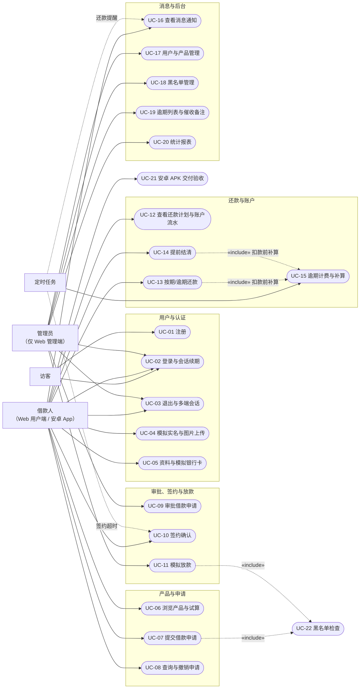
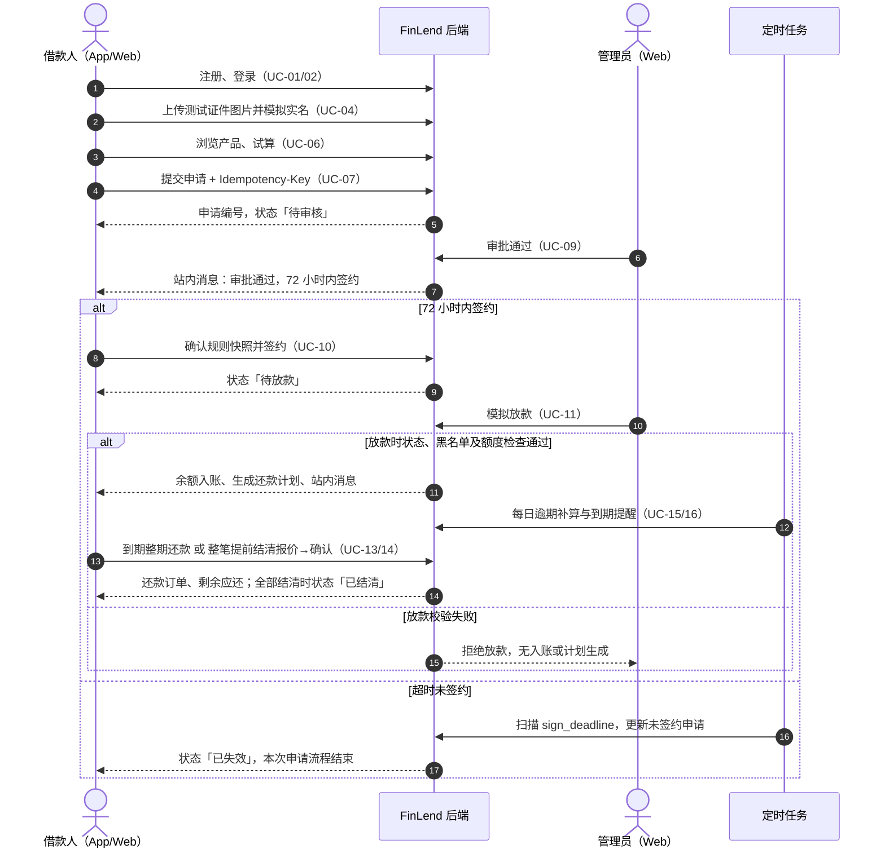
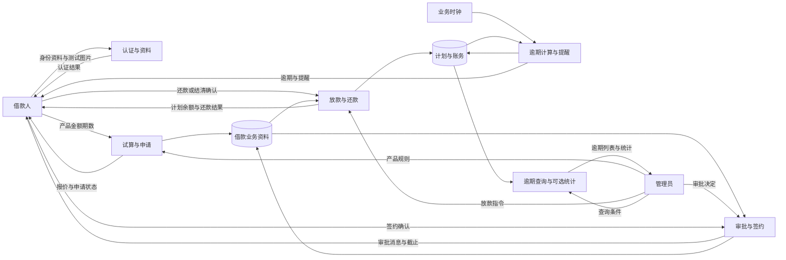
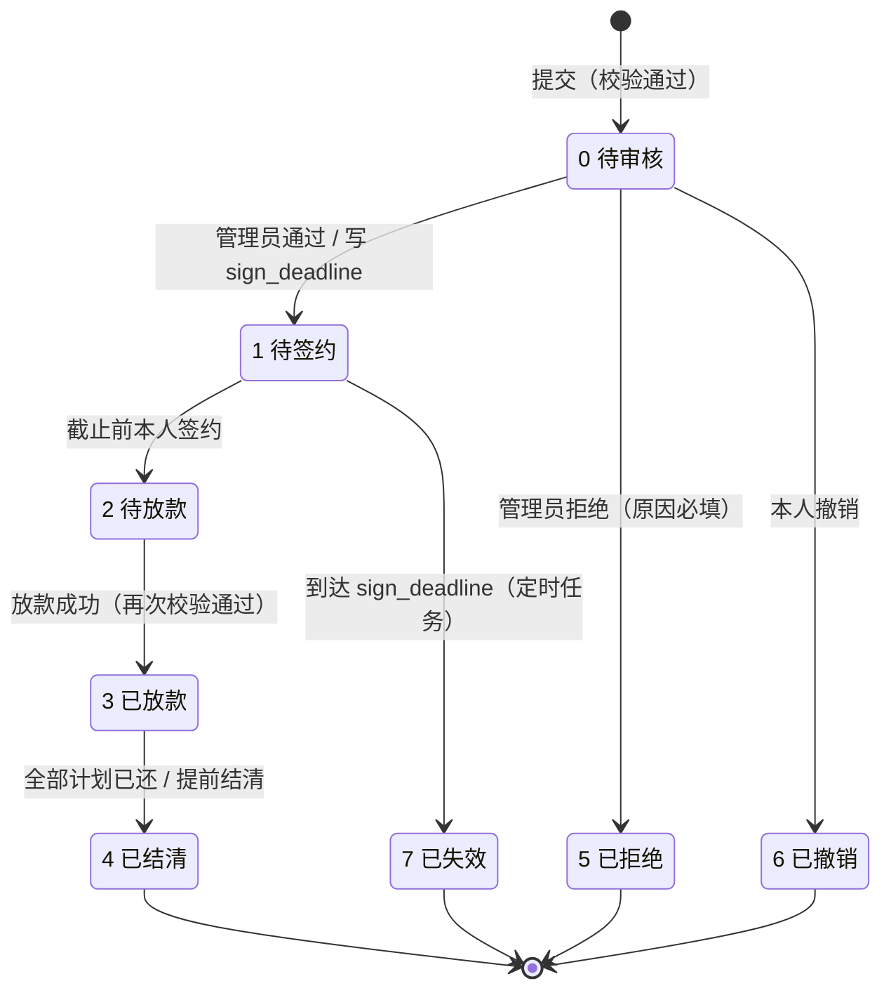
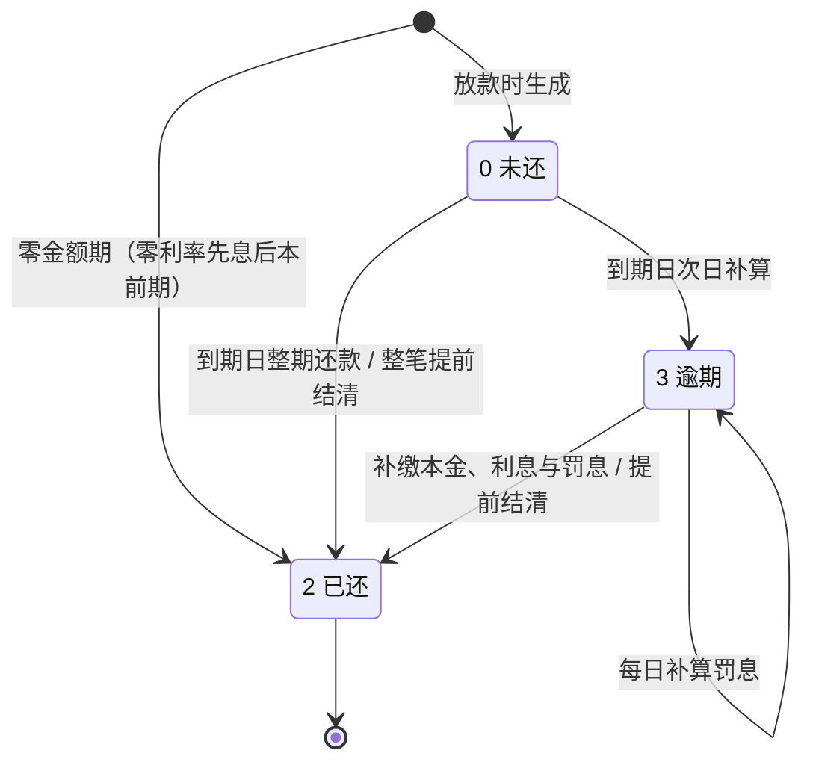
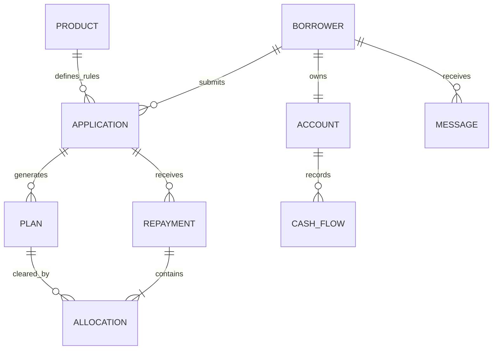
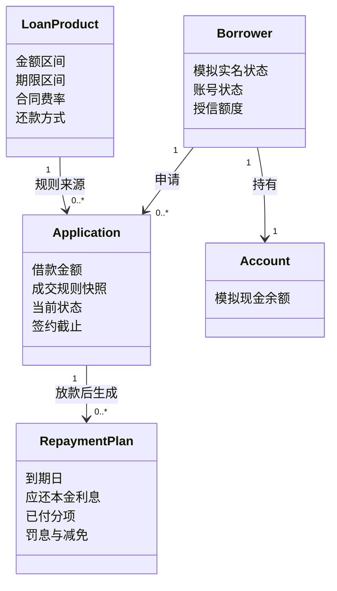

# 借贷软件平台（FinLend）需求分析报告

| 项目 | 内容 |
| --- | --- |
| 产品名称 | 借贷软件平台 FinLend |
| 项目类型 | 高校综合设计1课程设计 |
| 报告版本 | v1.2 |
| 产品版本 | 本学期v1.0演示系统 |
| 初次编制日期 | 2026年10月12日 |
| 本次修订日期 | 2026年11月1日 |
| 依据 | docs/02 功能需求分析v1.1 |
| 状态 | 需求稿，待团队评审；仓库尚无应用实现与实测结果 |

本报告规定FinLend应提供的服务、业务规则、外部交互和验收条件，供课程评审、开发与测试共同使用。本学期交付Web借款人端、Web管理端和安卓借款人APK，使用虚构资料与模拟资金完成借还闭环。架构、模块、数据库和程序流程分别见[概要设计报告](../概要设计报告/借贷软件平台概要设计报告.md)与[详细设计报告](../详细设计报告/借贷软件平台详细设计报告.md)。

业务口径以[02 功能需求分析](../docs/02-功能需求分析.md)v1.1为依据，调整须同步相关报告。性能与规模为计划验收目标，不是测试结论。保留原模板正文的10章结构；“系统用例设计”按模板正文要求独立为第4章，后续编号顺延。原FR、UC、BR和TC编号继续用于追踪。

# 1. 引言

## 1.1 编写目的

定义FinLend v1.0的需求范围，明确借款人和管理员可执行的操作、操作条件、金额计算、异常结果与验收标准，为概要设计、详细设计、编码和测试提供依据。

产品以注册认证、借款申请、审批签约、模拟放款、按期或逾期还款及结清为主线。成功标准是流程可演示、金额可核对、权限与异常行为可验证；信用评分、动态授信和多源风控不作为本期真实决策能力交付。

本报告保留计算公式、输入输出与验算示例，因为这些内容决定用户应还多少，且原模板要求明确计算过程。程序类名、接口路径、锁和事务步骤、物理表结构、任务配置、打包命令不作为本报告正文内容。

## 1.2 项目风险

| 风险承担者 | 主要风险 | 需求层面的控制 |
| --- | --- | --- |
| 课程组与指导教师 | 交付范围、验收标准与课程要求不一致 | 三端与必需功能明确列出，待确认项记录责任与节点 |
| 4人开发团队 | 需求过大或业务规则不一致，引起返工和延期 | 区分P0、P1及后续预留；金额规则提供固定示例 |
| 模拟借款人与管理员 | 错误金额、越权读取、重复扣款、结果未知 | 规定本人资源隔离、金额确认、重复请求及异常后果 |
| 部署维护人员 | 数据无法恢复、演示材料或APK无法复现 | 要求安装说明、恢复对账、设备与构建记录 |

金额错误、重复记账与超额放款属于高风险，必须验证。安卓交付、人员实际工时与依赖兼容性在早期确认，不能以只完成Web替代本期范围。

## 1.3 文档约定

**排版约定**

- 正文使用中文；业务术语与专业缩略语首次出现时给出英文原词，并在 §7 词汇表统一解释。
- 需求以表格形式逐条列出；图表统一使用 Mermaid 绘制，便于随代码一并版本化。
- 计算规则以**带缩进的算式块**给出，并附**验算基准**（给定输入与预期输出），供实现与测试双向核对。

**符号约定**

| 符号 | 含义 |
| --- | --- |
| ⚠️ | 本项目**不采用**的技术、方案或做法，列出以示区分 |
| 〔计划〕 | 该指标为**计划验收指标**，尚无实测结果 |
| 〔预留〕 | 本期只保留接口或数据结构设计，**不实现**，不作为本期通过条件 |
| ★ | 本期**必须交付**的 P0 项 |

**需求编号规则**

| 类型 | 格式 | 示例 | 说明 |
| --- | --- | --- | --- |
| 功能需求组 | `FR-<模块代号>-<序号>` | `FR-AUTH-01` | §5.1 组织功能范围，附录 A 关联用例、页面与来源 |
| 原子功能需求 | `FR-<模块代号>-<序号>-<子序号>` | `FR-AUTH-01-01` | 附录 B 为逐项验收规格，每条显式给出优先级与测试编号 |
| 验证用例 | `TC-<模块代号>-<序号>-<子序号>` | `TC-AUTH-01-01` | 与原子需求一一对应，验证步骤与预期结果见附录 B |
| 非功能需求 | `NFR-<类别>-<序号>` | `NFR-PERF-01`、`NFR-SEC-01` | 见 §6.1 及 §6.2~§6.4 |
| 业务规则 | `BR-<序号>` | `BR-10` | 见 §6.5；规则本身不是功能需求 |
| 用例 | `UC-<序号>` | `UC-07` | 见 §4；一个用例可对应多条原子功能需求 |
| 激励/响应 | `ES-<序号>` | `ES-11` | 见 §5.2 |
| 数据项 | 大驼峰 / 下划线英文名 | `AnnualRate` / `annual_rate` | 见 §8；实现时沿用同一英文名 |
| 待定问题 | `Q-<序号>` | `Q-11` | 见 §10 |

**模块代号**

`AUTH` 用户与认证 · `PROD` 贷款产品 · `LOAN` 借款申请 · `RISK` 风控与信用评估 · `LEND` 放款与账户 · `REPAY` 还款 · `FILE` 附件 · `ADMIN` 后台管理 · `MSG` 消息通知 · `APP` 安卓端交付。

**优先级定义**：高 / 中 / 低三档，与《02》§9 的 P0 / P1 / 后续预留对应（P0 = 高，P1 = 中，后续预留 = 低）。

**需求继承性**：高层次需求（如「支持完整借贷流程」）可被其细化的需求继承；**每条细化需求各自具有独立的优先级**，不因父需求为高优先级而自动获得高优先级。

**编号映射说明**：本报告的 `FR-*` 编号用于报告内部追踪，与《02》的模块化编号或章节**按业务含义建立对应关系**（对照列见 §5.1、汇总矩阵见附录 A）。附录 B 的子需求按对应需求组追溯到来源，属于细化关系而非一一映射。既有外部报告中的旧 `FR-*` 编号**不在本次自动重编**。

## 1.4 预期读者和阅读建议

| 读者 | 建议重点 |
| --- | --- |
| 指导教师和需求评审者 | 第1、2章范围；第4、5章用例和功能；第6章验收目标 |
| 开发人员 | 第3章外部接口需求；第5章输入输出及金额规则；第8章业务数据 |
| 测试人员 | 第5章异常路径、第6章非功能要求、附录B逐项验收场景 |
| 项目协调者 | 第10章待定问题，附录A需求追踪关系 |
| 用户文档编写者 | 第2章角色、第4章用例、第6.6节用户文档 |

文档依次包含引言、综合描述、外部接口需求、系统用例设计、系统功能需求、其它非功能需求、词汇表、数据定义、分析模型和待定问题；附录A用于需求组追踪，附录B保留193条原子需求与对应测试编号。架构和实现阅读分别转至两份设计报告。

## 1.5 产品范围

**产品描述**：一个**基础的借贷软件平台**。借款人可通过 Web 用户端或本学期交付的安卓 App 注册、完成模拟实名、浏览贷款产品、试算、提交借款申请并签约，在放款后按期还款或提前结清；管理员在 Web 管理端管理用户、贷款产品、审批流程、放款与逾期催收；系统按固定业务规则计算利息与罚息，并保证重复请求与并发操作后的账务结果一致。

**产品目标（与业务策略的联系）**：本项目不以商业收益衡量成果。它服务于三项课程目标——① 用一条完整业务链展示多角色状态流转；② 用金额计算与重复操作的正确结果展示「关键业务规则正确」；③ 用「Web + 安卓双端共用一套 API」展示跨端一致性与接口契约协作。因此产品的成功判据是**闭环可演示、金额可核对、规则可验证**，而不是用户量、放款规模或风险指标。

**利益**：团队成员获得从需求分析到 APK 交付的完整工程经历；产出可复用的接口契约、数据库迁移、测试基准与部署手册。

**范围边界**

| 类别 | 内容 |
| --- | --- |
| 必须交付 | 注册登录与会话续期、模拟实名与测试图片上传、产品浏览与管理、额度试算、申请/撤销/签约、审批、模拟放款、还款计划、按期与逾期还款、提前结清、逾期罚息、账户与流水、站内消息、**Web 基础后台管理**、**安卓 APK** |
| 配套交付 | 可重复的数据初始化与恢复材料、接口契约、测试记录与算例、安装部署指南与用户手册、演示与答辩材料 |
| 可选增强 | 统计图表与导出、催收备注、模拟充值页面（提供有来源的基础演示资金） |
| 后续扩展 | 信用评分与动态额度、多数据融合风控、小程序、厂商推送、真实身份核验、真实资金通道（本期只预留接口/表设计） |
| 本期排除 | 真实放贷与真实资金划转、真实征信与身份核验、真实个人敏感资料采集、任意部分还款、银行卡自动扣款 |

**非作用领域**（避免误解）：本产品**不是**真实的借贷服务，不满足金融业务的合规要求，不产生任何真实债权债务；本产品的信用分 60 与等级 C 是**模拟默认值**，不代表任何真实信用评估结果；本产品的「余额」是演示用模拟现金，不是可提现资金。

## 1.6 参考文献

| 编号 | 资料 | 版本与来源 | 用途 |
| --- | --- | --- | --- |
| R1 | 软件需求分析报告文档模板 | 用户提供，rubbish bin目录 | 章节、用例、计算过程与数据定义要求 |
| R2 | 02 功能需求分析 | v1.1，docs/02 | 功能和业务规则基线 |
| R3 | 00 可行性分析报告 | docs/00 | 项目定位及开发约束 |
| R4 | 04 团队分工与开发规范、06 扩展与演进规划、07 审阅记录与待验证事项 | docs/04、06、07 | 团队、交付和待验证条件 |
| R5 | 借贷软件平台概要设计报告 | v1.0，概要设计报告目录 | 系统架构、模块职责及总体数据关系 |
| R6 | 借贷软件平台详细设计报告 | v1.0，详细设计报告目录 | 部件、协议、物理数据与界面实现设计 |

需求报告不将模板示例、框架特性或尚未实测的环境配置视为已经批准的业务要求。

# 2. 综合描述

## 2.1 产品的状况

FinLend是自主开发的课程演示产品，不是已有商业系统的替换或升级版本。Web与安卓提供同一借款人业务，管理员通过Web处理产品、用户、申请和放款。系统独立保存演示数据，不依赖外部机构的授信或资金服务。

外部关系包括浏览器、安卓设备、服务端数据存储及测试附件存储。验证码通过演示通道提供，不接短信网关；身份核验、银行卡和账户余额均须明确显示模拟性质。不连接真实支付清算、征信、人脸识别或厂商推送。

## 2.2 产品的功能

本节从**业务层面**概略总结产品功能，详细规格见 §5。括号内为对应用例范围。

**F1 用户与认证**（UC-01~UC-05）★
访客注册；借款人登录、会话续期与退出；模拟实名认证与测试证件图片上传；个人资料维护与模拟银行卡管理（绑定、删除、设置唯一默认卡）；账户信息查询（余额、授信、可用额度）。

**F2 贷款产品与试算**（UC-06）★
借款人浏览上架产品列表与详情（金额与期限范围、年利率、还款方式、罚息与提前结清费率）；使用后端返回的逐期计划与应还总额进行试算。管理员创建、修改与上下架产品。

**F3 借款申请与签约**（UC-07、UC-08、UC-10）★
选择产品、试算、填写金额/期限/用途后提交申请；查询本人申请列表与详情；在「待审核」状态撤销申请；审批通过后在 72 小时内确认签约。

**F4 审批与放款**（UC-09、UC-11）★
管理员的待审批列表与详情查看；通过/拒绝审批（拒绝原因必填）；签约超时自动置为已失效；管理员对「待放款」申请执行模拟放款。

**F5 还款与逾期**（UC-12~UC-15）★
查看还款计划；对**最早到期的整期债务**发起按期或逾期还款；整笔提前结清（先报价后确认）；按日计提逾期罚息并支持漏跑补算；查看还款订单与分摊明细。

**F6 账户与流水**（UC-12）★
查看模拟现金余额、账户流水（含演示初始化流水、放款入账、还款出账）；每笔业务有可追踪编号。

**F7 后台管理**（UC-17~UC-19 必需；UC-20 可选）
用户查询/冻结/解冻；产品管理；黑名单管理；逾期借款列表；统计报表（放款总额、待还总额、逾期率、用户数）。

**F8 站内消息**（UC-16）★
审批结果、放款成功、到期前 3 天提醒、逾期提醒的站内消息；未读数与已读状态；App 前台 30 秒轮询未读数。

**F9 风控与信用接口**（UC-07、UC-08、UC-12、UC-18、UC-22）★
黑名单检查为**本期唯一真实执行的风控规则**；评分/决策/数据源/信用分接口返回带 `is_mock=true` 的模拟值，仅用于联调，**不能覆盖**实名、冻结、黑名单或额度检查，也不等于管理员审批通过。

**F10 安卓端交付**（UC-21）★
复用上述借款人必需功能（含签约与撤销入口）；签名 APK 在指定真机完成一次安装与完整借还流程；管理操作在 Web 演示。

**F11 后续扩展**〔预留〕
动态信用评分、动态授信额度、多源数据融合风控与可解释决策、小程序、厂商推送。本期只保留接口形状与表结构设计，不实现，见 [docs/06](../docs/06-扩展与演进规划.md) §3。

**非作用领域**：本产品提供**借款**方向业务，不含存款/理财/授信外的资金归集业务；不含面向第三方的开放 API 与对外对账；不含真实催收、法律与征信报送流程。

## 2.3 用户类和特性

| 用户类 | 重要程度 | 特征 | 使用终端 | 技术熟练度 | 关键诉求 |
| --- | --- | --- | --- | --- | --- |
| 借款人 | 重要 | 模拟自然人或小微经营者；全部为虚构身份演示账户；关注「能不能借、还多少、怎么还」 | Web 用户端 **或** 安卓 App | 一般 | 应还金额准确、状态清晰、操作可回退（撤销/查到结果） |
| 管理员 | 重要 | 平台运营人员，本期只有 `ADMIN` 一种角色；由演示初始化提供，不开放公开注册 | **仅 Web 管理端** | 较高 | 待办集中、审批有依据、逾期可见、操作可留痕（意见/原因） |
| 定时任务 | 次要 | 系统内部参与者：签约超时扫描、逾期罚息补算、还款提醒生成 | 无界面 | — | 可补算、可重跑、不重复计费/不重复发消息 |
| 课程组/评委 | 附加 | 通过报告、演示与产物（APK、接口文档、测试记录）获取产品数据与服务 | 文档与演示环境 | 高 | 需求可追溯、规则有算例、交付可复现 |
| 运维/部署者（团队内兼职） | 附加 | 通过部署手册和初始化恢复材料获得系统服务 | 命令行 / 主机 | 高 | 空库可初始化、备份可还原、依赖版本可锁定 |

**说明**

- 「用户不一定是软件产品的直接使用者」——课程组/评委与运维者通过**报表、接口文档、部署脚本**获得产品的数据与服务，因此作为附加用户类列出其需求（结果可复现、文档齐全），详见 §6.6 与 §6.2 NFR-SEC-11。
- 借款人**未完成模拟实名不能发起借款申请**；账号被冻结后不能登录、续期、申请或放款，但既有债务与罚息继续存在。
- 管理员权限**每次调用校验**，不能以客户端传入的角色字段获得权限。

## 2.4 运行环境

| 环境 | 需求 |
| --- | --- |
| 服务端 | 团队现有PC，Windows含WSL2或Linux；能运行统一后端、数据库、缓存和任务服务 |
| Web终端 | Chrome或Edge；用户端和管理端均在浏览器操作 |
| 安卓终端 | 至少一台可安装签名APK的Android真机；最低版本和机型在M1冻结 |
| 网络 | 演示局域网内浏览器和安卓设备可访问同一服务 |
| 数据与文件 | 业务数据可持久保存、备份恢复；测试附件可授权读取 |

建议服务端可用内存不少于4GB、可用磁盘不少于10GB，仍需按实际环境确认。完整运行时版本、安装路径、端口与构建工具配置由详细设计第2章和部署记录管理。

## 2.5 设计和实现上的限制

| 限制 | 原因与影响 |
| --- | --- |
| 本学期必须交付两个Web使用角色及安卓APK | 属于已采用的课程范围，安卓不能延期后用H5截图替代 |
| 延续Python/FastAPI、Vue3、uni-app及MySQL技术方案 | 团队已按此组织学习与分工；具体分层、依赖和存储机制由设计报告落实 |
| 只使用虚构身份、测试证件图片、模拟卡与模拟资金 | 确保教学演示范围一致，不引入真实资料或真实金融服务 |
| 金额精确到分，结果由后端统一确定 | 防止三端产生不同应还金额；禁止金额精度静默丢失 |
| 管理员操作只在Web提供，借款人只访问本人资源 | 保持角色边界，不增加安卓管理端 |
| 业务日期统一北京时间 | 到期、罚息和签约截止不受客户端时区影响 |
| 不实现任意部分还款、自动银行卡扣款与真实风控 | 控制本期复杂度；扩展需先评审变更 |
| 密钥、真实身份资料和签名私钥不进入项目交付仓库 | 防止敏感资料随演示文档与代码传播 |

上述为需求层面的约束。事务隔离、锁顺序、数据库字段、服务进程组织和文件存储步骤在设计报告中规定，不在此重复。

## 2.6 假设和约束（依赖）

| 编号 | 假设或依赖 | 验证节点与责任 | 不成立时的处理 |
| --- | --- | --- | --- |
| A-01 | 4人可投入12周；每周每人6至8小时只是估算 | M1，全员 | 先移除P1，重排任务；范围调整经课程评审 |
| A-02 | 团队有人能承担安卓开发并获得Web协助 | M1，前端与全栈 | 早期结对完成首个真机包 |
| A-03 | 有安卓真机和可互访局域网 | M1，全栈 | 调整演示设备和网络，保留安装验证 |
| A-04 | 现有PC可运行服务端及数据存储 | M1，后端 | 记录实际资源配置并验证基础能力 |
| A-05 | 课程接受模拟身份、模拟资金和模拟风控边界 | 范围评审，全员 | 额外要求按变更评估，不声称已获认可 |
| A-06 | 安卓构建签名链路可用 | M1，全栈 | 核对账号、网络及工具条件，形成构建记录 |
| A-07 | 用户具备基本浏览器和智能手机操作能力 | 演示准备，前端 | 提供用户指南和操作提示 |
| A-08 | 50个演示用户、20并发适合课程验收 | M1确认，M4实测 | 调整验收样本并记录依据 |

复用现有设备、不购买云服务为当前经费假设，实际发生的构建与辅助工具费用单独记录。详细进度和人员配置放入概要设计第8章，不在需求中指定每周编码任务。

# 3. 外部接口需求

## 3.1 用户界面

### 3.1.1 通用界面标准（三端共同遵守）

| 编号 | 标准项 | 要求 |
| --- | --- | --- |
| UI-01 | 语言 | 全部界面文案为简体中文；金额统一显示为「¥ 12,000.00」两位小数格式，利率显示为「12.00%」 |
| UI-02 | 模拟标识 | 实名认证页、银行卡页、风控结果区、账户余额区必须显示「模拟」标识，明确不是真实核验/真实资金 |
| UI-03 | 权威金额 | 所有应还金额、试算结果、结清报价只展示**后端返回值**；客户端不得自行计算并展示为最终金额 |
| UI-04 | 必填与校验 | 必填项以星号标注；前端即时校验格式（手机号、18 位证件号、金额区间），但**以后端校验结果为准** |
| UI-05 | 加载与防重复 | 写操作按钮点击后进入加载态并禁用，直到收到结果；**前端禁用只是交互措施，不替代服务端幂等** |
| UI-06 | 错误信息 | 错误提示以「发生了什么 + 用户可以做什么」两段给出，例如「可用额度不足（当前可用 ¥3,000.00）。请降低借款金额。」；不展示堆栈、SQL 或内部代码 |
| UI-07 | 结果未知 | 网络超时或断网时显示「结果待确认」，提供「查询结果」按钮；**不得自动换新幂等键重发扣款类请求** |
| UI-08 | 会话失效 | 收到 401 时自动续期一次；续期失败则提示「登录已失效，请重新登录」并跳转登录页，保留非敏感表单内容 |
| UI-09 | 状态展示 | 申请状态用 §5.1 规定的 8 个中文名称；逾期以计划级标签「逾期 N 天」展示，不作为申请状态 |
| UI-10 | 脱敏展示 | 手机号显示 `138****8888`；证件号显示前 3 后 4；银行卡号只显示后四位 |
| UI-11 | 危险操作确认 | 还款、提前结清、放款、拒绝、冻结、拉黑操作必须二次确认，确认框中重复展示金额或对象 |
| UI-12 | 无障碍 | 表单控件有可读标签；颜色不是状态的唯一表达（同时有文字）；文字与背景对比度满足常规可读要求（完整 WCAG 符合性需人工评审，本期不承诺） |
| UI-13 | 时间显示 | 统一显示北京时间（Asia/Shanghai），格式 `YYYY-MM-DD HH:mm`；到期日仅显示日期 |

### 3.1.2 Web 用户端（借款人）逻辑界面

必须覆盖注册登录、资料与模拟实名、产品浏览试算、申请列表与详情、撤销签约、账户流水、还款计划与结清、消息。申请详情显示规则快照与签约截止；还款界面分别列出本金、利息、罚息和费用。页面布局与路由归入详细设计第6章。

### 3.1.3 Web 管理端（管理员）逻辑界面

提供独立管理登录、用户产品管理、黑名单、审批、放款及逾期列表。审批拒绝要求原因，放款与冻结等操作二次确认。统计图表、导出和催收备注为可选增强。

### 3.1.4 安卓 App（借款人）逻辑界面

覆盖全部借款人必需业务，包含撤销与签约入口。断网、会话过期和操作结果未知均有明确提示；重启后的会话恢复不要求重新输入有效会话的密码。管理操作不在安卓提供。

### 3.1.5 键盘快捷键与功能按钮约定

Web表单可用Enter提交当前合法表单，Esc关闭可取消弹窗；不得绕过危险操作确认。按钮使用明确动作名称；写请求处理中显示加载状态并防止连续点击。具体组件选择不在需求报告规定。

## 3.2 硬件接口

系统通过操作系统提供的文件选择或相册能力获取测试图片，安卓可使用真机现有相机能力选择测试素材，不要求专用摄像头、读卡器、定位或生物识别设备。图片及其类型、大小是需要交换的数据；设备安装和网络访问必须在指定真机验证。

## 3.3 软件接口

### 3.3.1 与外部软件组件的接口

| 外部组件 | 数据或服务 | 外部需求 |
| --- | --- | --- |
| 浏览器与安卓客户端 | 表单、测试图片、查询与操作结果 | 使用同一业务口径，客户端不能直接读写数据库 |
| MySQL数据存储 | 用户、借款、计划、账务与会话等 | 业务持久化、完整性与恢复后对账 |
| Redis临时状态服务 | 演示验证码与访问频率信息 | 不因不可用而跳过所需安全校验 |
| 测试附件存储 | 本人测试证件图片 | 授权读取，不公开他人资料 |

MySQL主版本8.0沿用现有技术约束；Redis及完整补丁版本由M1环境清单记录。驱动、ORM、数据库端口及目录配置见详细设计第2章。

### 3.3.2 后端对客户端提供的服务

需要提供身份认证与会话、个人资料与模拟实名、产品与试算、申请与审批签约、模拟放款、账户流水、还款结清、附件、消息、用户名单管理及模拟风控数据服务。每类服务的输入输出见第5、8章，权限见第2.3节及各用例。具体HTTP路径、方法、请求模型与错误码映射统一在详细设计第5章管理。

## 3.4 通讯接口

客户端与服务端通过HTTP请求响应交换UTF-8数据，正式部署使用HTTPS；隔离局域网演示的明文例外须显式配置。业务响应说明成功、失败及可理解的原因；未知结果不得由客户端推定为已成功或已失败。

金额以十进制字符串表达到分，费率以百分数字符串表达，标识使用字符串以避免大整数精度丢失；日期为YYYY-MM-DD，时刻带北京时间偏移。图片单文件不超过5MiB，仅JPEG/PNG。列表支持分页并保持稳定顺序。

关键写请求须标识同一次逻辑操作。相同主体、操作、键和内容重试返回原结果，同键不同内容拒绝；网络超时后保留原操作标识。访问凭证放请求头，不放URL。未授权、权限不足、状态冲突、金额变化、参数错误、限流和服务不可用须可区分；完整协议字段及HTTP映射见详细设计。

消息采用前台主动查询，间隔30秒；进入后台停止，恢复前台立即刷新。无后台实时推送要求。响应时效见第6.1节，不预先指定未实测的网络带宽或吞吐量。

# 4. 系统用例设计

## 4.1 参与者

| 参与者 | 类型 | 说明 |
| --- | --- | --- |
| 访客 | 主要参与者 | 未登录的使用者，只能注册与登录 |
| 借款人 | 主要参与者 | 已注册用户，可使用 **Web 用户端或安卓 App**；未实名不能申请，冻结后不能登录 |
| 管理员 | 主要参与者 | 平台运营人员，**仅在 Web 管理端**操作，负责产品、审批、放款、黑名单与用户管理 |
| 定时任务 | 次要参与者 | 系统内部时钟驱动的参与者：签约超时扫描、逾期罚息补算、还款提醒 |

参与者说明：访客注册并登录后以借款人身份使用系统；这是认证状态的变化，不表示 UML 参与者泛化。管理员与借款人是独立主体，两类主体 ID 命名空间独立。

## 4.2 用例图



**图注**

- 实线箭头表示参与者发起用例；标注 «include» 的虚线表示必须执行的共享检查；其余虚线表示定时任务的次要参与。UC-22 只读取名单并返回校验结果，不执行 UC-18 的名单管理操作。未实名申请被拒绝并引导至 UC-04，是申请用例的异常路径，不画作 «extend»。
- UC-21 是交付验收用例：借款人在安卓真机上走通 UC-01→UC-14 的主路径，管理员在 Web 配合 UC-09、UC-11。
- 用例的权限隔离：借款人用例只能操作**本人资源**；管理员用例每次调用校验管理员身份。

## 4.3 用例清单

| 用例编号 | 用例名称 | 主要参与者 | 次要参与者 | 归属模块 | 对应需求组 | 优先级 | 负责人 |
| --- | --- | --- | --- | --- | --- | --- | --- |
| UC-01 | 注册 | 访客 | — | 用户与认证 | FR-AUTH-01 | 高 | 后端 A |
| UC-02 | 登录与会话续期 | 借款人/管理员 | — | 用户与认证 | FR-AUTH-02、FR-AUTH-07 | 高 | 后端 A |
| UC-03 | 退出与多端会话 | 借款人/管理员 | — | 用户与认证 | FR-AUTH-03 | 高 | 后端 A |
| UC-04 | 模拟实名与图片上传 | 借款人 | — | 用户与认证 | FR-AUTH-04、FR-FILE-01 | 高 | 后端 A |
| UC-05 | 资料与模拟银行卡 | 借款人 | — | 用户与认证 | FR-AUTH-05 | 高 | 后端 A |
| UC-06 | 浏览产品与试算 | 借款人 | — | 产品与申请 | FR-PROD-01、FR-LOAN-01 | 高 | 后端 B |
| UC-07 | 提交借款申请 | 借款人 | — | 产品与申请 | FR-LOAN-02、FR-PROD-03、FR-RISK-01、FR-RISK-05 | 高 | 后端 B |
| UC-08 | 查询与撤销申请 | 借款人 | — | 产品与申请 | FR-LOAN-03、FR-RISK-02 | 高 | 后端 B |
| UC-09 | 审批借款申请 | 管理员 | — | 审批与签约 | FR-LOAN-04 | 高 | 后端 B |
| UC-10 | 签约确认 | 借款人 | 定时任务 | 审批与签约 | FR-LOAN-05 | 高 | 后端 B |
| UC-11 | 模拟放款 | 管理员 | — | 放款 | FR-LEND-01、FR-REPAY-01 | 高 | 后端 B |
| UC-12 | 查看还款计划与账户流水 | 借款人 | — | 还款与账户 | FR-AUTH-06、FR-LEND-02、FR-LEND-03、FR-REPAY-06、FR-RISK-03、FR-RISK-04 | 高 | 后端 B |
| UC-13 | 按期/逾期还款 | 借款人 | — | 还款 | FR-REPAY-02、FR-REPAY-05 | 高 | 后端 B |
| UC-14 | 提前结清 | 借款人 | — | 还款 | FR-REPAY-03、FR-REPAY-05 | 高 | 后端 B |
| UC-15 | 逾期计费与补算 | 定时任务 | 借款人 | 还款 | FR-REPAY-04 | 高 | 后端 B |
| UC-16 | 查看消息通知 | 借款人 | 定时任务 | 消息 | FR-MSG-01、FR-MSG-02 | 高 | 后端 A |
| UC-17 | 用户与产品管理 | 管理员 | — | 后台管理 | FR-ADMIN-01、FR-PROD-02 | 高 | 后端 A |
| UC-18 | 黑名单管理 | 管理员 | — | 后台管理 | FR-RISK-05 | 高 | 后端 A |
| UC-19 | 逾期列表与催收备注 | 管理员 | — | 后台管理 | FR-ADMIN-02 | 高 | 后端 A |
| UC-20 | 统计报表 | 管理员 | — | 后台管理 | FR-ADMIN-03 | 中 | 后端 A |
| UC-21 | 安卓 APK 交付验收 | 借款人 | 管理员 | 安卓端交付 | FR-APP-01 | 高 | 全栈 |
| UC-22 | 黑名单检查 | 借款人/管理员（经申请或放款流程触发） | — | 风控 | FR-RISK-05 | 高 | 后端 A/B |

## 4.4 参与者与用例的交互概述

下图给出验收主路径「App 申请 → Web 审批 → App 签约 → Web 放款 → App 还款/结清」中参与者与系统的交互顺序，具体步骤见 §5.4 各用例描述。



---

# 5. 系统功能需求

## 5.1 需求组说明和优先级

> **需求粒度**：本节的 36 个 FR 编号为功能需求组，用于组织业务范围。表中的验收摘要包含多个场景，不作为一条原子需求或一条测试用例。附录 B 将每组拆成具有唯一编号、明确条件和单一验收场景的原子功能需求；每条对应一个 TC 编号。某个场景可以同时检查必要的账务不变量，但成功、非法输入、越权、过期、并发等独立场景分别编号。附录 B 是本报告逐项验收的规格。
> **优先级**：高 / 中 / 低，对应《02》§9 的 P0 / P1 / 后续预留。业务口径以《02》v1.1 为准。

### 5.1.1 用户与认证（AUTH）

| 需求组编号 | 需求名称 | 优先级 | 需求说明 | 验收摘要（逐项判据见附录 B） | 《02》编号 |
| --- | --- | --- | --- | --- | --- |
| FR-AUTH-01 | 注册 | 高 | 账号和手机号各自唯一；注册成功同时具备唯一用户与账户，默认授信50000.00、余额0；验证码经演示通道提供，5分钟过期且单次有效 | 用有效验证码注册成功后，查询可核对恰有 1 个用户与 1 个账户、授信 = 50000.00；同一验证码二次使用、超时验证码、重复账号/手机号均被拒绝 | AUTH-01 |
| FR-AUTH-02 | 登录 | 高 | 借款人与管理员从各自入口登录；正确密码且账号正常才建立会话，返回有效期2小时的访问凭证 | 正确密码登录成功并返回两种令牌；错误密码、冻结账号登录被拒绝；借款人凭证调用管理员登录入口失败 | AUTH-02 |
| FR-AUTH-03 | 退出与多端会话 | 高 | Web与App会话独立；退出立即使当前会话的访问及刷新凭证失效，不影响其他有效设备会话 | 同一账号 Web 与 App 各自登录后，App 退出；App 旧 access/refresh token 立即不可用，Web 会话仍可正常访问 | AUTH-03 |
| FR-AUTH-04 | 模拟实名 | 高 | 提交姓名、18位虚构证件号与本人测试证件图片，格式通过后标记模拟实名；界面说明不是实际身份核验 | 合规输入提交后用户被标记为模拟实名；证件号非 18 位、引用他人上传的 `file_id` 时被拒绝 | AUTH-04 |
| FR-AUTH-05 | 资料与模拟银行卡 | 高 | 修改本人资料；绑定/删除模拟卡；同一用户最多一张默认卡；银行卡不参与资金划转 | 连续把两张卡分别设为默认后，该用户恰好只有 1 张默认卡；还款与放款流程不读取银行卡 | AUTH-05 |
| FR-AUTH-06 | 账户查询 | 高 | 返回本人余额、授信、可用额度（按BR-10计算）；信用分标注为模拟 | 放款 10000.00 后，可用额度减少 10000.00、余额增加 10000.00；归还一期本金后可用额度按归还本金同步增加 | AUTH-06 |
| FR-AUTH-07 | 会话轮换与吊销 | 高 | 续期后旧刷新凭证失效；会话固定7天不延长；冻结立即终止全部会话，后续业务请求不得继续通过 | 用刷新令牌 R1 换得 R2 后，再用 R1 刷新失败；会话第 7 天到期后 R2 失效；管理员冻结后该用户所有 access token 立即返回 401/403 | AUTH-02/03 |

### 5.1.2 贷款产品（PROD）

| 需求组编号 | 需求名称 | 优先级 | 需求说明 | 验收摘要（逐项判据见附录 B） | 《02》编号 |
| --- | --- | --- | --- | --- | --- |
| FR-PROD-01 | 产品列表与详情 | 高 | 借款人只看到上架产品，并可读金额期限区间、年利率、还款方式、罚息与结清费率 | 列表接口只返回 上架状态 的产品，且每项包含上述 6 类字段 | PROD-01 |
| FR-PROD-02 | 产品管理 | 高 | 管理员创建/修改/上下架；校验 0 < 最小金额 ≤ 最大金额、1 ≤ 最短期限 ≤ 最长期限、费率非负；下架后不能新增申请 | 最小金额大于最大金额的产品创建失败；产品下架后，对其提交申请返回 409 | PROD-02 |
| FR-PROD-03 | 规则快照 | 高 | 每产品指定一种还款方式，本期年利率上下限相等；申请时复制年利率、罚息日利率、提前结清费率与还款方式 | 申请提交后修改产品年利率，该申请详情与放款生成的计划仍使用提交时的利率 | PROD-03 |

### 5.1.3 借款申请与审批（LOAN）

| 需求组编号 | 需求名称 | 优先级 | 需求说明 | 验收摘要（逐项判据见附录 B） | 《02》编号 |
| --- | --- | --- | --- | --- | --- |
| FR-LOAN-01 | 试算 | 高 | 按§5.3.2业务算式返回逐期本金利息和总额；试算不产生借款，金额以服务端结果为准 | P=12000.00、年利率 12.0000、12 期等额本息试算结果与 §5.3.2 ⑦ 验算基准逐期一致 | LOAN-01 |
| FR-LOAN-02 | 提交申请 | 高 | 校验已模拟实名、未冻结、不在黑名单、产品上架、金额/期限在区间内且 ≤ 可用额度；同一用户最多一笔待审核申请；**提交校验不承诺放款成功** | 满足条件的申请创建为「待审核」；未实名、黑名单、超可用额度、已有待审核申请四种情况各自被拒绝且不产生申请记录 | LOAN-02 |
| FR-LOAN-03 | 查询与撤销 | 高 | 仅本人可查询本人申请；只有「待审核」状态可撤销 | 用户 A 查询用户 B 的申请返回 403/404；「待审核」申请撤销后为「已撤销」；「待签约」申请撤销返回 409 | LOAN-03 |
| FR-LOAN-04 | 审批 | 高 | 管理员单次通过或拒绝待审核申请；拒绝原因必填；通过后72小时内可签约；并发审批只有一个有效结果 | 两个管理员会话并发审批同一申请，最终只有一次状态变更与一个有效审批结果；不填原因的拒绝被拒绝 | LOAN-04 |
| FR-LOAN-05 | 签约与超时 | 高 | 本人在截止前确认规则快照后转待放款；到达截止仍未签约则失效；截止之后不能签约或放款 | 截止前签约成功；将时钟推至截止时刻后，签约返回 409；执行超时任务后申请为「已失效」，放款接口拒绝该申请 | LOAN-05 |

### 5.1.4 风控与信用评估（RISK）

| 需求组编号 | 需求名称 | 优先级 | 需求说明 | 验收摘要（逐项判据见附录 B） | 《02》编号 |
| --- | --- | --- | --- | --- | --- |
| FR-RISK-01 | 风控评估（模拟） | 高 | 提供明确标为模拟的PASS、60分、C等级及用户当前授信；模拟结果不改变申请状态，不覆盖真实业务校验 | 对黑名单用户调用评估返回 PASS 且 `is_mock=true`，但该用户提交申请仍被拒绝 | 4.4 |
| FR-RISK-02 | 风控决策查询（模拟） | 高 | 校验申请存在与归属后返回模拟决策，不伪造持久化历史 | 本人查询本人申请返回模拟决策；查询他人申请返回 403/404 | 4.4 |
| FR-RISK-03 | 信用分查询（模拟） | 高 | 返回默认模拟信用分60、等级C，明确模拟性质，不作为真实信用评价 | 任意借款人调用均返回 60、C、`is_mock=true` | 4.4 |
| FR-RISK-04 | 授信额度查询 | 高 | 返回**用户当前实际配置的授信**，不做动态计算，不接受客户端指定额度 | 管理员将授信调为 30000.00 后，该用户查询结果为 30000.00（不是常量 50000.00） | 4.4 |
| FR-RISK-05 | 黑名单 | 高 | 管理员加入（原因必填）/移出黑名单；黑名单用户的新申请与放款被拒绝；**允许其查询并偿还既有债务**（本期唯一真实执行的风控规则） | 将已有「待放款」申请与一笔已放款借款的用户拉黑：放款被拒绝、新申请被拒绝，但其对既有借款的还款成功 | 4.4 |

### 5.1.5 放款与账户（LEND）

| 需求组编号 | 需求名称 | 优先级 | 需求说明 | 验收摘要（逐项判据见附录 B） | 《02》编号 |
| --- | --- | --- | --- | --- | --- |
| FR-LEND-01 | 模拟放款 | 高 | 只有待放款且借款人正常、非黑名单、额度足够的申请可放款；成功同时增加模拟余额、形成一笔放款流水与完整计划并通知；任何失败不部分记账 | 用户两笔「待放款」申请合计超过可用额度时，依次放款：第一笔成功（余额 + 金额、1 条流水、n 期计划），第二笔被拒绝且无任何数据变更 | LEND-01 |
| FR-LEND-02 | 余额与流水 | 高 | 余额代表模拟现金；流水展示入账出账、业务编号和记账后余额，余额与流水可核对 | 完成「初始化 → 放款 → 还款一期」后，账户余额 = 全部流水金额之和，且最后一条流水 `balance_after` = 当前余额 | LEND-02 |
| FR-LEND-03 | 演示资金 | 高 | 演示初始资金有对应流水，重复初始化不重复增加现金；准备资金足够覆盖指定演示费用；无真实充值扣卡 | 在同一环境重复初始化演示数据，演示用户余额与初始化流水条数不变 | LEND-03 |

### 5.1.6 还款（REPAY）

| 需求组编号 | 需求名称 | 优先级 | 需求说明 | 验收摘要（逐项判据见附录 B） | 《02》编号 |
| --- | --- | --- | --- | --- | --- |
| FR-REPAY-01 | 生成还款计划 | 高 | 放款生成约定期数且不重期，各期本金合计精确等于借款额；到期日按BR-13；零金额期不要求还款且不产生逾期 | 对三种还款方式各放款一笔 12000.00/12 期：每笔恰好 12 期、本金合计 = 12000.00；1 月 31 日放款的第 1、2 期到期日为 2 月末与 3 月 31 日 | REPAY-01 |
| FR-REPAY-02 | 按期/逾期还款 | 高 | 一次还款结清**最早一笔未还计划**的全部到期应还额（本金 + 利息 + 罚息）；最早未还期尚未到期时须改用提前结清；不接受任意部分还款或超额扣款 | 还款成功后最早未还期状态为「已还」、余额减少额 = 该期应还额；提交金额小于或大于应还额均返回 409 且余额不变 | REPAY-02 |
| FR-REPAY-03 | 提前结清 | 高 | 整笔提前结清先报价再确认；金额变化需重新确认；未来及当期未计收利息记录为减免，结清费独立展示与记录 | 按 §5.3.2 ⑨ 算例（2026-01-01 放款、2026-01-11 结清）报价为 12039.45；按该报价确认成功后申请「已结清」、减免利息 = 计划总利息 − 39.45 | REPAY-03 |
| FR-REPAY-04 | 逾期计费与补算 | 高 | 逐日计算逾期未还本金罚息；漏处理日期可补算，同日重复执行不重复收费；还款当天若逾期也计一天 | 漏处理3天后补算为3倍日罚息，同日再次处理总额不变 | REPAY-04 |
| FR-REPAY-05 | 还款记录与原子性 | 高 | 一次成功还款具有一个可追踪业务结果及逐期分项，余额、计划、流水与记录一致生效；失败不得出现部分扣款 | 模拟一次还款处理中断；账户、计划和记录均不出现部分结果；用原操作标识重试成功后只扣一次 | REPAY-05 |
| FR-REPAY-06 | 还款记录查询 | 高 | 本人查询还款计划、订单与分摊明细（分项本金/利息/罚息/减免） | 一笔提前结清订单的分摊明细条数 = 结清时未还期数，且订单金额 = 分摊现金合计 + 违约金 | REPAY-05 |

> 说明：旧版报告草稿把提前结清列为「中」。《02》§9 与 docs/07 §2 已明确「提前结清纳入必需项」（P0），本报告据此取**高**。

### 5.1.7 附件（FILE）

| 需求组编号 | 需求名称 | 优先级 | 需求说明 | 验收摘要（逐项判据见附录 B） | 《02》编号 |
| --- | --- | --- | --- | --- | --- |
| FR-FILE-01 | 图片上传与附件读取 | 高 | 仅接受真实格式为JPEG/PNG且不超过5MiB的虚构测试图片；附件只供所属用户或授权管理员读取，不公开存储位置 | 上传 4 MiB PNG 成功并返回 `file_id`；6 MiB 文件返回 413；改扩展名的 PDF 返回 415；用户 B 读取用户 A 的附件返回 403/404 | 4.1、06 §2.5 |

### 5.1.8 后台管理（ADMIN）

| 需求组编号 | 需求名称 | 优先级 | 需求说明 | 验收摘要（逐项判据见附录 B） | 《02》编号 |
| --- | --- | --- | --- | --- | --- |
| FR-ADMIN-01 | 用户管理 | 高 | 查询用户（脱敏）；冻结/解冻；调整授信但不得低于当前占用额；冻结吊销全部会话、**不清除欠款、不停止罚息** | 冻结有逾期借款的用户：其会话失效，次日罚息照常累加；将其授信调低到小于未还本金被拒绝 | 4.7 |
| FR-ADMIN-02 | 逾期列表与催收备注 | 高 | 列出存在逾期计划的借款（借款人、期次、逾期天数、应还罚息），属 P0；**催收备注为可选增强**（P1），不计入本条验收 | 构造 1 笔逾期、1 笔正常借款，逾期列表只返回前者且逾期天数正确 | 4.7 |
| FR-ADMIN-03 | 统计报表 | 中 | 放款总额、待还总额、逾期率、用户数，口径按 BR-18；显示计数与统计时间；图表与导出为可选 | 在已知演示数据上，四项统计值与手工按 BR-18 计算的结果一致；无已放款借款时逾期率显示 0% | 4.7 |

### 5.1.9 消息（MSG）

| 需求组编号 | 需求名称 | 优先级 | 需求说明 | 验收摘要（逐项判据见附录 B） | 《02》编号 |
| --- | --- | --- | --- | --- | --- |
| FR-MSG-01 | 站内消息 | 高 | 审批结果、放款成功、到期前 3 天、逾期提醒写入站内消息；同一用户同一事件只生成一次；支持已读状态 | 同一业务日连续运行两次提醒任务，每个到期计划只有 1 条提醒消息；标记已读后未读数减 1 | 4.8 |
| FR-MSG-02 | 未读数轮询 | 高 | App 前台每 30 秒查询未读数，进入消息页刷新，退到后台停止，恢复前台立即刷新；不要求后台实时推送 | App 退到后台 2 分钟期间服务端未收到该设备的未读数请求；回到前台后 1 秒内发出一次请求 | 4.8 |

### 5.1.10 安卓端交付（APP）

| 需求组编号 | 需求名称 | 优先级 | 需求说明 | 验收摘要（逐项判据见附录 B） | 《02》编号 |
| --- | --- | --- | --- | --- | --- |
| FR-APP-01 | 安卓端交付 | 高 | 复用全部借款人必需功能（含签约与撤销入口）；刷新令牌存安全存储；断网保留非敏感表单；结果未知时先查结果或用原键重试；签名 APK 安装 | 在指定 Android 真机安装签名 APK，走通「App 申请 → Web 审批 → App 签约 → Web 放款 → App 还款至结清」，App 与 Web 显示的金额与状态一致 | 4.9 |

### 5.1.11 功能需求组优先级汇总

| 模块 | 高 | 中 | 低 | 合计 |
| --- | --- | --- | --- | --- |
| AUTH | 7 | 0 | 0 | 7 |
| PROD | 3 | 0 | 0 | 3 |
| LOAN | 5 | 0 | 0 | 5 |
| RISK | 5 | 0 | 0 | 5 |
| LEND | 3 | 0 | 0 | 3 |
| REPAY | 6 | 0 | 0 | 6 |
| FILE | 1 | 0 | 0 | 1 |
| ADMIN | 2 | 1 | 0 | 3 |
| MSG | 2 | 0 | 0 | 2 |
| APP | 1 | 0 | 0 | 1 |
| **合计** | **35** | **1** | **0** | **36** |

**本期可选增强（P1，P0 全部通过后才安排）**：统计报表对应 FR-ADMIN-03；统计图表、导出、催收备注和模拟充值页面未作为独立原子需求纳入本次验收，实施前须补需求、契约和测试。
**后续预留（不在本期验收范围）**：真实信用评分与动态额度、多数据融合风控、小程序、厂商推送——本期须交付 FR-RISK-01~05 的模拟接口、实际配置授信查询及黑名单能力；真实评分与多源评估不在本期范围。

## 5.2 激励／响应序列

| 编号 | 激励 | 可观察的系统响应 | 关联需求 |
| --- | --- | --- | --- |
| ES-01 | 请求演示验证码 | 返回演示验证码或频率提示，验证码5分钟有效且仅可使用一次 | FR-AUTH-01 |
| ES-02 | 提交注册资料 | 有效且唯一则创建用户与账户；无效则说明原因且不创建重复账户 | FR-AUTH-01 |
| ES-03 | 登录 | 凭据正确且账号正常则建立对应设备会话，否则拒绝 | FR-AUTH-02 |
| ES-04 | 会话访问过期 | 可续期则恢复并继续原操作；失败提示重新登录 | FR-AUTH-07 |
| ES-05 | 退出 | 当前设备会话立即失效，其他有效会话不变 | FR-AUTH-03 |
| ES-06 | 上传测试图片 | 返回可用于本人认证的附件标识，超限或格式不符拒绝 | FR-FILE-01 |
| ES-07 | 提交模拟实名 | 格式与附件归属有效则标记模拟实名 | FR-AUTH-04 |
| ES-08 | 浏览并试算产品 | 显示有效产品规则和后端计算的逐期金额 | FR-PROD-01、FR-LOAN-01 |
| ES-09 | 提交申请 | 条件满足则进入待审核，并保留成交规则；否则不产生申请 | FR-LOAN-02 |
| ES-10 | 撤销 | 本人待审核可撤销，其他状态拒绝 | FR-LOAN-03 |
| ES-11 | 审批 | 通过进入待签约且告知截止，拒绝保留原因并通知 | FR-LOAN-04 |
| ES-12 | 签约或截止到达 | 截止前本人签约进入待放款；到期未签失效 | FR-LOAN-05 |
| ES-13 | 模拟放款 | 重新核对状态与额度，成功入账并生成计划；失败无部分变化 | FR-LEND-01 |
| ES-14 | 普通还款 | 按最早到期未还整期金额确认；成功后债务减少、余额减少且可查记录 | FR-REPAY-02/05 |
| ES-15 | 提前结清 | 先提供分项报价，确认有效后整笔结清，旧报价不扣款 | FR-REPAY-03 |
| ES-16 | 业务日推进 | 逾期罚息计至当日；漏跑可补、重跑不重复 | FR-REPAY-04 |
| ES-17 | 打开或阅读消息 | 显示本人消息与未读数，可标记本人消息已读 | FR-MSG |
| ES-18 | 冻结、调额或拉黑 | 权限与规则通过才生效；既有债务不因管理动作消失 | FR-ADMIN-01、FR-RISK-05 |
| ES-19 | 网络中断且结果未知 | 提示待确认，查询结果或沿用原操作标识重试，不重复扣款 | BR-16、FR-APP-01 |

## 5.3 输入／输出数据

### 5.3.1 关键功能的输入、处理与输出

| 功能 | 输入及来源 | 处理依据 | 输出 |
| --- | --- | --- | --- |
| 注册 | 访客账号、模拟手机号、密码、验证码 | 唯一性、验证码与密码要求 | 用户编号、零余额账户与默认授信 |
| 登录续期 | 对应主体凭据或刷新凭证 | 账号与会话有效性 | 访问及刷新凭证、有效期 |
| 模拟实名 | 姓名、虚构证件号、本人测试图片 | 格式与归属 | 模拟认证结果 |
| 产品试算 | 产品、金额、期数 | 产品规则与§5.3.2 | 各期本金利息与总额；实际到期日以放款后为准 |
| 提交申请 | 本人选择的产品金额期数用途 | BR-02至04、BR-10 | 申请编号、待审核状态、规则快照 |
| 审批签约 | 管理员决定原因、本人确认 | BR-05、BR-06 | 审批结果、签约截止及状态 |
| 放款 | 管理员选定申请 | BR-03、BR-10、BR-11 | 入账结果、流水、完整计划 |
| 普通还款 | 本人借款与确认金额 | 最早到期期的本金利息罚息 | 还款编号、分项、余额与剩余债务 |
| 提前结清 | 本人借款、报价后确认金额 | §5.3.2⑨ | 本金、到期利息罚息、日息、费用、减免与结清结果 |
| 逾期处理 | 业务日期与未清债务 | §5.3.2⑧ | 截至当日罚息、逾期天数与提醒 |
| 查询及统计 | 当前身份、筛选分页条件 | 资源归属、BR-18 | 本人列表；管理员逾期列表和可选统计 |

逐项数据的含义、类型、格式与范围见第8章；HTTP路径、传输模型与字段错误格式由详细设计第5章统一规定。

### 5.3.2 计算方法

**① 利率、精度与日期约定**

```
年利率以百分数存储：     7.2000 表示 7.2%
月利率：                 r = annual_rate / 100 / 12
罚息日利率：             penalty_daily_rate 同为百分数，0.0500 表示 0.05%/日
运算：                   十进制精确运算，不允许分位精度损失
舍入：                   四舍五入，每一期金额分别保留到 0.01 元（「逐期舍入」）
业务时区：               Asia/Shanghai
首期到期日：             放款日期 + 1 个自然月
第 k 期到期日：          放款日期 + k 个自然月（每期都从原放款日推算，不从上期到期日递推）
月末规则：               目标月不存在该日时取该月最后一天
                         例：1 月 31 日放款 → 第 1 期 2 月 28 日（闰年 29 日）、第 2 期 3 月 31 日
逾期起算：               到期日当天可还；到期日次日起为逾期；不因节假日顺延
```

**② 等额本息**（每期月供固定）

```
第 1 步  A = round( P × r × (1+r)^n / ((1+r)^n − 1) )
第 2 步  第 k 期利息 I_k = round( 期初剩余本金 × r )
第 3 步  第 k 期本金 C_k = A − I_k                    （k = 1 … n−1）
第 4 步  剩余本金 ← 剩余本金 − C_k，回到第 2 步
平账     第 n 期本金 C_n = P − (C_1 + … + C_{n−1})；第 n 期月供 = C_n + I_n，可因舍入与 A 略有差异
```

**③ 等额本金**

```
第 k 期本金 C_k = round(P / n)                       （k = 1 … n−1）
第 n 期本金 C_n = P − (n−1) × round(P / n)            （平账）
第 k 期利息 I_k = round( 期初剩余本金 × r )
```

**④ 先息后本**

```
第 k 期利息 I_k = round(P × r)                       （k = 1 … n）
第 1 … n−1 期本金为 0；第 n 期本金 = P
```

**⑤ 零利率分支**

```
annual_rate = 0 时：等额本息改用 A = round(P / n)，避免公式除零；三种方式利息均为 0
零利率先息后本的第 1 … n−1 期为零金额计划：生成时直接标记「已还」，不创建零金额扣款，也不产生逾期
```

**⑥ 参数组合合法性**

```
若某一期出现 C_k < 0，或在第 n 期之前剩余本金已 ≤ 0（极小本金 / 过长期数组合）
→ 试算与提交均拒绝该参数组合（422），不生成计划
```

**⑦ 验算基准**（P = 12000.00，annual_rate = 12.0000，r = 0.01，n = 12；文档数值验算基准，不代表软件实现已通过测试）

| 方式 | 预期结果 |
| --- | --- |
| 等额本息 | A = 1066.19；前 11 期月供 **1066.19**，末期平账月供 **1066.14**，总利息 **794.23** |
| 等额本金 | 每期本金 1000.00；首期利息 120.00（月供 1120.00），末期利息 10.00（月供 1010.00），总利息 **780.00** |
| 先息后本 | 每期利息 120.00；前 11 期月供 120.00，末期 12120.00，总利息 **1440.00** |

等额本息逐期明细（测试用例可直接比对）：

| 期数 | 期初剩余本金 | 利息 | 本金 | 月供 | 期末剩余本金 |
| --- | --- | --- | --- | --- | --- |
| 1 | 12000.00 | 120.00 | 946.19 | 1066.19 | 11053.81 |
| 2 | 11053.81 | 110.54 | 955.65 | 1066.19 | 10098.16 |
| 3 | 10098.16 | 100.98 | 965.21 | 1066.19 | 9132.95 |
| 4 | 9132.95 | 91.33 | 974.86 | 1066.19 | 8158.09 |
| 5 | 8158.09 | 81.58 | 984.61 | 1066.19 | 7173.48 |
| 6 | 7173.48 | 71.73 | 994.46 | 1066.19 | 6179.02 |
| 7 | 6179.02 | 61.79 | 1004.40 | 1066.19 | 5174.62 |
| 8 | 5174.62 | 51.75 | 1014.44 | 1066.19 | 4160.18 |
| 9 | 4160.18 | 41.60 | 1024.59 | 1066.19 | 3135.59 |
| 10 | 3135.59 | 31.36 | 1034.83 | 1066.19 | 2100.76 |
| 11 | 2100.76 | 21.01 | 1045.18 | 1066.19 | 1055.58 |
| 12 | 1055.58 | 10.56 | 1055.58 | 1066.14 | 0.00 |
| 合计 | — | 794.23 | 12000.00 | 12794.23 | — |

**⑧ 逾期罚息与补算**

计费对象为已过到期日且未清偿的该期本金，不对利息和罚息复利。日罚息=四舍五入到分（逾期未还本金×罚息日利率÷100）；总罚息按每个尚未计费的逾期日累加。到期日当天、未来期与已还期不新增罚息。先息后本纯利息期逾期时本金为零，该期罚息为零，但仍显示逾期。

本期不允许任意部分还款，单期未清偿期间本金固定。漏处理k天应补k份日罚息，同日重复处理总额不变。还款当日若已逾期也计一天，成功还清后停止该期计费。例：本金1000.00、日利率0.0500%，每日0.50，连续3天合计1.50。计费进度字段和补算程序见详细设计C10。

**⑨ 提前结清**（仅整笔结清，三种方式均适用）

```
结清金额 S = ① 全部未还本金
           + ② 到期（含当日）计划的未还利息与未还罚息（先按 ⑧ 补算到当日）
           + ③ 当期日息：下一笔未到期计划的
                 起息日剩余本金 × annual_rate / 100 / 365 × 已经过的自然日
                 且不超过该期未付计划利息
                 起息日 = 上期到期日；首期为放款日；当天放款当天结清，日息为 0
           + ④ 违约金 = 未还本金 × prepay_fee_rate / 100（默认费率 0）
减免       未来期利息与当期未计收部分记为 waived_interest，保留原计划利息，不覆盖
费用       违约金独立记入还款订单 prepay_fee，不能伪装成本金或罚息
特例       若已到最后到期日，按全额到期结清处理，不收违约金
流程       返回报价（不扣款）→ 用户提交确认金额 + 幂等键 → 后端重新核对当前金额
           → 金额一致才扣款；不一致返回 409，不能按过期报价扣款
例         P = 12000.00、年利率 12.0000%、2026-01-01 放款、2026-01-11 结清、费率 0
           ① 12000.00  ② 0.00（未有到期期）  ③ 12000 × 12 / 100 / 365 × 10 = 39.45  ④ 0.00
           S = 12039.45；等额本息下 waived_interest = 794.23 − 39.45 = 754.78
```

**⑩ 授信额度与余额**

```
已占用额度 = Σ(已放款未结清计划的 principal − paid_principal)
可用额度   = max(0, credit_line − 已占用额度)
只按未还本金占用，归还本金后立即释放；利息与罚息不占授信
授信 ≠ 余额：放款使余额增加、还款使余额减少；申请/审批/签约不扣现金、不预占额度
放款时重新核对可用额度，多笔待放款申请也不得合计超额
管理员调整授信：新 credit_line 不得低于当前已占用额度
```

**⑪ 应还余额**（单期与汇总）

```
单期应还余额 = principal − paid_principal + interest − paid_interest − waived_interest + penalty − paid_penalty
用户待还总额 = Σ 单期应还余额（status ≠ 已还）
订单金额     = Σ 分摊(本金 + 利息 + 罚息) + prepay_fee        （减免不参与现金扣款）
```

## 5.4 用例描述

按模板要求的 12 项要素逐一描述 22 个用例。「场景描述」写主成功路径，「异常处理」按编号列出备选与失败路径。

#### UC-01 注册

| 要素 | 内容 |
| --- | --- |
| 用例名 | 注册 |
| 简述 | 访客填写账号、手机号、密码并通过演示验证码，系统创建借款人用户与唯一账户 |
| 主要参与者 | 访客 |
| 情景目标 | 成功创建一个状态正常、未实名、授信 50000.00、余额 0.00 的借款人账号 |
| 前提条件 | 访客未登录；账号与手机号未被占用 |
| 触发事件 | 访客在注册页点击「注册」 |
| 场景描述 | 1) 获取演示验证码；2) 填写账号、模拟手机号和密码；3) 系统验证唯一性与验证码；4) 成功后具备唯一账号和零余额账户，授信50000.00；5) 提示进入登录。 |
| 异常处理 | ① 账号或手机号已存在 → 拒绝，提示更换；② 验证码错误/过期/已使用 → 提示重新获取；③ 密码 UTF-8 超过 72 字节 → 拒绝，**明确拒绝不截断**；④ 请求过于频繁 → 拒绝；⑤ 必要服务不可用 → 稍后重试 |
| 优先级 | 高 |
| 使用频率 | 低（每个用户一次） |
| 次要参与者 | — |
| 未明确的问题 | 验证码长度与冷却时长为本报告补充默认值（6 位、60 秒），见 Q-18 |

#### UC-02 登录与会话续期

| 要素 | 内容 |
| --- | --- |
| 用例名 | 登录与会话续期 |
| 简述 | 借款人或管理员凭账号密码登录取得令牌；access token 过期时由客户端用 refresh token 自动续期 |
| 主要参与者 | 借款人（Web/App）、管理员（Web，独立入口） |
| 情景目标 | 获得有效会话并持续访问，直至主动退出或会话 7 天到期 |
| 前提条件 | 账号存在且状态正常 |
| 触发事件 | 点击「登录」；或任一业务请求返回 401 |
| 场景描述 | 1) 从对应用户或管理入口输入凭据；2) 系统确认账号正常且密码正确；3) 建立独立设备会话；4) 凭证过期时在有效会话内续期；5) 续期失败提示重新登录。 |
| 异常处理 | ① 密码错误 → 提示「账号或密码错误」（不区分哪一项）；② 账号冻结 → 拒绝；③ refresh token 已轮换/吊销/过期 → 清除会话跳转登录；④ 多个请求并发 401 → 共用同一次刷新；⑤ 借款人账号访问管理员入口 → 拒绝 |
| 优先级 | 高 |
| 使用频率 | 高 |
| 次要参与者 | — |
| 未明确的问题 | 登录失败次数限流阈值未在 docs 中给出，见 Q-18 |

#### UC-03 退出与多端会话

| 要素 | 内容 |
| --- | --- |
| 用例名 | 退出与多端会话 |
| 简述 | 用户在某一端退出，系统只吊销该端会话，其他端会话保持有效 |
| 主要参与者 | 借款人、管理员 |
| 情景目标 | 当前端的 access/refresh token 立即失效，其他端不受影响 |
| 前提条件 | 用户已在至少一端登录 |
| 触发事件 | 点击「退出登录」 |
| 场景描述 | 1) 选择退出；2) 当前会话立即终止；3) 本机凭证清除并进入登录页；4) 其他正常设备会话继续有效。 |
| 异常处理 | ① 网络失败 → 客户端仍清除本地令牌并提示「已在本机退出」，会话在 7 天后自然到期；② 会话已被冻结吊销 → 直接跳转登录 |
| 优先级 | 高 |
| 使用频率 | 中 |
| 次要参与者 | — |
| 未明确的问题 | 无 |

#### UC-04 模拟实名与图片上传

| 要素 | 内容 |
| --- | --- |
| 用例名 | 模拟实名与图片上传 |
| 简述 | 借款人上传虚构测试证件图片并填写虚构姓名与 18 位证件号，系统格式检查后标记为模拟实名 |
| 主要参与者 | 借款人 |
| 情景目标 | `is_real_name = 1`，获得提交借款申请的资格 |
| 前提条件 | 已登录、账号正常、尚未实名 |
| 触发事件 | 在实名认证页点击「提交认证」；或提交申请时因未实名被引导至此（申请异常路径） |
| 场景描述 | 1) 阅读模拟认证提示；2) 选择虚构测试图片；3) 填写虚构姓名与18位证件号；4) 系统校验格式与附件归属；5) 显示模拟实名成功。 |
| 异常处理 | ① 图片 > 5 MiB → 拒绝；② 非 JPEG/PNG 或扩展名与内容不符 → 拒绝；③ 证件号非 18 位 → 拒绝；④ `file_id` 不属于本人 → 拒绝；⑤ 已实名 → 拒绝；⑥ 文件写入成功但落库失败 → 清理文件并提示重试 |
| 优先级 | 高 |
| 使用频率 | 低（每用户一次） |
| 次要参与者 | — |
| 未明确的问题 | 是否校验 18 位证件号的校验位：docs 只要求「格式检查」，本报告按长度与字符集检查，不校验校验位，见 Q-19 |

#### UC-05 资料与模拟银行卡

| 要素 | 内容 |
| --- | --- |
| 用例名 | 资料与模拟银行卡 |
| 简述 | 借款人修改个人资料，绑定/删除模拟银行卡并设置默认卡 |
| 主要参与者 | 借款人 |
| 情景目标 | 资料更新成功；银行卡列表中至多一张默认卡 |
| 前提条件 | 已登录 |
| 触发事件 | 在个人中心点击「保存」「添加银行卡」「删除」「设为默认」 |
| 场景描述 | 1) 更新本人允许编辑资料；2) 保存后可查询相同值；3) 绑定虚构模拟卡；4) 设置至多一张默认卡；5) 展示卡号后四位；6) 删除本人卡。 |
| 异常处理 | ① 同一卡号重复绑定 → 拒绝；② 月收入为负 → 拒绝；③ 删除默认卡 → 删除后该用户无默认卡；④ 页面明示「模拟银行卡不参与资金划转」 |
| 优先级 | 高 |
| 使用频率 | 低 |
| 次要参与者 | — |
| 未明确的问题 | 无 |

#### UC-06 浏览产品与试算

| 要素 | 内容 |
| --- | --- |
| 用例名 | 浏览产品与试算 |
| 简述 | 借款人浏览上架产品，选择金额与期限，由后端返回逐期还款计划和总额 |
| 主要参与者 | 借款人 |
| 情景目标 | 借款人在提交前获知准确的月供、总利息与应还总额 |
| 前提条件 | 已登录；存在上架产品 |
| 触发事件 | 进入产品页；点击「试算」 |
| 场景描述 | 1) 浏览上架产品；2) 查看金额期限与费率；3) 输入金额期数试算；4) 显示后端逐期本金利息和总额；5) 提示实际日期以放款计划为准。 |
| 异常处理 | ① 金额或期限超出区间 → 拒绝 并显示允许范围；② 参数组合导致负本金 → 拒绝；③ 产品已下架 → 提示刷新列表 |
| 优先级 | 高 |
| 使用频率 | 高 |
| 次要参与者 | — |
| 未明确的问题 | 试算是否需要登录：本报告按「需登录」处理（访客权限仅为注册/登录，见 §2.3） |

#### UC-07 提交借款申请

| 要素 | 内容 |
| --- | --- |
| 用例名 | 提交借款申请 |
| 简述 | 借款人选择产品并填写金额、期限、用途，系统校验后创建「待审核」申请并保存规则快照 |
| 主要参与者 | 借款人（Web 用户端或安卓 App） |
| 情景目标 | 成功创建一笔状态为「待审核」的借款申请 |
| 前提条件 | 已登录；已模拟实名；账号正常；不在黑名单；产品上架；当前无其它待审核申请 |
| 触发事件 | 点击「提交申请」 |
| 场景描述 | 1) 选择产品并试算；2) 填写用途确认申请；3) 系统检查实名、账号、名单、区间、可用额度与待审核唯一；4) 固定成交规则；5) 返回待审核申请编号，说明不保证最终放款。 |
| 异常处理 | ① 未实名 → 引导至 UC-04；② 冻结 → 拒绝；③ 黑名单 → 拒绝并说明「暂不能申请新借款」；④ 超区间或超可用额度 → 拒绝 并显示可用额度；⑤ 已有待审核申请 → 拒绝；⑥ 同键同内容重复提交 → 返回原申请；同键不同内容 → 拒绝；⑦ 网络超时 → 「查询结果」或原键重试 |
| 优先级 | 高 |
| 使用频率 | 高（核心链路） |
| 次要参与者 | — |
| 未明确的问题 | 无（「允许多笔待签约/待放款并存且不预占授信」已按《02》§4.3 采用） |

#### UC-08 查询与撤销申请

| 要素 | 内容 |
| --- | --- |
| 用例名 | 查询与撤销申请 |
| 简述 | 借款人查看本人申请列表与详情，并可撤销「待审核」申请 |
| 主要参与者 | 借款人 |
| 情景目标 | 准确了解申请进度；撤销后申请为「已撤销」 |
| 前提条件 | 已登录；存在本人申请 |
| 触发事件 | 进入「我的借款」；点击「撤销」 |
| 场景描述 | 1) 查看本人申请列表与详情；2) 选择待审核申请撤销；3) 确认后显示已撤销；4) 其他状态不允许撤销。 |
| 异常处理 | ① 访问他人申请 → 拒绝；② 撤销时状态已不是「待审核」（已被审批）→ 拒绝 并刷新详情；③ 重复撤销 → 返回原结果 |
| 优先级 | 高 |
| 使用频率 | 高 |
| 次要参与者 | — |
| 未明确的问题 | 无 |

#### UC-09 审批借款申请

| 要素 | 内容 |
| --- | --- |
| 用例名 | 审批借款申请 |
| 简述 | 管理员查看待审核申请，作出通过或拒绝决定并填写意见 |
| 主要参与者 | 管理员（仅 Web 管理端） |
| 情景目标 | 申请由「待审核」转为「待签约」或「已拒绝」，借款人收到站内消息 |
| 前提条件 | 管理员已登录；申请处于「待审核」 |
| 触发事件 | 点击「通过」或「拒绝」 |
| 场景描述 | 1) 管理员查看待审核详情与模拟信息；2) 选择通过或拒绝；3) 拒绝填写原因；4) 系统保留唯一有效决定及操作人时间；5) 通过后告知72小时签约截止并通知借款人。 |
| 异常处理 | ① 拒绝未填原因 → 阻止提交；② 申请已被撤销或已被他人审批 → 拒绝 并刷新；③ 两名管理员并发审批 → 只有一次状态转换成功；④ 同键重复提交 → 返回原结果 |
| 优先级 | 高 |
| 使用频率 | 高 |
| 次要参与者 | — |
| 未明确的问题 | 是否支持批量审批：本期不实现（Q-09）；本期为单次审批，不支持反复审核 |

#### UC-10 签约确认

| 要素 | 内容 |
| --- | --- |
| 用例名 | 签约确认 |
| 简述 | 借款人在审批通过后 72 小时内确认规则快照并签约；超时由定时任务置为已失效 |
| 主要参与者 | 借款人 |
| 情景目标 | 申请由「待签约」转为「待放款」 |
| 前提条件 | 申请属于本人且为「待签约」；当前时刻 < `sign_deadline` |
| 触发事件 | 点击「确认签约」 |
| 场景描述 | 1) 本人查看已通过申请的成交规则与截止；2) 截止前确认签约进入待放款；3) 达到截止仍未签约的申请失效；4) 失效申请不能签约或放款。 |
| 异常处理 | ① 已到截止时刻 → 拒绝，提示申请已失效；② 定时任务与签约同时发生 → 二者都带原状态条件，只有一方成功；③ 签约后放款前账户被冻结或拉黑 → 签约成功但放款时被拒绝（见 UC-11） |
| 优先级 | 高 |
| 使用频率 | 中 |
| 次要参与者 | 定时任务（每分钟扫描超时，置为「已失效」） |
| 未明确的问题 | 签约是否撤回：本期签约后不可撤回，「待放款」状态无撤销转换（见 §9.2 状态机） |

#### UC-11 模拟放款

| 要素 | 内容 |
| --- | --- |
| 用例名 | 模拟放款 |
| 简述 | 管理员对「待放款」申请执行模拟放款：借款人余额增加，生成放款流水与完整还款计划 |
| 主要参与者 | 管理员 |
| 情景目标 | 申请转为「已放款」；余额、流水、计划、消息一次性正确生成 |
| 前提条件 | 申请为「待放款」；借款人未冻结、不在黑名单；可用额度 ≥ 申请金额 |
| 触发事件 | 在放款中心点击「放款」并二次确认 |
| 场景描述 | 1) 管理员确认申请对象与金额；2) 系统重新检查待放款、账号、名单和可用额度；3) 成功增加模拟余额、形成唯一流水与完整计划；4) 申请显示已放款，借款人收到消息。 |
| 异常处理 | ① 可用额度不足（另一笔已先放款）→ 拒绝，无任何数据变更；② 借款人被冻结或拉黑 → 拒绝，不以过去审批结果绕过；③ 申请状态不是「待放款」→ 拒绝；④ 重复点击或超时重试 → 同键返回原结果，只有一条流水；⑤ 服务暂不可用 → 查询原结果或稍后沿用原操作标识重试 |
| 优先级 | 高 |
| 使用频率 | 中 |
| 次要参与者 | — |
| 未明确的问题 | 放款被拒绝后申请状态是否变化：本期保持「待放款」，由管理员处理后再次放款，见 Q-20 |

#### UC-12 查看还款计划与账户流水

| 要素 | 内容 |
| --- | --- |
| 用例名 | 查看还款计划与账户流水 |
| 简述 | 借款人查看借款的逐期还款计划、还款订单与分摊明细，以及账户余额、授信、可用额度与流水 |
| 主要参与者 | 借款人 |
| 情景目标 | 准确了解每期应还、已还与逾期情况，以及资金变动明细 |
| 前提条件 | 已登录 |
| 触发事件 | 进入「还款」或「账户」页面 |
| 场景描述 | 1) 查看本人借款计划与状态；2) 查看余额、授信、占用与可用额度；3) 按时间查看现金流水及业务编号；4) 核对计划、已付与剩余债务。 |
| 异常处理 | ① 无借款 → 空状态提示并引导至产品页；② 访问他人借款 → 拒绝 |
| 优先级 | 高 |
| 使用频率 | 高 |
| 次要参与者 | — |
| 未明确的问题 | 无 |

#### UC-13 按期/逾期还款

| 要素 | 内容 |
| --- | --- |
| 用例名 | 按期/逾期还款 |
| 简述 | 借款人对最早到期的整期债务发起还款，系统补算罚息、校验金额与余额后原子记账 |
| 主要参与者 | 借款人 |
| 情景目标 | 最早一笔未还计划变为「已还」；若为最后一期则申请变为「已结清」 |
| 前提条件 | 已登录、账号正常（黑名单用户允许还款）；存在已到期（含当日）的未还计划；余额充足 |
| 触发事件 | 点击「还款」 |
| 场景描述 | 1) 选择借款最早到期未还期；2) 查看截至当日本金利息罚息；3) 确认全期金额；4) 系统重新核对金额与余额；5) 成功后显示一次还款结果，余额和债务对应减少；6) 无剩余债务则结清。 |
| 异常处理 | ① 余额不足 → 拒绝，**无部分记账**；② 确认金额与重算结果不一致（如跨日后罚息变化）→ 拒绝 并重新报价；③ 最早未还期尚未到期 → 提示改用提前结清；④ 重复/并发请求 → 只产生一笔订单；⑤ 账号冻结 → 拒绝，需管理员解冻后继续还款；⑥ 依赖不可用 → 拒绝 |
| 优先级 | 高 |
| 使用频率 | 高（核心链路） |
| 次要参与者 | — |
| 未明确的问题 | 无（「不支持任意部分还款」已按《02》基线采用） |

#### UC-14 提前结清

| 要素 | 内容 |
| --- | --- |
| 用例名 | 提前结清 |
| 简述 | 借款人先获取整笔结清报价，确认后系统重算并一次性结清全部剩余计划 |
| 主要参与者 | 借款人 |
| 情景目标 | 申请转为「已结清」，未来期利息记为减免，违约金独立记账 |
| 前提条件 | 申请为「已放款」；余额 ≥ 结清金额 |
| 触发事件 | 点击「提前结清」 |
| 场景描述 | 1) 请求整笔结清报价；2) 查看本金、到期利息罚息、当期日息、费用与减免；3) 确认总额；4) 系统核对当前金额与余额；5) 成功一次扣款并记录逐期清偿和减免；6) 借款显示已结清。 |
| 异常处理 | ① 报价后跨日或发生逾期导致重算结果变化 → 拒绝，要求重新报价；② 余额不足 → 拒绝，无部分记账；③ 已到最后到期日 → 按全额到期结清处理，不收违约金；④ 重复提交 → 返回原结果 |
| 优先级 | 高 |
| 使用频率 | 低 |
| 次要参与者 | — |
| 未明确的问题 | 报价的有效期：本期不设有效期，以确认时重算结果为准 |

#### UC-15 逾期计费与补算

| 要素 | 内容 |
| --- | --- |
| 用例名 | 逾期计费与补算 |
| 简述 | 定时任务每日对已过到期日的未还计划按天增量计提罚息，并生成逾期提醒；还款流程扣款前也调用同一补算服务 |
| 主要参与者 | 定时任务 |
| 情景目标 | 每笔逾期计划的罚息恰好等于「逾期天数 × 日罚息」，不多计、不少计 |
| 前提条件 | 调度器单实例运行；存在 `due_date < 今日` 且未还的计划 |
| 触发事件 | 每日 0 点后调度；或 UC-13/UC-14 扣款前调用 |
| 场景描述 | 1) 业务日推进后识别未清偿逾期计划；2) 逐日计算尚未收费区间；3) 显示截至当日罚息与逾期状态；4) 生成适用提醒；5) 同日重复处理不增加收费。 |
| 异常处理 | ① 同日重跑 → `days = 0`，无变化；② 服务停机漏跑 → 恢复后按未处理天数一次补齐；③ 冻结或黑名单用户 → **照常计费**；④ 先息后本前期纯利息逾期 → 状态为逾期但罚息为 0；⑤ 单个借款处理失败 → 回滚该借款，不影响其他借款 |
| 优先级 | 高 |
| 使用频率 | 高（每日） |
| 次要参与者 | 借款人（接收逾期提醒） |
| 未明确的问题 | 无 |

#### UC-16 查看消息通知

| 要素 | 内容 |
| --- | --- |
| 用例名 | 查看消息通知 |
| 简述 | 借款人查看审批、放款、还款提醒与逾期提醒消息，并标记已读 |
| 主要参与者 | 借款人 |
| 情景目标 | 及时获知业务结果与还款节点，未读数准确 |
| 前提条件 | 已登录 |
| 触发事件 | 进入消息页；App 前台轮询计时到达 30 秒 |
| 场景描述 | 1) 查看本人消息与未读数；2) 打开消息可标已读；3) 前台按30秒更新未读数；4) 后台停止、回前台立即刷新。 |
| 异常处理 | ① App 进入后台 → 停止轮询，恢复前台立即刷新；② 轮询请求失败 → 静默跳过，不弹窗；③ 401 → 按 UC-02 续期 |
| 优先级 | 高 |
| 使用频率 | 高 |
| 次要参与者 | 定时任务（生成到期前 3 天提醒与逾期提醒） |
| 未明确的问题 | 无（不要求后台实时推送；厂商推送为后续扩展） |

#### UC-17 用户与产品管理

| 要素 | 内容 |
| --- | --- |
| 用例名 | 用户与产品管理 |
| 简述 | 管理员查询、冻结/解冻用户并调整授信；创建、修改、上下架贷款产品 |
| 主要参与者 | 管理员 |
| 情景目标 | 用户状态与授信按管理决定生效；产品规则有效且只影响之后提交的申请 |
| 前提条件 | 管理员已登录 |
| 触发事件 | 点击「冻结」「解冻」「调整授信」「新建产品」「保存」「上架/下架」 |
| 场景描述 | 1) 管理员查询脱敏用户；2) 冻结或解冻；3) 调整不低于占用的授信；4) 创建或修改产品有效区间与固定规则；5) 上下架产品；6) 既有申请规则不随修改改变。 |
| 异常处理 | ① 授信调低于已占用额度 → 拒绝；② 产品最小值大于最大值或费率为负 → 拒绝；③ 产品下架后对其新提交申请 → 拒绝，已提交申请不受影响；④ 借款人令牌调用管理接口 → 拒绝 |
| 优先级 | 高 |
| 使用频率 | 中 |
| 次要参与者 | — |
| 未明确的问题 | 无 |

#### UC-18 黑名单管理

| 要素 | 内容 |
| --- | --- |
| 用例名 | 黑名单管理 |
| 简述 | 管理员将用户加入或移出黑名单；申请与放款流程通过 UC-22 读取生效记录 |
| 主要参与者 | 管理员 |
| 情景目标 | 黑名单用户不能新申请、不能被放款，但可查询并偿还既有债务 |
| 前提条件 | 管理员已登录 |
| 触发事件 | 点击「加入黑名单」「移出黑名单」；申请和放款检查由 UC-22 执行 |
| 场景描述 | 1) 管理员选择用户并填写原因加入黑名单；2) 新申请和放款被阻断；3) 已有借款仍可查询偿还；4) 移出后恢复正常新申请资格。 |
| 异常处理 | ① 原因为空 → 阻止提交；② 已在黑名单中 → 提示已存在；③ 黑名单用户已有「待放款」申请 → 放款时被拒绝 |
| 优先级 | 高 |
| 使用频率 | 低 |
| 次要参与者 | — |
| 未明确的问题 | 本期不要求完整的拉黑/移出历史轨迹，只保存最后一次操作人 |

#### UC-19 逾期列表与催收备注

| 要素 | 内容 |
| --- | --- |
| 用例名 | 逾期列表与催收备注 |
| 简述 | 管理员查看当前存在逾期计划的借款；可选地记录催收备注 |
| 主要参与者 | 管理员 |
| 情景目标 | 管理员掌握逾期分布与金额 |
| 前提条件 | 管理员已登录 |
| 触发事件 | 进入「逾期管理」页面 |
| 场景描述 | 1) 查看存在逾期计划的借款；2) 显示借款人、期次、天数与债务分项；3) 若实施P1，可记录催收备注；4) 不执行真实催收。 |
| 异常处理 | ① 无逾期 → 空状态；② 列表数据以最近一次补算结果为准，页面显示补算时间 |
| 优先级 | 高（列表）/ 中（催收备注，可选增强） |
| 使用频率 | 中 |
| 次要参与者 | — |
| 未明确的问题 | 催收备注的数据结构未在 docs/03 中定义，若实施需先补表，见 Q-21 |

#### UC-20 统计报表

| 要素 | 内容 |
| --- | --- |
| 用例名 | 统计报表 |
| 简述 | 管理员查看放款总额、待还总额、逾期率与用户数 |
| 主要参与者 | 管理员 |
| 情景目标 | 统计数值与 BR-18 口径一致，可复核 |
| 前提条件 | 管理员已登录 |
| 触发事件 | 进入工作台或报表页 |
| 场景描述 | 1) 管理员请求统计；2) 按BR-18显示放款、待还、用户数和逾期率；3) 逾期率显示分子分母与时刻；4) 分母零显示0%。本用例为P1。 |
| 异常处理 | ① 分母为零 → 逾期率显示 0%；② 报表响应超过 2 s → 记录为性能缺陷（NFR-PERF-02） |
| 优先级 | 中 |
| 使用频率 | 中 |
| 次要参与者 | — |
| 未明确的问题 | 无 |

#### UC-21 安卓 APK 交付验收

| 要素 | 内容 |
| --- | --- |
| 用例名 | 安卓 APK 交付验收 |
| 简述 | 在指定 Android 真机安装签名 APK，借款人在 App 完成全部借款人流程，管理员在 Web 配合审批与放款 |
| 主要参与者 | 借款人（App） |
| 情景目标 | 证明 APK 可安装、可用，且与 Web 端共享同一业务数据、状态与金额一致 |
| 前提条件 | 已生成签名 APK；真机与服务端处于可互访网络；记录了机型、Android 版本、HBuilderX 版本、包名与版本号 |
| 触发事件 | M4 验收演示 |
| 场景描述 | 1) 在指定真机安装签名APK；2) 登录并完成模拟认证；3) 浏览试算、申请、撤销或签约；4) 管理员在Web审批放款；5) 安卓查看计划、还款或结清、消息与退出；6) 验证重启和弱网行为。 |
| 异常处理 | 验收同时覆盖：① access token 过期后自动续期；② 断网提交还款后恢复网络，用「查询结果」确认只扣一次；③ 快速重复点击「还款」只产生一笔订单；④ 上传非法格式图片被拒绝；⑤ 余额不足被拒绝；⑥ 杀进程重启后仍保持登录（凭证保护验证） |
| 优先级 | 高 |
| 使用频率 | 低（验收时） |
| 次要参与者 | 管理员（Web 管理端） |
| 未明确的问题 | 最低支持的 Android 版本与演示机型在 M1 冻结，见 Q-17 |

---

#### UC-22 黑名单检查

| 要素 | 内容 |
| --- | --- |
| 用例名 | 黑名单检查 |
| 简述 | 申请和放款服务读取用户的生效黑名单记录，决定是否允许继续当前操作 |
| 主要参与者 | 借款人或管理员，通过 UC-07 或 UC-11 触发 |
| 情景目标 | 生效黑名单阻断新申请和放款，未命中名单时继续其余独立业务校验 |
| 前提条件 | 主用例已完成身份与资源归属校验， |
| 触发事件 | UC-07/UC-11 包含调用黑名单检查服务 |
| 场景描述 | 1) 申请或放款时检查目标用户是否在生效黑名单；2) 命中则拒绝相应新业务；3) 未命中继续其余条件判断；4) 检查本身不改变名单资料。 |
| 异常处理 | 命中则拒绝主用例，无新申请或放款入账；数据库不可用返回 503，不放行；既有债务查询和还款不调用本检查作为阻断条件 |
| 优先级 | 高 |
| 使用频率 | 每次新申请和放款 |
| 次要参与者 | — |
| 未明确的问题 | 无；加入/移出名单由 UC-18 执行，不能由本检查代替 |

---

# 6. 其它非功能需求

> 本章所有指标均为**〔计划〕验收指标**，不能视为已测结果。每项给出「提出依据」与「验证方式」，实测结果在 M4 回填测试记录。
> 与《02》§7 的编号对照：NFR-01→NFR-PERF-01/02，NFR-02→NFR-SEC-04/05，NFR-03→NFR-SEC-06/07，NFR-04→NFR-QA-04，NFR-05→NFR-QA-06，NFR-06→NFR-SEC-11，NFR-07→NFR-QA-01。

## 6.1 性能需求

下列均为计划验收目标，测试须记录环境、数据、错误率与样本，不能表述为实测通过。

| 编号 | 目标 | 验证条件与依据 |
| --- | --- | --- |
| NFR-PERF-01 | 常规查询P95≤500ms，图片传输除外 | 50个演示用户、20并发，预热后连续测试5分钟 |
| NFR-PERF-02 | 可选统计查询≤2s | 与常规查询同环境，单独记录统计接口；P1实施才验收 |
| NFR-PERF-03 | 无竞争时关键写操作P95≤1s | 原报告补充目标，仍待Q-23确认；测试记录竞争条件 |
| NFR-PERF-04 | 演示规模逾期处理≤60s | 原报告补充目标，1000笔已放款样本，仍待Q-23确认 |
| NFR-PERF-05 | App前台30秒查询未读数，后台停止 | 用请求记录验证间隔和前后台行为 |
| NFR-PERF-06 | 验收数据与资源配置可明确复现 | 建议50用户、1000笔12期借款、12000期计划及不少于3000条有来源现金流水；实际配置和样本待Q-11确认，不作为最大容量承诺 |

查询时效用于保证页面反馈及时，写入时效需同时保证金额与状态正确。网络超时不代表业务失败，应继续查询结果。

## 6.2 安全措施需求

| 编号 | 风险 | 需求 |
| --- | --- | --- |
| NFR-SEC-01 | 密码泄露或被静默改写 | 不保存或返回明文密码；超长密码明确拒绝，不截断 |
| NFR-SEC-02 | 凭证被盗或伪造 | 校验访问凭证真实性、有效期与会话；续期后旧刷新凭证失效 |
| NFR-SEC-03 | 已退出或冻结仍可访问 | 退出立即终止当前会话；冻结立即终止全部会话；固定7天不因续期延长 |
| NFR-SEC-04 | 访问他人数据或越权管理 | 用户仅访问本人资源，管理员权限不能由客户端自报 |
| NFR-SEC-05 | 附件泄露 | 测试图片只向所属用户或授权管理员提供，不暴露公共路径 |
| NFR-SEC-06 | 重复提交造成重复记账 | 同一业务请求重复执行只产生一份有效结果 |
| NFR-SEC-07 | 并发超额放款或重复扣款 | 同用户并发也不能超额度、超余额或多次执行同一状态动作 |
| NFR-SEC-08 | 依赖异常跳过安全判断 | 无法完成必要校验时拒绝交易；不得降级放行或部分记账 |
| NFR-SEC-09 | 暴力登录或验证码滥用 | 频繁请求可被限制，并给出稍后重试提示；阈值M1确认 |
| NFR-SEC-10 | 客户端篡改金额或精度丢失 | 后端确定最终金额；计算与传输不丢失分位精度 |
| NFR-SEC-11 | 数据丢失 | 可初始化、备份和恢复；恢复后余额、流水与债务对账一致 |
| NFR-SEC-12 | 密钥和测试资料泄露 | 凭据与签名私钥不入库；日志不泄露令牌、密码和完整身份资料 |

实现上述要求的密码算法、持久化、并发与存储机制分别见概要设计第5章及详细设计C01、C02、C07至C12、C19。

## 6.3 安全性需求

身份授权区分访客、借款人和管理员；除注册登录等公开入口外，业务服务验证有效身份。用户修改资源标识不能取得他人借款、账户、消息或附件。管理员登录独立，普通用户凭据不得获取管理权限。

系统保存可核对的历史账务。余额等于全部现金流水合计；计划已付与减免等于对应还款分项合计；每次扣款等于分项现金加独立费用；结清后本金、利息与罚息均无剩余。账务历史不能因用户冻结、产品下架或名单移出而被删除。

| 资料 | 保护与展示要求 |
| --- | --- |
| 模拟证件号 | 只用虚构号码，展示前3后4，其余遮蔽 |
| 模拟手机号 | 展示如138****8888，日志脱敏 |
| 模拟卡号 | 只显示后4位，不参与真实划转 |
| 密码与令牌 | 不进入URL或日志，不对外返回密码；终端退出清理凭证 |
| 测试图片 | 明确禁止上传真实证件；未授权主体不可读取 |

冻结期间会话失效，既有债务与罚息继续；需解冻后由用户偿还。黑名单仅限制新申请与放款，不禁止查询和清偿既有债务。预置演示账号是否首次改密由Q-22确认，模板中的示例不自动成为需求。

## 6.4 软件质量属性

| 编号 | 属性 | 可验证要求 | 验证方式与侧重 |
| --- | --- | --- | --- |
| NFR-QA-01 | 可维护性 | 同一业务在三端结果一致，变更可追踪到需求与接口 | 对照文档、变更和双端场景；优先关注 |
| NFR-QA-02 | 可测试性 | 附录B每条原子需求有对应TC，可独立记录结果 | 逐条验收；与正确性同等重要 |
| NFR-QA-03 | 正确性 | 三种还款、零利率、月末、罚息和结清符合固定基准 | 数值核对与账务对账；优先关注 |
| NFR-QA-04 | 易用性 | 必填、加载、断网和会话失效提示清楚，错误给出下一步 | Web与APK成功和失败路径；易用性优于易学性 |
| NFR-QA-05 | 可靠性 | 失败无部分记账，漏处理可补，重跑不多收费 | 中断恢复、重复执行与并发场景 |
| NFR-QA-06 | 兼容性 | 指定Chrome/Edge及至少一台Android真机完成流程 | 记录OS、浏览器、机型、系统和APK版本 |
| NFR-QA-07 | 可移植性 | 第二台机器按交付说明能够部署和初始化 | 从空环境复现；核心有效性优先 |
| NFR-QA-08 | 可扩展性 | 更换模拟风控实现不改变现有借款人业务语义 | 设计评审；后续扩展仍需需求变更 |

正确性与权限优先于操作便捷，未知扣款结果先查询而非新建交易。具体代码分层、框架解耦和测试数据库选择属于设计与验证方案，移至两份设计报告。

## 6.5 业务规则

> 业务规则**本身不是功能需求**，但会引出执行这些规则的功能需求（右列）。规则默认值是本次采用的课程演示基线（docs/07 §2）；调整时须先改《02》，再同步 docs/03、接口契约与测试用例。

| 编号 | 业务规则 | 引出的功能需求 |
| --- | --- | --- |
| BR-01 | 借款流程：注册 → 模拟实名（含测试图片）→ 提交申请 → 审批 → 签约（72 小时内）→ 放款 → 按期/逾期还款或提前结清 → 结清 | 全部 LOAN、LEND、REPAY |
| BR-02 | 未完成模拟实名的用户不得发起借款申请 | FR-LOAN-02 |
| BR-03 | 借款金额与期限必须落在产品区间内，且金额 ≤ 用户可用额度；提交校验不承诺放款成功 | FR-LOAN-02、FR-LEND-01 |
| BR-04 | 同一用户同一时间只允许一笔「待审核」申请；「待签约」「待放款」申请可以并存，且不预占授信 | FR-LOAN-02 |
| BR-05 | 审批拒绝时必须填写拒绝原因；本期为单次审批，不支持反复审核 | FR-LOAN-04 |
| BR-06 | 审批通过后 72 小时内须完成签约；到达 `sign_deadline` 仍未签约则失效，不得放款；截止前已签约的申请不因该时刻到达而失效 | FR-LOAN-05 |
| BR-07 | 每个产品指定一种还款方式（等额本息 / 等额本金 / 先息后本）；本期年利率上下限相等；申请时复制规则快照，产品后续修改不影响已提交申请 | FR-PROD-03、FR-LOAN-01 |
| BR-08 | 年利率以百分数存储，月利率 = 年利率 / 100 / 12；金额按十进制四舍五入逐期保留到分；末期本金平账 | FR-LOAN-01、FR-REPAY-01 |
| BR-09 | 逾期罚息按日计提：日罚息 = 逾期未还本金 × 罚息日利率 / 100，分日舍入；不复利；漏处理业务日可补算，重跑不重计 | FR-REPAY-04 |
| BR-10 | 可用额度 = max(0, 授信额度 − 已放款未结清计划的未还本金)；只按未还本金占用，利息与罚息不占授信；授信 ≠ 余额；默认授信 50000.00，调整不得低于已占用 | FR-AUTH-06、FR-LEND-01、FR-ADMIN-01 |
| BR-11 | 放款增加借款人模拟余额，还款从余额扣减；罚息计提只增加应收，不单独扣款 | FR-LEND-01、FR-REPAY-02 |
| BR-12 | 一次普通还款结清**最早到期的整期债务**；不接受任意部分还款，不接受超额扣款，不自动退款 | FR-REPAY-02 |
| BR-13 | 业务时区 Asia/Shanghai；第 k 期到期日 = 放款日 + k 个自然月，目标月无该日取月末；到期日当天可还，次日起逾期；不因节假日顺延 | FR-REPAY-01、FR-REPAY-04 |
| BR-14 | 提前还款仅支持整笔结清；未来期利息与当期未计收部分记为 `waived_interest`；违约金独立记账，默认费率 0；先报价后确认，确认时重算 | FR-REPAY-03 |
| BR-15 | 黑名单阻断新申请与放款，不阻断查询与偿还既有债务；冻结是账号停用，吊销全部会话，**不清除欠款、不停止罚息** | FR-RISK-05、FR-ADMIN-01 |
| BR-16 | 提交、审批、签约、放款、还款等状态写操作必须幂等：同主体/操作/键/内容返回原结果，内容不同返回 409；结果未知时不得换新键重发扣款 | 全部写接口 |
| BR-17 | 虚拟身份、模拟资金：身份资料仅做格式检查；放款为账户记账；银行卡不参与资金划转；信用分 60/C 为模拟默认值并标注 `is_mock=true` | FR-AUTH-04/05、FR-RISK-01~03 |
| BR-18 | 统计口径：**放款总额** = 状态为已放款或已结清的申请金额合计；**待还总额** = 全部计划未付本金 + 未付且未减免利息 + 未付罚息（不含未触发的违约金）；**逾期率** = 当前存在逾期计划的未结清借款数 ÷ 当前未结清已放款借款数，分母为零显示 0%，并显示计数与统计时间；**用户数** = 已注册借款人数（不含管理员） | FR-ADMIN-03 |
| BR-19 | 会话规则：access token 2 小时；会话固定 7 天且轮换不延长；Web 与 App 会话独立；退出吊销当前会话 | FR-AUTH-02/03/07 |

## 6.6 用户文档

| 文档名称 | 面向读者 | 交付格式 | 主要内容 | 交付时间 |
| --- | --- | --- | --- | --- |
| 安装与部署指南 | 部署者、评委 | Markdown 电子文档，随仓库分发 | 环境版本清单、依赖安装、数据初始化、启动、备份恢复与任务维护 | M4 |
| 借款人使用手册 | 借款人 | 电子文档（含截图） | Web 用户端与安卓 App 的注册、认证、申请、签约、还款、结清操作 | M4 |
| 管理员手册 | 管理员 | 电子文档（含截图） | 审批、放款、产品、用户、黑名单、逾期与报表操作 | M4 |
| 安卓安装与版本说明 | 借款人、评委 | 电子文档 | APK 安装步骤、包名、版本号、构建环境、测试设备记录 | M4 |
| 接口文档 | 开发与测试 | 在线（FastAPI `/docs`）+ 导出的 OpenAPI 文件 | 全部接口、请求响应示例、业务错误码 | M2 起随迭代更新 |
| 测试记录 | 评委、开发 | 电子文档 | FR 测试用例与结果、§5.3.2 基准、对账、性能与恢复记录 | M3–M4 |
| 在线帮助（可选） | 借款人 | 系统内页面提示 | 关键页面的操作提示与「模拟」说明 | 可选 |

用户文档统一使用 Markdown 编写并随仓库版本化；是否另需纸质版见 §10 Q-12。

---

# 7. 词汇表

## 7.1 借贷业务术语

| 术语 | 英文 | 含义 |
| --- | --- | --- |
| 借款人 | Borrower | 使用虚构身份申请与偿还模拟借款的用户 |
| 本金 | Principal | 实际借入金额，不含利息和罚息 |
| 年利率 | Annual Rate | 以百分数表示的年化合同计息比率 |
| 等额本息 | Equal Payment | 通常各期本金与利息合计相同，末期按分位尾差平账 |
| 等额本金 | Equal Principal | 通常各期本金相同，利息随剩余本金递减 |
| 先息后本 | Interest First | 前期支付利息，末期归还本金及当期利息 |
| 授信额度 | Credit Line | 允许占用的借款本金上限，不是现金余额 |
| 可用额度 | Available Credit | 授信额度减已放款未还本金后的非负值 |
| 罚息 | Penalty Interest | 对逾期未还本金逐日计算的附加应付 |
| 提前结清 | Early Settlement | 一次清偿整笔借款本金、应收利息罚息及适用费用 |
| 减免利息 | Waived Interest | 提前结清时原计划中不再收取的利息 |
| 规则快照 | Rule Snapshot | 申请提交时固定的成交费率及还款方式 |
| 分摊 | Allocation | 一次还款对不同期本金、利息、罚息的清偿明细 |

## 7.2 不可避免的技术术语

| 术语 | 含义 |
| --- | --- |
| API | 客户端与服务端交换业务请求和结果的接口 |
| 会话 | 一次设备登录至过期或退出期间的身份状态 |
| 访问与刷新凭证 | 前者用于业务访问，后者用于有效会话内续期 |
| 幂等 | 重复处理同一次操作不重复产生业务效果 |
| P95 | 95%的观测请求不超过的响应时间 |
| APK | 安卓安装包，本期须真机安装验证 |

程序框架、ORM、锁与迁移等实现术语由设计报告解释。

# 8. 数据定义

本章定义需求层面的业务数据及外部格式，不指定物理列类型、外键、索引或存储位置。具体表结构由详细设计C19管理；同一英文业务名在接口与实现中保持含义一致。

## 8.1 记号与通用类型

组合项以“+”连接，可选项用圆括号，重复项用“{ }”表示，枚举逐项列出。金额为十进制数，单位元，精度0.01；一般金额非负，上限9999999999999999.99，流水可为负。费率单位为百分数，精度0.0001，范围0至9999.9999，实际产品可更窄。金额和费率传输为字符串；超范围或超精度拒绝，不静默截断。

标识为最长19位正整数字符串；日期为YYYY-MM-DD，时刻精确到秒、带+08:00；布尔取真或假。下表中“字符”为业务长度上限，不等于数据库字节数。保密字段只用于输入，不出现在一般查询结果。

## 8.2 身份与会话数据

| 中文及英文名 | 类型与大小 | 格式、单位、范围及含义 |
| --- | --- | --- |
| 用户标识user_id | 标识 | 唯一识别借款人，与管理员身份区分 |
| 账号username | 文本1至50字符 | 注册后唯一；具体允许字符集由M1契约冻结 |
| 模拟手机号phone | 文本 | 11位数字，按演示号码规则校验，不使用真实个人号码 |
| 密码password | 保密文本 | 不空，采用现有72字节UTF-8上限，超出拒绝；不回显 |
| 验证码code | 保密文本 | 5分钟有效、一次使用；6位为待确认默认值 |
| 姓名real_name | 文本1至50字符 | 虚构姓名，认证时必填 |
| 证件号id_card | 文本18字符 | 前17位数字，末位数字或X；是否验证校验位待Q-19确认 |
| 模拟实名is_real_name | 布尔 | 表示格式认证已完成，不代表真实核验 |
| 账号状态status | 枚举 | 正常或冻结；冻结不清除债务 |
| 昵称nickname | 可选文本≤50 | 用户可编辑展示名 |
| 邮箱email | 可选文本≤100 | 有值时符合邮箱格式 |
| 职业occupation与地址address | 可选文本≤50与≤200 | 演示资料，不向真实数据源核验 |
| 月收入monthly_income | 金额 | 0至9999999999.99元，本期不据此动态评分 |
| 访问凭证access_token | 保密字符串 | 有效期2小时且不能超过会话截止；不进入URL日志 |
| 刷新凭证refresh_token | 保密字符串 | 有效会话内续期，轮换后旧值不可用 |
| 会话截止expires_at | 时刻 | 初次登录后7天，不因刷新延长 |
| 终端类型client_type | 枚举 | WEB或ANDROID；同账号不同终端会话独立 |
| 设备标识device_id | 文本≤64 | 标识安装或登录实例，不当作真实硬件身份 |
| 模拟卡资料BankCard | 组合 | 卡标识+开户行bank_name≤50+持卡人holder_name≤50+虚构卡号card_no≤30+默认标志is_default；同用户至多一张默认卡 |

## 8.3 贷款产品数据

| 中文及英文名 | 类型与大小 | 格式、单位、范围及含义 |
| --- | --- | --- |
| 产品product_id与名称name | 标识与文本≤100 | 借款产品标识及可读名称 |
| 金额区间min_amount/max_amount | 金额 | 元，0<最小值≤最大值 |
| 期限区间min_term/max_term | 正整数 | 单位月，1≤最短≤最长 |
| 年利率annual_rate | 费率 | 百分数，如12.0000表示12%；本期固定，不接受用户指定成交值 |
| 还款方式repay_type | 枚举 | 等额本息、等额本金、先息后本，每产品一种 |
| 罚息日利率penalty_daily_rate | 费率 | 每日百分比，仅对逾期未还本金 |
| 提前结清费率prepay_fee_rate | 费率 | 未还本金的百分比，默认0 |
| 产品状态status及说明description | 枚举与可选文本 | 上架或下架，说明用于解释模拟产品规则 |

## 8.4 借款申请数据

| 中文及英文名 | 类型与大小 | 格式、单位、范围及含义 |
| --- | --- | --- |
| 申请标识application_id与编号apply_no | 标识与文本≤32 | 唯一定位与业务追踪编号 |
| 借款金额amount与期限term | 金额与正整数 | 满足产品区间；期限单位月 |
| 用途purpose | 可选文本≤200 | 借款人填写的模拟用途 |
| 成交规则RuleSnapshot | 组合 | 年利率+罚息日利率+结清费率+还款方式，提交后固定 |
| 申请状态status | 八项枚举 | 待审核、待签约、待放款、已放款、已结清、已拒绝、已撤销、已失效；逾期不是申请状态 |
| 审批意见audit_opinion | 文本≤200 | 拒绝时必填，关联审批人和审批时刻 |
| 签约截止sign_deadline | 时刻 | 审批通过时刻加72小时；到达即不得新签 |
| 签约、放款、结清时刻 | 可选时刻 | 对应实际成功事件，在事件发生前无值 |

## 8.5 还款与结清数据

| 中文及英文名 | 类型与大小 | 格式、单位、范围及含义 |
| --- | --- | --- |
| 计划RepaymentPlan | 组合与重复 | 申请标识+{期数period_no+到期日due_date+本金principal+利息interest+已付分项+罚息penalty+减免waived_interest+状态} |
| 期数period_no与到期日due_date | 正整数与日期 | 1至借款总期数，按原放款日加自然月 |
| 本金principal与利息interest | 非负金额 | 原计划金额，末期本金平账，不因结清覆盖原值 |
| 已付分项paid_principal/paid_interest/paid_penalty | 非负金额 | 各项已清偿值，不能超过对应应付 |
| 罚息penalty | 非负金额 | 截至当前计费日的累计应计，分日舍入且不复利 |
| 减免waived_interest | 非负金额 | 已付利息+减免不得大于计划利息，不作为现金 |
| 计划状态status | 枚举 | 未还、已还、逾期；部分还为后续预留，本期不产生 |
| 逾期天数overdue_days | 非负整数，天 | 从到期次日起至业务日；已还后不继续增加收费 |
| 还款结果Repayment | 组合 | 还款编号repay_no≤32+实际金额+类型+时刻+{各期本金利息罚息减免分项}+独立结清费 |
| 结清报价SettlementQuote | 组合 | 全未还本金+到期未付利息+罚息+当期日息+结清费+合计+减免说明 |
| 确认金额confirm_amount | 正金额 | 用户确认值，提交时须与服务端当前金额相等 |

## 8.6 账户与辅助业务数据

| 中文及英文名 | 类型与大小 | 格式、单位、范围及含义 |
| --- | --- | --- |
| 余额balance | 非负金额 | 模拟现金；放款增加，还款减少 |
| 授信credit_line | 非负金额 | 默认50000.00，可调但不低于占用 |
| 占用occupied_credit与可用available_credit | 非负金额 | 只计已放款未还本金，后者=max(0,授信−占用) |
| 流水AccountFlow | 组合 | 业务编号business_no≤64+现金金额amount+记账后余额balance_after+类型+时刻；入账正、出账负 |
| 消息Message | 组合 | 消息标识+标题title≤200+内容content+类型+是否已读is_read+时刻；同事件不重复 |
| 黑名单Blacklist | 组合 | 用户标识+原因reason≤200+操作管理员+是否有效active；加入原因必填 |
| 附件Attachment | 组合 | file_id+实际类型mime_type+字节数size_bytes+用途purpose；仅JPEG/PNG，1至5242880字节，供模拟实名 |
| 模拟信用RiskResult | 组合 | 默认分60+等级C+模拟决策PASS+当前授信+模拟标志is_mock=true；不替代审批 |
| 操作标识IdempotencyKey | 文本≤64 | 同一逻辑写请求重试使用相同值，不授予身份权限 |

## 8.7 后续预留数据

动态信用特征、多源数据记录、真实风控历史、真实银行卡资金数据及厂商推送标识不属于本期数据采集。仅在需求变更后补充其意义、来源、授权和验证条件，不在需求字典加入尚无业务用途的物理字段。

# 9. 分析模型

本章只表达外部角色、业务数据流、状态与领域关系，不描述程序类、仓储调用、物理表或线程锁。

## 9.1 数据流程图



## 9.2 状态转换图

### 9.2.1 借款申请状态机



| 当前状态 | 允许的操作 | 不允许的操作（返回 409） |
| --- | --- | --- |
| 待审核 | 审批、撤销 | 签约、放款、还款 |
| 待签约 | 签约、超时失效 | 撤销、再次审批、放款 |
| 待放款 | 放款 | 撤销、签约、审批（放款被拒时保持本状态，见 Q-20） |
| 已放款 | 还款、提前结清 | 撤销、审批、签约、再次放款 |
| 终态 | 查询 | 一切状态写操作 |

逾期是还款计划状态及其聚合标志，不增加申请状态枚举；已放款申请可同时存在已还、未还与逾期计划。所有状态更新都带原状态条件（`WHERE status = 原状态`），影响行数为 0 即视为并发冲突。

### 9.2.2 还款计划状态机



状态「1 部分还」在数据定义中保留，但本期不支持部分还款，因此**不会产生**。

## 9.3 实体关系图



申请在放款前可以没有计划；一次提前结清可清偿多个计划。此处为业务关系，不作为数据库建表脚本。

## 9.4 领域类图



领域类不指定代码方法、服务依赖或数据库字段类型；这些属于两份设计报告。

# 10. 待定问题列表

本表保留仍影响需求或验收的原问题编号，不为填表而新增产品承诺。已经采用的章节编排、模拟范围等不再作为待办；接口命名、数据库与存储实现转入设计文档评审。

| 编号 | 待确认内容 | 影响 | 责任与节点 | 当前处理 |
| --- | --- | --- | --- | --- |
| Q-03 | 是否额外提交需求报告Word版 | 交付格式 | 统稿人，提交前 | 已按用户要求补充Word排版副本，Markdown继续作为正文来源 |
| Q-09 | 是否需要批量审批 | 功能范围 | 后端B，M2 | 当前不实现批量审批 |
| Q-11 | 实际验收机器和数据规模 | 性能目标 | 全栈，M1确认M4实测 | 当前为建议样本，非容量上限 |
| Q-12 | 是否提交纸质材料 | 文档交付 | 统稿人，提交前 | 待课程确认 |
| Q-17 | 安卓最低版本、机型与签名验收记录 | APK兼容性 | 全栈，M1 | 先做真机安装验证 |
| Q-18 | 验证码位数、冷却和频率限制 | 认证体验 | 后端A，M1 | 6位、60秒仅为暂定配置 |
| Q-19 | 虚构证件号是否验证校验位 | 模拟实名输入 | 后端A，M2 | 暂按18位长度与字符集 |
| Q-20 | 放款因额度不足或黑名单拒绝后的状态 | 申请生命周期 | 后端B，M2 | 暂保留待放款，不新增终态 |
| Q-21 | 是否实施催收备注 | P1范围 | 统稿人与后端A，P0后 | 确认后再补数据和界面设计 |
| Q-22 | 演示预置账号是否首次强制改密 | 安全与演示流程 | 后端A，评审时 | 当前不把模板举例自动采为规则 |
| Q-23 | 写P95≤1秒、逾期≤60秒目标及超时配置 | 非功能验收 | 全栈，M3 | 保留待确认，不报告为已达标 |
| Q-24 | 最终接口契约与实现一致性 | 双端联调 | 后端A/B，M1起持续 | 具体命名已移入详细设计，导出OpenAPI核对 |

本次v1.2为内容分层修订，未调整P0/P1范围和已有金额基线。团队评审签署、软件实现与实际验收结果仍须后续补充。

# 附录 A 需求追踪矩阵

| 需求组 | 用例 | 业务规则 | 主要数据（§8） | 关联界面（设计编号） | 验收阶段 |
| --- | --- | --- | --- | --- | --- |
| FR-AUTH-01 | UC-01 | BR-10 | 用户、账户 | U01 | M1 |
| FR-AUTH-02 | UC-02 | BR-19 | 用户、管理员、会话 | U01 | M1 |
| FR-AUTH-03 | UC-03 | BR-19 | 会话 | U01、U08 | M1 |
| FR-AUTH-04 | UC-04 | BR-02、BR-17 | 用户、附件 | U02 | M2 |
| FR-AUTH-05 | UC-05 | BR-17 | 银行卡 | U02 | M2 |
| FR-AUTH-06 | UC-12 | BR-10 | 账户、还款计划 | U06 | M3 |
| FR-AUTH-07 | UC-02 | BR-19 | 会话 | 全部 | M1 |
| FR-PROD-01 | UC-06 | BR-07 | 产品 | U03 | M2 |
| FR-PROD-02 | UC-17 | BR-07 | 产品 | U10 | M2 |
| FR-PROD-03 | UC-07 | BR-07 | 产品、申请（快照） | U04 | M2 |
| FR-LOAN-01 | UC-06 | BR-08 | 产品 | U03 | M2 |
| FR-LOAN-02 | UC-07 | BR-02~04、BR-16 | 申请、用户、黑名单、操作结果 | U04 | M2 |
| FR-LOAN-03 | UC-08 | — | 申请 | U04 | M2 |
| FR-LOAN-04 | UC-09 | BR-05 | 申请、消息 | U11 | M2 |
| FR-LOAN-05 | UC-10 | BR-06 | 申请 | U04 | M2 |
| FR-RISK-01 | UC-07 | BR-17 | 模拟评估结果 | U04、U11 | M2 |
| FR-RISK-02 | UC-08 | BR-17 | 申请 | U04 | M2 |
| FR-RISK-03 | UC-12 | BR-17 | 用户 | U06 | M2 |
| FR-RISK-04 | UC-12 | BR-10 | 用户 | U06 | M2 |
| FR-RISK-05 | UC-07、UC-11、UC-18、UC-22 | BR-15 | 黑名单、用户 | U09 | M2 |
| FR-LEND-01 | UC-11 | BR-03、BR-10、BR-11 | 申请、账户、流水、计划、操作结果 | U11 | M3 |
| FR-LEND-02 | UC-12 | BR-11 | 账户、流水 | U06 | M3 |
| FR-LEND-03 | UC-12 | BR-17 | 账户、流水 | — | M1 |
| FR-REPAY-01 | UC-11 | BR-08、BR-13 | 还款计划 | U05 | M3 |
| FR-REPAY-02 | UC-13 | BR-12、BR-16 | 计划、订单、分摊、流水 | U05 | M3 |
| FR-REPAY-03 | UC-14 | BR-14 | 计划、订单、分摊、流水 | U05 | M3 |
| FR-REPAY-04 | UC-15 | BR-09、BR-13 | 还款计划、消息 | — | M3 |
| FR-REPAY-05 | UC-13、UC-14 | BR-16 | 订单、分摊、计划、流水、操作结果 | — | M3 |
| FR-REPAY-06 | UC-12 | — | 订单、分摊 | U05 | M3 |
| FR-FILE-01 | UC-04 | BR-17 | 附件 | U02 | M2 |
| FR-ADMIN-01 | UC-17 | BR-10、BR-15 | 用户、会话 | U09 | M2 |
| FR-ADMIN-02 | UC-19 | BR-09 | 还款计划 | U12 | M3 |
| FR-ADMIN-03 | UC-20 | BR-18 | 申请、计划、用户 | U12 | M4 |
| FR-MSG-01 | UC-16 | — | 消息 | U07 | M3 |
| FR-MSG-02 | UC-16 | — | 消息 | U07 | M3 |
| FR-APP-01 | UC-21 | 全部 | 全部 | U01至U08 | M1 首包、M4 验收 |

**覆盖性要求**：22 个用例均关联需求组，36 个需求组的关联界面（设计编号）、数据和里程碑见本附录。逐项验收按附录 B 的原子需求与 TC 编号执行；需求组通过须以其全部必需子需求通过为依据，不能只凭 §5.1 的摘要判定。

---

界面编号定义见详细设计第6章，此处仅作跨文档追踪，不限制页面布局。


# 附录 B 原子功能需求与验收场景

本附录将 §5.1 的 36 个需求组细化为 **193 条原子功能需求**，各自有唯一需求编号和一个验收测试编号。每行定义一个独立场景的条件、触发与预期结果；实现后在测试记录中填写环境、执行步骤、实际结果和证据，本文不填写虚构的通过结果。

测试数据均为虚构。涉及到期、签约截止与令牌期限的场景在隔离测试环境使用受控业务时钟或已知历史数据，不需等待真实月份；业务时间不得由生产接口的客户端任意改写。参数规则的其他边界值可用于补充回归，不能用一个摘要编号掩盖尚未验证的独立行为。

每条原子需求显式列出优先级。需求组的来源、页面、主要数据与里程碑按附录 A 关联；具体执行用例见下表。全部 P0 原子需求均须通过才能判定本期必需功能完成；P1 报表在选择实施后才验收。调用者鉴权、数据格式、幂等和回滚等共同约束同时遵循 §3.4 与 §6，不能因某行仅验证一个场景而省略其他检查。

## B.1 FR-AUTH-01 注册

| 原子需求编号 | 优先级 | 执行用例 | 条件与需求 | 单一验收场景及预期结果 | 验证编号 |
| --- | --- | --- | --- | --- | --- |
| FR-AUTH-01-01 | 高 | UC-01 | 注册成功须原子创建借款人与唯一账户，并采用默认授信。 | 使用未占用账号、手机号和有效演示验证码注册一次；存在一个用户及其一个余额 0.00 的账户，授信为 50000.00。 | TC-AUTH-01-01 |
| FR-AUTH-01-02 | 高 | UC-01 | 已占用的登录账号不得再次注册。 | 预置一个账号，用相同账号及另一未占用手机号注册；请求被拒绝，用户和账户条数不增加。 | TC-AUTH-01-02 |
| FR-AUTH-01-03 | 高 | UC-01 | 已占用的手机号不得再次注册。 | 预置一个手机号，用另一未占用账号及该手机号注册；请求被拒绝，用户和账户条数不增加。 | TC-AUTH-01-03 |
| FR-AUTH-01-04 | 高 | UC-01 | 验证码从生成起 5 分钟后失效。 | 在测试时钟达到验证码生成后 5 分钟时提交注册；被拒绝且无用户创建。 | TC-AUTH-01-04 |
| FR-AUTH-01-05 | 高 | UC-01 | 验证码成功使用后不得再次用于注册。 | 预先完成一次使用该验证码的注册，再提交该验证码；被拒绝且无新用户创建。 | TC-AUTH-01-05 |
| FR-AUTH-01-06 | 高 | UC-01 | 不匹配的验证码不得用于注册。 | 提交与该手机号已生成验证码不同的值；被拒绝且无用户创建。 | TC-AUTH-01-06 |
| FR-AUTH-01-07 | 高 | UC-01 | 注册不得截断超过约定上限的密码。 | 提交 UTF-8 编码后超过 72 字节的密码；被拒绝 且不创建用户。 | TC-AUTH-01-07 |
| FR-AUTH-01-08 | 高 | UC-01 | 获取验证码仅经演示通道，不发送真实短信。 | 在隔离演示环境请求一次验证码；演示通道可取得验证码，在第5分钟到期后不能再使用，且不发送真实短信。 | TC-AUTH-01-08 |

## B.2 FR-AUTH-02 登录

| 原子需求编号 | 优先级 | 执行用例 | 条件与需求 | 单一验收场景及预期结果 | 验证编号 |
| --- | --- | --- | --- | --- | --- |
| FR-AUTH-02-01 | 高 | UC-02 | 正常借款人可凭正确密码建立会话。 | 用正常用户的正确密码登录一次；返回两种令牌及 expires_in=7200，会话为该用户所有。 | TC-AUTH-02-01 |
| FR-AUTH-02-02 | 高 | UC-02 | 错误密码不得建立会话。 | 用错误密码登录正常用户一次；被拒绝，新增会话数为零。 | TC-AUTH-02-02 |
| FR-AUTH-02-03 | 高 | UC-02 | 冻结用户不得登录。 | 用冻结用户的正确密码登录一次；被拒绝，不建立会话。 | TC-AUTH-02-03 |
| FR-AUTH-02-04 | 高 | UC-02 | 正常管理员须从独立管理登录入口建立会话。 | 用管理员正确凭证调用管理登录入口；返回主体为 admin 的会话和令牌。 | TC-AUTH-02-04 |
| FR-AUTH-02-05 | 高 | UC-02 | 借款人凭证不能通过管理员登录入口取得管理员权限。 | 用有效借款人凭证调用管理登录入口；被拒绝且无 ADMIN 会话。 | TC-AUTH-02-05 |

## B.3 FR-AUTH-03 退出与多端会话

| 原子需求编号 | 优先级 | 执行用例 | 条件与需求 | 单一验收场景及预期结果 | 验证编号 |
| --- | --- | --- | --- | --- | --- |
| FR-AUTH-03-01 | 高 | UC-03 | 在线退出须立即吊销当前会话的访问令牌。 | 预置两个有效设备会话，退出其中一个后用其旧访问令牌请求账户；被拒绝，另一会话仍有效。 | TC-AUTH-03-01 |
| FR-AUTH-03-02 | 高 | UC-03 | 在线退出须立即吊销当前会话的刷新令牌。 | 退出一个有效会话后使用该会话旧刷新令牌续期；被拒绝。 | TC-AUTH-03-02 |
| FR-AUTH-03-03 | 高 | UC-03 | Web与安卓登录须建立独立会话。 | 预置 Web 会话，再在安卓登录同一用户；两个会话相互独立且Web会话仍有效。 | TC-AUTH-03-03 |
| FR-AUTH-03-04 | 高 | UC-03 | 客户端退出须清理本机保存的凭证。 | 在已登录 App 点击退出；本机保存的访问及刷新凭证均清除，页面进入登录态。 | TC-AUTH-03-04 |

## B.4 FR-AUTH-04 模拟实名

| 原子需求编号 | 优先级 | 执行用例 | 条件与需求 | 单一验收场景及预期结果 | 验证编号 |
| --- | --- | --- | --- | --- | --- |
| FR-AUTH-04-01 | 高 | UC-04 | 姓名、格式正确的虚构证件号及本人测试附件可完成模拟实名。 | 提交符合格式的虚构姓名、证件号及本人 file_id；模拟实名成功，并保存对应资料。 | TC-AUTH-04-01 |
| FR-AUTH-04-02 | 高 | UC-04 | 模拟实名必须具有姓名。 | 提交空姓名及其他有效数据；被拒绝，不标记实名。 | TC-AUTH-04-02 |
| FR-AUTH-04-03 | 高 | UC-04 | 模拟实名证件号须符合约定字符集。 | 提交一个含非法字母的 18 字符证件号；被拒绝，不标记实名。 | TC-AUTH-04-03 |
| FR-AUTH-04-04 | 高 | UC-04 | 模拟实名只能引用本人上传的证件附件。 | 用户 A 提交属于用户 B 的 file_id；被拒绝且 A 的认证状态不变。 | TC-AUTH-04-04 |
| FR-AUTH-04-05 | 高 | UC-04 | 模拟认证页面须明确模拟性质。 | 打开认证页面；可见“模拟认证，非真实身份核验，请勿上传真实证件”的提示。 | TC-AUTH-04-05 |
| FR-AUTH-04-06 | 高 | UC-04 | 模拟实名证件号须为 18 字符。 | 提交仅含数字但长度为 17 的证件号；被拒绝，不标记实名。 | TC-AUTH-04-06 |

## B.5 FR-AUTH-05 资料与模拟银行卡

| 原子需求编号 | 优先级 | 执行用例 | 条件与需求 | 单一验收场景及预期结果 | 验证编号 |
| --- | --- | --- | --- | --- | --- |
| FR-AUTH-05-01 | 高 | UC-05 | 用户可更新本人可编辑资料。 | 用户修改本人昵称、邮箱、职业、地址及非负月收入并保存一次；重新读取返回保存值。 | TC-AUTH-05-01 |
| FR-AUTH-05-02 | 高 | UC-05 | 月收入不得超过9999999999.99元。 | 提交月收入 10000000000.00；被拒绝，不保存超出字段范围的值。 | TC-AUTH-05-02 |
| FR-AUTH-05-03 | 高 | UC-05 | 用户可绑定一张虚构模拟银行卡。 | 提交本人开户行、持卡人及未绑定的虚构卡号；创建归属于本人的一条卡记录。 | TC-AUTH-05-03 |
| FR-AUTH-05-04 | 高 | UC-05 | 同一用户不能重复绑定同一卡号。 | 预置一张模拟卡，再提交该用户相同卡号；被拒绝，卡条数不增加。 | TC-AUTH-05-04 |
| FR-AUTH-05-05 | 高 | UC-05 | 用户可删除本人模拟银行卡。 | 删除本人一张默认模拟卡；该卡从本人列表移除，未自动产生另一张默认卡。 | TC-AUTH-05-05 |
| FR-AUTH-05-06 | 高 | UC-05 | 设置默认卡须保证同一用户至多一张默认卡。 | 预置默认卡 A 和非默认卡 B，设 B 为默认；B 为 1，A 为 0，默认卡数为 1。 | TC-AUTH-05-06 |
| FR-AUTH-05-07 | 高 | UC-05 | 模拟银行卡不参与现金划转。 | 预置无银行卡的实名用户并执行一次允许的放款；正常入账，未调用真实银行卡资金通道。 | TC-AUTH-05-07 |
| FR-AUTH-05-08 | 高 | UC-05 | 月收入必须非负。 | 提交月收入 -0.01；被拒绝，原月收入保持不变。 | TC-AUTH-05-08 |

## B.6 FR-AUTH-06 账户查询

| 原子需求编号 | 优先级 | 执行用例 | 条件与需求 | 单一验收场景及预期结果 | 验证编号 |
| --- | --- | --- | --- | --- | --- |
| FR-AUTH-06-01 | 高 | UC-12 | 账户查询须返回本人实际模拟余额。 | 预置本人账户余额 13500.00，查询一次；balance 为字符串 13500.00。 | TC-AUTH-06-01 |
| FR-AUTH-06-02 | 高 | UC-12 | 账户查询须返回本人当前授信。 | 预置本人授信 30000.00，查询一次；credit_line 为字符串 30000.00。 | TC-AUTH-06-02 |
| FR-AUTH-06-03 | 高 | UC-12 | 可用额度只扣除已放款未还本金。 | 预置授信 50000.00、未还本金 10000.00 及非零利息罚息；查询返回可用额度 40000.00。 | TC-AUTH-06-03 |
| FR-AUTH-06-04 | 高 | UC-12 | 归还本金后须立即释放相应授信占用。 | 预置一次成功还款归还本金 1000.00 的结果，再查询账户；可用额度比还款前增加 1000.00。 | TC-AUTH-06-04 |

## B.7 FR-AUTH-07 会话轮换与吊销

| 原子需求编号 | 优先级 | 执行用例 | 条件与需求 | 单一验收场景及预期结果 | 验证编号 |
| --- | --- | --- | --- | --- | --- |
| FR-AUTH-07-01 | 高 | UC-02 | 续期须签发新刷新凭证并使旧值失效。 | 用有效 R1 刷新一次；返回 R2 且 R2 与 R1 不同，仅R2可继续续期，R1不再有效。 | TC-AUTH-07-01 |
| FR-AUTH-07-02 | 高 | UC-02 | 轮换后的旧刷新令牌不得再次使用。 | 预置 R1 已轮换为 R2 的会话，再用 R1 刷新；被拒绝，不签发令牌。 | TC-AUTH-07-02 |
| FR-AUTH-07-03 | 高 | UC-02 | 刷新不能延长会话固定 7 天期限。 | 在有效会话第 6 天刷新一次；expires_at 仍为最初登录时刻加 7 天。 | TC-AUTH-07-03 |
| FR-AUTH-07-04 | 高 | UC-02 | 到期会话不得续期。 | 将测试时钟设为会话 expires_at，提交当前刷新令牌；被拒绝。 | TC-AUTH-07-04 |
| FR-AUTH-07-05 | 高 | UC-02 | 吊销会话不得续期。 | 预置已被吊销的会话，提交其当前刷新令牌；被拒绝。 | TC-AUTH-07-05 |
| FR-AUTH-07-06 | 高 | UC-02 | 冻结须立即使用户全部既有会话不可用。 | 预置同用户两个有效会话后执行冻结；两会话均被吊销，旧访问令牌不再通过鉴权。 | TC-AUTH-07-06 |

## B.8 FR-PROD-01 产品列表与详情

| 原子需求编号 | 优先级 | 执行用例 | 条件与需求 | 单一验收场景及预期结果 | 验证编号 |
| --- | --- | --- | --- | --- | --- |
| FR-PROD-01-01 | 高 | UC-06 | 用户产品列表仅返回上架产品。 | 预置一个上架与一个下架产品，读取用户列表；只包含上架产品。 | TC-PROD-01-01 |
| FR-PROD-01-02 | 高 | UC-06 | 上架产品详情须展示借款规则。 | 读取一个上架产品详情；包含金额范围、期限范围、年利率、还款方式、罚息日利率和结清费率。 | TC-PROD-01-02 |

## B.9 FR-PROD-02 产品管理

| 原子需求编号 | 优先级 | 执行用例 | 条件与需求 | 单一验收场景及预期结果 | 验证编号 |
| --- | --- | --- | --- | --- | --- |
| FR-PROD-02-01 | 高 | UC-17 | 管理员可创建规则有效的贷款产品。 | 用管理员提交区间有效、费率非负且年利率上下限相等的产品；创建成功并保存输入规则。 | TC-PROD-02-01 |
| FR-PROD-02-02 | 高 | UC-17 | 管理员可修改产品规则。 | 修改已存在产品的名称一次；重新读取产品得到新名称。 | TC-PROD-02-02 |
| FR-PROD-02-03 | 高 | UC-17 | 产品金额区间必须满足 0 < min_amount ≤ max_amount。 | 提交 min_amount 大于 max_amount 的产品；被拒绝 且不创建产品。 | TC-PROD-02-03 |
| FR-PROD-02-04 | 高 | UC-17 | 产品期限区间必须满足 1 ≤ min_term ≤ max_term。 | 提交 min_term=0 的产品；被拒绝 且不创建产品。 | TC-PROD-02-04 |
| FR-PROD-02-05 | 高 | UC-17 | 产品费率必须非负。 | 提交 penalty_daily_rate=-0.0100 的产品；被拒绝 且不创建产品。 | TC-PROD-02-05 |
| FR-PROD-02-06 | 高 | UC-17 | 产品只能选择一种受支持还款方式。 | 提交 repay_type=4 的产品；被拒绝 且不创建产品。 | TC-PROD-02-06 |
| FR-PROD-02-07 | 高 | UC-17 | 下架须阻止新增申请。 | 预置已下架产品，提交其他条件有效的申请；被拒绝 且无申请创建。 | TC-PROD-02-07 |
| FR-PROD-02-08 | 高 | UC-17 | 管理员可将产品上架。 | 预置下架产品并执行上架；产品状态为 1，可在用户列表中检索。 | TC-PROD-02-08 |

## B.10 FR-PROD-03 规则快照

| 原子需求编号 | 优先级 | 执行用例 | 条件与需求 | 单一验收场景及预期结果 | 验证编号 |
| --- | --- | --- | --- | --- | --- |
| FR-PROD-03-01 | 高 | UC-07 | 本期产品年利率上下限必须相等。 | 提交年利率上下限不同的产品；被拒绝，不保存变动利率区间。 | TC-PROD-03-01 |
| FR-PROD-03-02 | 高 | UC-07 | 申请须保存提交时的全部费率及方式快照。 | 对规则已知的产品提交一次申请；申请年利率、罚息率、结清费率和还款方式与提交时产品一致。 | TC-PROD-03-02 |
| FR-PROD-03-03 | 高 | UC-07 | 产品修改不得改变已提交申请的成交规则。 | 预置使用旧利率的已签约申请，修改产品利率后放款；计划仍按旧快照计算。 | TC-PROD-03-03 |

## B.11 FR-LOAN-01 试算

| 原子需求编号 | 优先级 | 执行用例 | 条件与需求 | 单一验收场景及预期结果 | 验证编号 |
| --- | --- | --- | --- | --- | --- |
| FR-LOAN-01-01 | 高 | UC-06 | 等额本息试算须返回权威逐期金额。 | 试算 12000.00、12.0000%、12 期等额本息；12 期逐项匹配 §5.3.2 ⑦，试算不创建申请或计划记录。 | TC-LOAN-01-01 |
| FR-LOAN-01-02 | 高 | UC-06 | 等额本金试算须按期初余额计算利息。 | 试算相同本金、利率和期限的等额本金；每期本金 1000.00，总利息 780.00。 | TC-LOAN-01-02 |
| FR-LOAN-01-03 | 高 | UC-06 | 先息后本试算须将本金安排在末期。 | 试算相同本金、利率和期限的先息后本；前 11 期本金为 0，末期本金 12000.00，总利息 1440.00。 | TC-LOAN-01-03 |
| FR-LOAN-01-04 | 高 | UC-06 | 零利率等额本息须走不除零的分支。 | 试算 12000.00、零利率、12 期等额本息；每期本金 1000.00，利息为 0，正常返回。 | TC-LOAN-01-04 |
| FR-LOAN-01-05 | 高 | UC-06 | 金额分配不可行的组合须被拒绝。 | 以放宽产品区间的测试产品试算 0.02 元、零利率、4 期等额本金；被拒绝，不生成负末期本金计划。 | TC-LOAN-01-05 |
| FR-LOAN-01-06 | 高 | UC-06 | 客户端须展示后端试算值。 | Mock 一次带末期差额的试算响应；页面逐期金额及总额与该响应一致，不使用客户端另算金额覆盖。 | TC-LOAN-01-06 |

## B.12 FR-LOAN-02 提交申请

| 原子需求编号 | 优先级 | 执行用例 | 条件与需求 | 单一验收场景及预期结果 | 验证编号 |
| --- | --- | --- | --- | --- | --- |
| FR-LOAN-02-01 | 高 | UC-07 | 满足业务校验的申请须创建为待审核。 | 预置正常实名用户、上架产品、足额授信且无待审核申请，提交合法金额和期限；创建状态 0 的申请。 | TC-LOAN-02-01 |
| FR-LOAN-02-02 | 高 | UC-07 | 未模拟实名用户不能新申请。 | 预置未实名用户，提交其他条件合法的申请；被拒绝且无申请创建。 | TC-LOAN-02-02 |
| FR-LOAN-02-03 | 高 | UC-07 | 冻结用户不能新申请。 | 用冻结前签发的访问令牌提交申请；被拒绝，无申请创建。 | TC-LOAN-02-03 |
| FR-LOAN-02-04 | 高 | UC-07、UC-22 | 命中生效黑名单用户不能新申请。 | 预置 active=1 的名单用户，提交其他条件合法的申请；被拒绝且无申请创建。 | TC-LOAN-02-04 |
| FR-LOAN-02-05 | 高 | UC-07 | 申请金额必须处于产品区间。 | 提交大于产品 max_amount 的金额；被拒绝，无申请创建。 | TC-LOAN-02-05 |
| FR-LOAN-02-06 | 高 | UC-07 | 申请期限必须处于产品区间。 | 提交大于产品 max_term 的期限；被拒绝，无申请创建。 | TC-LOAN-02-06 |
| FR-LOAN-02-07 | 高 | UC-07 | 申请金额不得超过当前可用额度。 | 预置可用额度 3000.00，提交产品允许的 4000.00；被拒绝且无申请创建。 | TC-LOAN-02-07 |
| FR-LOAN-02-08 | 高 | UC-07 | 同一用户最多一笔待审核申请。 | 预置本人状态 0 申请，再提交另一合法申请；被拒绝，待审核数仍为 1。 | TC-LOAN-02-08 |
| FR-LOAN-02-09 | 高 | UC-07 | 待签约与待放款申请不预占授信。 | 预置本人一笔待签约和一笔待放款申请，再提交合法申请；可用额度未因这些申请扣减，新申请允许创建。 | TC-LOAN-02-09 |
| FR-LOAN-02-10 | 高 | UC-07 | 申请提交须支持同键同内容重放。 | 预置一次成功提交及幂等结果，用相同键和内容重试；返回原申请且申请数不增加。 | TC-LOAN-02-10 |
| FR-LOAN-02-11 | 高 | UC-07 | 同键不同申请内容须返回冲突。 | 预置成功提交后用原键改变金额再次提交；被拒绝，无新申请。 | TC-LOAN-02-11 |

## B.13 FR-LOAN-03 查询与撤销

| 原子需求编号 | 优先级 | 执行用例 | 条件与需求 | 单一验收场景及预期结果 | 验证编号 |
| --- | --- | --- | --- | --- | --- |
| FR-LOAN-03-01 | 高 | UC-08 | 借款人可查询本人申请。 | 读取本人一笔申请详情；返回其状态、快照及已发生的审批签约时间。 | TC-LOAN-03-01 |
| FR-LOAN-03-02 | 高 | UC-08 | 借款人不得查询他人申请。 | 用户 A 读取用户 B 的申请详情；被拒绝，无 B 的数据。 | TC-LOAN-03-02 |
| FR-LOAN-03-03 | 高 | UC-08 | 本人待审核申请可撤销。 | 对本人状态 0 申请执行撤销；状态变为 6，不删除记录。 | TC-LOAN-03-03 |
| FR-LOAN-03-04 | 高 | UC-08 | 非待审核申请不得撤销。 | 对本人状态 1 申请执行撤销；被拒绝，状态不变。 | TC-LOAN-03-04 |
| FR-LOAN-03-05 | 高 | UC-08 | 相同撤销请求重放应返回首次结果。 | 预置成功撤销，再用相同幂等键及内容撤销；返回原结果，无第二次状态转换。 | TC-LOAN-03-05 |

## B.14 FR-LOAN-04 审批

| 原子需求编号 | 优先级 | 执行用例 | 条件与需求 | 单一验收场景及预期结果 | 验证编号 |
| --- | --- | --- | --- | --- | --- |
| FR-LOAN-04-01 | 高 | UC-09 | 管理员通过申请须设置 72 小时签约期限。 | 在已知测试时刻通过一笔待审核申请；状态为 1，审批信息已写入，sign_deadline=审批时刻+72h。 | TC-LOAN-04-01 |
| FR-LOAN-04-02 | 高 | UC-09 | 管理员拒绝申请须保留拒绝原因。 | 携带非空原因拒绝待审核申请；状态为 5，审批人、时间与原因可查询。 | TC-LOAN-04-02 |
| FR-LOAN-04-03 | 高 | UC-09 | 拒绝原因为空时不得完成拒绝。 | 提交空原因的拒绝请求；被拒绝，申请仍为 0。 | TC-LOAN-04-03 |
| FR-LOAN-04-04 | 高 | UC-09 | 并发审批最多一次状态转换成功。 | 两个管理员对同一待审核申请以不同键并发审批；只一次新审批生效，另一方为 409，申请表仅保留一个有效审批结果。 | TC-LOAN-04-04 |
| FR-LOAN-04-05 | 高 | UC-09 | 已审批申请的相同请求可幂等重放。 | 预置成功审批后用同键同内容重试；返回原结果，不改写审批时间。 | TC-LOAN-04-05 |

## B.15 FR-LOAN-05 签约与超时

| 原子需求编号 | 优先级 | 执行用例 | 条件与需求 | 单一验收场景及预期结果 | 验证编号 |
| --- | --- | --- | --- | --- | --- |
| FR-LOAN-05-01 | 高 | UC-10 | 截止前本人可确认规则并签约。 | 在 now<sign_deadline 时签约本人状态 1 申请；转为 2 并写 signed_at。 | TC-LOAN-05-01 |
| FR-LOAN-05-02 | 高 | UC-10 | 达到截止时刻不得签约。 | 在 now=sign_deadline 时提交未签约申请；被拒绝，不转为待放款。 | TC-LOAN-05-02 |
| FR-LOAN-05-03 | 高 | UC-10 | 超时任务只失效仍待签约的申请。 | 预置已到截止但未签约的状态 1 申请，运行扫描；变为 7。 | TC-LOAN-05-03 |
| FR-LOAN-05-04 | 高 | UC-10 | 截止前已签约申请不得被超时任务失效。 | 预置 signed_at<sign_deadline 的状态 2 申请，在截止后运行扫描；仍为 2。 | TC-LOAN-05-04 |
| FR-LOAN-05-05 | 高 | UC-10 | 签约与超时任务竞争须遵守同一截止条件。 | 让签约与到期处理同时作用于同一申请；最终仅有一条合法状态路径，无已失效后签约。 | TC-LOAN-05-05 |
| FR-LOAN-05-06 | 高 | UC-10 | 签约请求须幂等。 | 预置成功签约后用同键同内容重试；返回原结果，signed_at 不变。 | TC-LOAN-05-06 |

## B.16 FR-RISK-01 风控评估（模拟）

| 原子需求编号 | 优先级 | 执行用例 | 条件与需求 | 单一验收场景及预期结果 | 验证编号 |
| --- | --- | --- | --- | --- | --- |
| FR-RISK-01-01 | 高 | UC-07、UC-09（模拟接口联调） | 模拟评估须返回明确模拟值与当前授信。 | 管理员评估授信为 30000.00 的用户；返回 PASS、60/C、is_mock=true、mock-v1 及授信 30000.00。 | TC-RISK-01-01 |
| FR-RISK-01-02 | 高 | UC-07、UC-09（模拟接口联调） | 模拟 PASS 不得改变申请审批状态。 | 对状态 0 的已存在申请评估一次；响应为模拟 PASS，申请仍为 0。 | TC-RISK-01-02 |
| FR-RISK-01-03 | 高 | UC-07、UC-09（模拟接口联调） | 借款人不能直接调用管理员评估入口。 | 用借款人访问令牌调用评估入口；被拒绝。 | TC-RISK-01-03 |
| FR-RISK-01-04 | 高 | UC-07、UC-09（模拟接口联调） | 本期数据源列表仅返回静态 internal 元信息。 | 管理员读取数据源列表；返回 internal 元信息，不读取 t*risk*\* 预留表或外部数据源。 | TC-RISK-01-04 |

## B.17 FR-RISK-02 风控决策查询（模拟）

| 原子需求编号 | 优先级 | 执行用例 | 条件与需求 | 单一验收场景及预期结果 | 验证编号 |
| --- | --- | --- | --- | --- | --- |
| FR-RISK-02-01 | 高 | UC-08、UC-09 | 本人可读取已存在申请的模拟决策。 | 本人查询自己的有效申请；返回 is_mock=true 的模拟决策，不伪造持久化评分历史。 | TC-RISK-02-01 |
| FR-RISK-02-02 | 高 | UC-08、UC-09 | 不存在的申请不能返回模拟决策。 | 查询不存在申请编号；被拒绝。 | TC-RISK-02-02 |
| FR-RISK-02-03 | 高 | UC-08、UC-09 | 他人申请的模拟决策不得向借款人泄露。 | 用户 A 查询用户 B 的申请决策；被拒绝。 | TC-RISK-02-03 |
| FR-RISK-02-04 | 高 | UC-08、UC-09 | 管理员可读取已存在申请的模拟决策。 | 管理员查询一笔有效申请；返回带 is_mock=true 的模拟决策。 | TC-RISK-02-04 |

## B.18 FR-RISK-03 信用分查询（模拟）

| 原子需求编号 | 优先级 | 执行用例 | 条件与需求 | 单一验收场景及预期结果 | 验证编号 |
| --- | --- | --- | --- | --- | --- |
| FR-RISK-03-01 | 高 | UC-12 | 信用分查询固定返回模拟 60/C。 | 本人调用信用分接口一次；返回 60、C、is_mock=true。 | TC-RISK-03-01 |

## B.19 FR-RISK-04 授信额度查询

| 原子需求编号 | 优先级 | 执行用例 | 条件与需求 | 单一验收场景及预期结果 | 验证编号 |
| --- | --- | --- | --- | --- | --- |
| FR-RISK-04-01 | 高 | UC-12 | 额度查询须返回当前配置授信而非默认常量。 | 预置本人授信 30000.00，查询授信接口；返回 30000.00。 | TC-RISK-04-01 |
| FR-RISK-04-02 | 高 | UC-12 | 额度接口不得使用客户端指定值改变授信。 | 在查询参数附带 credit_line=99999.00；本人配置授信不发生变更。 | TC-RISK-04-02 |

## B.20 FR-RISK-05 黑名单

| 原子需求编号 | 优先级 | 执行用例 | 条件与需求 | 单一验收场景及预期结果 | 验证编号 |
| --- | --- | --- | --- | --- | --- |
| FR-RISK-05-01 | 高 | UC-18 | 管理员可加入生效黑名单。 | 携带非空原因将正常用户加入；用户唯一名单记录 active=1，原因与操作人正确。 | TC-RISK-05-01 |
| FR-RISK-05-02 | 高 | UC-18 | 加入名单必须有原因。 | 提交空原因的加入请求；被拒绝，不生成生效记录。 | TC-RISK-05-02 |
| FR-RISK-05-03 | 高 | UC-18 | 移出名单须保留记录并取消生效。 | 对已有生效记录执行移出；active=0，保留原因并更新操作人与更新时间。 | TC-RISK-05-03 |
| FR-RISK-05-04 | 高 | UC-22 | 申请或放款服务只读取名单，不代为管理名单。 | 执行UC-22检查一次；返回命中结果，名单原因、操作人和有效状态均不改变。 | TC-RISK-05-04 |
| FR-RISK-05-05 | 高 | UC-11、UC-22 | 生效黑名单须阻断已签约申请放款。 | 预置用户待放款申请后拉黑，再执行放款；被拒绝，无现金或计划变更。 | TC-RISK-05-05 |
| FR-RISK-05-06 | 高 | UC-13 | 黑名单不得阻断既有债务还款。 | 预置被拉黑但未冻结用户的已到期债务与足额余额，执行普通还款；还款成功。 | TC-RISK-05-06 |

## B.21 FR-LEND-01 模拟放款

| 原子需求编号 | 优先级 | 执行用例 | 条件与需求 | 单一验收场景及预期结果 | 验证编号 |
| --- | --- | --- | --- | --- | --- |
| FR-LEND-01-01 | 高 | UC-11 | 合法放款须原子入账、生成计划并进入已放款状态。 | 对正常用户合法状态 2 申请放款一次；余额增加借款额，唯一 LEND 流水、n 期计划及放款消息存在，状态为 3。 | TC-LEND-01-01 |
| FR-LEND-01-02 | 高 | UC-11 | 非待放款申请不得放款。 | 对状态 1 申请发起放款；被拒绝，无余额或计划变更。 | TC-LEND-01-02 |
| FR-LEND-01-03 | 高 | UC-11 | 放款须再次检查可用额度。 | 预置另一笔已放款债务使额度不足，再对待放款申请放款；被拒绝，申请保持 2。 | TC-LEND-01-03 |
| FR-LEND-01-04 | 高 | UC-11 | 冻结后不得对该用户放款。 | 预置待放款申请后冻结用户，再执行放款；被拒绝，无入账。 | TC-LEND-01-04 |
| FR-LEND-01-05 | 高 | UC-11 | 同用户并发放款不得超授信。 | 预置两笔待放款申请，单笔各可放但合计超额度，以不同键并发放款；最多一笔成功，占用额不超过授信。 | TC-LEND-01-05 |
| FR-LEND-01-06 | 高 | UC-11 | 相同放款请求重放不得再次入账。 | 预置成功放款后以同键同内容重试；返回原结果，放款流水仍一条。 | TC-LEND-01-06 |
| FR-LEND-01-07 | 高 | UC-11 | 放款失败须整体回滚。 | 在测试环境于计划写入阶段注入异常；余额、流水、申请状态、计划、消息和成功幂等记录均无部分提交。 | TC-LEND-01-07 |

## B.22 FR-LEND-02 余额与流水

| 原子需求编号 | 优先级 | 执行用例 | 条件与需求 | 单一验收场景及预期结果 | 验证编号 |
| --- | --- | --- | --- | --- | --- |
| FR-LEND-02-01 | 高 | UC-12 | 账户余额必须与全部现金流水合计一致。 | 对已完成初始化、放款和还款的已知账户查询对账；余额等于流水有符号金额之和。 | TC-LEND-02-01 |
| FR-LEND-02-02 | 高 | UC-12 | 流水须记录业务编号与记账后余额。 | 查询一笔已知还款的流水；business_no 对应 REPAY 编号，金额为负，balance_after 为记账后余额。 | TC-LEND-02-02 |
| FR-LEND-02-03 | 高 | UC-12 | 借款人不得查询他人账户流水。 | 用户 A 请求用户 B 的流水资源；被拒绝。 | TC-LEND-02-03 |

## B.23 FR-LEND-03 演示资金

| 原子需求编号 | 优先级 | 执行用例 | 条件与需求 | 单一验收场景及预期结果 | 验证编号 |
| --- | --- | --- | --- | --- | --- |
| FR-LEND-03-01 | 高 | UC-12（演示数据前置） | 演示初始余额须有初始化流水来源。 | 在空的演示数据集初始化演示数据；每个设置非零初始余额的账户都有对应初始化流水，余额与流水一致。 | TC-LEND-03-01 |
| FR-LEND-03-02 | 高 | UC-12（演示数据前置） | 重复初始化不得重复入账。 | 预置演示数据已初始化的环境，再执行一次同版本初始化；余额及初始化流水条数不变。 | TC-LEND-03-02 |
| FR-LEND-03-03 | 高 | UC-12（演示数据前置） | 演示资金须足够覆盖指定流程费用。 | 按演示数据说明选取演示用户，执行已定义的借还结清脚本；不因遗漏利息/费用准备而出现余额不足。 | TC-LEND-03-03 |

## B.24 FR-REPAY-01 生成还款计划

| 原子需求编号 | 优先级 | 执行用例 | 条件与需求 | 单一验收场景及预期结果 | 验证编号 |
| --- | --- | --- | --- | --- | --- |
| FR-REPAY-01-01 | 高 | UC-11 | 放款须生成与期限相等的唯一期次。 | 对 12 期合法申请放款；恰有期次 1~12 的 12 条计划，各期本金合计等于借款额。 | TC-REPAY-01-01 |
| FR-REPAY-01-02 | 高 | UC-11 | 计划须按原放款日逐月推算月末到期日。 | 使用 2026-01-31 的受控业务日期放款；首两期到期日为 2026-02-28 和 2026-03-31。 | TC-REPAY-01-02 |
| FR-REPAY-01-03 | 高 | UC-11 | 等额本息放款计划须符合基准。 | 对 12000.00、12.0000%、12 期等额本息放款；逐期计划与 §5.3.2 ⑦ 完全一致。 | TC-REPAY-01-03 |
| FR-REPAY-01-04 | 高 | UC-11 | 等额本金放款计划须符合基准。 | 对相同金额利率期限的等额本金放款；每期本金 1000.00，总利息 780.00。 | TC-REPAY-01-04 |
| FR-REPAY-01-05 | 高 | UC-11 | 先息后本放款计划须符合基准。 | 对相同金额利率期限的先息后本放款；前期本金为 0，末期本金为 12000.00，总利息 1440.00。 | TC-REPAY-01-05 |
| FR-REPAY-01-06 | 高 | UC-11 | 零利率先息后本零金额期须直接标记已还。 | 放款一笔零利率先息后本借款；前 n-1 期状态为 2，不生成零金额扣款订单。 | TC-REPAY-01-06 |

## B.25 FR-REPAY-02 按期/逾期还款

| 原子需求编号 | 优先级 | 执行用例 | 条件与需求 | 单一验收场景及预期结果 | 验证编号 |
| --- | --- | --- | --- | --- | --- |
| FR-REPAY-02-01 | 高 | UC-13 | 普通还款须结清最早未还且已到期的一整期。 | 预置两期已到期未还债务，按最早一期全额确认并还款；仅最早期结清，余额减少相同金额。 | TC-REPAY-02-01 |
| FR-REPAY-02-02 | 高 | UC-13 | 尚未到期不得单独提前偿还一期。 | 预置最早未还计划在未来到期，调用普通还款；被拒绝并提示整笔提前结清，无扣款。 | TC-REPAY-02-02 |
| FR-REPAY-02-03 | 高 | UC-13 | 小于整期应还额的普通还款须被拒绝。 | 应还额 1066.19，确认 1000.00；被拒绝，余额与计划不变。 | TC-REPAY-02-03 |
| FR-REPAY-02-04 | 高 | UC-13 | 超额普通还款须被拒绝。 | 应还额 1066.19，确认 1100.00；被拒绝，无多扣或自动退款。 | TC-REPAY-02-04 |
| FR-REPAY-02-05 | 高 | UC-13 | 余额不足不得发生部分扣款。 | 预置余额小于整期应还额，按正确金额还款；被拒绝，余额和已付金额不变。 | TC-REPAY-02-05 |
| FR-REPAY-02-06 | 高 | UC-13 | 逾期还款须包含还款日罚息。 | 预置到期本金 1000.00、日罚息率 0.0500%，将时钟设为到期后第 3 天并确认正确金额还款；累计罚息和已付罚息均为 1.50。 | TC-REPAY-02-06 |
| FR-REPAY-02-07 | 高 | UC-13 | 冻结用户须解冻后才能继续用户还款。 | 使用冻结前令牌提交既有债务还款；被拒绝，无扣款。 | TC-REPAY-02-07 |
| FR-REPAY-02-08 | 高 | UC-13 | 最后一笔债务偿清须更新借款结清状态。 | 预置借款仅剩最后一期未还，成功普通还款；申请为 4，未还本金、利息与罚息为 0。 | TC-REPAY-02-08 |

## B.26 FR-REPAY-03 提前结清

| 原子需求编号 | 优先级 | 执行用例 | 条件与需求 | 单一验收场景及预期结果 | 验证编号 |
| --- | --- | --- | --- | --- | --- |
| FR-REPAY-03-01 | 高 | UC-14 | 整笔提前结清报价须符合日息基准。 | 对 2026-01-01 放款的 12000.00、12.0000% 借款，在 2026-01-11、费用率 0 报价；合计 12039.45，报价不扣现金。 | TC-REPAY-03-01 |
| FR-REPAY-03-02 | 高 | UC-14 | 报价须包含已到期未还利息和罚息。 | 预置已到期未还计划及下一未到期计划，在已知日查询整笔报价；各分项按 §5.3.2 ⑨ 合计，无漏收或复利。 | TC-REPAY-03-02 |
| FR-REPAY-03-03 | 高 | UC-14 | 有效报价确认须结清全部剩余债务并保留减免。 | 按基准报价 12039.45 确认等额本息结清；申请为 4，原利息不覆盖，减免合计 754.78。 | TC-REPAY-03-03 |
| FR-REPAY-03-04 | 高 | UC-14 | 确认金额与重算报价不符须重新确认。 | 预置昨日报价，使受控时钟跨日后提交旧确认金额；被拒绝，无扣款或结清。 | TC-REPAY-03-04 |
| FR-REPAY-03-05 | 高 | UC-14 | 提前结清费用须独立记入订单。 | 预置费用率 1.0000%、未还本金 12000.00 的有效结清请求；订单 prepay_fee=120.00，不记入分摊本金或罚息。 | TC-REPAY-03-05 |
| FR-REPAY-03-06 | 高 | UC-14 | 到最后到期日后结清不得收提前结清费。 | 预置非零费用率借款，在最后到期日请求全额到期结清；报价及成功订单 prepay_fee 均为 0。 | TC-REPAY-03-06 |
| FR-REPAY-03-07 | 高 | UC-14 | 当天放款当天结清不得计收当期日息。 | 同业务日放款后请求整笔结清报价；当期日息为 0。 | TC-REPAY-03-07 |
| FR-REPAY-03-08 | 高 | UC-14 | 当期日息不得超过该期未付计划利息。 | 使用跨度较长的自然月及已知计划，在期末前报价；当期利息不超过该期未付计划利息，减免非负。 | TC-REPAY-03-08 |

## B.27 FR-REPAY-04 逾期计费与补算

| 原子需求编号 | 优先级 | 执行用例 | 条件与需求 | 单一验收场景及预期结果 | 验证编号 |
| --- | --- | --- | --- | --- | --- |
| FR-REPAY-04-01 | 高 | UC-15 | 罚息漏跑须按未处理日期补齐。 | 预置本金 1000.00、日率 0.0500%、到期后三天未计费计划，补算一次；penalty=1.50，进度为第三天。 | TC-REPAY-04-01 |
| FR-REPAY-04-02 | 高 | UC-15 | 同日重复补算不得增加罚息。 | 预置当天已补算的计划，再运行补算；penalty 与计费进度不变。 | TC-REPAY-04-02 |
| FR-REPAY-04-03 | 高 | UC-15 | 罚息不能对利息或罚息复利。 | 预置未还本金 1000.00、非零未付利息及既有罚息，以日率 0.0500% 补算一天；罚息仅增加 0.50。 | TC-REPAY-04-03 |
| FR-REPAY-04-04 | 高 | UC-15 | 先息后本纯利息期逾期罚息为零。 | 对本金为 0、利息未还且已过到期日的计划补算；状态为 3，新增罚息为 0。 | TC-REPAY-04-04 |
| FR-REPAY-04-05 | 高 | UC-15 | 未来期和到期日当天不能被补算为逾期。 | 在该期 due_date 当天调用补算；状态仍为 0，罚息和计费结果均不变。 | TC-REPAY-04-05 |
| FR-REPAY-04-06 | 高 | UC-15 | 已还期不得继续计费。 | 预置状态 2 的计划并将时钟推进一天，运行补算；该计划罚息不增加。 | TC-REPAY-04-06 |
| FR-REPAY-04-07 | 高 | UC-15 | 冻结账户欠款须照常计费。 | 预置冻结用户的逾期未还计划，运行一天补算；按本金和快照费率正常新增罚息。 | TC-REPAY-04-07 |

## B.28 FR-REPAY-05 还款记录与原子性

| 原子需求编号 | 优先级 | 执行用例 | 条件与需求 | 单一验收场景及预期结果 | 验证编号 |
| --- | --- | --- | --- | --- | --- |
| FR-REPAY-05-01 | 高 | UC-13、UC-14 | 成功还款须原子提交订单、分摊、计划和现金流水。 | 执行一次合法普通还款；只有一个成功订单，对应分摊、已付值、负数流水和余额全部匹配。 | TC-REPAY-05-01 |
| FR-REPAY-05-02 | 高 | UC-13、UC-14 | 还款写入中途失败须全部回滚。 | 在写分摊后注入异常；余额、计划、流水、订单、分摊和成功幂等结果均与请求前一致。 | TC-REPAY-05-02 |
| FR-REPAY-05-03 | 高 | UC-13、UC-14 | 同键还款重放不得再次扣款。 | 预置成功还款及幂等记录，用相同键和内容重试；返回原订单，余额及订单数不变。 | TC-REPAY-05-03 |
| FR-REPAY-05-04 | 高 | UC-13、UC-14 | 同键不同还款内容须拒绝。 | 预置成功还款后以同键更改确认金额重试；被拒绝，无新扣款。 | TC-REPAY-05-04 |
| FR-REPAY-05-05 | 高 | UC-13、UC-14 | 并发同一幂等还款请求最多产生一个订单。 | 以相同主体、操作、键及内容并发提交两次还款；返回同一业务结果且只一笔扣款。 | TC-REPAY-05-05 |
| FR-REPAY-05-06 | 高 | UC-13、UC-14 | 提前结清订单金额须等于现金分摊加独立费用。 | 对成功提前结清订单执行对账；amount=分摊本金+利息+罚息合计+prepay_fee，减免不计现金。 | TC-REPAY-05-06 |

## B.29 FR-REPAY-06 还款记录查询

| 原子需求编号 | 优先级 | 执行用例 | 条件与需求 | 单一验收场景及预期结果 | 验证编号 |
| --- | --- | --- | --- | --- | --- |
| FR-REPAY-06-01 | 高 | UC-12 | 本人可读取逐期计划。 | 本人读取一笔已放款借款计划；期数、到期日、原始金额、已付及减免字段与存储一致。 | TC-REPAY-06-01 |
| FR-REPAY-06-02 | 高 | UC-12 | 本人可读取订单及跨期分摊明细。 | 读取本人已完成提前结清的订单；分摊覆盖结清时全部未还期，分项可对账。 | TC-REPAY-06-02 |
| FR-REPAY-06-03 | 高 | UC-12 | 借款人不得读取他人还款记录。 | 用户 A 请求用户 B 的订单或计划资源之一；被拒绝。 | TC-REPAY-06-03 |

## B.30 FR-FILE-01 图片上传与附件读取

| 原子需求编号 | 优先级 | 执行用例 | 条件与需求 | 单一验收场景及预期结果 | 验证编号 |
| --- | --- | --- | --- | --- | --- |
| FR-FILE-01-01 | 高 | UC-04 | 合法测试图片须只供授权主体使用。 | 用户上传 4 MiB PNG；返回 file_id，附件归属本人且不能通过公共静态地址读取。 | TC-FILE-01-01 |
| FR-FILE-01-02 | 高 | UC-04 | 超过 5 MiB 的附件须被拒绝。 | 上传 6 MiB 图片；被拒绝，无有效附件记录。 | TC-FILE-01-02 |
| FR-FILE-01-03 | 高 | UC-04 | 文件实际格式须为 JPEG 或 PNG。 | 上传扩展名为 jpg、实际文件头为 PDF 的文件；被拒绝，不保存有效附件。 | TC-FILE-01-03 |
| FR-FILE-01-04 | 高 | UC-04 | 附件读取须校验归属。 | 用户 B 请求用户 A 的 file_id；被拒绝，不返回文件字节。 | TC-FILE-01-04 |
| FR-FILE-01-05 | 高 | UC-04 | 所属用户可读取测试图片字节。 | 用户 A 请求本人有效 file_id；返回正确图片字节与匹配媒体类型。 | TC-FILE-01-05 |
| FR-FILE-01-06 | 高 | UC-04 | 管理员可鉴权读取测试图片。 | 管理员请求有效用户附件；返回图片字节，仍需管理员身份校验。 | TC-FILE-01-06 |
| FR-FILE-01-07 | 高 | UC-04 | 附件保存失败不得留下可用或公开的无效附件。 | 模拟一次上传保存失败；不产生可用附件引用，新增测试文件不会被公开读取。 | TC-FILE-01-07 |

## B.31 FR-ADMIN-01 用户管理

| 原子需求编号 | 优先级 | 执行用例 | 条件与需求 | 单一验收场景及预期结果 | 验证编号 |
| --- | --- | --- | --- | --- | --- |
| FR-ADMIN-01-01 | 高 | UC-17 | 管理员用户查询须脱敏展示。 | 管理员查询已知用户；手机号和证件号以约定掩码显示，不返回密码哈希。 | TC-ADMIN-01-01 |
| FR-ADMIN-01-02 | 高 | UC-17 | 管理员可冻结正常用户并吊销会话。 | 管理员冻结有有效会话的用户；状态为 1，相应会话被吊销，欠款记录保留。 | TC-ADMIN-01-02 |
| FR-ADMIN-01-03 | 高 | UC-17 | 管理员可解冻用户。 | 对冻结用户执行解冻；状态为 0，旧被吊销会话仍不恢复，用户需重新登录。 | TC-ADMIN-01-03 |
| FR-ADMIN-01-04 | 高 | UC-17 | 授信调整不得低于未还本金占用。 | 预置占用 10000.00，提交授信 9000.00；被拒绝，原授信不变。 | TC-ADMIN-01-04 |
| FR-ADMIN-01-05 | 高 | UC-17 | 合法授信调整须更新当前配置。 | 预置占用 10000.00，提交授信 30000.00；更新成功，查询反映新额度。 | TC-ADMIN-01-05 |
| FR-ADMIN-01-06 | 高 | UC-17 | 借款人不得执行管理操作。 | 借款人访问令牌调用用户冻结接口；被拒绝，目标用户状态不变。 | TC-ADMIN-01-06 |

## B.32 FR-ADMIN-02 逾期列表与催收备注

| 原子需求编号 | 优先级 | 执行用例 | 条件与需求 | 单一验收场景及预期结果 | 验证编号 |
| --- | --- | --- | --- | --- | --- |
| FR-ADMIN-02-01 | 高 | UC-19 | 管理员逾期列表只列存在逾期计划的借款。 | 预置一笔逾期和一笔正常借款，查询逾期列表；仅包含逾期借款。 | TC-ADMIN-02-01 |
| FR-ADMIN-02-02 | 高 | UC-19 | 逾期列表须按业务日计算逾期天数。 | 预置 2026-01-01 到期且未还的计划，时钟为 2026-01-04，查询列表；逾期天数为 3。 | TC-ADMIN-02-02 |

## B.33 FR-ADMIN-03 统计报表

| 原子需求编号 | 优先级 | 执行用例 | 条件与需求 | 单一验收场景及预期结果 | 验证编号 |
| --- | --- | --- | --- | --- | --- |
| FR-ADMIN-03-01 | 中 | UC-20 | 可选报表放款总额只累计已放款或已结清申请。 | 预置状态 2/3/4 的已知金额申请，查询报表；放款总额只合计 3 和 4。 | TC-ADMIN-03-01 |
| FR-ADMIN-03-02 | 中 | UC-20 | 可选报表待还总额按本金、利息减免和罚息汇总。 | 预置含已付与减免的已知计划，查询报表；待还总额符合 BR-18，不含尚未触发的提前结清费。 | TC-ADMIN-03-02 |
| FR-ADMIN-03-03 | 中 | UC-20 | 可选报表逾期率以未结清已放款借款为分母。 | 预置两笔未结清已放款借款，其中一笔有逾期计划；逾期率为 50%，分子 1、分母 2，显示统计时间。 | TC-ADMIN-03-03 |
| FR-ADMIN-03-04 | 中 | UC-20 | 逾期率分母为零时须显示零。 | 预置无未结清已放款借款的数据集，查询报表；逾期率 0%，分子分母均 0。 | TC-ADMIN-03-04 |
| FR-ADMIN-03-05 | 中 | UC-20 | 报表用户数不得计入管理员。 | 预置 5 名借款人及 1 名管理员，查询报表；用户数为 5。 | TC-ADMIN-03-05 |

## B.34 FR-MSG-01 站内消息

| 原子需求编号 | 优先级 | 执行用例 | 条件与需求 | 单一验收场景及预期结果 | 验证编号 |
| --- | --- | --- | --- | --- | --- |
| FR-MSG-01-01 | 高 | UC-16 | 审批结果须生成站内消息。 | 管理员通过一笔申请；用户收到对应审批结果消息，事件归属正确。 | TC-MSG-01-01 |
| FR-MSG-01-02 | 高 | UC-16 | 放款成功须生成站内消息。 | 合法放款一次；存在与成功放款一致的放款成功消息。 | TC-MSG-01-02 |
| FR-MSG-01-03 | 高 | UC-16 | 到期前三天须生成还款提醒。 | 预置 due_date=今日+3 天的未还计划，运行提醒任务；该用户得到对应计划提醒。 | TC-MSG-01-03 |
| FR-MSG-01-04 | 高 | UC-16 | 逾期计划须生成逾期提醒。 | 预置今日逾期计划，运行逾期任务；存在 OVERDUE:计划:今日 的消息。 | TC-MSG-01-04 |
| FR-MSG-01-05 | 高 | UC-16 | 重复消息任务须按事件键去重。 | 预置同业务日已完成提醒任务，再运行一次；该事件消息数仍为 1。 | TC-MSG-01-05 |
| FR-MSG-01-06 | 高 | UC-16 | 标记本人消息已读须更新未读数。 | 预置一条本人未读消息，执行已读操作；该消息已读，未读数减少 1。 | TC-MSG-01-06 |
| FR-MSG-01-07 | 高 | UC-16 | 借款人不得读取他人消息。 | 用户 A 读取用户 B 的消息；被拒绝。 | TC-MSG-01-07 |

## B.35 FR-MSG-02 未读数轮询

| 原子需求编号 | 优先级 | 执行用例 | 条件与需求 | 单一验收场景及预期结果 | 验证编号 |
| --- | --- | --- | --- | --- | --- |
| FR-MSG-02-01 | 高 | UC-16 | App 前台须每 30 秒查询未读数。 | 在有效登录且网络正常的 App 前台观察一个完整轮询周期；按 30 秒间隔发送未读数查询。 | TC-MSG-02-01 |
| FR-MSG-02-02 | 高 | UC-16 | App 后台须停止未读数轮询。 | App 退后台并观察 2 分钟；不发出新的轮询请求，进入后台前已发出的请求另行标识。 | TC-MSG-02-02 |
| FR-MSG-02-03 | 高 | UC-16 | App 恢复前台须立即触发刷新。 | App 从后台恢复；恢复事件触发一次未读数查询，不等待下个 30 秒周期。 | TC-MSG-02-03 |
| FR-MSG-02-04 | 高 | UC-16 | 进入消息页须刷新列表。 | 进入消息页一次；触发列表请求并用返回结果更新页面。 | TC-MSG-02-04 |

## B.36 FR-APP-01 安卓端交付

| 原子需求编号 | 优先级 | 执行用例 | 条件与需求 | 单一验收场景及预期结果 | 验证编号 |
| --- | --- | --- | --- | --- | --- |
| FR-APP-01-01 | 高 | UC-21 | 交付签名 APK 须在记录的真机安装启动。 | 在登记机型安装交付 APK 并启动；可打开登录页，包名和版本与交付说明一致。 | TC-APP-01-01 |
| FR-APP-01-02 | 高 | UC-21 | 安卓须完成与 Web 管理端协作的完整借还链路。 | 按 UC-21 成功路径执行一次注册到结清脚本；包含签约、放款、到期整期还款及提前结清，最终申请为已结清。 | TC-APP-01-02 |
| FR-APP-01-03 | 高 | UC-21 | 同一用户 Web 与安卓须读取一致业务数据。 | 预置已放款用户，在两端刷新同一借款与账户；金额及申请状态一致。 | TC-APP-01-03 |
| FR-APP-01-04 | 高 | UC-21 | 安卓须提供本人待审核申请撤销入口。 | 在 App 打开本人待审核申请并撤销；可操作该入口，详情刷新为已撤销。 | TC-APP-01-04 |
| FR-APP-01-05 | 高 | UC-21 | App重启须以受保护的有效凭证恢复会话。 | 预置有效登录后杀进程重启；恢复有效会话，无需保存明文密码。 | TC-APP-01-05 |
| FR-APP-01-06 | 高 | UC-21 | 断网编辑须保留非敏感未提交表单。 | 在申请页填写金额、期限和用途，断网后恢复；非敏感内容保留，证件图片和凭证不写普通表单缓存。 | TC-APP-01-06 |
| FR-APP-01-07 | 高 | UC-21 | 扣款结果未知时须沿用原操作标识确认结果。 | 在已提交还款后模拟响应丢失并恢复网络；客户端查询结果或以原键重试，最终只有原扣款，不换新键自动再扣。 | TC-APP-01-07 |

**验收数量核对**：36 个需求组、22 个用例、193 条原子功能需求、193 个唯一 TC 编号；原子需求优先级为高 188 条、中 5 条、低 0 条。数量统计仅证明结构覆盖，系统验收须以实施后的逐项执行证据为准。
